# TypeScript Learning Modules

[](https://www.typescriptlang.org/)
[](https://nodejs.org/)
[](https://github.com/privatenumber/tsx)
[](#learning-roadmap)
[](#learning-modules--subtopics)
[](#learning-modules--subtopics)
[](#learning-roadmap)
[](./LICENSE)


## Project Description

**TypeScript Learning Modules** is a comprehensive, production-grade educational curriculum and code learning repository engineered to guide learners from fundamental type annotations to advanced type-level metaprogramming and enterprise full-stack software architecture. Built on modern **ECMAScript (ES2022 / ESNext)** and powered by the high-performance **Node.js** runtime and **tsx** execution engine, this curriculum systematically explores every dimension of TypeScript: syntax primitives, memory models, first-class functions, composite collections, structural typing, discriminated unions, generic programming, mapped and conditional types, object-oriented design patterns, modular project architectures, asynchronous concurrency pipelines, browser DOM manipulation, backend services with Express 5, database integrations, automated testing, application security, and full-featured capstone systems.

The repository is architected around **300 self-contained, standalone single-file TypeScript programs** structured into **18 pedagogical modules**. Every single lesson isolates a concrete language mechanism, type-level computation, or architectural pattern without burdensome boilerplate or convoluted project configurations. Every file is executable directly via `npx tsx <filename>.ts` and features informative educational inline commentary clarifying every critical line of code. Furthermore, each lesson includes an authentic terminal execution screenshot captured under its module's `output/` directory, allowing learners to verify their local execution results directly against known baselines.

Whether you are a newcomer building foundational programming intuition, a JavaScript developer transitioning to static typing, or an experienced backend engineer architecting scalable enterprise systems, this repository provides a rigorous, transparent, and verifiable path toward complete TypeScript mastery.

## Learning Objectives

Upon completing this curriculum, learners will have developed concrete, verified proficiencies across four distinct pedagogical tiers:

### Tier 1: Syntax Primitives, Type Annotations, and Imperative Foundations (Modules 01-05)
- Master TypeScript program anatomy, compilation and execution lifecycles (`tsc`, `tsx`), developer console formatting, and strict type checking (`strict: true`).
- Understand variable declarations (`let`, `const`, `var`), lexical scoping, temporal dead zones (TDZ), and explicit type annotations across primitive types (`string`, `number`, `boolean`, `bigint`, `symbol`, `null`, `undefined`).
- Leverage top and bottom types (`any`, `unknown`, `never`, `void`), compiler type inference, and exact value literal types.
- Implement arithmetic, assignment, relational, logical, and bitwise operations, utilizing nullish coalescing (`??`), optional chaining (`?.`), runtime type inspection (`typeof`, `instanceof`, `in`), and compiler Control Flow Analysis (CFA).
- Build iterative workflows (`for`, `while`, `do...while`, `for...of`, `for...in`), nested loops, loop jump statements (`break`, `continue`), and numerical algorithms (factorials, primes, Fibonacci).
- Modularize logic with function declarations, expressions, arrow functions, optional/default parameters, rest parameters (`...args`), function overloads, higher-order functions (HOFs), closures, explicit `this` parameters, and assertion functions (`asserts`).

### Tier 2: Data Modeling, Composite Structures, and Type Narrowing (Modules 06-08)
- Manipulate typed arrays, enforce immutability with `readonly T[]` and `ReadonlyArray<T>`, and execute functional transformations (`map`, `filter`, `reduce`, `sort`).
- Model fixed-length positional sequences using tuples, labeled named tuples, and optional tuple elements.
- Construct complex domain models using object literals, explicit type annotations, destructuring, `readonly` fields, dynamic index signatures, and excess property checks.
- Master structural typing using type aliases (`type`) and interfaces (`interface`), callable signatures, interface inheritance (`extends`), declaration merging, and numeric/string/const enums.
- Synthesize flexible types using union types (`|`) and intersection types (`&`), and implement robust pattern matching with tagged discriminated unions.
- Refine types dynamically using built-in type guards, custom user-defined type guards with type predicates (`is`), equality/truthiness narrowing, and compile-time exhaustiveness checking with `never`.
- Apply modern type enforcement utilities including the `satisfies` operator, type assertions (`as`), `const` assertions (`as const`), non-null assertions (`!`), and branded nominal types.

### Tier 3: Advanced Typing, OOP Architecture, and Metaprogramming (Modules 09-12)
- Engineer reusable abstractions with Generic Programming: generic functions (`<T>`), multiple type parameters, constraints (`extends`), generic interfaces, classes, and type aliases.
- Master type-level query operators: `keyof`, `typeof`, indexed access types (`T[K]`), generic key constraints, generic constructor factories (`new () => T`), and variance concepts.
- Execute advanced type-level computations: conditional types (`T extends U ? X : Y`), pattern matching with `infer`, mapped types (`[K in Keys]`), modifier mapping (`+`, `-`, `readonly`, `?`), key remapping (`as`), template literal types, and recursive types.
- Harness TypeScript standard utility types (`Partial`, `Required`, `Readonly`, `Pick`, `Omit`, `Record`, `Exclude`, `Extract`, `NonNullable`, `ReturnType`, `Parameters`, `InstanceType`, `Awaited`) and build custom utility types.
- Architect class hierarchies with Object-Oriented Programming (OOP): constructors, access modifiers (`public`, `private`, `protected`), parameter properties, getters/setters, static members, abstract classes, method overriding, polymorphism, composition, and experimental decorators.
- Organize modular codebases using ECMAScript Modules (ESM: named/default imports/exports, dynamic imports), module resolution strategies, module augmentation, ambient declarations (`declare module`, `.d.ts`, `declare global`), namespaces, project references, and `tsconfig.json` compiler optimization.

### Tier 4: Enterprise Backends, Tooling, Security, and Full-Stack Systems (Modules 13-18)
- Coordinate asynchronous workflows with Promises, `.then()`/`.catch()` pipelines, Promise combinators (`all`, `allSettled`, `race`), `async/await`, async iterators/generators, `AbortController`, Fetch API integrations, retry patterns with exponential backoff, custom error hierarchies, and the functional `Result<T, E>` pattern.
- Build typed browser client interfaces: DOM selection, typed element hierarchies (`HTMLElement`, `HTMLInputElement`), event listener handling (`MouseEvent`, `KeyboardEvent`), form validation, `FormData`, Web Storage (`localStorage`, `sessionStorage`), URL APIs, Observers (`IntersectionObserver`, `MutationObserver`), Web Workers, and WebSockets.
- Develop backend Node.js solutions utilizing core modules: `process`, CLI arguments, `fs.promises` file I/O, `path`, typed environment variables, native HTTP servers/clients, streams, `EventEmitter`, `crypto`, `worker_threads`, child processes, and `@types/node`.
- Build enterprise backend services with Express 5 and NestJS patterns: DTO contracts, RFC 7807 error formats, Express routing and custom middleware, CRUD REST APIs, database connection pooling, Repository Pattern, typed SQL queries, Prisma Client ORM, runtime schema validation with Zod (`z.infer`), and Dependency Injection (DI).
- Implement software quality assurance and defensive engineering: unit testing with custom assertion harnesses, Vitest (`describe`, `it`, `expect`), Jest matchers, mock spies/stubs, integration testing, compile-time type testing, ESLint, Prettier, secure input validation (path traversal defense), XSS sanitization, JWT authentication typing, and Role-Based Access Control (RBAC).
- Construct two production-grade capstone applications: an Academic Student Management System with GPA calculation and honours classifications, and an Enterprise Full-Stack Task Manager featuring multi-tier Clean Architecture and sprint productivity analytics.

## Learning Roadmap

The curriculum is organized into **18 pedagogical modules** structured in progressive learning sequence across four tiers:

| Module | Title | Level | Topics & Core Focus | Lessons | Material Link |
| :---: | :--- | :---: | :--- | :---: | :---: |
| **01** | Introduction to TypeScript and Program Structure | Level 1 | TypeScript runtime architecture, static typing philosophy, program anatomy, educational documentation syntax, developer console output formatting, basic variable declarations, compiler invocation (tsc), compilation and execution lifecycles, tsconfig.json configurations, strict mode enforcement, and interactive code playground experimentation. | 10 | [`module-01-pengenalan-typescript-dan-struktur-program`](./module-01-pengenalan-typescript-dan-struktur-program) |
| **02** | Variables and Basic Data Types | Level 1 | Modern and legacy variable declarations (let, const, var), scoping and temporal dead zones (TDZ), explicit type annotations, primitive data types (string, number, boolean, bigint, symbol), nullability handling (null, undefined), top and bottom types (any, unknown, never, void), automatic type inference mechanisms, and literal types. | 16 | [`module-02-variabel-dan-tipe-data-dasar`](./module-02-variabel-dan-tipe-data-dasar) |
| **03** | Operators and Control Flow Decision Making | Level 1 | Arithmetic, assignment, comparison, logical, and bitwise operators, unary increment and decrement, inline ternary conditional expressions, nullish coalescing (??), optional chaining (?.), runtime type reflection operators (typeof, instanceof, in), single and multi-branch decision trees (if, else if, else), switch statements with exhaustive branch checking, and compiler Control Flow Analysis (CFA). | 16 | [`module-03-operator-dan-pengambilan-keputusan`](./module-03-operator-dan-pengambilan-keputusan) |
| **04** | Loops and Iteration Control Flow | Level 1 | Iterative control flow structures (for, while, do-while), collection iterations (for...of, for...in), nested loop matrices, jump statements (break, continue), iteration state counters, typed array iteration, loop boundary conditions, numerical pyramid patterns, factorial computation, prime number filtering, and Fibonacci sequence generation. | 16 | [`module-04-perulangan-dan-kontrol-alur`](./module-04-perulangan-dan-kontrol-alur) |
| **05** | Functions and Parameter Signatures | Level 1 | Function declarations, expressions, arrow functions, parameter typing, return type annotations, optional and default parameters, rest parameter arrays (...args), function signature overloads, function type aliases, synchronous and asynchronous callbacks, higher-order functions (HOFs), recursion, introductory generic functions, lexical scoping, closures, explicit this parameter typings, and custom assertion functions (asserts). | 18 | [`module-05-fungsi-dan-parameter`](./module-05-fungsi-dan-parameter) |
| **06** | Arrays, Tuples, and Objects | Level 2 | Homogeneous array data structures, type annotations (T[] vs Array<T>), compile-time readonly arrays, array transformation and iteration methods (map, filter, reduce), sorting algorithms, array destructuring patterns, fixed-length typed tuples, labeled named tuples, optional tuple elements, object literal declarations, type annotations, object destructuring, readonly properties, dynamic index signatures, and excess property checking. | 18 | [`module-06-array-tuple-dan-object`](./module-06-array-tuple-dan-object) |
| **07** | Type Aliases, Interfaces, and Enums | Level 2 | Custom type definitions with type aliases, object shape modeling with interfaces, optional and readonly interface properties, callable interface signatures, index signatures, interface inheritance (extends), automated declaration merging, architectural trade-offs between type aliases and interfaces, numeric, string, and const enums, string literal union alternatives, object type composition, and domain data modeling. | 16 | [`module-07-type-aliases-interface-dan-enum`](./module-07-type-aliases-interface-dan-enum) |
| **08** | Unions, Intersections, and Type Narrowing | Level 2 | Union types (|), intersection types (&), tagged discriminated unions with discriminant properties, runtime type narrowing strategies, standard type guards (typeof, instanceof, in), custom user-defined type guards, type predicates (is), equality and truthiness narrowing, exhaustive switch matching with never guards, the satisfies operator, type assertions (as), deep immutability via const assertions (as const), non-null assertions (!), and nominal branded types. | 18 | [`module-08-union-intersection-dan-type-narrowing`](./module-08-union-intersection-dan-type-narrowing) |
| **09** | Generics and Generic Programming | Level 3 | Generic function signatures (<T>), multiple type parameters, type parameter constraints (extends), generic interfaces, generic class definitions, generic type aliases, default type arguments, key query operator (keyof), runtime-to-type capture (typeof), indexed access types (T[K]), generic key constraints, generic constructor factory patterns (new () => T), generic data collection classes, generic callbacks, compiler type inference, type variance foundations, and generic type guards. | 18 | [`module-09-generics-dan-pemrograman-generik`](./module-09-generics-dan-pemrograman-generik) |
| **10** | Advanced and Mapped Types | Level 3 | Conditional type expressions (T extends U ? X : Y), conditional type inference, type pattern matching with the infer keyword, mapped types, mapped type modifiers (+, -, readonly, ?), key remapping via the as clause, template literal string types, recursive type modeling, recursive conditional types, built-in utility types (Partial, Required, Readonly, Pick, Omit, Record, Exclude, Extract, NonNullable, ReturnType, Parameters, InstanceType, Awaited), and custom enterprise utility types. | 22 | [`module-10-advanced-types`](./module-10-advanced-types) |
| **11** | Classes and Object-Oriented Programming (OOP) | Level 3 | Class syntax and object instantiation, class field definitions, typed methods, constructor initialization, access modifier encapsulation (public, private, protected), readonly class properties, concise parameter properties, getters and setters, static members, abstract classes and abstract method contracts, class inheritance (extends, super), method overriding, interface implementation (implements), polymorphism, object composition and aggregation, advanced generic classes, and parameter decorators with reflection metadata. | 20 | [`module-11-class-dan-object-oriented-programming`](./module-11-class-dan-object-oriented-programming) |
| **12** | Modules, Project References, and Configuration | Level 3 | ECMAScript Modules (ESM) named and default exports, named and default imports, namespace imports (import * as), re-exports (export *), dynamic asynchronous imports (import()), module resolution algorithms, module augmentation, declaration merging across files, ambient modules (declare module), type declaration files (.d.ts), global scope augmentation (declare global), namespaces, TypeScript project references, path mapping aliases in tsconfig.json, compiler options, and project configuration. | 18 | [`module-12-modules-dan-pengelolaan-proyek`](./module-12-modules-dan-pengelolaan-proyek) |
| **13** | Asynchronous Programming and Error Handling | Level 4 | Asynchronous callbacks, Promise initialization and typing (Promise<T>), Promise chaining (.then(), .catch(), .finally()), Promise combinators (Promise.all, Promise.allSettled, Promise.race), async/await syntax, asynchronous error handling with try/catch, async return signatures, generic promise wrappers, async iterators (Symbol.asyncIterator), async generators, request cancellation with AbortController, Fetch API integration for GET and POST requests, API response typing, async retry strategies with exponential backoff, custom error class hierarchies, and functional error modeling with the Result<T, E> pattern. | 22 | [`module-13-asynchronous-programming-dan-error-handling`](./module-13-asynchronous-programming-dan-error-handling) |
| **14** | Browser, DOM, and Frontend TypeScript | Level 4 | Document Object Model (DOM) node selection (getElementById, querySelector), DOM element type hierarchies (HTMLElement, HTMLInputElement), text content manipulation, typed attribute operations, dynamic CSS class manipulation (classList), programmatic element creation, typed event listeners and event objects (MouseEvent, KeyboardEvent), form input controls and client-side validation, FormData handling, Web Storage APIs (localStorage, sessionStorage), URL and URLSearchParams APIs, IntersectionObserver, MutationObserver, Web Workers, client WebSockets, Canvas 2D graphics, and modular frontend compilation. | 20 | [`module-14-browser-dom-dan-frontend-typescript`](./module-14-browser-dom-dan-frontend-typescript) |
| **15** | Node.js and Backend TypeScript | Level 4 | Node.js backend execution runtime, process metadata and memory inspection, CLI argument parsing (process.argv), asynchronous file I/O operations (fs.promises), cross-platform path management (path), typed environment variables (process.env), native HTTP web server construction, outbound HTTP client requests, stream data pipelines (Readable, Writable), event-driven architectures (EventEmitter), cryptographic hashing and tokens (crypto), multithreaded worker threads, child process execution, Node.js ambient type definitions (@types/node), and Node.js module interop. | 16 | [`module-15-node-js-dan-backend-typescript`](./module-15-node-js-dan-backend-typescript) |
| **16** | APIs, Databases, and Enterprise Frameworks | Level 4 | REST API contract design with DTOs and standardized response wrappers, request validation pipelines, RFC 7807 compliant error format standards, Express 5 server initialization and typed route handlers, modular Express routers, custom middleware pipelines (request logging and auth guards), controller separation, complete CRUD REST APIs with Express, database connection management and connection pools, Repository Pattern architecture, typed SQL query result sets, Prisma Client ORM workflows, Prisma CRUD operations, runtime schema validation and static inference with Zod (z.infer), NestJS decorator-based controllers, @Injectable() service layers, Dependency Injection (DI) architectures, and NestJS REST API implementations. | 18 | [`module-16-api-database-dan-framework`](./module-16-api-database-dan-framework) |
| **17** | Testing, Tooling, and Application Security | Level 4 | Unit testing principles, modern test execution with Vitest (describe, it, expect), test assertions and matchers with Jest, mock functions (spies and stubs), integration testing methodologies, API endpoint testing, test fixtures and data factories, compile-time static type testing (type assertions), static code analysis with ESLint TypeScript rules, automated code formatting with Prettier, npm package management and lockfile auditing, strongly typed environment configuration loaders, defensive input validation against path traversal attacks, Cross-Site Scripting (XSS) input sanitization, JWT authentication claim modeling, and Role-Based Access Control (RBAC) authorization guards. | 16 | [`module-17-testing-tooling-dan-keamanan`](./module-17-testing-tooling-dan-keamanan) |
| **18** | Practical Capstone Projects | Level 4 | Full-scale capstone software systems consolidating the entire 18-module TypeScript curriculum into enterprise-grade applications: (1) an Object-Oriented Academic Student Management System with course enrollment, credit weighting, automated GPA calculation, honors classifications (Cum Laude, Magna Cum Laude), and formal academic transcript generation; and (2) an enterprise-style Full-Stack Task Manager Application featuring multi-tier Clean Architecture (Controllers, Services, Repositories, DTOs, functional Result<T, E> error handling, state transition guards, and sprint productivity analytics dashboards). | 2 | [`module-18-proyek-praktik-typescript`](./module-18-proyek-praktik-typescript) |

## Prerequisites

To run, compile, and experiment with the code examples in this repository, ensure your development environment satisfies the following baseline requirements:

- **Node.js Runtime:** **Node.js 20+ LTS** (or Node.js 18+ LTS) is recommended. The repository has been verified on Node.js v26.13.0 LTS. Node.js provides the JavaScript runtime engine required to execute compiled code and tooling.
- **Package Manager:** **npm** (v9.x, v10+, or v11+ bundled with Node.js) for installing project dependencies and executing CLI runners.
- **TypeScript Runner:** **tsx** (v4.23+), bundled as a development dependency. `tsx` provides zero-config, high-speed execution for TypeScript files directly without a manual ahead-of-time compile step.
- **TypeScript Compiler:** **tsc** (v5.x / v7.0+), bundled in `devDependencies` to perform full project type checking and JavaScript emission.
- **Command-Line Environment:** Terminal shell such as PowerShell, Command Prompt (cmd), Bash, or Zsh.
- **Code Editor / IDE:** Any modern editor supporting TypeScript language services (Visual Studio Code, Cursor, WebStorm, or Neovim).
- **Prior Experience:** Familiarity with basic programming concepts is helpful, but no prior TypeScript experience is necessary. The curriculum starts from the absolute fundamentals (`01_hello_world.ts`) and progresses systematically.

## Tech Stack & Tools

| Category | Technology / Tool | Version / Standard | Purpose in Curriculum |
| :--- | :--- | :--- | :--- |
| **Core Language** | TypeScript | v7.0.2 (Target ES2022, Module ESNext) | Primary typed programming language and compiler |
| **Runtime Engine** | Node.js | v20+ LTS (Tested v26.13.0) | Underlying JavaScript runtime environment and standard I/O |
| **Fast TS Runner** | tsx | ^4.23.15 | High-speed, zero-config TypeScript execution powered by esbuild |
| **Package Manager** | npm (Node Package Manager) | v10.x / v11.x (Tested v11.20.0) | Dependency management and script lifecycle automation |
| **Web Framework** | Express | ^5.3.0 | Backend HTTP web server, routing, and RESTful API architecture |
| **Schema Validation**| Zod | ^4.6.7 | Runtime input validation and static TypeScript type inference (`z.infer`) |
| **Type Definitions**| @types/node, @types/express | ^26.6.5, ^5.0.6 | Ambient TypeScript typings for Node.js core modules and Express |
| **Testing Paradigms**| Vitest & Jest Patterns | Modern Matcher Assertions | Unit testing, integration testing, and mock function harnesses |
| **Execution Model** | Standalone Single-File Execution | `npx tsx <file>.ts` | Instant file execution without heavy build tooling overhead |

## Getting Started

Follow these steps to set up your local development environment and run your first TypeScript lesson:

### 1. Clone the Repository
```bash
git clone https://github.com/weztcy/TypeScript-Learning-Modules.git
cd "TypeScript-Learning-Modules"
```

### 2. Verify Node.js and npm Installation
Verify that Node.js and npm are installed and available in your system `PATH`:
```bash
node -v
npm -v
```
*(Expected output: `v20.x.x` or later for Node.js, and `9.x.x` or later for npm)*

### 3. Install Repository Dependencies
Install `tsx`, `typescript`, `express`, `zod`, and ambient type declarations:
```bash
npm install
```
*(On Windows PowerShell, if script execution policy restricts `npm`, execute `npm.cmd install`)*

### 4. Execute Your First Lesson
Run the first fundamental lesson directly using `tsx`:
```bash
cd module-01-pengenalan-typescript-dan-struktur-program
npx tsx 01_hello_world.ts
```
*(Alternatively, from the repository root: `npx tsx module-01-pengenalan-typescript-dan-struktur-program/01_hello_world.ts`)*

## How to Use This Repository

To maximize conceptual understanding and practical mastery, follow this recommended six-step study workflow for each subtopic:

```
[Select Module] ──> [Study Theory & README] ──> [Inspect Source Code]
                                                       │
                                                       ▼
[Experiment & Refactor] <── [Compare with Output/ PNG] <── [Execute with tsx]
```

1. **Select a Module:** Begin with Module 01 if you are new to TypeScript, or jump directly to targeted modules (such as Module 08 for Discriminated Unions, Module 09 for Generics, Module 10 for Advanced Types, or Module 16 for Express & Zod) based on your learning goals.
2. **Review the Module README:** Read the dedicated `README.md` inside each module folder for a conceptual overview, learning objectives, and curriculum index.
3. **Inspect the Source Code:** Open the corresponding `.ts` file in your editor. Each file is designed to be self-explanatory, featuring comprehensive educational comments that explain language nuances and structural design.
4. **Execute the Code:** Run the file in your terminal using `npx tsx <filename>.ts`.
5. **Verify Against Execution Screenshots:** Compare your console output against the verified capture in `output/<filename>.png` to ensure expected behavior.
6. **Experiment and Refactor:** Tweak type definitions, alter constraints, introduce intentional type errors to observe compiler diagnostics, and test edge cases to solidify your mental model.

## Learning Modules & Subtopics

Below is the complete curriculum covering all **18 modules** and **300 standalone lessons**. Every lesson includes a direct link to its source file and its verified execution capture.

### Module 01: Pengenalan TypeScript dan Struktur Program (Introduction to TypeScript and Program Structure)

- **Pedagogical Tier:** Tier 1: Syntax Primitives, Type Annotations, and Imperative Foundations
- **Pedagogical Level:** Level 1: Fundamental
- **Module Overview:** TypeScript runtime architecture, static typing philosophy, program anatomy, educational documentation syntax, developer console output formatting, basic variable declarations, compiler invocation (tsc), compilation and execution lifecycles, tsconfig.json configurations, strict mode enforcement, and interactive code playground experimentation.
- **Module Directory:** [`./module-01-pengenalan-typescript-dan-struktur-program/`](./module-01-pengenalan-typescript-dan-struktur-program) | **Lessons Count:** 10

| Lesson | Source Code | Pedagogical Concept & Scope | Verified Execution Output |
| :---: | :--- | :--- | :---: |
| **01** | [`01_hello_world.ts`](./module-01-pengenalan-typescript-dan-struktur-program/01_hello_world.ts) | First TypeScript program, explicit string type annotations, and standard console output printing | [](./module-01-pengenalan-typescript-dan-struktur-program/output/01_hello_world.png) |
| **02** | [`02_typescript_structure.ts`](./module-01-pengenalan-typescript-dan-struktur-program/02_typescript_structure.ts) | TypeScript program anatomy, custom type aliases, typed parameters, and structured object execution | [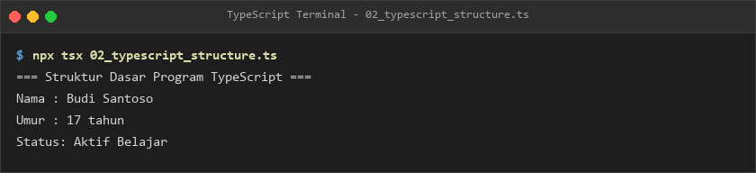](./module-01-pengenalan-typescript-dan-struktur-program/output/02_typescript_structure.png) |
| **03** | [`03_comments.ts`](./module-01-pengenalan-typescript-dan-struktur-program/03_comments.ts) | Single-line (//), multi-line (/* */), and JSDoc/TSDoc educational documentation syntax | [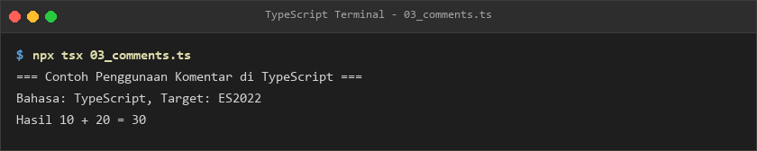](./module-01-pengenalan-typescript-dan-struktur-program/output/03_comments.png) |
| **04** | [`04_console_output.ts`](./module-01-pengenalan-typescript-dan-struktur-program/04_console_output.ts) | Standard console output formatting, diagnostics, argument logging, and stream inspection | [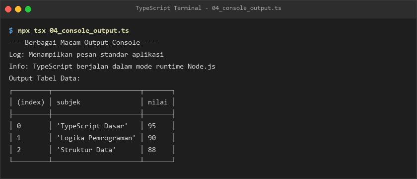](./module-01-pengenalan-typescript-dan-struktur-program/output/04_console_output.png) |
| **05** | [`05_variable_declaration.ts`](./module-01-pengenalan-typescript-dan-struktur-program/05_variable_declaration.ts) | Fundamental variable declarations, static type assignments, and identifier mutability basics | [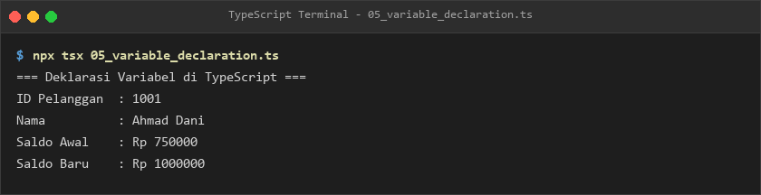](./module-01-pengenalan-typescript-dan-struktur-program/output/05_variable_declaration.png) |
| **06** | [`06_typescript_compiler.ts`](./module-01-pengenalan-typescript-dan-struktur-program/06_typescript_compiler.ts) | Invoking the TypeScript compiler (tsc), transpile-time diagnostics, and emitted JavaScript analysis | [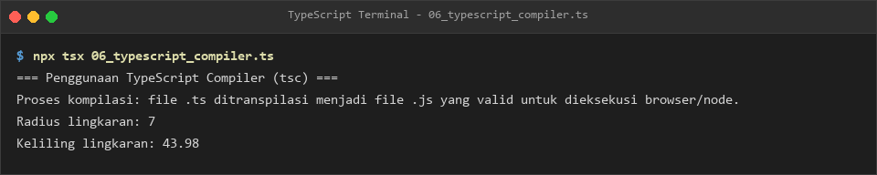](./module-01-pengenalan-typescript-dan-struktur-program/output/06_typescript_compiler.png) |
| **07** | [`07_compile_and_run.ts`](./module-01-pengenalan-typescript-dan-struktur-program/07_compile_and_run.ts) | Two-stage compilation lifecycle via Node.js and zero-config instant script execution via tsx | [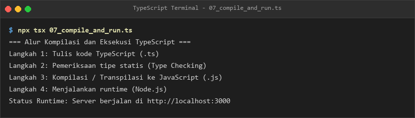](./module-01-pengenalan-typescript-dan-struktur-program/output/07_compile_and_run.png) |
| **08** | [`08_typescript_configuration.ts`](./module-01-pengenalan-typescript-dan-struktur-program/08_typescript_configuration.ts) | TypeScript project compiler options and compiler architecture configured via tsconfig.json | [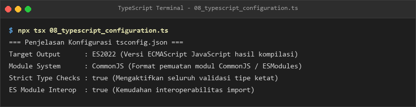](./module-01-pengenalan-typescript-dan-struktur-program/output/08_typescript_configuration.png) |
| **09** | [`09_strict_mode.ts`](./module-01-pengenalan-typescript-dan-struktur-program/09_strict_mode.ts) | Enforcing strict type checking (strict: true), null safety checks, and eliminating silent errors | [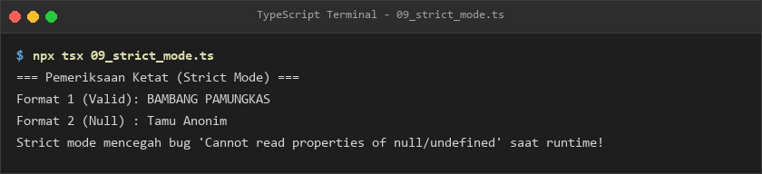](./module-01-pengenalan-typescript-dan-struktur-program/output/09_strict_mode.png) |
| **10** | [`10_typescript_playground.ts`](./module-01-pengenalan-typescript-dan-struktur-program/10_typescript_playground.ts) | Interactive code experimentation, static type validation, and rapid prototyping workflows | [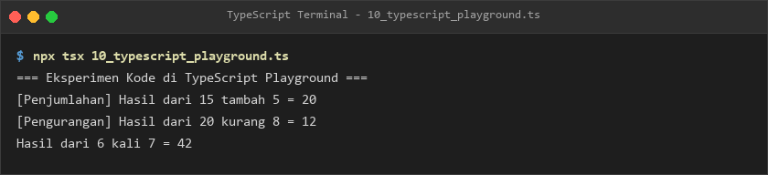](./module-01-pengenalan-typescript-dan-struktur-program/output/10_typescript_playground.png) |

### Module 02: Variabel dan Tipe Data Dasar (Variables and Basic Data Types)

- **Pedagogical Tier:** Tier 1: Syntax Primitives, Type Annotations, and Imperative Foundations
- **Pedagogical Level:** Level 1: Fundamental
- **Module Overview:** Modern and legacy variable declarations (let, const, var), scoping and temporal dead zones (TDZ), explicit type annotations, primitive data types (string, number, boolean, bigint, symbol), nullability handling (null, undefined), top and bottom types (any, unknown, never, void), automatic type inference mechanisms, and literal types.
- **Module Directory:** [`./module-02-variabel-dan-tipe-data-dasar/`](./module-02-variabel-dan-tipe-data-dasar) | **Lessons Count:** 16

| Lesson | Source Code | Pedagogical Concept & Scope | Verified Execution Output |
| :---: | :--- | :--- | :---: |
| **11** | [`11_let_variable.ts`](./module-02-variabel-dan-tipe-data-dasar/11_let_variable.ts) | Block-scoped mutable variable declarations, reassignment rules, and temporal dead zones (TDZ) using let | [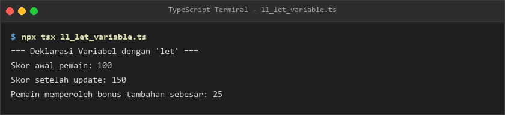](./module-02-variabel-dan-tipe-data-dasar/output/11_let_variable.png) |
| **12** | [`12_const_variable.ts`](./module-02-variabel-dan-tipe-data-dasar/12_const_variable.ts) | Immutable identifier bindings and constant declaration constraints using const | [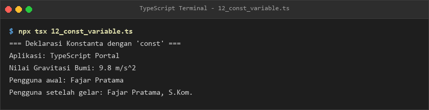](./module-02-variabel-dan-tipe-data-dasar/output/12_const_variable.png) |
| **13** | [`13_var_variable.ts`](./module-02-variabel-dan-tipe-data-dasar/13_var_variable.ts) | Legacy function-scoped variable declarations, hoisting semantics, and scope leakage using var | [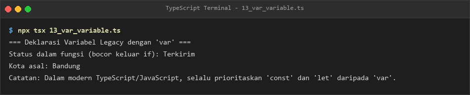](./module-02-variabel-dan-tipe-data-dasar/output/13_var_variable.png) |
| **14** | [`14_type_annotations.ts`](./module-02-variabel-dan-tipe-data-dasar/14_type_annotations.ts) | Explicit primitive and composite type annotations for variables, expressions, and parameters | [](./module-02-variabel-dan-tipe-data-dasar/output/14_type_annotations.png) |
| **15** | [`15_string_type.ts`](./module-02-variabel-dan-tipe-data-dasar/15_string_type.ts) | Textual primitive string representation, string interpolation, escape sequences, and operations | [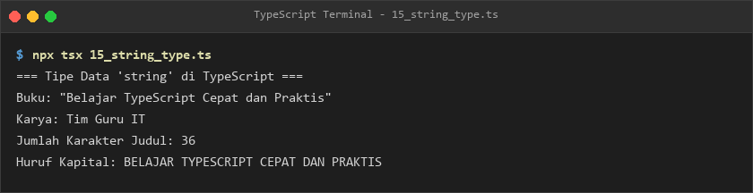](./module-02-variabel-dan-tipe-data-dasar/output/15_string_type.png) |
| **16** | [`16_number_type.ts`](./module-02-variabel-dan-tipe-data-dasar/16_number_type.ts) | IEEE 754 64-bit floating point numbers, integer arithmetic, NaN, and numeric literal formats | [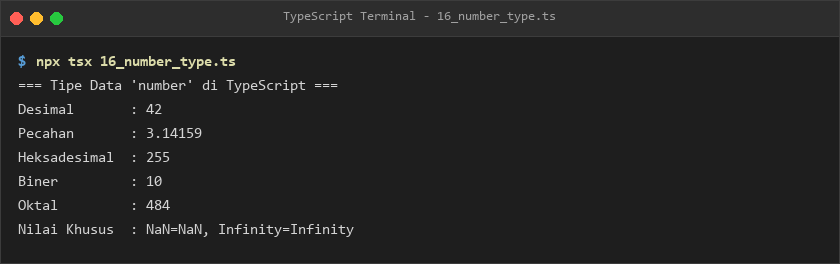](./module-02-variabel-dan-tipe-data-dasar/output/16_number_type.png) |
| **17** | [`17_boolean_type.ts`](./module-02-variabel-dan-tipe-data-dasar/17_boolean_type.ts) | Logical boolean primitive type with true and false truth evaluations | [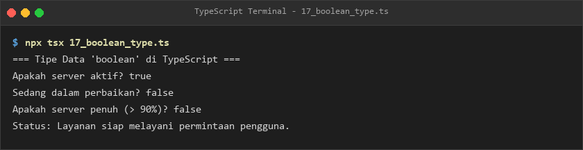](./module-02-variabel-dan-tipe-data-dasar/output/17_boolean_type.png) |
| **18** | [`18_bigint_type.ts`](./module-02-variabel-dan-tipe-data-dasar/18_bigint_type.ts) | Arbitrary-precision integer arithmetic using bigint primitives and literals with "n" suffix | [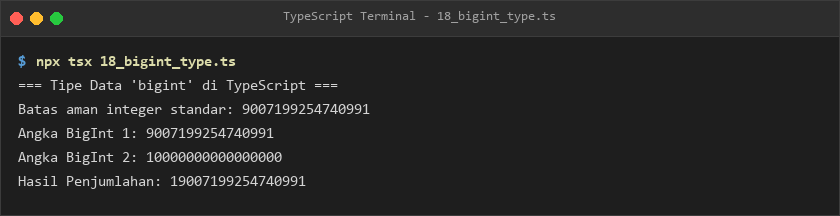](./module-02-variabel-dan-tipe-data-dasar/output/18_bigint_type.png) |
| **19** | [`19_symbol_type.ts`](./module-02-variabel-dan-tipe-data-dasar/19_symbol_type.ts) | Unique and immutable primitive symbol tokens created via the Symbol() factory function | [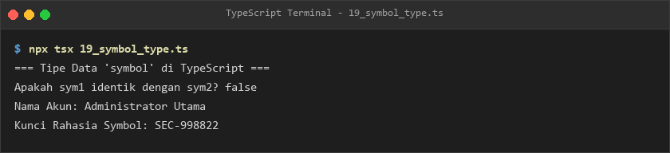](./module-02-variabel-dan-tipe-data-dasar/output/19_symbol_type.png) |
| **20** | [`20_null_undefined.ts`](./module-02-variabel-dan-tipe-data-dasar/20_null_undefined.ts) | Primitive nullability semantics, uninitialized variable states, and intentional empty references | [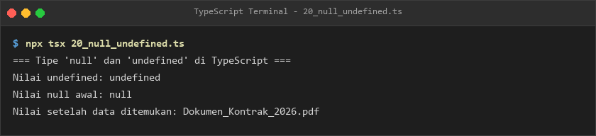](./module-02-variabel-dan-tipe-data-dasar/output/20_null_undefined.png) |
| **21** | [`21_any_type.ts`](./module-02-variabel-dan-tipe-data-dasar/21_any_type.ts) | Disabling static type checking and dynamic escape hatches using the any top type | [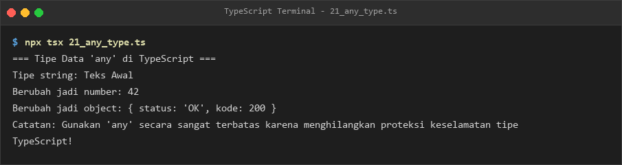](./module-02-variabel-dan-tipe-data-dasar/output/21_any_type.png) |
| **22** | [`22_unknown_type.ts`](./module-02-variabel-dan-tipe-data-dasar/22_unknown_type.ts) | Type-safe top type requiring mandatory runtime type narrowing before operation invocation using unknown | [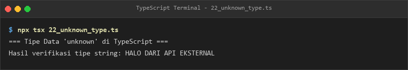](./module-02-variabel-dan-tipe-data-dasar/output/22_unknown_type.png) |
| **23** | [`23_never_type.ts`](./module-02-variabel-dan-tipe-data-dasar/23_never_type.ts) | Empty bottom type representing unreachable code branches, infinite loops, and impossible states using never | [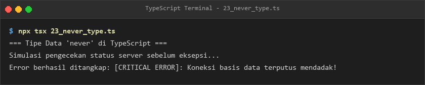](./module-02-variabel-dan-tipe-data-dasar/output/23_never_type.png) |
| **24** | [`24_void_type.ts`](./module-02-variabel-dan-tipe-data-dasar/24_void_type.ts) | Representing the complete absence of a return value in functions and subroutines using void | [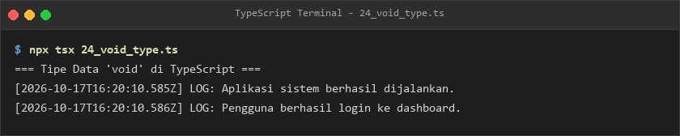](./module-02-variabel-dan-tipe-data-dasar/output/24_void_type.png) |
| **25** | [`25_type_inference.ts`](./module-02-variabel-dan-tipe-data-dasar/25_type_inference.ts) | Automatic type deduction and contextual typing performed by the TypeScript compiler engine | [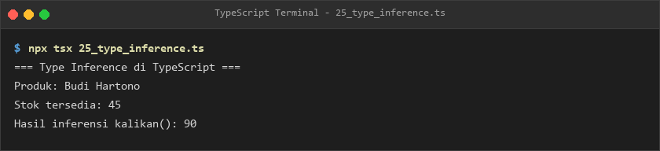](./module-02-variabel-dan-tipe-data-dasar/output/25_type_inference.png) |
| **26** | [`26_literal_types.ts`](./module-02-variabel-dan-tipe-data-dasar/26_literal_types.ts) | Exact value literal types restricting identifiers to specific string, number, or boolean values | [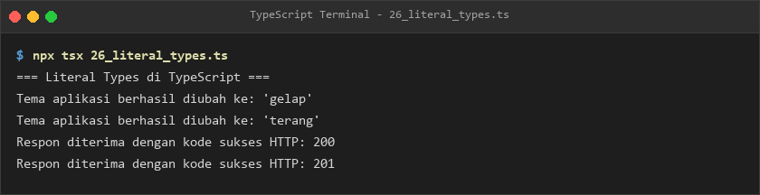](./module-02-variabel-dan-tipe-data-dasar/output/26_literal_types.png) |

### Module 03: Operator dan Pengambilan Keputusan (Operators and Control Flow Decision Making)

- **Pedagogical Tier:** Tier 1: Syntax Primitives, Type Annotations, and Imperative Foundations
- **Pedagogical Level:** Level 1: Fundamental
- **Module Overview:** Arithmetic, assignment, comparison, logical, and bitwise operators, unary increment and decrement, inline ternary conditional expressions, nullish coalescing (??), optional chaining (?.), runtime type reflection operators (typeof, instanceof, in), single and multi-branch decision trees (if, else if, else), switch statements with exhaustive branch checking, and compiler Control Flow Analysis (CFA).
- **Module Directory:** [`./module-03-operator-dan-pengambilan-keputusan/`](./module-03-operator-dan-pengambilan-keputusan) | **Lessons Count:** 16

| Lesson | Source Code | Pedagogical Concept & Scope | Verified Execution Output |
| :---: | :--- | :--- | :---: |
| **27** | [`27_arithmetic_operators.ts`](./module-03-operator-dan-pengambilan-keputusan/27_arithmetic_operators.ts) | Standard arithmetic operators (+, -, *, /, %, **) and operator evaluation associativity | [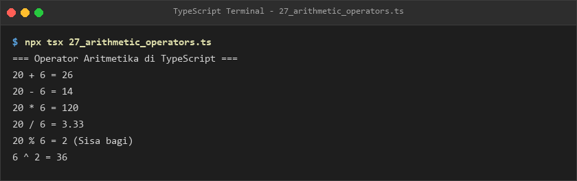](./module-03-operator-dan-pengambilan-keputusan/output/27_arithmetic_operators.png) |
| **28** | [`28_assignment_operators.ts`](./module-03-operator-dan-pengambilan-keputusan/28_assignment_operators.ts) | Compound arithmetic and bitwise assignment operators (+=, -=, *=, /=, %=, **=) | [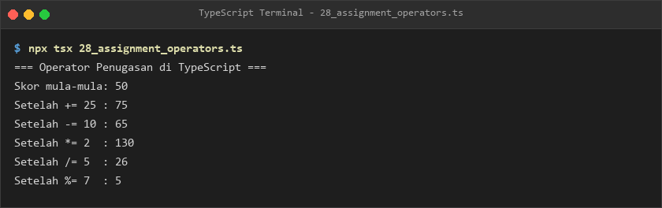](./module-03-operator-dan-pengambilan-keputusan/output/28_assignment_operators.png) |
| **29** | [`29_comparison_operators.ts`](./module-03-operator-dan-pengambilan-keputusan/29_comparison_operators.ts) | Relational comparison operators (>, <, >=, <=) and strict equality evaluations (===, !==) | [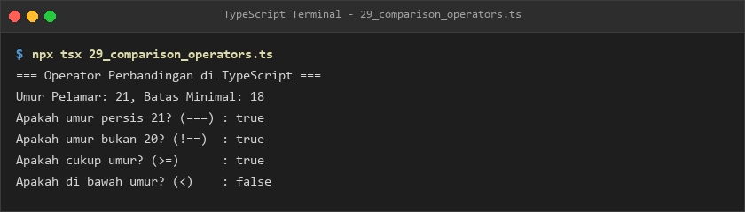](./module-03-operator-dan-pengambilan-keputusan/output/29_comparison_operators.png) |
| **30** | [`30_logical_operators.ts`](./module-03-operator-dan-pengambilan-keputusan/30_logical_operators.ts) | Boolean logic evaluations using Logical AND (&&), Logical OR (||), and Logical NOT (!) | [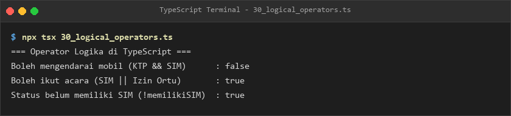](./module-03-operator-dan-pengambilan-keputusan/output/30_logical_operators.png) |
| **31** | [`31_bitwise_operators.ts`](./module-03-operator-dan-pengambilan-keputusan/31_bitwise_operators.ts) | Low-level bitwise operations (&, |, ^, ~, <<, >>, >>>) on 32-bit integer representations | [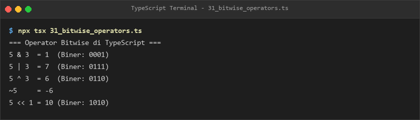](./module-03-operator-dan-pengambilan-keputusan/output/31_bitwise_operators.png) |
| **32** | [`32_increment_decrement.ts`](./module-03-operator-dan-pengambilan-keputusan/32_increment_decrement.ts) | Prefix and postfix increment (++) and decrement (--) evaluation order and side-effects | [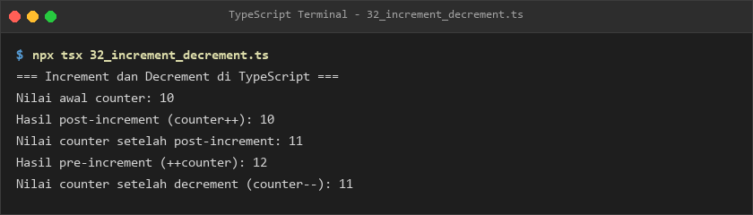](./module-03-operator-dan-pengambilan-keputusan/output/32_increment_decrement.png) |
| **33** | [`33_ternary_operator.ts`](./module-03-operator-dan-pengambilan-keputusan/33_ternary_operator.ts) | Concise inline conditional decision expressions using the ternary conditional operator (? :) | [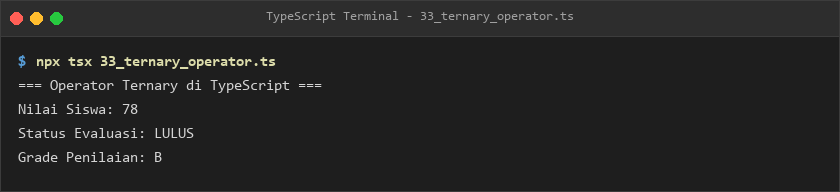](./module-03-operator-dan-pengambilan-keputusan/output/33_ternary_operator.png) |
| **34** | [`34_nullish_coalescing.ts`](./module-03-operator-dan-pengambilan-keputusan/34_nullish_coalescing.ts) | Default value assignment against null or undefined operands using the nullish coalescing operator (??) | [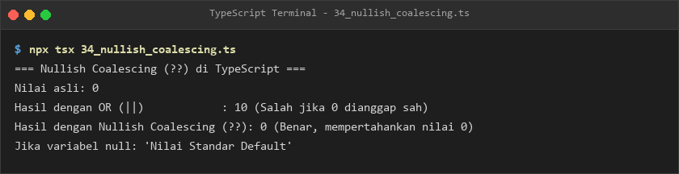](./module-03-operator-dan-pengambilan-keputusan/output/34_nullish_coalescing.png) |
| **35** | [`35_optional_chaining.ts`](./module-03-operator-dan-pengambilan-keputusan/35_optional_chaining.ts) | Safe nested property and method navigation preventing runtime errors with optional chaining (?.) | [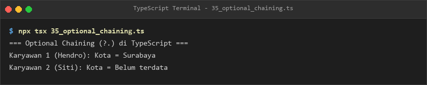](./module-03-operator-dan-pengambilan-keputusan/output/35_optional_chaining.png) |
| **36** | [`36_typeof_operator.ts`](./module-03-operator-dan-pengambilan-keputusan/36_typeof_operator.ts) | Runtime type inspection and primitive type discrimination using the typeof operator | [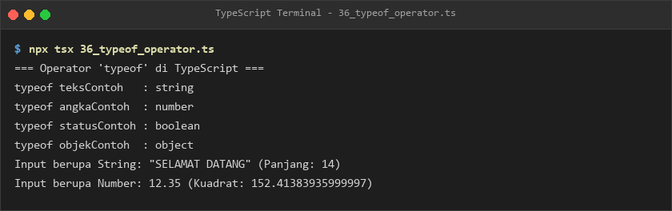](./module-03-operator-dan-pengambilan-keputusan/output/36_typeof_operator.png) |
| **37** | [`37_instanceof_operator.ts`](./module-03-operator-dan-pengambilan-keputusan/37_instanceof_operator.ts) | Prototype-based class instance checking and object identity verification using instanceof | [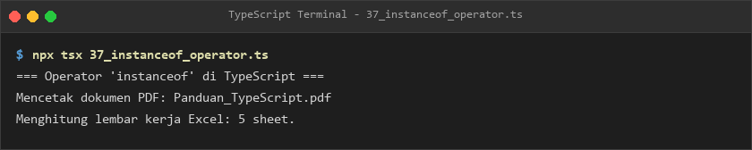](./module-03-operator-dan-pengambilan-keputusan/output/37_instanceof_operator.png) |
| **38** | [`38_in_operator.ts`](./module-03-operator-dan-pengambilan-keputusan/38_in_operator.ts) | Object property existence verification and type narrowing using the in operator | [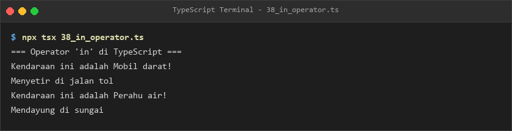](./module-03-operator-dan-pengambilan-keputusan/output/38_in_operator.png) |
| **39** | [`39_if_statement.ts`](./module-03-operator-dan-pengambilan-keputusan/39_if_statement.ts) | Single and dual-branch conditional decision workflows using if, else if, and else statements | [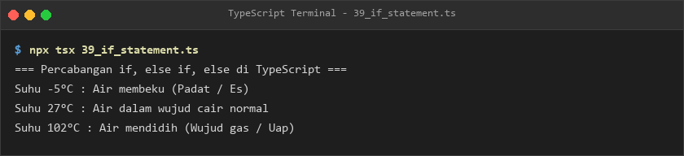](./module-03-operator-dan-pengambilan-keputusan/output/39_if_statement.png) |
| **40** | [`40_switch_statement.ts`](./module-03-operator-dan-pengambilan-keputusan/40_switch_statement.ts) | Multi-branch exact value matching control flow using switch, case, default, and break statements | [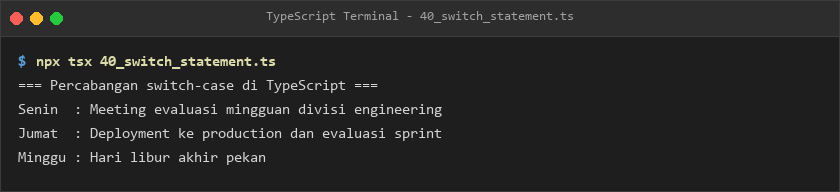](./module-03-operator-dan-pengambilan-keputusan/output/40_switch_statement.png) |
| **41** | [`41_switch_exhaustiveness.ts`](./module-03-operator-dan-pengambilan-keputusan/41_switch_exhaustiveness.ts) | Compile-time exhaustiveness checking and unhandled case prevention using never in switch statements | [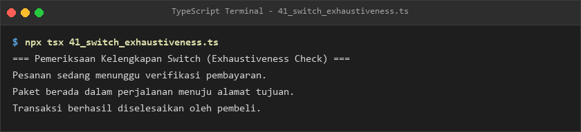](./module-03-operator-dan-pengambilan-keputusan/output/41_switch_exhaustiveness.png) |
| **42** | [`42_control_flow_analysis.ts`](./module-03-operator-dan-pengambilan-keputusan/42_control_flow_analysis.ts) | TypeScript Control Flow Analysis (CFA) tracking variable types along conditional execution paths | [](./module-03-operator-dan-pengambilan-keputusan/output/42_control_flow_analysis.png) |

### Module 04: Perulangan dan Kontrol Alur (Loops and Iteration Control Flow)

- **Pedagogical Tier:** Tier 1: Syntax Primitives, Type Annotations, and Imperative Foundations
- **Pedagogical Level:** Level 1: Fundamental
- **Module Overview:** Iterative control flow structures (for, while, do-while), collection iterations (for...of, for...in), nested loop matrices, jump statements (break, continue), iteration state counters, typed array iteration, loop boundary conditions, numerical pyramid patterns, factorial computation, prime number filtering, and Fibonacci sequence generation.
- **Module Directory:** [`./module-04-perulangan-dan-kontrol-alur/`](./module-04-perulangan-dan-kontrol-alur) | **Lessons Count:** 16

| Lesson | Source Code | Pedagogical Concept & Scope | Verified Execution Output |
| :---: | :--- | :--- | :---: |
| **43** | [`43_for_loop.ts`](./module-04-perulangan-dan-kontrol-alur/43_for_loop.ts) | Classic indexed iterative loops with initialization, conditional guards, and step expressions | [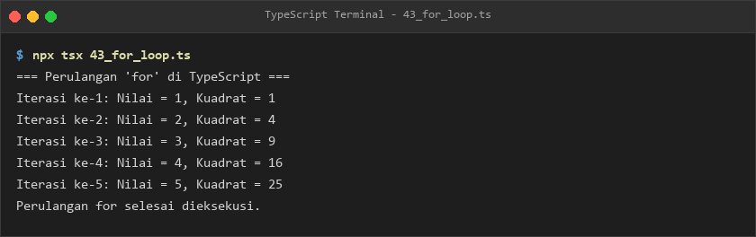](./module-04-perulangan-dan-kontrol-alur/output/43_for_loop.png) |
| **44** | [`44_while_loop.ts`](./module-04-perulangan-dan-kontrol-alur/44_while_loop.ts) | Pre-condition controlled iteration workflows executing while conditional guards evaluate to true | [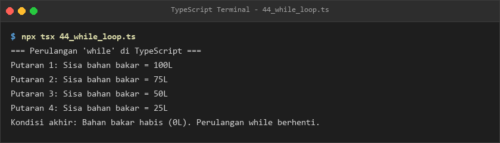](./module-04-perulangan-dan-kontrol-alur/output/44_while_loop.png) |
| **45** | [`45_do_while_loop.ts`](./module-04-perulangan-dan-kontrol-alur/45_do_while_loop.ts) | Post-condition controlled iterative loops guaranteeing at least one execution pass using do-while | [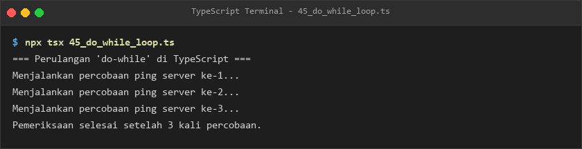](./module-04-perulangan-dan-kontrol-alur/output/45_do_while_loop.png) |
| **46** | [`46_for_of_loop.ts`](./module-04-perulangan-dan-kontrol-alur/46_for_of_loop.ts) | Iterating over iterable collections, arrays, and string character sequences using for...of | [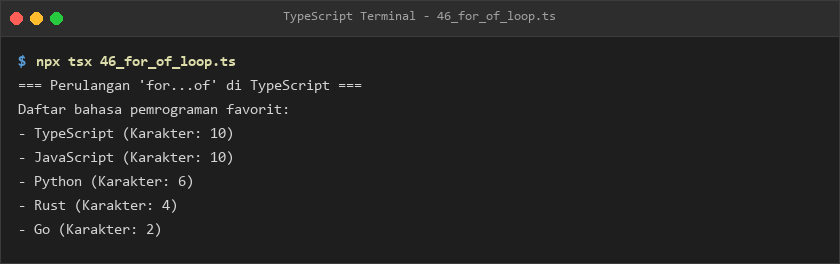](./module-04-perulangan-dan-kontrol-alur/output/46_for_of_loop.png) |
| **47** | [`47_for_in_loop.ts`](./module-04-perulangan-dan-kontrol-alur/47_for_in_loop.ts) | Enumerating enumerable property keys of JavaScript objects and records using for...in | [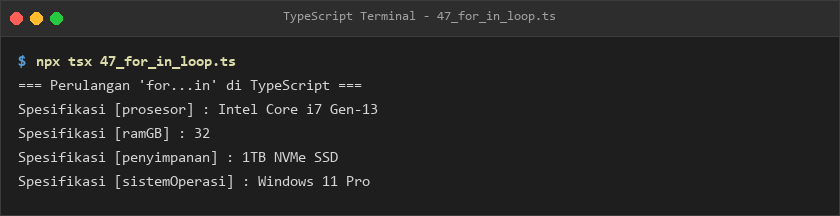](./module-04-perulangan-dan-kontrol-alur/output/47_for_in_loop.png) |
| **48** | [`48_nested_loop.ts`](./module-04-perulangan-dan-kontrol-alur/48_nested_loop.ts) | Multi-dimensional nested loop structures, grid coordinates, and matrix traversals | [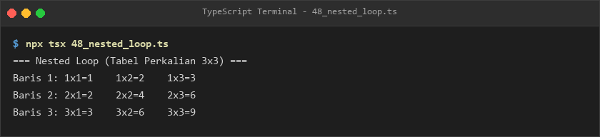](./module-04-perulangan-dan-kontrol-alur/output/48_nested_loop.png) |
| **49** | [`49_break_statement.ts`](./module-04-perulangan-dan-kontrol-alur/49_break_statement.ts) | Immediate loop termination, sentinel detection, and early exit workflows using break | [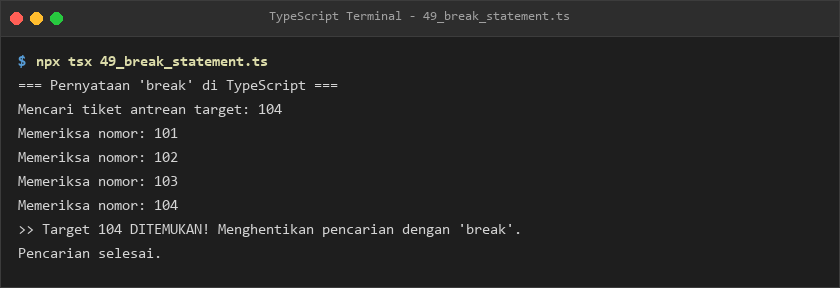](./module-04-perulangan-dan-kontrol-alur/output/49_break_statement.png) |
| **50** | [`50_continue_statement.ts`](./module-04-perulangan-dan-kontrol-alur/50_continue_statement.ts) | Skipping remaining statements in current loop iterations and advancing to subsequent cycles via continue | [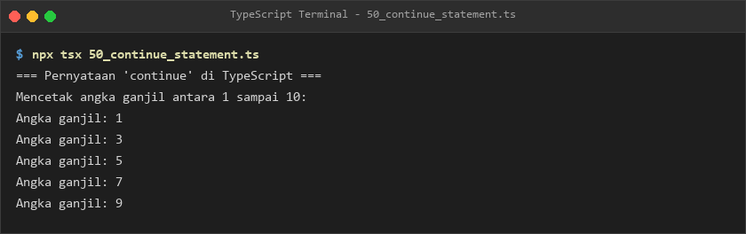](./module-04-perulangan-dan-kontrol-alur/output/50_continue_statement.png) |
| **51** | [`51_loop_counter.ts`](./module-04-perulangan-dan-kontrol-alur/51_loop_counter.ts) | Maintaining stateful iteration counters, accumulators, step increments, and progress trackers | [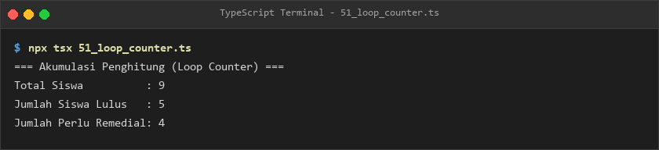](./module-04-perulangan-dan-kontrol-alur/output/51_loop_counter.png) |
| **52** | [`52_array_iteration.ts`](./module-04-perulangan-dan-kontrol-alur/52_array_iteration.ts) | Iterating through typed array collections using indexed loops and modern collection iterators | [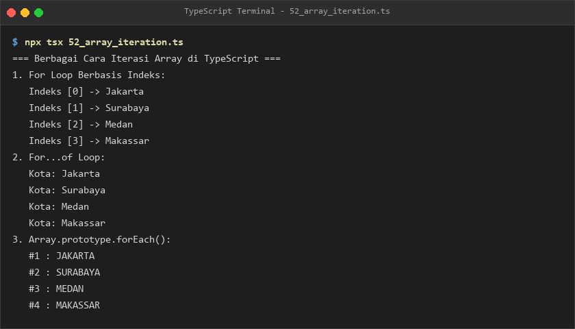](./module-04-perulangan-dan-kontrol-alur/output/52_array_iteration.png) |
| **53** | [`53_loop_with_types.ts`](./module-04-perulangan-dan-kontrol-alur/53_loop_with_types.ts) | Enforcing strict static typing and type safety across loop index variables and collection items | [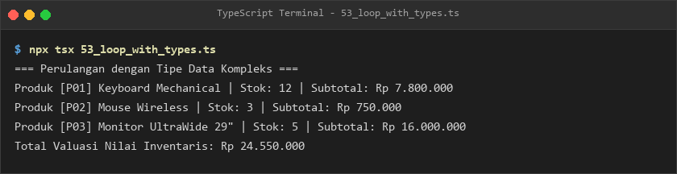](./module-04-perulangan-dan-kontrol-alur/output/53_loop_with_types.png) |
| **54** | [`54_loop_conditions.ts`](./module-04-perulangan-dan-kontrol-alur/54_loop_conditions.ts) | Complex compound boolean loop boundary conditions and sentinel termination logic | [](./module-04-perulangan-dan-kontrol-alur/output/54_loop_conditions.png) |
| **55** | [`55_number_patterns.ts`](./module-04-perulangan-dan-kontrol-alur/55_number_patterns.ts) | Algorithmic number pyramids, geometric triangles, and visual pattern generation using nested loops | [](./module-04-perulangan-dan-kontrol-alur/output/55_number_patterns.png) |
| **56** | [`56_factorial_loop.ts`](./module-04-perulangan-dan-kontrol-alur/56_factorial_loop.ts) | Iterative mathematical factorial calculation algorithm with accumulator variables | [](./module-04-perulangan-dan-kontrol-alur/output/56_factorial_loop.png) |
| **57** | [`57_prime_number.ts`](./module-04-perulangan-dan-kontrol-alur/57_prime_number.ts) | Algorithmic prime number determination, divisibility tests, and prime sequence filtering | [](./module-04-perulangan-dan-kontrol-alur/output/57_prime_number.png) |
| **58** | [`58_fibonacci_loop.ts`](./module-04-perulangan-dan-kontrol-alur/58_fibonacci_loop.ts) | Iterative Fibonacci sequence generation and mathematical numerical accumulator patterns | [](./module-04-perulangan-dan-kontrol-alur/output/58_fibonacci_loop.png) |

### Module 05: Fungsi dan Parameter (Functions and Parameter Signatures)

- **Pedagogical Tier:** Tier 1: Syntax Primitives, Type Annotations, and Imperative Foundations
- **Pedagogical Level:** Level 1: Fundamental
- **Module Overview:** Function declarations, expressions, arrow functions, parameter typing, return type annotations, optional and default parameters, rest parameter arrays (...args), function signature overloads, function type aliases, synchronous and asynchronous callbacks, higher-order functions (HOFs), recursion, introductory generic functions, lexical scoping, closures, explicit this parameter typings, and custom assertion functions (asserts).
- **Module Directory:** [`./module-05-fungsi-dan-parameter/`](./module-05-fungsi-dan-parameter) | **Lessons Count:** 18

| Lesson | Source Code | Pedagogical Concept & Scope | Verified Execution Output |
| :---: | :--- | :--- | :---: |
| **59** | [`59_function_declaration.ts`](./module-05-fungsi-dan-parameter/59_function_declaration.ts) | Standard named function declarations, typed parameters, and explicit return type annotations | [](./module-05-fungsi-dan-parameter/output/59_function_declaration.png) |
| **60** | [`60_function_expression.ts`](./module-05-fungsi-dan-parameter/60_function_expression.ts) | Anonymous and named function expressions assigned to strongly typed variable identifiers | [](./module-05-fungsi-dan-parameter/output/60_function_expression.png) |
| **61** | [`61_arrow_function.ts`](./module-05-fungsi-dan-parameter/61_arrow_function.ts) | Concise ES6 arrow function syntax, implicit return expressions, and lexical scope binding | [](./module-05-fungsi-dan-parameter/output/61_arrow_function.png) |
| **62** | [`62_function_parameters.ts`](./module-05-fungsi-dan-parameter/62_function_parameters.ts) | Parameter type annotations, required argument enforcement, and signature contracts | [](./module-05-fungsi-dan-parameter/output/62_function_parameters.png) |
| **63** | [`63_function_return_types.ts`](./module-05-fungsi-dan-parameter/63_function_return_types.ts) | Explicit function return type annotations, void signatures, and type-checked return values | [](./module-05-fungsi-dan-parameter/output/63_function_return_types.png) |
| **64** | [`64_optional_parameters.ts`](./module-05-fungsi-dan-parameter/64_optional_parameters.ts) | Defining optional function parameters using the question mark (?) syntax modifier | [](./module-05-fungsi-dan-parameter/output/64_optional_parameters.png) |
| **65** | [`65_default_parameters.ts`](./module-05-fungsi-dan-parameter/65_default_parameters.ts) | Supplying default fallback values for parameters with automatic compiler type inference | [](./module-05-fungsi-dan-parameter/output/65_default_parameters.png) |
| **66** | [`66_rest_parameters.ts`](./module-05-fungsi-dan-parameter/66_rest_parameters.ts) | Capturing variable-length argument lists into typed array structures using rest parameters (...args) | [](./module-05-fungsi-dan-parameter/output/66_rest_parameters.png) |
| **67** | [`67_function_overloads.ts`](./module-05-fungsi-dan-parameter/67_function_overloads.ts) | Defining multiple callable function signature overloads with unified implementation bodies | [](./module-05-fungsi-dan-parameter/output/67_function_overloads.png) |
| **68** | [`68_function_type_alias.ts`](./module-05-fungsi-dan-parameter/68_function_type_alias.ts) | Declaring reusable callable function signature contracts using TypeScript type aliases | [](./module-05-fungsi-dan-parameter/output/68_function_type_alias.png) |
| **69** | [`69_callback_functions.ts`](./module-05-fungsi-dan-parameter/69_callback_functions.ts) | Synchronous and asynchronous callback function typing, error-first conventions, and invocations | [](./module-05-fungsi-dan-parameter/output/69_callback_functions.png) |
| **70** | [`70_higher_order_functions.ts`](./module-05-fungsi-dan-parameter/70_higher_order_functions.ts) | Designing Higher-Order Functions (HOFs) that accept or return other functions | [](./module-05-fungsi-dan-parameter/output/70_higher_order_functions.png) |
| **71** | [`71_recursive_functions.ts`](./module-05-fungsi-dan-parameter/71_recursive_functions.ts) | Self-referential recursive algorithms, recursive call stacks, and base termination conditions | [](./module-05-fungsi-dan-parameter/output/71_recursive_functions.png) |
| **72** | [`72_generic_functions_intro.ts`](./module-05-fungsi-dan-parameter/72_generic_functions_intro.ts) | Introduction to generic type parameters (<T>) creating flexible and type-safe reusable functions | [](./module-05-fungsi-dan-parameter/output/72_generic_functions_intro.png) |
| **73** | [`73_function_scope.ts`](./module-05-fungsi-dan-parameter/73_function_scope.ts) | Lexical scope boundaries, identifier shadowing, variable lifetimes, and function encapsulation | [](./module-05-fungsi-dan-parameter/output/73_function_scope.png) |
| **74** | [`74_closures.ts`](./module-05-fungsi-dan-parameter/74_closures.ts) | Lexical closures capturing outer scope variables, private state preservation, and factory functions | [](./module-05-fungsi-dan-parameter/output/74_closures.png) |
| **75** | [`75_this_parameter.ts`](./module-05-fungsi-dan-parameter/75_this_parameter.ts) | Explicit this parameter typing for method execution contexts and callback handlers | [](./module-05-fungsi-dan-parameter/output/75_this_parameter.png) |
| **76** | [`76_assertion_functions.ts`](./module-05-fungsi-dan-parameter/76_assertion_functions.ts) | Authoring custom invariant assertion functions using TypeScript asserts type return syntax | [](./module-05-fungsi-dan-parameter/output/76_assertion_functions.png) |

### Module 06: Array, Tuple, dan Object (Arrays, Tuples, and Objects)

- **Pedagogical Tier:** Tier 2: Data Modeling, Composite Structures, and Type Narrowing
- **Pedagogical Level:** Level 2: Intermediate
- **Module Overview:** Homogeneous array data structures, type annotations (T[] vs Array<T>), compile-time readonly arrays, array transformation and iteration methods (map, filter, reduce), sorting algorithms, array destructuring patterns, fixed-length typed tuples, labeled named tuples, optional tuple elements, object literal declarations, type annotations, object destructuring, readonly properties, dynamic index signatures, and excess property checking.
- **Module Directory:** [`./module-06-array-tuple-dan-object/`](./module-06-array-tuple-dan-object) | **Lessons Count:** 18

| Lesson | Source Code | Pedagogical Concept & Scope | Verified Execution Output |
| :---: | :--- | :--- | :---: |
| **77** | [`77_array_basic.ts`](./module-06-array-tuple-dan-object/77_array_basic.ts) | Initializing, indexing, modifying, and calculating lengths of basic typed array collections | [](./module-06-array-tuple-dan-object/output/77_array_basic.png) |
| **78** | [`78_array_type_annotations.ts`](./module-06-array-tuple-dan-object/78_array_type_annotations.ts) | Syntax conventions for typed array declarations (T[] square bracket vs Array<T> generic syntax) | [](./module-06-array-tuple-dan-object/output/78_array_type_annotations.png) |
| **79** | [`79_readonly_array.ts`](./module-06-array-tuple-dan-object/79_readonly_array.ts) | Immutable array collections preventing mutations using readonly T[] and ReadonlyArray<T> | [](./module-06-array-tuple-dan-object/output/79_readonly_array.png) |
| **80** | [`80_array_methods.ts`](./module-06-array-tuple-dan-object/80_array_methods.ts) | Core array mutator and accessor methods (push, pop, shift, unshift, slice, concat, includes) | [](./module-06-array-tuple-dan-object/output/80_array_methods.png) |
| **81** | [`81_array_map.ts`](./module-06-array-tuple-dan-object/81_array_map.ts) | Pure functional array transformations and element projection pipelines using .map() | [](./module-06-array-tuple-dan-object/output/81_array_map.png) |
| **82** | [`82_array_filter.ts`](./module-06-array-tuple-dan-object/82_array_filter.ts) | Declarative element filtering and subset extraction based on boolean predicates using .filter() | [](./module-06-array-tuple-dan-object/output/82_array_filter.png) |
| **83** | [`83_array_reduce.ts`](./module-06-array-tuple-dan-object/83_array_reduce.ts) | Accumulating array items into scalar values or complex grouped objects using .reduce() | [](./module-06-array-tuple-dan-object/output/83_array_reduce.png) |
| **84** | [`84_array_sorting.ts`](./module-06-array-tuple-dan-object/84_array_sorting.ts) | Custom comparison predicates for alphabetical, numerical, and object property sorting | [](./module-06-array-tuple-dan-object/output/84_array_sorting.png) |
| **85** | [`85_array_destructuring.ts`](./module-06-array-tuple-dan-object/85_array_destructuring.ts) | Unpacking array elements into discrete variables using destructuring assignments and rest patterns | [](./module-06-array-tuple-dan-object/output/85_array_destructuring.png) |
| **86** | [`86_tuple_basic.ts`](./module-06-array-tuple-dan-object/86_tuple_basic.ts) | Fixed-length typed arrays with distinct element types at specific positions (tuples) | [](./module-06-array-tuple-dan-object/output/86_tuple_basic.png) |
| **87** | [`87_named_tuple.ts`](./module-06-array-tuple-dan-object/87_named_tuple.ts) | Labeled tuple elements providing descriptive names for positional types to enhance IDE documentation | [](./module-06-array-tuple-dan-object/output/87_named_tuple.png) |
| **88** | [`88_optional_tuple_elements.ts`](./module-06-array-tuple-dan-object/88_optional_tuple_elements.ts) | Defining flexible tuple types containing optional positional elements using the ? modifier | [](./module-06-array-tuple-dan-object/output/88_optional_tuple_elements.png) |
| **89** | [`89_object_basic.ts`](./module-06-array-tuple-dan-object/89_object_basic.ts) | Object literal instantiation, property access, dynamic modification, and property deletion | [](./module-06-array-tuple-dan-object/output/89_object_basic.png) |
| **90** | [`90_object_type_annotations.ts`](./module-06-array-tuple-dan-object/90_object_type_annotations.ts) | Explicit object shape typing, property contracts, and structural type compatibility | [](./module-06-array-tuple-dan-object/output/90_object_type_annotations.png) |
| **91** | [`91_object_destructuring.ts`](./module-06-array-tuple-dan-object/91_object_destructuring.ts) | Extracting object properties into variables, property renaming, and default value destructuring | [](./module-06-array-tuple-dan-object/output/91_object_destructuring.png) |
| **92** | [`92_readonly_properties.ts`](./module-06-array-tuple-dan-object/92_readonly_properties.ts) | Enforcing compile-time immutability on specific object fields using the readonly modifier | [](./module-06-array-tuple-dan-object/output/92_readonly_properties.png) |
| **93** | [`93_index_signatures.ts`](./module-06-array-tuple-dan-object/93_index_signatures.ts) | Defining dynamic string and number dictionary lookups using TypeScript index signatures | [](./module-06-array-tuple-dan-object/output/93_index_signatures.png) |
| **94** | [`94_excess_property_checks.ts`](./module-06-array-tuple-dan-object/94_excess_property_checks.ts) | Understanding TypeScript excess property checks on fresh object literals and bypass techniques | [](./module-06-array-tuple-dan-object/output/94_excess_property_checks.png) |

### Module 07: Type Aliases, Interface, dan Enum (Type Aliases, Interfaces, and Enums)

- **Pedagogical Tier:** Tier 2: Data Modeling, Composite Structures, and Type Narrowing
- **Pedagogical Level:** Level 2: Intermediate
- **Module Overview:** Custom type definitions with type aliases, object shape modeling with interfaces, optional and readonly interface properties, callable interface signatures, index signatures, interface inheritance (extends), automated declaration merging, architectural trade-offs between type aliases and interfaces, numeric, string, and const enums, string literal union alternatives, object type composition, and domain data modeling.
- **Module Directory:** [`./module-07-type-aliases-interface-dan-enum/`](./module-07-type-aliases-interface-dan-enum) | **Lessons Count:** 16

| Lesson | Source Code | Pedagogical Concept & Scope | Verified Execution Output |
| :---: | :--- | :--- | :---: |
| **100** | [`100_interface_index_signatures.ts`](./module-07-type-aliases-interface-dan-enum/100_interface_index_signatures.ts) | Modeling extensible key-value maps and dynamic dictionaries inside interface contracts | [](./module-07-type-aliases-interface-dan-enum/output/100_interface_index_signatures.png) |
| **101** | [`101_interface_extends.ts`](./module-07-type-aliases-interface-dan-enum/101_interface_extends.ts) | Interface inheritance, multi-interface extension, and structural composition using extends | [](./module-07-type-aliases-interface-dan-enum/output/101_interface_extends.png) |
| **102** | [`102_interface_declaration_merging.ts`](./module-07-type-aliases-interface-dan-enum/102_interface_declaration_merging.ts) | Automatic augmentation and declaration merging of duplicate interface declarations | [](./module-07-type-aliases-interface-dan-enum/output/102_interface_declaration_merging.png) |
| **103** | [`103_type_alias_vs_interface.ts`](./module-07-type-aliases-interface-dan-enum/103_type_alias_vs_interface.ts) | Comprehensive architectural comparison, capabilities, and decision criteria for type vs interface | [](./module-07-type-aliases-interface-dan-enum/output/103_type_alias_vs_interface.png) |
| **104** | [`104_enum_basic.ts`](./module-07-type-aliases-interface-dan-enum/104_enum_basic.ts) | Declaring enumerated collections of named constant values using the enum keyword | [](./module-07-type-aliases-interface-dan-enum/output/104_enum_basic.png) |
| **105** | [`105_numeric_enum.ts`](./module-07-type-aliases-interface-dan-enum/105_numeric_enum.ts) | Auto-incrementing and custom-assigned numeric enums and reverse name-to-value mappings | [](./module-07-type-aliases-interface-dan-enum/output/105_numeric_enum.png) |
| **106** | [`106_string_enum.ts`](./module-07-type-aliases-interface-dan-enum/106_string_enum.ts) | Explicit string-valued enums with meaningful serialized runtime values and debugging traces | [](./module-07-type-aliases-interface-dan-enum/output/106_string_enum.png) |
| **107** | [`107_const_enum.ts`](./module-07-type-aliases-interface-dan-enum/107_const_enum.ts) | Inlined constant enums eliminated during compilation to minimize JavaScript bundle footprint | [](./module-07-type-aliases-interface-dan-enum/output/107_const_enum.png) |
| **108** | [`108_enum_alternatives.ts`](./module-07-type-aliases-interface-dan-enum/108_enum_alternatives.ts) | Idiomatic, lightweight alternatives to enums using string literal union types and const objects | [](./module-07-type-aliases-interface-dan-enum/output/108_enum_alternatives.png) |
| **109** | [`109_object_type_composition.ts`](./module-07-type-aliases-interface-dan-enum/109_object_type_composition.ts) | Composing modular, reusable object types via intersection types and interface inheritance | [](./module-07-type-aliases-interface-dan-enum/output/109_object_type_composition.png) |
| **110** | [`110_data_modeling.ts`](./module-07-type-aliases-interface-dan-enum/110_data_modeling.ts) | Real-world domain entity modeling combining interfaces, types, enums, and nested relations | [](./module-07-type-aliases-interface-dan-enum/output/110_data_modeling.png) |
| **95** | [`95_type_aliases.ts`](./module-07-type-aliases-interface-dan-enum/95_type_aliases.ts) | Defining custom type identifiers and complex composite structures using the type keyword | [](./module-07-type-aliases-interface-dan-enum/output/95_type_aliases.png) |
| **96** | [`96_interface_basic.ts`](./module-07-type-aliases-interface-dan-enum/96_interface_basic.ts) | Defining structural shape contracts and object blueprint specifications using interface | [](./module-07-type-aliases-interface-dan-enum/output/96_interface_basic.png) |
| **97** | [`97_interface_optional_properties.ts`](./module-07-type-aliases-interface-dan-enum/97_interface_optional_properties.ts) | Marking non-mandatory object properties in interfaces using the optional (?) modifier | [](./module-07-type-aliases-interface-dan-enum/output/97_interface_optional_properties.png) |
| **98** | [`98_interface_readonly_properties.ts`](./module-07-type-aliases-interface-dan-enum/98_interface_readonly_properties.ts) | Enforcing compile-time read-only constraints on interface properties using readonly | [](./module-07-type-aliases-interface-dan-enum/output/98_interface_readonly_properties.png) |
| **99** | [`99_interface_function_types.ts`](./module-07-type-aliases-interface-dan-enum/99_interface_function_types.ts) | Describing callable function signatures and method contracts within interface definitions | [](./module-07-type-aliases-interface-dan-enum/output/99_interface_function_types.png) |

### Module 08: Union, Intersection, dan Type Narrowing (Unions, Intersections, and Type Narrowing)

- **Pedagogical Tier:** Tier 2: Data Modeling, Composite Structures, and Type Narrowing
- **Pedagogical Level:** Level 2: Intermediate
- **Module Overview:** Union types (|), intersection types (&), tagged discriminated unions with discriminant properties, runtime type narrowing strategies, standard type guards (typeof, instanceof, in), custom user-defined type guards, type predicates (is), equality and truthiness narrowing, exhaustive switch matching with never guards, the satisfies operator, type assertions (as), deep immutability via const assertions (as const), non-null assertions (!), and nominal branded types.
- **Module Directory:** [`./module-08-union-intersection-dan-type-narrowing/`](./module-08-union-intersection-dan-type-narrowing) | **Lessons Count:** 18

| Lesson | Source Code | Pedagogical Concept & Scope | Verified Execution Output |
| :---: | :--- | :--- | :---: |
| **111** | [`111_union_types.ts`](./module-08-union-intersection-dan-type-narrowing/111_union_types.ts) | Composing flexible types that represent values matching any one of multiple possibilities (|) | [](./module-08-union-intersection-dan-type-narrowing/output/111_union_types.png) |
| **112** | [`112_intersection_types.ts`](./module-08-union-intersection-dan-type-narrowing/112_intersection_types.ts) | Combining multiple distinct type definitions into a single unified composite type (&) | [](./module-08-union-intersection-dan-type-narrowing/output/112_intersection_types.png) |
| **113** | [`113_discriminated_unions.ts`](./module-08-union-intersection-dan-type-narrowing/113_discriminated_unions.ts) | Tagged discriminated union patterns with literal discriminant properties for safe branching | [](./module-08-union-intersection-dan-type-narrowing/output/113_discriminated_unions.png) |
| **114** | [`114_type_narrowing.ts`](./module-08-union-intersection-dan-type-narrowing/114_type_narrowing.ts) | Refining broad ambiguous types into specific concrete types through conditional execution logic | [](./module-08-union-intersection-dan-type-narrowing/output/114_type_narrowing.png) |
| **115** | [`115_type_guards.ts`](./module-08-union-intersection-dan-type-narrowing/115_type_guards.ts) | Utilizing built-in runtime type guards (typeof, instanceof) to narrow types within conditional blocks | [](./module-08-union-intersection-dan-type-narrowing/output/115_type_guards.png) |
| **116** | [`116_custom_type_guards.ts`](./module-08-union-intersection-dan-type-narrowing/116_custom_type_guards.ts) | Authoring user-defined type guard functions to inspect and validate complex runtime object shapes | [](./module-08-union-intersection-dan-type-narrowing/output/116_custom_type_guards.png) |
| **117** | [`117_type_predicates.ts`](./module-08-union-intersection-dan-type-narrowing/117_type_predicates.ts) | Writing explicit type predicate return signatures (parameterName is Type) for custom guards | [](./module-08-union-intersection-dan-type-narrowing/output/117_type_predicates.png) |
| **118** | [`118_in_operator_narrowing.ts`](./module-08-union-intersection-dan-type-narrowing/118_in_operator_narrowing.ts) | Differentiating union object shapes by verifying property presence using the in operator | [](./module-08-union-intersection-dan-type-narrowing/output/118_in_operator_narrowing.png) |
| **119** | [`119_instanceof_narrowing.ts`](./module-08-union-intersection-dan-type-narrowing/119_instanceof_narrowing.ts) | Narrowing class hierarchies, custom error instances, and prototype chains with instanceof | [](./module-08-union-intersection-dan-type-narrowing/output/119_instanceof_narrowing.png) |
| **120** | [`120_equality_narrowing.ts`](./module-08-union-intersection-dan-type-narrowing/120_equality_narrowing.ts) | Refining types through literal value comparisons using strict equality checks (===, !==) | [](./module-08-union-intersection-dan-type-narrowing/output/120_equality_narrowing.png) |
| **121** | [`121_truthiness_narrowing.ts`](./module-08-union-intersection-dan-type-narrowing/121_truthiness_narrowing.ts) | Filtering out null, undefined, 0, empty strings, and falsy values using truthiness evaluation | [](./module-08-union-intersection-dan-type-narrowing/output/121_truthiness_narrowing.png) |
| **122** | [`122_discriminated_switch.ts`](./module-08-union-intersection-dan-type-narrowing/122_discriminated_switch.ts) | Exhaustive pattern matching and branch dispatching over discriminated unions using switch | [](./module-08-union-intersection-dan-type-narrowing/output/122_discriminated_switch.png) |
| **123** | [`123_exhaustive_checks.ts`](./module-08-union-intersection-dan-type-narrowing/123_exhaustive_checks.ts) | Enforcing complete case handling at compile time using unassignable never type assertions | [](./module-08-union-intersection-dan-type-narrowing/output/123_exhaustive_checks.png) |
| **124** | [`124_satisfies_operator.ts`](./module-08-union-intersection-dan-type-narrowing/124_satisfies_operator.ts) | Validating expressions against type contracts without widening inferred types via satisfies | [](./module-08-union-intersection-dan-type-narrowing/output/124_satisfies_operator.png) |
| **125** | [`125_type_assertions.ts`](./module-08-union-intersection-dan-type-narrowing/125_type_assertions.ts) | Explicit type casting and override assertions using the as Type syntax | [](./module-08-union-intersection-dan-type-narrowing/output/125_type_assertions.png) |
| **126** | [`126_const_assertions.ts`](./module-08-union-intersection-dan-type-narrowing/126_const_assertions.ts) | Enforcing deep immutability, literal preservation, and readonly tuples using as const | [](./module-08-union-intersection-dan-type-narrowing/output/126_const_assertions.png) |
| **127** | [`127_non_null_assertion.ts`](./module-08-union-intersection-dan-type-narrowing/127_non_null_assertion.ts) | Asserting non-null and non-undefined operand status using the postfix exclamation mark (!) operator | [](./module-08-union-intersection-dan-type-narrowing/output/127_non_null_assertion.png) |
| **128** | [`128_branded_types.ts`](./module-08-union-intersection-dan-type-narrowing/128_branded_types.ts) | Nominal typing patterns and branded primitive types preventing accidental value substitution | [](./module-08-union-intersection-dan-type-narrowing/output/128_branded_types.png) |

### Module 09: Generics dan Pemrograman Generik (Generics and Generic Programming)

- **Pedagogical Tier:** Tier 3: Advanced Typing, OOP Architecture, and Metaprogramming
- **Pedagogical Level:** Level 3: Advanced
- **Module Overview:** Generic function signatures (<T>), multiple type parameters, type parameter constraints (extends), generic interfaces, generic class definitions, generic type aliases, default type arguments, key query operator (keyof), runtime-to-type capture (typeof), indexed access types (T[K]), generic key constraints, generic constructor factory patterns (new () => T), generic data collection classes, generic callbacks, compiler type inference, type variance foundations, and generic type guards.
- **Module Directory:** [`./module-09-generics-dan-pemrograman-generik/`](./module-09-generics-dan-pemrograman-generik) | **Lessons Count:** 18

| Lesson | Source Code | Pedagogical Concept & Scope | Verified Execution Output |
| :---: | :--- | :--- | :---: |
| **129** | [`129_generic_functions.ts`](./module-09-generics-dan-pemrograman-generik/129_generic_functions.ts) | Authoring parameterized functions with reusable generic type arguments (<T>) for type safety | [](./module-09-generics-dan-pemrograman-generik/output/129_generic_functions.png) |
| **130** | [`130_generic_parameters.ts`](./module-09-generics-dan-pemrograman-generik/130_generic_parameters.ts) | Managing multiple independent generic type parameters (<T, U, V>) in signatures | [](./module-09-generics-dan-pemrograman-generik/output/130_generic_parameters.png) |
| **131** | [`131_generic_constraints.ts`](./module-09-generics-dan-pemrograman-generik/131_generic_constraints.ts) | Restricting allowable generic type arguments using the extends constraint keyword | [](./module-09-generics-dan-pemrograman-generik/output/131_generic_constraints.png) |
| **132** | [`132_generic_interfaces.ts`](./module-09-generics-dan-pemrograman-generik/132_generic_interfaces.ts) | Defining flexible, reusable interface contracts parameterized by generic types | [](./module-09-generics-dan-pemrograman-generik/output/132_generic_interfaces.png) |
| **133** | [`133_generic_classes.ts`](./module-09-generics-dan-pemrograman-generik/133_generic_classes.ts) | Implementing generic class architectures that manage type-parameterized state and operations | [](./module-09-generics-dan-pemrograman-generik/output/133_generic_classes.png) |
| **134** | [`134_generic_type_aliases.ts`](./module-09-generics-dan-pemrograman-generik/134_generic_type_aliases.ts) | Parameterized type aliases for modeling generic data containers, wrappers, and responses | [](./module-09-generics-dan-pemrograman-generik/output/134_generic_type_aliases.png) |
| **135** | [`135_multiple_type_parameters.ts`](./module-09-generics-dan-pemrograman-generik/135_multiple_type_parameters.ts) | Coordinating complex multi-type parameter mappings, key-value pairs, and converters | [](./module-09-generics-dan-pemrograman-generik/output/135_multiple_type_parameters.png) |
| **136** | [`136_default_generic_parameters.ts`](./module-09-generics-dan-pemrograman-generik/136_default_generic_parameters.ts) | Specifying default fallback types for generic parameters (<T = string>) | [](./module-09-generics-dan-pemrograman-generik/output/136_default_generic_parameters.png) |
| **137** | [`137_keyof_operator.ts`](./module-09-generics-dan-pemrograman-generik/137_keyof_operator.ts) | Extracting a union of property name string/number literals from object types via keyof | [](./module-09-generics-dan-pemrograman-generik/output/137_keyof_operator.png) |
| **138** | [`138_typeof_type_operator.ts`](./module-09-generics-dan-pemrograman-generik/138_typeof_type_operator.ts) | Capturing compile-time TypeScript types directly from runtime JavaScript values using typeof | [](./module-09-generics-dan-pemrograman-generik/output/138_typeof_type_operator.png) |
| **139** | [`139_indexed_access_types.ts`](./module-09-generics-dan-pemrograman-generik/139_indexed_access_types.ts) | Looking up specific property types within other types using indexed access notation (T[K]) | [](./module-09-generics-dan-pemrograman-generik/output/139_indexed_access_types.png) |
| **140** | [`140_generic_key_constraints.ts`](./module-09-generics-dan-pemrograman-generik/140_generic_key_constraints.ts) | Enforcing type-safe dynamic property lookups using generic key constraints (<K extends keyof T>) | [](./module-09-generics-dan-pemrograman-generik/output/140_generic_key_constraints.png) |
| **141** | [`141_generic_factory.ts`](./module-09-generics-dan-pemrograman-generik/141_generic_factory.ts) | Instantiating generic object instances using constructor signature contracts (new () => T) | [](./module-09-generics-dan-pemrograman-generik/output/141_generic_factory.png) |
| **142** | [`142_generic_collections.ts`](./module-09-generics-dan-pemrograman-generik/142_generic_collections.ts) | Building type-safe reusable data collection data structures (Stack, Queue, List) with Generics | [](./module-09-generics-dan-pemrograman-generik/output/142_generic_collections.png) |
| **143** | [`143_generic_callbacks.ts`](./module-09-generics-dan-pemrograman-generik/143_generic_callbacks.ts) | Typing generic event listeners, observer subscriptions, and asynchronous callback pipelines | [](./module-09-generics-dan-pemrograman-generik/output/143_generic_callbacks.png) |
| **144** | [`144_generic_inference.ts`](./module-09-generics-dan-pemrograman-generik/144_generic_inference.ts) | Relying on compiler generic type argument inference from runtime function invocation arguments | [](./module-09-generics-dan-pemrograman-generik/output/144_generic_inference.png) |
| **145** | [`145_variance_basics.ts`](./module-09-generics-dan-pemrograman-generik/145_variance_basics.ts) | Foundational concepts of covariance, contravariance, and invariance in generic type assignments | [](./module-09-generics-dan-pemrograman-generik/output/145_variance_basics.png) |
| **146** | [`146_generic_type_guards.ts`](./module-09-generics-dan-pemrograman-generik/146_generic_type_guards.ts) | Authoring reusable generic type guard functions that narrow collections and container items | [](./module-09-generics-dan-pemrograman-generik/output/146_generic_type_guards.png) |

### Module 10: Advanced Types (Advanced and Mapped Types)

- **Pedagogical Tier:** Tier 3: Advanced Typing, OOP Architecture, and Metaprogramming
- **Pedagogical Level:** Level 3: Advanced
- **Module Overview:** Conditional type expressions (T extends U ? X : Y), conditional type inference, type pattern matching with the infer keyword, mapped types, mapped type modifiers (+, -, readonly, ?), key remapping via the as clause, template literal string types, recursive type modeling, recursive conditional types, built-in utility types (Partial, Required, Readonly, Pick, Omit, Record, Exclude, Extract, NonNullable, ReturnType, Parameters, InstanceType, Awaited), and custom enterprise utility types.
- **Module Directory:** [`./module-10-advanced-types/`](./module-10-advanced-types) | **Lessons Count:** 22

| Lesson | Source Code | Pedagogical Concept & Scope | Verified Execution Output |
| :---: | :--- | :--- | :---: |
| **147** | [`147_conditional_types.ts`](./module-10-advanced-types/147_conditional_types.ts) | Type-level conditional branching logic using ternary type expressions (T extends U ? X : Y) | [](./module-10-advanced-types/output/147_conditional_types.png) |
| **148** | [`148_conditional_type_inference.ts`](./module-10-advanced-types/148_conditional_type_inference.ts) | Extracting and deducing nested types within conditional type branches | [](./module-10-advanced-types/output/148_conditional_type_inference.png) |
| **149** | [`149_infer_keyword.ts`](./module-10-advanced-types/149_infer_keyword.ts) | Dynamic type pattern matching and type extraction using the infer keyword in conditional types | [](./module-10-advanced-types/output/149_infer_keyword.png) |
| **150** | [`150_mapped_types.ts`](./module-10-advanced-types/150_mapped_types.ts) | Generating new object types by iterating over and transforming existing property keys ([K in Keys]) | [](./module-10-advanced-types/output/150_mapped_types.png) |
| **151** | [`151_mapped_type_modifiers.ts`](./module-10-advanced-types/151_mapped_type_modifiers.ts) | Adding and stripping readonly and optional (?) modifiers using + and - prefix operators | [](./module-10-advanced-types/output/151_mapped_type_modifiers.png) |
| **152** | [`152_key_remapping.ts`](./module-10-advanced-types/152_key_remapping.ts) | Transforming, filtering, and remapping property keys in mapped types using the as clause | [](./module-10-advanced-types/output/152_key_remapping.png) |
| **153** | [`153_template_literal_types.ts`](./module-10-advanced-types/153_template_literal_types.ts) | Building type-safe string permutations and event listener types using template literal syntax | [](./module-10-advanced-types/output/153_template_literal_types.png) |
| **154** | [`154_recursive_types.ts`](./module-10-advanced-types/154_recursive_types.ts) | Defining self-referential recursive types for modeling trees, JSON documents, and nested nodes | [](./module-10-advanced-types/output/154_recursive_types.png) |
| **155** | [`155_recursive_conditional_types.ts`](./module-10-advanced-types/155_recursive_conditional_types.ts) | Deep nested type flattening and conditional type evaluation over arbitrary nesting depths | [](./module-10-advanced-types/output/155_recursive_conditional_types.png) |
| **156** | [`156_utility_partial.ts`](./module-10-advanced-types/156_utility_partial.ts) | Transforming all properties of an object type into optional fields using the Partial<T> utility | [](./module-10-advanced-types/output/156_utility_partial.png) |
| **157** | [`157_utility_required.ts`](./module-10-advanced-types/157_utility_required.ts) | Enforcing all properties of an object type as strictly mandatory using the Required<T> utility | [](./module-10-advanced-types/output/157_utility_required.png) |
| **158** | [`158_utility_readonly.ts`](./module-10-advanced-types/158_utility_readonly.ts) | Freezing all properties of an object type to prevent mutation using the Readonly<T> utility | [](./module-10-advanced-types/output/158_utility_readonly.png) |
| **159** | [`159_utility_pick.ts`](./module-10-advanced-types/159_utility_pick.ts) | Constructing a new type by extracting a designated subset of keys using the Pick<T, K> utility | [](./module-10-advanced-types/output/159_utility_pick.png) |
| **160** | [`160_utility_omit.ts`](./module-10-advanced-types/160_utility_omit.ts) | Constructing a new type by excluding specific designated keys using the Omit<T, K> utility | [](./module-10-advanced-types/output/160_utility_omit.png) |
| **161** | [`161_utility_record.ts`](./module-10-advanced-types/161_utility_record.ts) | Constructing typed dictionary maps with designated key types and value types via Record<K, T> | [](./module-10-advanced-types/output/161_utility_record.png) |
| **162** | [`162_utility_exclude_extract.ts`](./module-10-advanced-types/162_utility_exclude_extract.ts) | Filtering union types using the Exclude<T, U> and Extract<T, U> standard utility types | [](./module-10-advanced-types/output/162_utility_exclude_extract.png) |
| **163** | [`163_utility_nonnullable.ts`](./module-10-advanced-types/163_utility_nonnullable.ts) | Stripping null and undefined variants from a union type using the NonNullable<T> utility | [](./module-10-advanced-types/output/163_utility_nonnullable.png) |
| **164** | [`164_utility_returntype.ts`](./module-10-advanced-types/164_utility_returntype.ts) | Extracting the return type of any callable function type using the ReturnType<T> utility | [](./module-10-advanced-types/output/164_utility_returntype.png) |
| **165** | [`165_utility_parameters.ts`](./module-10-advanced-types/165_utility_parameters.ts) | Extracting the parameter types of a callable function as a tuple using Parameters<T> | [](./module-10-advanced-types/output/165_utility_parameters.png) |
| **166** | [`166_utility_instance_type.ts`](./module-10-advanced-types/166_utility_instance_type.ts) | Extracting the instance type produced by a constructor function using InstanceType<T> | [](./module-10-advanced-types/output/166_utility_instance_type.png) |
| **167** | [`167_utility_awaited.ts`](./module-10-advanced-types/167_utility_awaited.ts) | Recursively unwrapping nested Promise types to extract underlying resolved values with Awaited<T> | [](./module-10-advanced-types/output/167_utility_awaited.png) |
| **168** | [`168_custom_utility_types.ts`](./module-10-advanced-types/168_custom_utility_types.ts) | Designing advanced custom utility types combining mapped, conditional, and recursive types | [](./module-10-advanced-types/output/168_custom_utility_types.png) |

### Module 11: Class dan Object-Oriented Programming (Classes and Object-Oriented Programming (OOP))

- **Pedagogical Tier:** Tier 3: Advanced Typing, OOP Architecture, and Metaprogramming
- **Pedagogical Level:** Level 3: Advanced
- **Module Overview:** Class syntax and object instantiation, class field definitions, typed methods, constructor initialization, access modifier encapsulation (public, private, protected), readonly class properties, concise parameter properties, getters and setters, static members, abstract classes and abstract method contracts, class inheritance (extends, super), method overriding, interface implementation (implements), polymorphism, object composition and aggregation, advanced generic classes, and parameter decorators with reflection metadata.
- **Module Directory:** [`./module-11-class-dan-object-oriented-programming/`](./module-11-class-dan-object-oriented-programming) | **Lessons Count:** 20

| Lesson | Source Code | Pedagogical Concept & Scope | Verified Execution Output |
| :---: | :--- | :--- | :---: |
| **169** | [`169_class_basic.ts`](./module-11-class-dan-object-oriented-programming/169_class_basic.ts) | Class definitions, object instantiation, field initialization, and instance creation | [](./module-11-class-dan-object-oriented-programming/output/169_class_basic.png) |
| **170** | [`170_class_properties.ts`](./module-11-class-dan-object-oriented-programming/170_class_properties.ts) | Class field declarations, default initializers, and static type annotations | [](./module-11-class-dan-object-oriented-programming/output/170_class_properties.png) |
| **171** | [`171_class_methods.ts`](./module-11-class-dan-object-oriented-programming/171_class_methods.ts) | Defining instance member methods, parameter typings, and method return contracts | [](./module-11-class-dan-object-oriented-programming/output/171_class_methods.png) |
| **172** | [`172_class_constructor.ts`](./module-11-class-dan-object-oriented-programming/172_class_constructor.ts) | Constructor method parameters, initialization logic, and instance creation lifecycle | [](./module-11-class-dan-object-oriented-programming/output/172_class_constructor.png) |
| **173** | [`173_access_modifiers.ts`](./module-11-class-dan-object-oriented-programming/173_access_modifiers.ts) | Encapsulation boundaries using public, private, and protected visibility modifiers | [](./module-11-class-dan-object-oriented-programming/output/173_access_modifiers.png) |
| **174** | [`174_readonly_class_properties.ts`](./module-11-class-dan-object-oriented-programming/174_readonly_class_properties.ts) | Enforcing write-once constructor initialization on class fields using readonly | [](./module-11-class-dan-object-oriented-programming/output/174_readonly_class_properties.png) |
| **175** | [`175_parameter_properties.ts`](./module-11-class-dan-object-oriented-programming/175_parameter_properties.ts) | Concise property declaration and assignment directly inside constructor parameter signatures | [](./module-11-class-dan-object-oriented-programming/output/175_parameter_properties.png) |
| **176** | [`176_getters_setters.ts`](./module-11-class-dan-object-oriented-programming/176_getters_setters.ts) | Encapsulated property reading and mutation validation using get and set accessors | [](./module-11-class-dan-object-oriented-programming/output/176_getters_setters.png) |
| **177** | [`177_static_members.ts`](./module-11-class-dan-object-oriented-programming/177_static_members.ts) | Class-level static properties, utility methods, and static initialization blocks | [](./module-11-class-dan-object-oriented-programming/output/177_static_members.png) |
| **178** | [`178_abstract_classes.ts`](./module-11-class-dan-object-oriented-programming/178_abstract_classes.ts) | Defining non-instantiable base architectural blueprints using the abstract class keyword | [](./module-11-class-dan-object-oriented-programming/output/178_abstract_classes.png) |
| **179** | [`179_abstract_methods.ts`](./module-11-class-dan-object-oriented-programming/179_abstract_methods.ts) | Declaring mandatory polymorphic method contracts that must be implemented by derived subclasses | [](./module-11-class-dan-object-oriented-programming/output/179_abstract_methods.png) |
| **180** | [`180_class_inheritance.ts`](./module-11-class-dan-object-oriented-programming/180_class_inheritance.ts) | Subclass specialization, parent class extension (extends), and super constructor invocation | [](./module-11-class-dan-object-oriented-programming/output/180_class_inheritance.png) |
| **181** | [`181_method_overriding.ts`](./module-11-class-dan-object-oriented-programming/181_method_overriding.ts) | Overriding inherited parent class methods in subclasses with specialized behavior | [](./module-11-class-dan-object-oriented-programming/output/181_method_overriding.png) |
| **182** | [`182_implements_keyword.ts`](./module-11-class-dan-object-oriented-programming/182_implements_keyword.ts) | Enforcing structural interface contracts onto class implementations using implements | [](./module-11-class-dan-object-oriented-programming/output/182_implements_keyword.png) |
| **183** | [`183_abstract_vs_interface.ts`](./module-11-class-dan-object-oriented-programming/183_abstract_vs_interface.ts) | Architectural comparison, trade-offs, and design guidelines for abstract classes vs interfaces | [](./module-11-class-dan-object-oriented-programming/output/183_abstract_vs_interface.png) |
| **184** | [`184_polymorphism.ts`](./module-11-class-dan-object-oriented-programming/184_polymorphism.ts) | Runtime polymorphic method dispatching across inherited class hierarchies | [](./module-11-class-dan-object-oriented-programming/output/184_polymorphism.png) |
| **185** | [`185_composition.ts`](./module-11-class-dan-object-oriented-programming/185_composition.ts) | Favoring object composition and delegation over class inheritance for modular software design | [](./module-11-class-dan-object-oriented-programming/output/185_composition.png) |
| **186** | [`186_aggregation.ts`](./module-11-class-dan-object-oriented-programming/186_aggregation.ts) | Modeling loose whole-part associations and managing independent object lifecycles | [](./module-11-class-dan-object-oriented-programming/output/186_aggregation.png) |
| **187** | [`187_generic_classes_advanced.ts`](./module-11-class-dan-object-oriented-programming/187_generic_classes_advanced.ts) | Advanced generic class architectures with type parameter constraints and factory patterns | [](./module-11-class-dan-object-oriented-programming/output/187_generic_classes_advanced.png) |
| **188** | [`188_parameter_decorators.ts`](./module-11-class-dan-object-oriented-programming/188_parameter_decorators.ts) | Metaprogramming with experimental decorators and parameter reflection metadata introspection | [](./module-11-class-dan-object-oriented-programming/output/188_parameter_decorators.png) |

### Module 12: Modules dan Pengelolaan Proyek (Modules, Project References, and Configuration)

- **Pedagogical Tier:** Tier 3: Advanced Typing, OOP Architecture, and Metaprogramming
- **Pedagogical Level:** Level 3: Advanced
- **Module Overview:** ECMAScript Modules (ESM) named and default exports, named and default imports, namespace imports (import * as), re-exports (export *), dynamic asynchronous imports (import()), module resolution algorithms, module augmentation, declaration merging across files, ambient modules (declare module), type declaration files (.d.ts), global scope augmentation (declare global), namespaces, TypeScript project references, path mapping aliases in tsconfig.json, compiler options, and project configuration.
- **Module Directory:** [`./module-12-modules-dan-pengelolaan-proyek/`](./module-12-modules-dan-pengelolaan-proyek) | **Lessons Count:** 18

| Lesson | Source Code | Pedagogical Concept & Scope | Verified Execution Output |
| :---: | :--- | :--- | :---: |
| **189** | [`189_es_module_exports.ts`](./module-12-modules-dan-pengelolaan-proyek/189_es_module_exports.ts) | Modular code organization using ECMAScript named exports for functions, types, and constants | [](./module-12-modules-dan-pengelolaan-proyek/output/189_es_module_exports.png) |
| **190** | [`190_default_exports.ts`](./module-12-modules-dan-pengelolaan-proyek/190_default_exports.ts) | Single primary entity export conventions from modules using export default | [](./module-12-modules-dan-pengelolaan-proyek/output/190_default_exports.png) |
| **191** | [`191_named_imports.ts`](./module-12-modules-dan-pengelolaan-proyek/191_named_imports.ts) | Consuming specific exported items from internal and external modules using named imports | [](./module-12-modules-dan-pengelolaan-proyek/output/191_named_imports.png) |
| **192** | [`192_default_imports.ts`](./module-12-modules-dan-pengelolaan-proyek/192_default_imports.ts) | Importing default exported entities from external libraries and internal files | [](./module-12-modules-dan-pengelolaan-proyek/output/192_default_imports.png) |
| **193** | [`193_namespace_imports.ts`](./module-12-modules-dan-pengelolaan-proyek/193_namespace_imports.ts) | Bundling all exported module members into a single namespace object using import * as | [](./module-12-modules-dan-pengelolaan-proyek/output/193_namespace_imports.png) |
| **194** | [`194_re_exports.ts`](./module-12-modules-dan-pengelolaan-proyek/194_re_exports.ts) | Aggregating and forwarding exports across subdirectories via barrel re-exports (export *) | [](./module-12-modules-dan-pengelolaan-proyek/output/194_re_exports.png) |
| **195** | [`195_dynamic_import.ts`](./module-12-modules-dan-pengelolaan-proyek/195_dynamic_import.ts) | Asynchronous on-demand module loading at runtime using dynamic import() expressions | [](./module-12-modules-dan-pengelolaan-proyek/output/195_dynamic_import.png) |
| **196** | [`196_module_resolution.ts`](./module-12-modules-dan-pengelolaan-proyek/196_module_resolution.ts) | TypeScript module resolution algorithms and strategies (node, bundler, nodenext) | [](./module-12-modules-dan-pengelolaan-proyek/output/196_module_resolution.png) |
| **197** | [`197_module_augmentation.ts`](./module-12-modules-dan-pengelolaan-proyek/197_module_augmentation.ts) | Extending and patching external third-party module typings via module augmentation | [](./module-12-modules-dan-pengelolaan-proyek/output/197_module_augmentation.png) |
| **198** | [`198_declaration_merging.ts`](./module-12-modules-dan-pengelolaan-proyek/198_declaration_merging.ts) | Advanced declaration merging across interfaces, namespaces, and classes in multi-file projects | [](./module-12-modules-dan-pengelolaan-proyek/output/198_declaration_merging.png) |
| **199** | [`199_ambient_modules.ts`](./module-12-modules-dan-pengelolaan-proyek/199_ambient_modules.ts) | Declaring ambient type definitions for untyped legacy JavaScript packages using declare module | [](./module-12-modules-dan-pengelolaan-proyek/output/199_ambient_modules.png) |
| **200** | [`200_declaration_files.ts`](./module-12-modules-dan-pengelolaan-proyek/200_declaration_files.ts) | Authoring and structuring TypeScript declaration files (.d.ts) for library distribution | [](./module-12-modules-dan-pengelolaan-proyek/output/200_declaration_files.png) |
| **201** | [`201_global_declarations.ts`](./module-12-modules-dan-pengelolaan-proyek/201_global_declarations.ts) | Augmenting global execution scope objects and browser/Node.js window types via declare global | [](./module-12-modules-dan-pengelolaan-proyek/output/201_global_declarations.png) |
| **202** | [`202_namespace_basic.ts`](./module-12-modules-dan-pengelolaan-proyek/202_namespace_basic.ts) | Organizing internal code identifiers and preventing global collisions using namespaces | [](./module-12-modules-dan-pengelolaan-proyek/output/202_namespace_basic.png) |
| **203** | [`203_project_references.ts`](./module-12-modules-dan-pengelolaan-proyek/203_project_references.ts) | Multi-project compilation, monorepo architectures, and sub-project builds via Project References | [](./module-12-modules-dan-pengelolaan-proyek/output/203_project_references.png) |
| **204** | [`204_path_aliases.ts`](./module-12-modules-dan-pengelolaan-proyek/204_path_aliases.ts) | Configuring clean module import path mapping aliases in tsconfig.json (paths) | [](./module-12-modules-dan-pengelolaan-proyek/output/204_path_aliases.png) |
| **205** | [`205_tsconfig_basic.ts`](./module-12-modules-dan-pengelolaan-proyek/205_tsconfig_basic.ts) | Foundational compiler options in tsconfig.json (target, module, lib, strict, outDir) | [](./module-12-modules-dan-pengelolaan-proyek/output/205_tsconfig_basic.png) |
| **206** | [`206_compiler_options.ts`](./module-12-modules-dan-pengelolaan-proyek/206_compiler_options.ts) | Advanced TypeScript compiler flags for type checking, emit behavior, and performance optimization | [](./module-12-modules-dan-pengelolaan-proyek/output/206_compiler_options.png) |

### Module 13: Asynchronous Programming dan Error Handling (Asynchronous Programming and Error Handling)

- **Pedagogical Tier:** Tier 4: Enterprise Backends, Tooling, Security, and Full-Stack Systems
- **Pedagogical Level:** Level 4: Professional & Full-Stack
- **Module Overview:** Asynchronous callbacks, Promise initialization and typing (Promise<T>), Promise chaining (.then(), .catch(), .finally()), Promise combinators (Promise.all, Promise.allSettled, Promise.race), async/await syntax, asynchronous error handling with try/catch, async return signatures, generic promise wrappers, async iterators (Symbol.asyncIterator), async generators, request cancellation with AbortController, Fetch API integration for GET and POST requests, API response typing, async retry strategies with exponential backoff, custom error class hierarchies, and functional error modeling with the Result<T, E> pattern.
- **Module Directory:** [`./module-13-asynchronous-programming-dan-error-handling/`](./module-13-asynchronous-programming-dan-error-handling) | **Lessons Count:** 22

| Lesson | Source Code | Pedagogical Concept & Scope | Verified Execution Output |
| :---: | :--- | :--- | :---: |
| **207** | [`207_callback_functions.ts`](./module-13-asynchronous-programming-dan-error-handling/207_callback_functions.ts) | Asynchronous execution flow, callback conventions, and callback pyramid mitigation | [](./module-13-asynchronous-programming-dan-error-handling/output/207_callback_functions.png) |
| **208** | [`208_promise_basic.ts`](./module-13-asynchronous-programming-dan-error-handling/208_promise_basic.ts) | Initializing, resolving, rejecting, and consuming basic JavaScript Promise objects | [](./module-13-asynchronous-programming-dan-error-handling/output/208_promise_basic.png) |
| **209** | [`209_promise_types.ts`](./module-13-asynchronous-programming-dan-error-handling/209_promise_types.ts) | Strongly typed Promise resolution values and generic Promise<T> return contracts | [](./module-13-asynchronous-programming-dan-error-handling/output/209_promise_types.png) |
| **210** | [`210_promise_then_catch.ts`](./module-13-asynchronous-programming-dan-error-handling/210_promise_then_catch.ts) | Composing asynchronous operation chains using .then(), .catch(), and .finally() handlers | [](./module-13-asynchronous-programming-dan-error-handling/output/210_promise_then_catch.png) |
| **211** | [`211_promise_all.ts`](./module-13-asynchronous-programming-dan-error-handling/211_promise_all.ts) | Coordinating concurrent parallel asynchronous tasks and short-circuit rejection with Promise.all() | [](./module-13-asynchronous-programming-dan-error-handling/output/211_promise_all.png) |
| **212** | [`212_promise_all_settled.ts`](./module-13-asynchronous-programming-dan-error-handling/212_promise_all_settled.ts) | Inspecting comprehensive outcomes of multiple promises using Promise.allSettled() | [](./module-13-asynchronous-programming-dan-error-handling/output/212_promise_all_settled.png) |
| **213** | [`213_promise_race.ts`](./module-13-asynchronous-programming-dan-error-handling/213_promise_race.ts) | Competitive asynchronous execution and request timeout handling using Promise.race() | [](./module-13-asynchronous-programming-dan-error-handling/output/213_promise_race.png) |
| **214** | [`214_async_functions.ts`](./module-13-asynchronous-programming-dan-error-handling/214_async_functions.ts) | Authoring asynchronous subroutines with clear sequential syntax using the async keyword | [](./module-13-asynchronous-programming-dan-error-handling/output/214_async_functions.png) |
| **215** | [`215_await_keyword.ts`](./module-13-asynchronous-programming-dan-error-handling/215_await_keyword.ts) | Suspending execution until Promise resolution and unwrapping values using the await operator | [](./module-13-asynchronous-programming-dan-error-handling/output/215_await_keyword.png) |
| **216** | [`216_async_error_handling.ts`](./module-13-asynchronous-programming-dan-error-handling/216_async_error_handling.ts) | Robust error handling in asynchronous workflows using try...catch...finally blocks | [](./module-13-asynchronous-programming-dan-error-handling/output/216_async_error_handling.png) |
| **217** | [`217_async_return_types.ts`](./module-13-asynchronous-programming-dan-error-handling/217_async_return_types.ts) | Proper type annotations for asynchronous functions returning Promise wrapped values | [](./module-13-asynchronous-programming-dan-error-handling/output/217_async_return_types.png) |
| **218** | [`218_generic_promises.ts`](./module-13-asynchronous-programming-dan-error-handling/218_generic_promises.ts) | Building reusable generic asynchronous data loaders and typed network client wrappers | [](./module-13-asynchronous-programming-dan-error-handling/output/218_generic_promises.png) |
| **219** | [`219_async_iterators.ts`](./module-13-asynchronous-programming-dan-error-handling/219_async_iterators.ts) | Consuming asynchronous data streams using Symbol.asyncIterator and for await...of loops | [](./module-13-asynchronous-programming-dan-error-handling/output/219_async_iterators.png) |
| **220** | [`220_async_generators.ts`](./module-13-asynchronous-programming-dan-error-handling/220_async_generators.ts) | Authoring asynchronous generator functions yielding streamed data values over time | [](./module-13-asynchronous-programming-dan-error-handling/output/220_async_generators.png) |
| **221** | [`221_abort_controller.ts`](./module-13-asynchronous-programming-dan-error-handling/221_abort_controller.ts) | Canceling ongoing asynchronous operations, timeouts, and network requests using AbortController | [](./module-13-asynchronous-programming-dan-error-handling/output/221_abort_controller.png) |
| **222** | [`222_fetch_api.ts`](./module-13-asynchronous-programming-dan-error-handling/222_fetch_api.ts) | Performing strongly typed HTTP networking requests using the modern standard Fetch API | [](./module-13-asynchronous-programming-dan-error-handling/output/222_fetch_api.png) |
| **223** | [`223_fetch_get_request.ts`](./module-13-asynchronous-programming-dan-error-handling/223_fetch_get_request.ts) | Sending HTTP GET requests, verifying response status, and deserializing typed JSON payloads | [](./module-13-asynchronous-programming-dan-error-handling/output/223_fetch_get_request.png) |
| **224** | [`224_fetch_post_request.ts`](./module-13-asynchronous-programming-dan-error-handling/224_fetch_post_request.ts) | Transmitting structured JSON payloads via HTTP POST requests with designated request headers | [](./module-13-asynchronous-programming-dan-error-handling/output/224_fetch_post_request.png) |
| **225** | [`225_api_response_types.ts`](./module-13-asynchronous-programming-dan-error-handling/225_api_response_types.ts) | Modeling multi-status REST API response payloads and standardized response wrappers | [](./module-13-asynchronous-programming-dan-error-handling/output/225_api_response_types.png) |
| **226** | [`226_async_retry.ts`](./module-13-asynchronous-programming-dan-error-handling/226_async_retry.ts) | Implementing resilient asynchronous retry algorithms with exponential backoff for flaky operations | [](./module-13-asynchronous-programming-dan-error-handling/output/226_async_retry.png) |
| **227** | [`227_error_classification.ts`](./module-13-asynchronous-programming-dan-error-handling/227_error_classification.ts) | Designing custom domain error class hierarchies inheriting from the native Error class | [](./module-13-asynchronous-programming-dan-error-handling/output/227_error_classification.png) |
| **228** | [`228_result_type_pattern.ts`](./module-13-asynchronous-programming-dan-error-handling/228_result_type_pattern.ts) | Modeling expected failures without throwing exceptions using the functional Result<T, E> pattern | [](./module-13-asynchronous-programming-dan-error-handling/output/228_result_type_pattern.png) |

### Module 14: Browser, DOM, dan Frontend TypeScript (Browser, DOM, and Frontend TypeScript)

- **Pedagogical Tier:** Tier 4: Enterprise Backends, Tooling, Security, and Full-Stack Systems
- **Pedagogical Level:** Level 4: Professional & Full-Stack
- **Module Overview:** Document Object Model (DOM) node selection (getElementById, querySelector), DOM element type hierarchies (HTMLElement, HTMLInputElement), text content manipulation, typed attribute operations, dynamic CSS class manipulation (classList), programmatic element creation, typed event listeners and event objects (MouseEvent, KeyboardEvent), form input controls and client-side validation, FormData handling, Web Storage APIs (localStorage, sessionStorage), URL and URLSearchParams APIs, IntersectionObserver, MutationObserver, Web Workers, client WebSockets, Canvas 2D graphics, and modular frontend compilation.
- **Module Directory:** [`./module-14-browser-dom-dan-frontend-typescript/`](./module-14-browser-dom-dan-frontend-typescript) | **Lessons Count:** 20

| Lesson | Source Code | Pedagogical Concept & Scope | Verified Execution Output |
| :---: | :--- | :--- | :---: |
| **229** | [`229_dom_element_selection.ts`](./module-14-browser-dom-dan-frontend-typescript/229_dom_element_selection.ts) | Selecting DOM tree nodes using getElementById, querySelector, and querySelectorAll | [](./module-14-browser-dom-dan-frontend-typescript/output/229_dom_element_selection.png) |
| **230** | [`230_dom_element_types.ts`](./module-14-browser-dom-dan-frontend-typescript/230_dom_element_types.ts) | Navigating DOM type hierarchies (Node, Element, HTMLElement, HTMLButtonElement, HTMLInputElement) | [](./module-14-browser-dom-dan-frontend-typescript/output/230_dom_element_types.png) |
| **231** | [`231_dom_text_content.ts`](./module-14-browser-dom-dan-frontend-typescript/231_dom_text_content.ts) | Reading and updating element text content safely using textContent and innerText | [](./module-14-browser-dom-dan-frontend-typescript/output/231_dom_text_content.png) |
| **232** | [`232_dom_attributes.ts`](./module-14-browser-dom-dan-frontend-typescript/232_dom_attributes.ts) | Setting, retrieving, and removing DOM node attributes with type safety (setAttribute, getAttribute) | [](./module-14-browser-dom-dan-frontend-typescript/output/232_dom_attributes.png) |
| **233** | [`233_dom_class_list.ts`](./module-14-browser-dom-dan-frontend-typescript/233_dom_class_list.ts) | Dynamic CSS class manipulation using classList.add, classList.remove, and classList.toggle | [](./module-14-browser-dom-dan-frontend-typescript/output/233_dom_class_list.png) |
| **234** | [`234_dom_create_element.ts`](./module-14-browser-dom-dan-frontend-typescript/234_dom_create_element.ts) | Programmatically creating, styling, and appending typed DOM elements to the document tree | [](./module-14-browser-dom-dan-frontend-typescript/output/234_dom_create_element.png) |
| **235** | [`235_dom_event_listener.ts`](./module-14-browser-dom-dan-frontend-typescript/235_dom_event_listener.ts) | Registering strongly typed event listener callbacks using addEventListener | [](./module-14-browser-dom-dan-frontend-typescript/output/235_dom_event_listener.png) |
| **236** | [`236_dom_event_types.ts`](./module-14-browser-dom-dan-frontend-typescript/236_dom_event_types.ts) | Typing specific browser event objects (MouseEvent, KeyboardEvent, FocusEvent, SubmitEvent) | [](./module-14-browser-dom-dan-frontend-typescript/output/236_dom_event_types.png) |
| **237** | [`237_form_input_types.ts`](./module-14-browser-dom-dan-frontend-typescript/237_form_input_types.ts) | Extracting typed values from HTML input elements, radio buttons, checkboxes, and select dropdowns | [](./module-14-browser-dom-dan-frontend-typescript/output/237_form_input_types.png) |
| **238** | [`238_form_validation.ts`](./module-14-browser-dom-dan-frontend-typescript/238_form_validation.ts) | Client-side HTML form validation, input sanitization, and real-time error messaging | [](./module-14-browser-dom-dan-frontend-typescript/output/238_form_validation.png) |
| **239** | [`239_form_data.ts`](./module-14-browser-dom-dan-frontend-typescript/239_form_data.ts) | Extracting and serializing form data submissions using the browser FormData API | [](./module-14-browser-dom-dan-frontend-typescript/output/239_form_data.png) |
| **240** | [`240_local_storage.ts`](./module-14-browser-dom-dan-frontend-typescript/240_local_storage.ts) | Persistent client-side key-value storage with serialization and type safety using localStorage | [](./module-14-browser-dom-dan-frontend-typescript/output/240_local_storage.png) |
| **241** | [`241_session_storage.ts`](./module-14-browser-dom-dan-frontend-typescript/241_session_storage.ts) | Managing temporary session-scoped client-side storage states using sessionStorage | [](./module-14-browser-dom-dan-frontend-typescript/output/241_session_storage.png) |
| **242** | [`242_url_api.ts`](./module-14-browser-dom-dan-frontend-typescript/242_url_api.ts) | Parsing, constructing, and manipulating URLs and search query parameters via URL and URLSearchParams | [](./module-14-browser-dom-dan-frontend-typescript/output/242_url_api.png) |
| **243** | [`243_intersection_observer.ts`](./module-14-browser-dom-dan-frontend-typescript/243_intersection_observer.ts) | Asynchronously detecting element visibility and viewport intersection via IntersectionObserver | [](./module-14-browser-dom-dan-frontend-typescript/output/243_intersection_observer.png) |
| **244** | [`244_mutation_observer.ts`](./module-14-browser-dom-dan-frontend-typescript/244_mutation_observer.ts) | Monitoring DOM tree mutations, child list modifications, and attribute changes with MutationObserver | [](./module-14-browser-dom-dan-frontend-typescript/output/244_mutation_observer.png) |
| **245** | [`245_web_workers.ts`](./module-14-browser-dom-dan-frontend-typescript/245_web_workers.ts) | Offloading CPU-heavy background tasks to separate browser threads using typed Web Workers | [](./module-14-browser-dom-dan-frontend-typescript/output/245_web_workers.png) |
| **246** | [`246_web_socket.ts`](./module-14-browser-dom-dan-frontend-typescript/246_web_socket.ts) | Establishing real-time bidirectional client-server communication using the WebSocket API | [](./module-14-browser-dom-dan-frontend-typescript/output/246_web_socket.png) |
| **247** | [`247_canvas_api.ts`](./module-14-browser-dom-dan-frontend-typescript/247_canvas_api.ts) | Drawing 2D vector shapes, paths, text, and raster graphics on HTML5 Canvas using CanvasRenderingContext2D | [](./module-14-browser-dom-dan-frontend-typescript/output/247_canvas_api.png) |
| **248** | [`248_browser_modules.ts`](./module-14-browser-dom-dan-frontend-typescript/248_browser_modules.ts) | Compiling, bundling, and running modular TypeScript scripts natively in modern web browsers | [](./module-14-browser-dom-dan-frontend-typescript/output/248_browser_modules.png) |

### Module 15: Node.js dan Backend TypeScript (Node.js and Backend TypeScript)

- **Pedagogical Tier:** Tier 4: Enterprise Backends, Tooling, Security, and Full-Stack Systems
- **Pedagogical Level:** Level 4: Professional & Full-Stack
- **Module Overview:** Node.js backend execution runtime, process metadata and memory inspection, CLI argument parsing (process.argv), asynchronous file I/O operations (fs.promises), cross-platform path management (path), typed environment variables (process.env), native HTTP web server construction, outbound HTTP client requests, stream data pipelines (Readable, Writable), event-driven architectures (EventEmitter), cryptographic hashing and tokens (crypto), multithreaded worker threads, child process execution, Node.js ambient type definitions (@types/node), and Node.js module interop.
- **Module Directory:** [`./module-15-node-js-dan-backend-typescript/`](./module-15-node-js-dan-backend-typescript) | **Lessons Count:** 16

| Lesson | Source Code | Pedagogical Concept & Scope | Verified Execution Output |
| :---: | :--- | :--- | :---: |
| **249** | [`249_node_hello_world.ts`](./module-15-node-js-dan-backend-typescript/249_node_hello_world.ts) | First backend Node.js script execution, runtime environment, and console printing | [](./module-15-node-js-dan-backend-typescript/output/249_node_hello_world.png) |
| **250** | [`250_node_process.ts`](./module-15-node-js-dan-backend-typescript/250_node_process.ts) | Inspecting process metadata, runtime memory metrics, CPU architecture, and process exit codes | [](./module-15-node-js-dan-backend-typescript/output/250_node_process.png) |
| **251** | [`251_node_command_line.ts`](./module-15-node-js-dan-backend-typescript/251_node_command_line.ts) | Parsing, typing, and validating command-line flags and parameters from process.argv | [](./module-15-node-js-dan-backend-typescript/output/251_node_command_line.png) |
| **252** | [`252_node_file_read.ts`](./module-15-node-js-dan-backend-typescript/252_node_file_read.ts) | Reading local text files asynchronously using the Node.js File System promises API (fs.promises) | [](./module-15-node-js-dan-backend-typescript/output/252_node_file_read.png) |
| **253** | [`253_node_file_write.ts`](./module-15-node-js-dan-backend-typescript/253_node_file_write.ts) | Writing, appending, and persisting structured file data to local disk with error handling | [](./module-15-node-js-dan-backend-typescript/output/253_node_file_write.png) |
| **254** | [`254_node_path.ts`](./module-15-node-js-dan-backend-typescript/254_node_path.ts) | Cross-platform file path resolution, path normalization, joining, and parsing with node:path | [](./module-15-node-js-dan-backend-typescript/output/254_node_path.png) |
| **255** | [`255_node_environment.ts`](./module-15-node-js-dan-backend-typescript/255_node_environment.ts) | Accessing, parsing, and enforcing types on system environment variables via process.env | [](./module-15-node-js-dan-backend-typescript/output/255_node_environment.png) |
| **256** | [`256_node_http_server.ts`](./module-15-node-js-dan-backend-typescript/256_node_http_server.ts) | Constructing native HTTP web servers and routing requests using the core node:http module | [](./module-15-node-js-dan-backend-typescript/output/256_node_http_server.png) |
| **257** | [`257_node_http_client.ts`](./module-15-node-js-dan-backend-typescript/257_node_http_client.ts) | Dispatching outbound HTTP network requests using native Node.js networking modules | [](./module-15-node-js-dan-backend-typescript/output/257_node_http_client.png) |
| **258** | [`258_node_streams.ts`](./module-15-node-js-dan-backend-typescript/258_node_streams.ts) | High-performance streaming I/O data pipelines using Node.js Readable and Writable streams | [](./module-15-node-js-dan-backend-typescript/output/258_node_streams.png) |
| **259** | [`259_node_events.ts`](./module-15-node-js-dan-backend-typescript/259_node_events.ts) | Building event-driven application architectures using the core Node.js EventEmitter class | [](./module-15-node-js-dan-backend-typescript/output/259_node_events.png) |
| **260** | [`260_node_crypto.ts`](./module-15-node-js-dan-backend-typescript/260_node_crypto.ts) | Cryptographic hashing, HMAC token generation, and secure random byte generation with node:crypto | [](./module-15-node-js-dan-backend-typescript/output/260_node_crypto.png) |
| **261** | [`261_node_worker_threads.ts`](./module-15-node-js-dan-backend-typescript/261_node_worker_threads.ts) | Parallel CPU-bound multithreaded compute pipelines using Node.js worker_threads | [](./module-15-node-js-dan-backend-typescript/output/261_node_worker_threads.png) |
| **262** | [`262_node_child_process.ts`](./module-15-node-js-dan-backend-typescript/262_node_child_process.ts) | Spawning external CLI commands, subshells, and child processes using node:child_process | [](./module-15-node-js-dan-backend-typescript/output/262_node_child_process.png) |
| **263** | [`263_node_types.ts`](./module-15-node-js-dan-backend-typescript/263_node_types.ts) | Leveraging @types/node type definition packages for Node.js standard library APIs | [](./module-15-node-js-dan-backend-typescript/output/263_node_types.png) |
| **264** | [`264_node_module_system.ts`](./module-15-node-js-dan-backend-typescript/264_node_module_system.ts) | Interoperability between Node.js CommonJS (require) and modern ECMAScript Modules (ESM) | [](./module-15-node-js-dan-backend-typescript/output/264_node_module_system.png) |

### Module 16: API, Database, dan Framework (APIs, Databases, and Enterprise Frameworks)

- **Pedagogical Tier:** Tier 4: Enterprise Backends, Tooling, Security, and Full-Stack Systems
- **Pedagogical Level:** Level 4: Professional & Full-Stack
- **Module Overview:** REST API contract design with DTOs and standardized response wrappers, request validation pipelines, RFC 7807 compliant error format standards, Express 5 server initialization and typed route handlers, modular Express routers, custom middleware pipelines (request logging and auth guards), controller separation, complete CRUD REST APIs with Express, database connection management and connection pools, Repository Pattern architecture, typed SQL query result sets, Prisma Client ORM workflows, Prisma CRUD operations, runtime schema validation and static inference with Zod (z.infer), NestJS decorator-based controllers, @Injectable() service layers, Dependency Injection (DI) architectures, and NestJS REST API implementations.
- **Module Directory:** [`./module-16-api-database-dan-framework/`](./module-16-api-database-dan-framework) | **Lessons Count:** 18

| Lesson | Source Code | Pedagogical Concept & Scope | Verified Execution Output |
| :---: | :--- | :--- | :---: |
| **265** | [`265_rest_api_types.ts`](./module-16-api-database-dan-framework/265_rest_api_types.ts) | Designing strongly typed REST API Data Transfer Objects (DTOs) and standardized response wrappers | [](./module-16-api-database-dan-framework/output/265_rest_api_types.png) |
| **266** | [`266_api_request_validation.ts`](./module-16-api-database-dan-framework/266_api_request_validation.ts) | Validating incoming API request payload structures, email formats, and string lengths | [](./module-16-api-database-dan-framework/output/266_api_request_validation.png) |
| **267** | [`267_api_error_responses.ts`](./module-16-api-database-dan-framework/267_api_error_responses.ts) | Standardizing RFC 7807 compliant problem details and API error response schemas | [](./module-16-api-database-dan-framework/output/267_api_error_responses.png) |
| **268** | [`268_express_server.ts`](./module-16-api-database-dan-framework/268_express_server.ts) | Bootstrapping typed Express web application instances, middleware chains, and HTTP listeners | [](./module-16-api-database-dan-framework/output/268_express_server.png) |
| **269** | [`269_express_routes.ts`](./module-16-api-database-dan-framework/269_express_routes.ts) | Modularizing route definitions and URL parameter extraction using Express Router | [](./module-16-api-database-dan-framework/output/269_express_routes.png) |
| **270** | [`270_express_middleware.ts`](./module-16-api-database-dan-framework/270_express_middleware.ts) | Developing custom Express middleware functions for request logging, timing, and security headers | [](./module-16-api-database-dan-framework/output/270_express_middleware.png) |
| **271** | [`271_express_controllers.ts`](./module-16-api-database-dan-framework/271_express_controllers.ts) | Architectural separation of routing contracts from business controller handler logic | [](./module-16-api-database-dan-framework/output/271_express_controllers.png) |
| **272** | [`272_express_rest_api.ts`](./module-16-api-database-dan-framework/272_express_rest_api.ts) | Building an end-to-end CRUD REST API service handling entity lifecycles with Express | [](./module-16-api-database-dan-framework/output/272_express_rest_api.png) |
| **273** | [`273_database_connection.ts`](./module-16-api-database-dan-framework/273_database_connection.ts) | Simulating relational database connection pool lifecycles, health checks, and state transitions | [](./module-16-api-database-dan-framework/output/273_database_connection.png) |
| **274** | [`274_database_repository.ts`](./module-16-api-database-dan-framework/274_database_repository.ts) | Implementing the Repository Pattern for abstracting persistent database storage operations | [](./module-16-api-database-dan-framework/output/274_database_repository.png) |
| **275** | [`275_sql_query_types.ts`](./module-16-api-database-dan-framework/275_sql_query_types.ts) | Typing relational SQL query results, raw table records, and joined entity datasets | [](./module-16-api-database-dan-framework/output/275_sql_query_types.png) |
| **276** | [`276_prisma_client.ts`](./module-16-api-database-dan-framework/276_prisma_client.ts) | Exploring Prisma Client architecture, schema models, and auto-generated database client types | [](./module-16-api-database-dan-framework/output/276_prisma_client.png) |
| **277** | [`277_prisma_crud.ts`](./module-16-api-database-dan-framework/277_prisma_crud.ts) | Modeling typed CRUD database operations using Prisma ORM repository methods | [](./module-16-api-database-dan-framework/output/277_prisma_crud.png) |
| **278** | [`278_zod_validation.ts`](./module-16-api-database-dan-framework/278_zod_validation.ts) | Runtime schema validation and automated static TypeScript type inference using Zod (z.infer) | [](./module-16-api-database-dan-framework/output/278_zod_validation.png) |
| **279** | [`279_nestjs_controller.ts`](./module-16-api-database-dan-framework/279_nestjs_controller.ts) | Building declarative HTTP controllers using NestJS routing decorators (@Controller, @Get, @Post) | [](./module-16-api-database-dan-framework/output/279_nestjs_controller.png) |
| **280** | [`280_nestjs_service.ts`](./module-16-api-database-dan-framework/280_nestjs_service.ts) | Designing business service layers marked with @Injectable() in NestJS enterprise architectures | [](./module-16-api-database-dan-framework/output/280_nestjs_service.png) |
| **281** | [`281_nestjs_dependency_injection.ts`](./module-16-api-database-dan-framework/281_nestjs_dependency_injection.ts) | Inverting dependencies and configuring Dependency Injection (DI) containers and providers | [](./module-16-api-database-dan-framework/output/281_nestjs_dependency_injection.png) |
| **282** | [`282_nestjs_rest_api.ts`](./module-16-api-database-dan-framework/282_nestjs_rest_api.ts) | Constructing cohesive multi-layered enterprise REST API architectures with NestJS patterns | [](./module-16-api-database-dan-framework/output/282_nestjs_rest_api.png) |

### Module 17: Testing, Tooling, dan Keamanan (Testing, Tooling, and Application Security)

- **Pedagogical Tier:** Tier 4: Enterprise Backends, Tooling, Security, and Full-Stack Systems
- **Pedagogical Level:** Level 4: Professional & Full-Stack
- **Module Overview:** Unit testing principles, modern test execution with Vitest (describe, it, expect), test assertions and matchers with Jest, mock functions (spies and stubs), integration testing methodologies, API endpoint testing, test fixtures and data factories, compile-time static type testing (type assertions), static code analysis with ESLint TypeScript rules, automated code formatting with Prettier, npm package management and lockfile auditing, strongly typed environment configuration loaders, defensive input validation against path traversal attacks, Cross-Site Scripting (XSS) input sanitization, JWT authentication claim modeling, and Role-Based Access Control (RBAC) authorization guards.
- **Module Directory:** [`./module-17-testing-tooling-dan-keamanan/`](./module-17-testing-tooling-dan-keamanan) | **Lessons Count:** 16

| Lesson | Source Code | Pedagogical Concept & Scope | Verified Execution Output |
| :---: | :--- | :--- | :---: |
| **283** | [`283_typescript_unit_testing.ts`](./module-17-testing-tooling-dan-keamanan/283_typescript_unit_testing.ts) | Writing isolated unit tests and custom assertion harnesses for pure business functions | [](./module-17-testing-tooling-dan-keamanan/output/283_typescript_unit_testing.png) |
| **284** | [`284_vitest_basic.ts`](./module-17-testing-tooling-dan-keamanan/284_vitest_basic.ts) | Modern fast unit testing workflows using Vitest test blocks (describe, it, expect) | [](./module-17-testing-tooling-dan-keamanan/output/284_vitest_basic.png) |
| **285** | [`285_jest_basic.ts`](./module-17-testing-tooling-dan-keamanan/285_jest_basic.ts) | Validating functional logic and state mutations using Jest matchers and assertions | [](./module-17-testing-tooling-dan-keamanan/output/285_jest_basic.png) |
| **286** | [`286_mock_functions.ts`](./module-17-testing-tooling-dan-keamanan/286_mock_functions.ts) | Isolating side-effects using mock functions, spies, and argument call verification | [](./module-17-testing-tooling-dan-keamanan/output/286_mock_functions.png) |
| **287** | [`287_integration_testing.ts`](./module-17-testing-tooling-dan-keamanan/287_integration_testing.ts) | Testing multi-component workflows, service boundaries, and database repositories | [](./module-17-testing-tooling-dan-keamanan/output/287_integration_testing.png) |
| **288** | [`288_api_testing.ts`](./module-17-testing-tooling-dan-keamanan/288_api_testing.ts) | Writing automated HTTP API endpoint integration tests with simulated requests and assertions | [](./module-17-testing-tooling-dan-keamanan/output/288_api_testing.png) |
| **289** | [`289_test_fixtures.ts`](./module-17-testing-tooling-dan-keamanan/289_test_fixtures.ts) | Managing reproducible test fixtures, seed data, and mock entity factories for tests | [](./module-17-testing-tooling-dan-keamanan/output/289_test_fixtures.png) |
| **290** | [`290_type_testing.ts`](./module-17-testing-tooling-dan-keamanan/290_type_testing.ts) | Performing static compile-time type testing and assignment verification without runtime overhead | [](./module-17-testing-tooling-dan-keamanan/output/290_type_testing.png) |
| **291** | [`291_eslint_typescript.ts`](./module-17-testing-tooling-dan-keamanan/291_eslint_typescript.ts) | Enforcing static code quality, type-aware linting, and stylistic standards with ESLint | [](./module-17-testing-tooling-dan-keamanan/output/291_eslint_typescript.png) |
| **292** | [`292_prettier_typescript.ts`](./module-17-testing-tooling-dan-keamanan/292_prettier_typescript.ts) | Automating consistent code formatting and style rules using Prettier configuration | [](./module-17-testing-tooling-dan-keamanan/output/292_prettier_typescript.png) |
| **293** | [`293_npm_package_management.ts`](./module-17-testing-tooling-dan-keamanan/293_npm_package_management.ts) | Managing dependency lifecycles, semantic versioning, and npm lockfile security auditing | [](./module-17-testing-tooling-dan-keamanan/output/293_npm_package_management.png) |
| **294** | [`294_environment_configuration.ts`](./module-17-testing-tooling-dan-keamanan/294_environment_configuration.ts) | Validating and parsing strongly typed environment variables at application startup | [](./module-17-testing-tooling-dan-keamanan/output/294_environment_configuration.png) |
| **295** | [`295_secure_input_validation.ts`](./module-17-testing-tooling-dan-keamanan/295_secure_input_validation.ts) | Defensive input validation and path traversal attack prevention on file system operations | [](./module-17-testing-tooling-dan-keamanan/output/295_secure_input_validation.png) |
| **296** | [`296_xss_prevention.ts`](./module-17-testing-tooling-dan-keamanan/296_xss_prevention.ts) | Sanitizing user inputs and escaping HTML entities to prevent Cross-Site Scripting (XSS) attacks | [](./module-17-testing-tooling-dan-keamanan/output/296_xss_prevention.png) |
| **297** | [`297_authentication_types.ts`](./module-17-testing-tooling-dan-keamanan/297_authentication_types.ts) | Modeling authentication tokens, JWT payload claims, and session credential types | [](./module-17-testing-tooling-dan-keamanan/output/297_authentication_types.png) |
| **298** | [`298_authorization_types.ts`](./module-17-testing-tooling-dan-keamanan/298_authorization_types.ts) | Implementing Role-Based Access Control (RBAC) permission checking and authorization guards | [](./module-17-testing-tooling-dan-keamanan/output/298_authorization_types.png) |

### Module 18: Proyek Praktik TypeScript (Practical Capstone Projects)

- **Pedagogical Tier:** Tier 4: Enterprise Backends, Tooling, Security, and Full-Stack Systems
- **Pedagogical Level:** Level 4: Professional & Full-Stack
- **Module Overview:** Full-scale capstone software systems consolidating the entire 18-module TypeScript curriculum into enterprise-grade applications: (1) an Object-Oriented Academic Student Management System with course enrollment, credit weighting, automated GPA calculation, honors classifications (Cum Laude, Magna Cum Laude), and formal academic transcript generation; and (2) an enterprise-style Full-Stack Task Manager Application featuring multi-tier Clean Architecture (Controllers, Services, Repositories, DTOs, functional Result<T, E> error handling, state transition guards, and sprint productivity analytics dashboards).
- **Module Directory:** [`./module-18-proyek-praktik-typescript/`](./module-18-proyek-praktik-typescript) | **Lessons Count:** 2

| Lesson | Source Code | Pedagogical Concept & Scope | Verified Execution Output |
| :---: | :--- | :--- | :---: |
| **299** | [`299_student_management_project.ts`](./module-18-proyek-praktik-typescript/299_student_management_project.ts) | Enterprise Academic Student Management System with OOP architecture, credit weighting, GPA calculation, honors classification, and transcript generation | [](./module-18-proyek-praktik-typescript/output/299_student_management_project.png) |
| **300** | [`300_fullstack_task_manager_project.ts`](./module-18-proyek-praktik-typescript/300_fullstack_task_manager_project.ts) | Enterprise Full-Stack Task Manager Application with multi-tier Clean Architecture (Controllers, Services, Repositories, DTOs, Result pattern, and sprint analytics) | [](./module-18-proyek-praktik-typescript/output/300_fullstack_task_manager_project.png) |

## Exercises & Practice

Practical application and problem-solving exercises are integrated directly throughout the curriculum across four key pedagogical areas:

### 1. Algorithmic Patterns & Iterative Logic (Module 04)
Master core computing algorithms, state accumulators, and mathematical sequences implemented with static type contracts:
- **Number Pattern Generators:** Multi-dimensional pyramid and triangle generators using nested loops ([`55_number_patterns.ts`](./module-04-perulangan-dan-kontrol-alur/55_number_patterns.ts)).
- **Iterative Factorials:** Mathematical factorial computation algorithm with typed accumulator bounds ([`56_factorial_loop.ts`](./module-04-perulangan-dan-kontrol-alur/56_factorial_loop.ts)).
- **Prime Number Filtering:** Divisibility checking and prime number sequence determination ([`57_prime_number.ts`](./module-04-perulangan-dan-kontrol-alur/57_prime_number.ts)).
- **Fibonacci Sequence Generator:** Iterative Fibonacci sequence generation with accumulator state management ([`58_fibonacci_loop.ts`](./module-04-perulangan-dan-kontrol-alur/58_fibonacci_loop.ts)).

### 2. Advanced Type Challenges & Generic Data Structures (Modules 08, 09, & 10)
Solve sophisticated type-level challenges and construct reusable generic collections:
- **Nominal Branded Typing:** Preventing accidental value substitution with branded type brands ([`128_branded_types.ts`](./module-08-union-intersection-dan-type-narrowing/128_branded_types.ts)).
- **Generic Constructor Factories:** Instantiating parameterized instances via constructor signatures ([`141_generic_factory.ts`](./module-09-generics-dan-pemrograman-generik/141_generic_factory.ts)).
- **Generic Collections (Stack & Queue):** Type-safe, reusable data collection classes built from scratch ([`142_generic_collections.ts`](./module-09-generics-dan-pemrograman-generik/142_generic_collections.ts)).
- **Recursive Conditional Types:** Deep nested type flattening and arbitrary-depth type unpacking ([`155_recursive_conditional_types.ts`](./module-10-advanced-types/155_recursive_conditional_types.ts)).
- **Custom Enterprise Utility Types:** Synthesizing complex utility types combining mapped, conditional, and template literal types ([`168_custom_utility_types.ts`](./module-10-advanced-types/168_custom_utility_types.ts)).

### 3. Software Verification & Defensive Security Harnesses (Module 17)
Hands-on practice validating application correctness and implementing defensive security controls:
- **Custom Assertion Test Harness:** Isolated unit testing framework verifying expected outputs against actual results ([`283_typescript_unit_testing.ts`](./module-17-testing-tooling-dan-keamanan/283_typescript_unit_testing.ts)).
- **Vitest Modern Test Suites:** Unit testing using `describe`, `it`, and `expect` matchers ([`284_vitest_basic.ts`](./module-17-testing-tooling-dan-keamanan/284_vitest_basic.ts)).
- **Jest Functional Assertions:** Verifying financial ledger account balances and state mutations ([`285_jest_basic.ts`](./module-17-testing-tooling-dan-keamanan/285_jest_basic.ts)).
- **Mock Functions & Spies:** Isolating service side-effects and asserting invocation counts and parameters ([`286_mock_functions.ts`](./module-17-testing-tooling-dan-keamanan/286_mock_functions.ts)).
- **Compile-Time Static Type Testing:** Validating type assignability and type contracts without runtime overhead ([`290_type_testing.ts`](./module-17-testing-tooling-dan-keamanan/290_type_testing.ts)).
- **Path Traversal Security Guard:** Defensive path normalization preventing unauthorized directory traversal ([`295_secure_input_validation.ts`](./module-17-testing-tooling-dan-keamanan/295_secure_input_validation.ts)).
- **XSS Sanitization Engine:** Escaping untrusted user inputs to neutralize Cross-Site Scripting threats ([`296_xss_prevention.ts`](./module-17-testing-tooling-dan-keamanan/296_xss_prevention.ts)).

### 4. Enterprise Capstone Projects (Module 18)
Module 18 culminates in two comprehensive, end-to-end practical software systems:
1. [`299_student_management_project.ts`](./module-18-proyek-praktik-typescript/299_student_management_project.ts): Full-scale Academic Student Management System featuring Object-Oriented design, credit weighting (SKS), automated GPA calculation, honours predicate evaluations (Cum Laude, Magna Cum Laude), and formal academic transcript generation.
2. [`300_fullstack_task_manager_project.ts`](./module-18-proyek-praktik-typescript/300_fullstack_task_manager_project.ts): Enterprise Full-Stack Task Manager Application architected with multi-tiered Clean Architecture (Controllers, Services, Repositories, DTOs, functional `Result<T, E>` error handling, state transition guards, and sprint productivity analytics dashboards).

## Code Execution & Expected Output

### High-Speed Direct Execution via tsx
Every lesson in this repository is designed to be executed directly from your terminal using `tsx` without a manual build step:
```bash
cd module-01-pengenalan-typescript-dan-struktur-program
npx tsx 01_hello_world.ts
```

### Ahead-of-Time Compilation via tsc
To verify type checking across all files and compile the curriculum to JavaScript:
```bash
npx tsc --noEmit
```
*(Runs the TypeScript compiler in type-check mode without emitting `.js` files)*

### Passing Command-Line Arguments
For lessons demonstrating command-line parameter handling, such as [`251_node_command_line.ts`](./module-15-node-js-dan-backend-typescript/251_node_command_line.ts), supply arguments directly after the script name:
```bash
cd module-15-node-js-dan-backend-typescript
npx tsx 251_node_command_line.ts --mode=production --port=8080 --verbose
```

### Asynchronous & Event-Driven Workflows
Asynchronous lessons (Modules 13, 14, 15, and 16) demonstrate non-blocking I/O and Promise resolution. When running these lessons, synchronous output displays immediately, followed by resolved asynchronous microtasks and timer callbacks:
```bash
cd module-13-asynchronous-programming-dan-error-handling
npx tsx 211_promise_all.ts
```

### Interpreting Execution Screenshots
Each module directory contains an `output/` subfolder holding verified `.png` captures of the actual terminal output produced by executing each specific lesson. Use these screenshots to:
- Confirm that your local runtime output matches the verified reference output byte-for-byte.
- Verify complex terminal formatting, structured JSON output, and tabular summaries.
- Cross-check the execution sequence of asynchronous operations against the JavaScript Event Loop.
- Observe intentional error reporting, stack traces, and validation rejection notices.

## Learning Resources & References

To deepen your knowledge of TypeScript, static typing, and backend software engineering, consult these official documentation portals and reference materials:

- **Official TypeScript Documentation:** [typescriptlang.org/docs](https://www.typescriptlang.org/docs/) — The authoritative reference for TypeScript syntax, compiler options, and handbook guides.
- **TypeScript Handbook:** [typescriptlang.org/docs/handbook/intro.html](https://www.typescriptlang.org/docs/handbook/intro.html) — Comprehensive guide covering basic types, narrowing, object types, and generics.
- **TypeScript TSConfig Reference:** [typescriptlang.org/tsconfig](https://www.typescriptlang.org/tsconfig) — Complete documentation for every configuration flag in `tsconfig.json`.
- **Node.js Official Documentation:** [nodejs.org/docs/latest/api/](https://nodejs.org/docs/latest/api/) — API reference for Node.js core modules (`fs`, `path`, `events`, `http`, `crypto`, `worker_threads`).
- **Express.js Documentation:** [expressjs.com](https://expressjs.com/) — Official documentation for routing, middleware pipelines, and web APIs with Express.
- **Zod Schema Documentation:** [zod.dev](https://zod.dev/) — Definitive documentation for TypeScript-first runtime schema declaration and validation.
- **MDN Web Docs (TypeScript & JavaScript):** [developer.mozilla.org/en-US/docs/Web/JavaScript](https://developer.mozilla.org/en-US/docs/Web/JavaScript) — Standard reference for ECMAScript specifications, browser DOM, and Web APIs.

## Troubleshooting

Common environment issues and their verified solutions:

### 1. PowerShell Script Execution Policy Error with `npm` or `npx`
- **Cause:** Windows PowerShell restricts executing unsigned script files (`npm.ps1`, `npx.ps1`) under default execution policies (`UnauthorizedAccess`).
- **Fix:** Execute commands using the `.cmd` extension explicitly (e.g., `npm.cmd install` or `npx.cmd tsx <filename>.ts`), or adjust the execution policy for your current user session:
  ```powershell
  Set-ExecutionPolicy -Scope CurrentUser -ExecutionPolicy RemoteSigned
  ```

### 2. `Error: Cannot find module 'express'` or `Cannot find module 'zod'`
- **Cause:** Optional project dependencies have not been installed in the repository root before executing Module 16 or 18 lessons.
- **Fix:** Navigate to the repository root directory and install dependencies:
  ```bash
  cd "TypeScript-Learning-Modules"
  npm install
  ```

### 3. `'node'` or `'npx'` is not recognized as an internal or external command
- **Cause:** Node.js is not installed or its binary directory has not been added to your system `PATH` environment variable.
- **Fix:** Download and install the latest LTS release from [nodejs.org](https://nodejs.org/). During installation, verify that the "Add to PATH" option is checked, then restart your terminal.

### 4. Special Characters or Emojis Rendering Incorrectly in Windows Console
- **Cause:** Default Windows Command Prompt code page (CP1252 or OEM 437) does not render UTF-8 encoded characters properly.
- **Fix:** Switch your console code page to UTF-8 before running lessons:
  ```powershell
  chcp 65001
  ```

### 5. `TS2304: Cannot find name 'process'` or `Cannot find name 'document'`
- **Cause:** Missing ambient type definitions or missing library flags in `tsconfig.json` (`@types/node` or `"lib": ["DOM"]`).
- **Fix:** Ensure `@types/node` is installed (`npm install -D @types/node`) and verify that `tsconfig.json` contains `"lib": ["ES2022", "DOM", "DOM.Iterable"]`.

## License

Please see the [LICENSE](./LICENSE) file for the terms and conditions governing the use, modification, and distribution of this project.

## Author & Contact

**Yohanes Dimas Pratama**

- GitHub: [github.com/weztcy](https://github.com/weztcy)
- Portfolio: [dimaspratama.vercel.app](https://dimaspratama.vercel.app)
- LinkedIn: [linkedin.com/in/yohanes-dimas](https://www.linkedin.com/in/yohanes-dimas)
