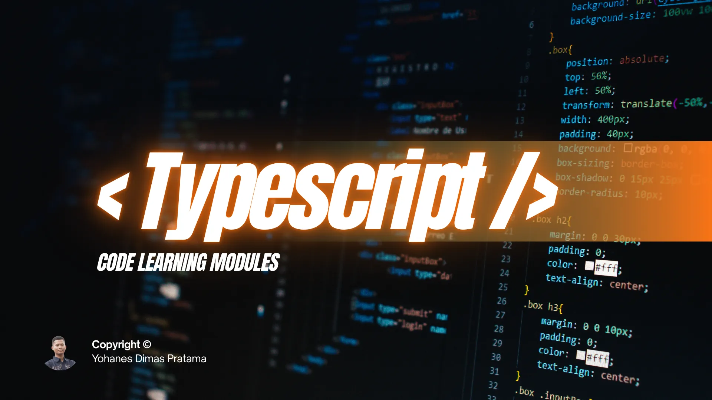

# TypeScript Learning Modules




## Project Overview

**TypeScript Learning Modules** is a structured, module-based programming education repository designed to guide learners from foundational TypeScript syntax to production-oriented backend architecture and practical software engineering. Organized into 18 progressive modules containing 300 numbered, self-contained TypeScript submodules (`01_hello_world.ts` through `300_fullstack_task_manager_project.ts`), the curriculum pairs concise module guides (`README.md` inside each module directory) with directly executable Node.js/`tsx` source files and captured terminal execution outputs (`output/*.png`).

## Learning Objectives

By working sequentially through the 18 modules and executing the accompanying submodules, learners develop practical competency across TypeScript's static type system, runtime patterns, and application architecture:

- Configure strict TypeScript projects (`tsconfig.json`) and understand compilation vs. direct execution workflows.
- Apply primitive, literal, tuple, array, object, `enum`, `interface`, and `type` alias constructs to model domain data safely.
- Implement control flow narrowing, discriminated unions, exhaustive `never` checks, and custom type predicates.
- Build reusable APIs using generics, constraints, variance concepts, conditional/mapped/template-literal types, and built-in utility types.
- Design maintainable object-oriented hierarchies using access modifiers, abstract classes, polymorphism, composition, aggregation, and decorators.
- Manage modular ES/CommonJS codebases, declaration files (`.d.ts`), path aliases, and asynchronous workflows (`Promise`, `async/await`, `AbortController`, `Result` pattern).
- Apply TypeScript to frontend DOM/browser APIs, Node.js core modules, Express REST APIs, Zod schema validation, unit testing concepts, and secure coding practices.

## Learning Level & Approach

The curriculum progresses systematically from introductory syntax in Module 01 to type-level programming, layered backend architecture, and integrated capstone implementations in Module 18. Each module directory includes a localized `README.md` guide, numbered `.ts` exercises, and corresponding execution captures in `output/`.

| Attribute | Description |
| --- | --- |
| Learning Level | Beginner to Advanced (progressive 18-module track) |
| Learning Approach | Module-based with incremental numbered submodules (`01`–`300`) |
| Learning Format | Module guides (`README.md`), runnable `.ts` source files, and terminal output captures (`output/*.png`) |
| Programming Focus | TypeScript static typing, OOP, asynchronous patterns, Node.js, and backend API design |
| Learning Pace | Self-paced sequential or topic-targeted study |

## Learning Path & Curriculum

The repository follows a linear 18-module progression grouped into foundational syntax, type system mastery, architectural patterns, platform integration, and capstone implementation:

1. **Foundations & Core Syntax (Modules 01–06):** Program structure, compiler configuration, primitives, operators, control flow, loops, functions, arrays, tuples, and objects.
2. **Type System & Type-Level Programming (Modules 07–10):** Type aliases, interfaces, enums, union/intersection narrowing, generics, conditional types, mapped types, and utility types.
3. **Architecture, Modularity & Concurrency (Modules 11–13):** Object-oriented programming, decorators, ES modules, `.d.ts` declarations, promises, `async/await`, and `Result` error handling.
4. **Frontend, Backend, Quality & Capstones (Modules 14–18):** Browser DOM APIs, Node.js core runtime, Express & Zod REST APIs, testing/tooling/security patterns, and two full capstone projects.

| Order | Module | Main Topics | Materials |
| --- | --- | --- | --- |
| 01 | [Module 01 — Introduction & Program Structure](module-01-pengenalan-typescript-dan-struktur-program/README.md) | `tsc`, `tsconfig.json`, strict mode, console I/O | 10 submodules (`01`–`10`) |
| 02 | [Module 02 — Variables & Basic Data Types](module-02-variabel-dan-tipe-data-dasar/README.md) | `let`/`const`/`var`, primitives, `unknown`, `never`, literals | 16 submodules (`11`–`26`) |
| 03 | [Module 03 — Operators & Decision Making](module-03-operator-dan-pengambilan-keputusan/README.md) | Operators, `??`, `?.`, `switch` exhaustiveness, CFA | 16 submodules (`27`–`42`) |
| 04 | [Module 04 — Loops & Flow Control](module-04-perulangan-dan-kontrol-alur/README.md) | `for`, `while`, `for...of`, `for...in`, iterative algorithms | 16 submodules (`43`–`58`) |
| 05 | [Module 05 — Functions & Parameters](module-05-fungsi-dan-parameter/README.md) | Arrow functions, overloads, HOFs, closures, assertions | 18 submodules (`59`–`76`) |
| 06 | [Module 06 — Arrays, Tuples & Objects](module-06-array-tuple-dan-object/README.md) | `readonly` collections, `map`/`filter`/`reduce`, named tuples | 18 submodules (`77`–`94`) |
| 07 | [Module 07 — Type Aliases, Interfaces & Enums](module-07-type-aliases-interface-dan-enum/README.md) | Declaration merging, `extends`, enums vs. union alternatives | 16 submodules (`95`–`110`) |
| 08 | [Module 08 — Union, Intersection & Narrowing](module-08-union-intersection-dan-type-narrowing/README.md) | Discriminated unions, type guards, `satisfies`, branded types | 18 submodules (`111`–`128`) |
| 09 | [Module 09 — Generics & Generic Programming](module-09-generics-dan-pemrograman-generik/README.md) | `<T>`, constraints, `keyof`, indexed access, variance basics | 18 submodules (`129`–`146`) |
| 10 | [Module 10 — Advanced Types](module-10-advanced-types/README.md) | Conditional/mapped/template types, `infer`, utility types | 22 submodules (`147`–`168`) |
| 11 | [Module 11 — Classes & OOP](module-11-class-dan-object-oriented-programming/README.md) | Access modifiers, abstract classes, polymorphism, decorators | 20 submodules (`169`–`188`) |
| 12 | [Module 12 — Modules & Project Management](module-12-modules-dan-pengelolaan-proyek/README.md) | ESM exports, module augmentation, `.d.ts`, project references | 18 submodules (`189`–`206`) |
| 13 | [Module 13 — Asynchronous Programming & Errors](module-13-asynchronous-programming-dan-error-handling/README.md) | Promises, `async/await`, async iterators, `AbortController`, `Result` | 22 submodules (`207`–`228`) |
| 14 | [Module 14 — Browser, DOM & Frontend](module-14-browser-dom-dan-frontend-typescript/README.md) | DOM element types, events, forms, storage, observers, WebSocket | 20 submodules (`229`–`248`) |
| 15 | [Module 15 — Node.js & Backend TypeScript](module-15-node-js-dan-backend-typescript/README.md) | `process`, `fs/promises`, `http`, streams, `crypto`, worker threads | 16 submodules (`249`–`264`) |
| 16 | [Module 16 — API, Database & Frameworks](module-16-api-database-dan-framework/README.md) | Express REST APIs, Zod schemas, Repository pattern, Prisma/NestJS | 18 submodules (`265`–`282`) |
| 17 | [Module 17 — Testing, Tooling & Security](module-17-testing-tooling-dan-keamanan/README.md) | Unit/integration/type testing, ESLint/Prettier, XSS & RBAC types | 16 submodules (`283`–`298`) |
| 18 | [Module 18 — Practical TypeScript Projects](module-18-proyek-praktik-typescript/README.md) | Student Management System & Full-Stack Task Manager capstones | 2 submodules (`299`–`300`) |

## Learning Modules & Contents

Each module directory contains its own detailed `README.md` indexing all submodules, source code explanations, and PNG execution outputs in `output/`. Below is the top-level navigation index for all 18 modules.

### Module 01 — Introduction to TypeScript and Program Structure

- **Module Guide:** [Open Module 01 README](module-01-pengenalan-typescript-dan-struktur-program/README.md)
- **Submodules (`01`–`10`):** Covers hello world, program structure, TSDoc comments, console methods, compiler workflow (`tsc`), `tsconfig.json`, and `strict` mode.
- **Entry & Milestone Files:** [01_hello_world.ts](module-01-pengenalan-typescript-dan-struktur-program/01_hello_world.ts) · [06_typescript_compiler.ts](module-01-pengenalan-typescript-dan-struktur-program/06_typescript_compiler.ts) · [09_strict_mode.ts](module-01-pengenalan-typescript-dan-struktur-program/09_strict_mode.ts) · [10_typescript_playground.ts](module-01-pengenalan-typescript-dan-struktur-program/10_typescript_playground.ts)
- **Execution Outputs:** [View Module 01 Outputs](module-01-pengenalan-typescript-dan-struktur-program/output)

### Module 02 — Variables and Basic Data Types

- **Module Guide:** [Open Module 02 README](module-02-variabel-dan-tipe-data-dasar/README.md)
- **Submodules (`11`–`26`):** Covers `let`, `const`, `var`, explicit type annotations, `string`, `number`, `boolean`, `bigint`, `symbol`, `null`/`undefined`, `any`, `unknown`, `never`, `void`, type inference, and literal types.
- **Entry & Milestone Files:** [11_let_variable.ts](module-02-variabel-dan-tipe-data-dasar/11_let_variable.ts) · [22_unknown_type.ts](module-02-variabel-dan-tipe-data-dasar/22_unknown_type.ts) · [23_never_type.ts](module-02-variabel-dan-tipe-data-dasar/23_never_type.ts) · [26_literal_types.ts](module-02-variabel-dan-tipe-data-dasar/26_literal_types.ts)
- **Execution Outputs:** [View Module 02 Outputs](module-02-variabel-dan-tipe-data-dasar/output)

### Module 03 — Operators and Decision Making

- **Module Guide:** [Open Module 03 README](module-03-operator-dan-pengambilan-keputusan/README.md)
- **Submodules (`27`–`42`):** Covers arithmetic, assignment, comparison, logical, bitwise, increment/decrement, ternary, nullish coalescing (`??`), optional chaining (`?.`), `typeof`, `instanceof`, `in`, `if`, `switch` exhaustiveness, and Control Flow Analysis.
- **Entry & Milestone Files:** [27_arithmetic_operators.ts](module-03-operator-dan-pengambilan-keputusan/27_arithmetic_operators.ts) · [34_nullish_coalescing.ts](module-03-operator-dan-pengambilan-keputusan/34_nullish_coalescing.ts) · [41_switch_exhaustiveness.ts](module-03-operator-dan-pengambilan-keputusan/41_switch_exhaustiveness.ts) · [42_control_flow_analysis.ts](module-03-operator-dan-pengambilan-keputusan/42_control_flow_analysis.ts)
- **Execution Outputs:** [View Module 03 Outputs](module-03-operator-dan-pengambilan-keputusan/output)

### Module 04 — Loops and Flow Control

- **Module Guide:** [Open Module 04 README](module-04-perulangan-dan-kontrol-alur/README.md)
- **Submodules (`43`–`58`):** Covers `for`, `while`, `do-while`, `for...of`, `for...in`, nested loops, `break`/`continue`, typed array iteration, number patterns, factorial, prime verification, and Fibonacci sequences.
- **Entry & Milestone Files:** [43_for_loop.ts](module-04-perulangan-dan-kontrol-alur/43_for_loop.ts) · [46_for_of_loop.ts](module-04-perulangan-dan-kontrol-alur/46_for_of_loop.ts) · [57_prime_number.ts](module-04-perulangan-dan-kontrol-alur/57_prime_number.ts) · [58_fibonacci_loop.ts](module-04-perulangan-dan-kontrol-alur/58_fibonacci_loop.ts)
- **Execution Outputs:** [View Module 04 Outputs](module-04-perulangan-dan-kontrol-alur/output)

### Module 05 — Functions and Parameters

- **Module Guide:** [Open Module 05 README](module-05-fungsi-dan-parameter/README.md)
- **Submodules (`59`–`76`):** Covers function declarations, expressions, arrow functions, parameter/return typing, optional/default/rest parameters, overloads, higher-order functions, recursion, closures, `this` typing, and assertion functions.
- **Entry & Milestone Files:** [59_function_declaration.ts](module-05-fungsi-dan-parameter/59_function_declaration.ts) · [67_function_overloads.ts](module-05-fungsi-dan-parameter/67_function_overloads.ts) · [74_closures.ts](module-05-fungsi-dan-parameter/74_closures.ts) · [76_assertion_functions.ts](module-05-fungsi-dan-parameter/76_assertion_functions.ts)
- **Execution Outputs:** [View Module 05 Outputs](module-05-fungsi-dan-parameter/output)

### Module 06 — Arrays, Tuples, and Objects

- **Module Guide:** [Open Module 06 README](module-06-array-tuple-dan-object/README.md)
- **Submodules (`77`–`94`):** Covers `T[]` vs. `Array<T>`, `readonly` arrays, `map`/`filter`/`reduce`, sorting, destructuring, fixed/named/optional tuples, typed objects, `readonly` properties, index signatures, and excess property checks.
- **Entry & Milestone Files:** [77_array_basic.ts](module-06-array-tuple-dan-object/77_array_basic.ts) · [87_named_tuple.ts](module-06-array-tuple-dan-object/87_named_tuple.ts) · [93_index_signatures.ts](module-06-array-tuple-dan-object/93_index_signatures.ts) · [94_excess_property_checks.ts](module-06-array-tuple-dan-object/94_excess_property_checks.ts)
- **Execution Outputs:** [View Module 06 Outputs](module-06-array-tuple-dan-object/output)

### Module 07 — Type Aliases, Interfaces, and Enums

- **Module Guide:** [Open Module 07 README](module-07-type-aliases-interface-dan-enum/README.md)
- **Submodules (`95`–`110`):** Covers type aliases, interfaces, optional/readonly/function/index interface members, `extends`, declaration merging, numeric/string/`const` enums, union alternatives (`as const`), type composition, and domain data modeling.
- **Entry & Milestone Files:** [95_type_aliases.ts](module-07-type-aliases-interface-dan-enum/95_type_aliases.ts) · [102_interface_declaration_merging.ts](module-07-type-aliases-interface-dan-enum/102_interface_declaration_merging.ts) · [108_enum_alternatives.ts](module-07-type-aliases-interface-dan-enum/108_enum_alternatives.ts) · [110_data_modeling.ts](module-07-type-aliases-interface-dan-enum/110_data_modeling.ts)
- **Execution Outputs:** [View Module 07 Outputs](module-07-type-aliases-interface-dan-enum/output)

### Module 08 — Union, Intersection, and Type Narrowing

- **Module Guide:** [Open Module 08 README](module-08-union-intersection-dan-type-narrowing/README.md)
- **Submodules (`111`–`128`):** Covers union/intersection types, discriminated unions, `typeof`/`instanceof`/`in`/equality/truthiness narrowing, custom type guards, type predicates, `never` exhaustiveness, `satisfies`, `as const`, non-null assertions, and branded types.
- **Entry & Milestone Files:** [111_union_types.ts](module-08-union-intersection-dan-type-narrowing/111_union_types.ts) · [113_discriminated_unions.ts](module-08-union-intersection-dan-type-narrowing/113_discriminated_unions.ts) · [124_satisfies_operator.ts](module-08-union-intersection-dan-type-narrowing/124_satisfies_operator.ts) · [128_branded_types.ts](module-08-union-intersection-dan-type-narrowing/128_branded_types.ts)
- **Execution Outputs:** [View Module 08 Outputs](module-08-union-intersection-dan-type-narrowing/output)

### Module 09 — Generics and Generic Programming

- **Module Guide:** [Open Module 09 README](module-09-generics-dan-pemrograman-generik/README.md)
- **Submodules (`129`–`146`):** Covers generic functions, parameters, constraints, interfaces, classes, type aliases, default generic parameters, `keyof`, `typeof`, indexed access types, generic factories, collections, inference, variance basics, and generic type guards.
- **Entry & Milestone Files:** [129_generic_functions.ts](module-09-generics-dan-pemrograman-generik/129_generic_functions.ts) · [137_keyof_operator.ts](module-09-generics-dan-pemrograman-generik/137_keyof_operator.ts) · [141_generic_factory.ts](module-09-generics-dan-pemrograman-generik/141_generic_factory.ts) · [146_generic_type_guards.ts](module-09-generics-dan-pemrograman-generik/146_generic_type_guards.ts)
- **Execution Outputs:** [View Module 09 Outputs](module-09-generics-dan-pemrograman-generik/output)

### Module 10 — Advanced Types

- **Module Guide:** [Open Module 10 README](module-10-advanced-types/README.md)
- **Submodules (`147`–`168`):** Covers conditional types, `infer`, mapped types and modifiers, key remapping (`as`), template literal types, recursive types, all major built-in utility types (`Partial`, `Required`, `Readonly`, `Pick`, `Omit`, `Record`, `Exclude`, `Extract`, `NonNullable`, `ReturnType`, `Parameters`, `InstanceType`, `Awaited`), and custom utility types.
- **Entry & Milestone Files:** [147_conditional_types.ts](module-10-advanced-types/147_conditional_types.ts) · [152_key_remapping.ts](module-10-advanced-types/152_key_remapping.ts) · [153_template_literal_types.ts](module-10-advanced-types/153_template_literal_types.ts) · [168_custom_utility_types.ts](module-10-advanced-types/168_custom_utility_types.ts)
- **Execution Outputs:** [View Module 10 Outputs](module-10-advanced-types/output)

### Module 11 — Classes and Object-Oriented Programming

- **Module Guide:** [Open Module 11 README](module-11-class-dan-object-oriented-programming/README.md)
- **Submodules (`169`–`188`):** Covers classes, constructors, access modifiers (`public`/`private`/`protected`), parameter properties, getters/setters, static members, abstract classes/methods, inheritance, `implements`, polymorphism, composition, aggregation, generic repositories, and parameter decorators.
- **Entry & Milestone Files:** [169_class_basic.ts](module-11-class-dan-object-oriented-programming/169_class_basic.ts) · [178_abstract_classes.ts](module-11-class-dan-object-oriented-programming/178_abstract_classes.ts) · [187_generic_classes_advanced.ts](module-11-class-dan-object-oriented-programming/187_generic_classes_advanced.ts) · [188_parameter_decorators.ts](module-11-class-dan-object-oriented-programming/188_parameter_decorators.ts)
- **Execution Outputs:** [View Module 11 Outputs](module-11-class-dan-object-oriented-programming/output)

### Module 12 — Modules and Project Management

- **Module Guide:** [Open Module 12 README](module-12-modules-dan-pengelolaan-proyek/README.md)
- **Submodules (`189`–`206`):** Covers named/default/namespace imports & exports, barrel re-exports, dynamic `import()`, module resolution, module augmentation, declaration merging, ambient modules, `.d.ts` files, `declare global`, namespaces, project references, path aliases, and `tsconfig.json` compiler options.
- **Entry & Milestone Files:** [189_es_module_exports.ts](module-12-modules-dan-pengelolaan-proyek/189_es_module_exports.ts) · [197_module_augmentation.ts](module-12-modules-dan-pengelolaan-proyek/197_module_augmentation.ts) · [200_declaration_files.ts](module-12-modules-dan-pengelolaan-proyek/200_declaration_files.ts) · [206_compiler_options.ts](module-12-modules-dan-pengelolaan-proyek/206_compiler_options.ts)
- **Execution Outputs:** [View Module 12 Outputs](module-12-modules-dan-pengelolaan-proyek/output)

### Module 13 — Asynchronous Programming and Error Handling

- **Module Guide:** [Open Module 13 README](module-13-asynchronous-programming-dan-error-handling/README.md)
- **Submodules (`207`–`228`):** Covers callbacks, `Promise<T>`, `.then()`/`.catch()`, `Promise.all`/`allSettled`/`race`, `async/await`, async iterators & generators, `AbortController`, Fetch API GET/POST typing, API response envelopes, async retry, error hierarchies, and the `Result` pattern.
- **Entry & Milestone Files:** [207_callback_functions.ts](module-13-asynchronous-programming-dan-error-handling/207_callback_functions.ts) · [214_async_functions.ts](module-13-asynchronous-programming-dan-error-handling/214_async_functions.ts) · [221_abort_controller.ts](module-13-asynchronous-programming-dan-error-handling/221_abort_controller.ts) · [228_result_type_pattern.ts](module-13-asynchronous-programming-dan-error-handling/228_result_type_pattern.ts)
- **Execution Outputs:** [View Module 13 Outputs](module-13-asynchronous-programming-dan-error-handling/output)

### Module 14 — Browser, DOM, and Frontend TypeScript

- **Module Guide:** [Open Module 14 README](module-14-browser-dom-dan-frontend-typescript/README.md)
- **Submodules (`229`–`248`):** Covers DOM selection and element types, `textContent`, attributes, `classList`, dynamic element creation, typed events, form validation and `FormData`, Web Storage, URL API, Intersection/Mutation Observers, Web Workers, WebSockets, Canvas API, and browser modules (simulated cleanly for Node.js execution).
- **Entry & Milestone Files:** [229_dom_element_selection.ts](module-14-browser-dom-dan-frontend-typescript/229_dom_element_selection.ts) · [238_form_validation.ts](module-14-browser-dom-dan-frontend-typescript/238_form_validation.ts) · [245_web_workers.ts](module-14-browser-dom-dan-frontend-typescript/245_web_workers.ts) · [248_browser_modules.ts](module-14-browser-dom-dan-frontend-typescript/248_browser_modules.ts)
- **Execution Outputs:** [View Module 14 Outputs](module-14-browser-dom-dan-frontend-typescript/output)

### Module 15 — Node.js and Backend TypeScript

- **Module Guide:** [Open Module 15 README](module-15-node-js-dan-backend-typescript/README.md)
- **Submodules (`249`–`264`):** Covers `process`, CLI args, `fs/promises`, `path`, environment variables, native `http` server/client, streams, `EventEmitter`, `crypto`, `worker_threads`, `child_process`, `@types/node` `Buffer`, and CommonJS vs. ESM module systems.
- **Entry & Milestone Files:** [249_node_hello_world.ts](module-15-node-js-dan-backend-typescript/249_node_hello_world.ts) · [256_node_http_server.ts](module-15-node-js-dan-backend-typescript/256_node_http_server.ts) · [260_node_crypto.ts](module-15-node-js-dan-backend-typescript/260_node_crypto.ts) · [264_node_module_system.ts](module-15-node-js-dan-backend-typescript/264_node_module_system.ts)
- **Execution Outputs:** [View Module 15 Outputs](module-15-node-js-dan-backend-typescript/output)

### Module 16 — API, Database, and Frameworks

- **Module Guide:** [Open Module 16 README](module-16-api-database-dan-framework/README.md)
- **Submodules (`265`–`282`):** Covers REST DTOs, RFC 7807 error formats, Express server/routing/middleware/controllers/CRUD (using installed `express`), repository pattern, SQL query typing, Prisma Client/CRUD simulations, runtime validation with `zod`, and decorator-based NestJS controller/service/DI patterns.
- **Entry & Milestone Files:** [265_rest_api_types.ts](module-16-api-database-dan-framework/265_rest_api_types.ts) · [272_express_rest_api.ts](module-16-api-database-dan-framework/272_express_rest_api.ts) · [278_zod_validation.ts](module-16-api-database-dan-framework/278_zod_validation.ts) · [282_nestjs_rest_api.ts](module-16-api-database-dan-framework/282_nestjs_rest_api.ts)
- **Execution Outputs:** [View Module 16 Outputs](module-16-api-database-dan-framework/output)

### Module 17 — Testing, Tooling, and Security

- **Module Guide:** [Open Module 17 README](module-17-testing-tooling-dan-keamanan/README.md)
- **Submodules (`283`–`298`):** Covers unit testing harnesses, Vitest/Jest syntax patterns, mock functions, integration and API testing, fixtures, compile-time type testing, ESLint/Prettier configuration concepts, npm package management, typed env config, secure input validation, XSS prevention, JWT authentication types, and RBAC authorization types.
- **Entry & Milestone Files:** [283_typescript_unit_testing.ts](module-17-testing-tooling-dan-keamanan/283_typescript_unit_testing.ts) · [290_type_testing.ts](module-17-testing-tooling-dan-keamanan/290_type_testing.ts) · [296_xss_prevention.ts](module-17-testing-tooling-dan-keamanan/296_xss_prevention.ts) · [298_authorization_types.ts](module-17-testing-tooling-dan-keamanan/298_authorization_types.ts)
- **Execution Outputs:** [View Module 17 Outputs](module-17-testing-tooling-dan-keamanan/output)

### Module 18 — Practical TypeScript Projects

- **Module Guide:** [Open Module 18 README](module-18-proyek-praktik-typescript/README.md)
- **Submodules (`299`–`300`):** Consolidates OOP, interfaces, enums, collections, `Result<T, E>` error handling, and layered backend architecture into two complete capstone applications.
- **Capstone Source Files:** [299_student_management_project.ts](module-18-proyek-praktik-typescript/299_student_management_project.ts) · [300_fullstack_task_manager_project.ts](module-18-proyek-praktik-typescript/300_fullstack_task_manager_project.ts)
- **Execution Outputs:** [View Module 18 Outputs](module-18-proyek-praktik-typescript/output)

## Projects & Coding Challenges

Module 18 serves as the practical capstone module, delivering two complete, runnable TypeScript implementations that integrate concepts from Modules 01 through 17.

| Project | Learning Focus | Implementation File |
| --- | --- | --- |
| Student Management System | Enums, interfaces, union types, `Map` storage, OOP service (`SistemAkademikMahasiswa`), weighted GPA calculation, academic transcript formatting | [299_student_management_project.ts](module-18-proyek-praktik-typescript/299_student_management_project.ts) |
| Full-Stack Task Manager Application | Layered Controller/Service/Repository architecture, `Result<T, E>` error pattern, state-transition validation, sprint metrics analytics | [300_fullstack_task_manager_project.ts](module-18-proyek-praktik-typescript/300_fullstack_task_manager_project.ts) |

## Programming Languages & Tech Stack

| Category | Technology | Purpose |
| --- | --- | --- |
| Primary Language | TypeScript | Static typing, interfaces, generics, advanced types, OOP, and decorators |
| Runtime | Node.js | JavaScript/TypeScript execution environment for backend and CLI scripts |
| TypeScript Runner | tsx | Direct zero-build execution of `.ts` lesson files |
| Web Framework | Express | Typed REST API routing, middleware, and controller examples in Module 16 |
| Schema Validation | Zod | Runtime input validation and static type inference (`z.infer`) in Module 16 |
| Type Definitions | `@types/node`, `@types/express` | Ambient type declarations for Node.js APIs and Express |
| Configuration | `tsconfig.json` | Strict compiler configuration (`ES2022`, `ESNext`, `strict: true`, decorators enabled) |

## Prerequisites & Setup

To run the TypeScript modules locally, ensure Node.js and npm are installed on your system.

- **Required:** Node.js (LTS recommended) and `npm`
- **Recommended:** Visual Studio Code or any TypeScript-aware IDE for inline type checking and IntelliSense
- **Repository Configuration:** Uses [package.json](package.json) and [tsconfig.json](tsconfig.json) at the repository root

```bash
git clone https://github.com/weztcy/TypeScript-Learning-Modules.git
cd "TypeScript Learning Modules"
npm install
```

## Code Execution & Usage

Every submodule (`01` through `300`) is self-contained and executed directly with `tsx`. You can either run files from the repository root or navigate into an individual module directory as shown in each module's `README.md`.

1. Verify TypeScript compilation across the workspace:

```bash
npx tsc --noEmit
```

2. Run any lesson file directly from the repository root using `npx tsx`:

```bash
npx tsx module-01-pengenalan-typescript-dan-struktur-program/01_hello_world.ts
npx tsx module-16-api-database-dan-framework/278_zod_validation.ts
```

3. Run the Module 18 capstone projects:

```bash
npx tsx module-18-proyek-praktik-typescript/299_student_management_project.ts
npx tsx module-18-proyek-praktik-typescript/300_fullstack_task_manager_project.ts
```

## Contributing

Contributions that improve clarity, fix typos, or expand educational examples are welcome.

1. Fork the repository.
2. Create a branch for the change.
3. Add or improve learning materials, source code, exercises, or documentation.
4. Verify code examples and links where practical.
5. Commit and push the branch.
6. Open a pull request with a clear explanation.

## License

This project is licensed under the MIT License.
See the [LICENSE](LICENSE) file for details.

## Author & Contact

**Yohanes Dimas Pratama**

- GitHub: [github.com/weztcy](https://github.com/weztcy)
- Portfolio: [yohanesdimas.com](https://yohanesdimas.com)
- LinkedIn: [linkedin.com/in/yohanes-dimas](https://www.linkedin.com/in/yohanes-dimas)
