# TypeScript Learning Modules

[](https://www.typescriptlang.org/)
[](https://nodejs.org/)
[](https://github.com/privatenumber/tsx)
[](./TypeScript_modules.md)
[](./TypeScript_modules.md)
[](./LICENSE)

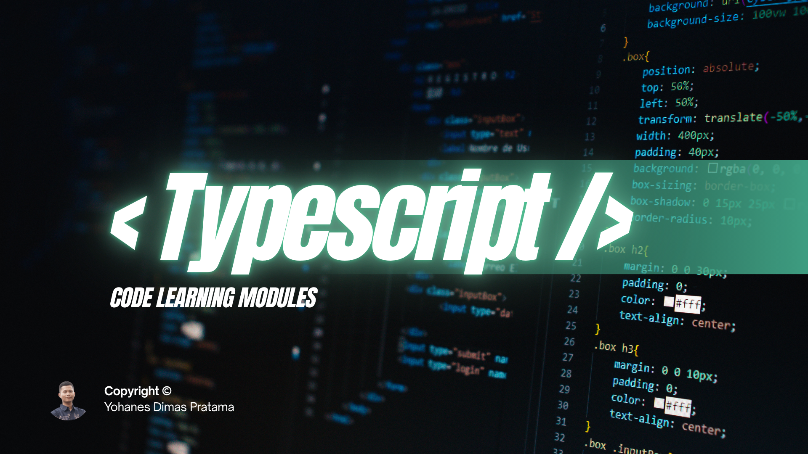

## Project Description

**TypeScript Learning Modules** is a comprehensive, production-grade programming curriculum and executable code repository designed to guide learners from fundamental TypeScript syntax to enterprise-level architecture. Comprising **18 structured pedagogical modules** and **300 self-contained, executable lessons**, this repository provides an exhaustive, hands-on path for mastering modern TypeScript.

Each lesson in the curriculum is paired with concrete problem definitions, fully typed source implementations, and verified terminal execution output captures stored in dedicated `output/` folders. Topics progress systematically through fundamental type systems, control flow analysis, functional abstractions, generics, mapped and conditional types, object-oriented design patterns, module systems, asynchronous workflows, DOM manipulation, backend services with Node.js and Express, schema validation with Zod, automated testing with Vitest/Jest, defensive security practices, and culminate in full-scale capstone projects.

Whether you are a developer transitioning from JavaScript seeking static type safety or an experienced engineer refining advanced type manipulation and Clean Architecture skills, this repository serves as both an end-to-end learning path and a comprehensive desktop reference.

---

## Learning Objectives

Learners studying this curriculum will develop verified, production-ready competencies across modern TypeScript development:

- **Static Typing & Foundational Syntax**: Master type annotations, type inference, strict null checks (`strict: true`), primitive types (`string`, `number`, `boolean`, `bigint`, `symbol`), and special utility types (`unknown`, `never`, `void`, `any`).
- **Control Flow & Modern Operators**: Leverage Control Flow Analysis (CFA), nullish coalescing (`??`), optional chaining (`?.`), bitwise operations, exhaustive switch matching with `never`, and complex looping algorithms.
- **Functions & Functional Paradigms**: Architect robust function signatures using return type annotations, optional/default/rest parameters, function overloads, closures, contextual `this`, and custom type assertion functions.
- **Data Structures & Domain Modeling**: Construct structured data schemas using readonly arrays, fixed-size named tuples, custom object models, index signatures, type aliases, interfaces, and numeric/string enums.
- **Type Narrowing & Discriminated Unions**: Build type-safe application logic with discriminated unions, user-defined type guards (`is`), equality/truthiness narrowing, the `satisfies` operator, and branded (nominal) types.
- **Generics & Generic Abstractions**: Design highly reusable APIs with generic functions, classes, interfaces, generic constraints (`extends`), keyof/typeof operators, and indexed access types (`T[K]`).
- **Advanced Type Systems**: Formulate complex type-level computations using conditional types (`infer`), mapped types with property modifiers (`+readonly`, `-?`), key remapping (`as`), template literal types, recursive JSON types, and standard utility types (`Partial`, `Pick`, `Omit`, `Record`, `Awaited`, etc.).
- **Object-Oriented Architecture**: Implement robust OOP systems with access modifiers (`public`, `private`, `protected`), parameter properties, abstract classes, inheritance, polymorphism, composition, and parameter decorators.
- **Module Architecture & Project Configuration**: Configure enterprise TypeScript environments using ECMAScript modules, ambient declarations (`declare module`, `.d.ts`), path aliases, project references, and fine-tuned `tsconfig.json` compiler flags.
- **Asynchronous Engineering & Robust Error Handling**: Manage concurrent asynchronous operations via Promises, `async/await`, `AbortController`, typed Fetch pipelines, exponential retry strategies, custom error hierarchies, and functional `Result<T, E>` pattern modeling.
- **Browser DOM & Frontend Engineering**: Manipulate browser elements with typed DOM hierarchies, event listener contracts, programmatic form validation, Web Storage APIs, Web Workers, WebSockets, and HTML5 Canvas.
- **Backend Services & Tooling**: Develop typed Node.js backends utilizing file system promises, streams, `EventEmitter`, cryptographic hashing, worker threads, Express.js REST APIs with routing middleware, Prisma ORM, and runtime schema validation with Zod.
- **Testing, Security & Quality Assurance**: Write automated test suites using Vitest and Jest, perform compile-time type testing, enforce linting and formatting with ESLint/Prettier, prevent security vulnerabilities (XSS, path traversal), and model JWT authentication and Role-Based Access Control (RBAC).
- **Full-Stack Capstone Implementation**: Synthesize all curriculum concepts into end-to-end enterprise applications implementing Clean Architecture, repository patterns, business state mutation guards, and analytical dashboards.

---

## Learning Roadmap

The curriculum is structured into 18 sequential pedagogical modules grouped into 5 progressive learning tiers:

### Tier 1: Fundamentals & Basic Syntax (Modules 01–04)
- [Module 01: Introduction to TypeScript & Program Structure](./module-01-pengenalan-typescript-dan-struktur-program/README.md) — 10 Lessons (01–10) · Environment setup, compiler workflow, strict mode, basic syntax.
- [Module 02: Variables & Primitive Data Types](./module-02-variabel-dan-tipe-data-dasar/README.md) — 16 Lessons (11–26) · `let`/`const`/`var`, primitive types, `unknown`, `never`, type inference, literal types.
- [Module 03: Operators & Decision Making](./module-03-operator-dan-pengambilan-keputusan/README.md) — 16 Lessons (27–42) · Operators, ternary expressions, nullish coalescing, CFA, exhaustive switch matching.
- [Module 04: Loops & Flow Control](./module-04-perulangan-dan-kontrol-alur/README.md) — 16 Lessons (43–58) · Iteration constructs (`for`, `while`, `for...of`), nested loops, counters, numerical algorithms.

### Tier 2: Functions, Data Structures & Modeling (Modules 05–08)
- [Module 05: Functions & Parameters](./module-05-fungsi-dan-parameter/README.md) — 18 Lessons (59–76) · Function declarations, overloads, rest/optional parameters, closures, assertion functions.
- [Module 06: Arrays, Tuples & Objects](./module-06-array-tuple-dan-object/README.md) — 18 Lessons (77–94) · Readonly arrays, array methods (`map`/`filter`/`reduce`), named tuples, index signatures.
- [Module 07: Type Aliases, Interfaces & Enums](./module-07-type-aliases-interface-dan-enum/README.md) — 16 Lessons (95–110) · Type aliases vs interfaces, declaration merging, enums, data modeling.
- [Module 08: Union, Intersection & Type Narrowing](./module-08-union-intersection-dan-type-narrowing/README.md) — 18 Lessons (111–128) · Discriminated unions, custom type guards, `satisfies`, assertions, branded types.

### Tier 3: Advanced Type Systems & OOP (Modules 09–12)
- [Module 09: Generics & Generic Programming](./module-09-generics-dan-pemrograman-generik/README.md) — 18 Lessons (129–146) · Generic functions/classes, constraints, `keyof`, indexed access types, variance.
- [Module 10: Advanced Types & Type Manipulation](./module-10-advanced-types/README.md) — 22 Lessons (147–168) · Conditional types (`infer`), mapped types, template literals, built-in utility types.
- [Module 11: Classes & Object-Oriented Programming](./module-11-class-dan-object-oriented-programming/README.md) — 20 Lessons (169–188) · Access modifiers, abstract classes, polymorphism, composition, decorators.
- [Module 12: Modules & Project Management](./module-12-modules-dan-pengelolaan-proyek/README.md) — 18 Lessons (189–206) · ES modules, declaration files (`.d.ts`), path aliases, compiler configuration.

### Tier 4: Asynchronous & Platform Runtimes (Modules 13–15)
- [Module 13: Asynchronous Programming & Error Handling](./module-13-asynchronous-programming-dan-error-handling/README.md) — 22 Lessons (207–228) · Promises, `async/await`, Fetch API, retry patterns, `Result<T, E>` pattern.
- [Module 14: Browser DOM & Frontend TypeScript](./module-14-browser-dom-dan-frontend-typescript/README.md) — 20 Lessons (229–248) · Typed DOM elements, events, form validation, Web Storage, Workers, Canvas.
- [Module 15: Node.js & Backend TypeScript](./module-15-node-js-dan-backend-typescript/README.md) — 16 Lessons (249–264) · Node process, file system I/O, streams, `EventEmitter`, crypto, worker threads.

### Tier 5: Enterprise Architecture, Tooling & Capstones (Modules 16–18)
- [Module 16: APIs, Databases & Frameworks](./module-16-api-database-dan-framework/README.md) — 18 Lessons (265–282) · REST API DTOs, Express.js server, Prisma ORM, Zod validation, NestJS architecture.
- [Module 17: Testing, Tooling & Application Security](./module-17-testing-tooling-dan-keamanan/README.md) — 16 Lessons (283–298) · Vitest, Jest, ESLint, Prettier, secure input validation, XSS prevention, JWT & RBAC.
- [Module 18: Practical Capstone Projects](./module-18-proyek-praktik-typescript/README.md) — 2 Capstone Projects (299–300) · Student Academic Management System & Full-Stack Task Manager.

---

## Prerequisites

Before getting started with this curriculum, ensure your environment meets the following requirements:

- **Node.js Runtime**: Version `18.0.0` or higher (tested on Node.js `v22+`).
- **Package Manager**: `npm` (version `9.0.0` or higher, bundled with Node.js).
- **Core Knowledge**: Basic familiarity with general programming concepts (variables, conditional branches, loops, and functions). Prior experience with JavaScript is helpful but not strictly required as concepts are developed from first principles.
- **Terminal & Shell**: Any modern shell environment:
  - Linux / macOS: `bash` or `zsh`
  - Windows: PowerShell or Command Prompt (`cmd.exe`)

---

## Tech Stack & Tools

The repository utilizes a modern TypeScript execution ecosystem configured for rapid development, static verification, and enterprise software engineering:

- **Core Programming Language**: [TypeScript](https://www.typescriptlang.org/) (`typescript` `^7.0.2` / target `ES2022`, module `ESNext`, strict mode enabled)
- **Zero-Config Execution Engine**: [tsx](https://github.com/privatenumber/tsx) (`^4.23.15`) for immediate, on-the-fly TypeScript execution without manual pre-compilation
- **Backend Web Framework**: [Express.js](https://expressjs.com/) (`express` `^5.3.0`)
- **Schema Validation & Type Inference**: [Zod](https://zod.dev/) (`zod` `^4.6.7`)
- **Type Definitions**:
  - `@types/node` (`^26.6.5`)
  - `@types/express` (`^5.0.6`)
- **Testing & Quality Tooling Covered**: [Vitest](https://vitest.dev/), [Jest](https://jestjs.io/), [ESLint](https://eslint.org/), [Prettier](https://prettier.io/)

---

## Getting Started / Installation & Setup

Follow these verified steps to clone, configure, and execute the repository locally:

### 1. Clone the Repository
```bash
git clone https://github.com/weztcy/TypeScript-Learning-Modules.git
cd "TypeScript Learning Modules"
```

### 2. Install Project Dependencies
Install the required development tools and runtime dependencies specified in `package.json`:
```bash
npm install
```

### 3. Verify the Environment
Execute the first lesson to verify that the TypeScript runtime operates correctly:
```bash
npx tsx module-01-pengenalan-typescript-dan-struktur-program/01_hello_world.ts
```

*Expected Verification Output:*
```text
=== Program Pertama TypeScript ===
Halo Dunia, Selamat Datang di Pemrograman TypeScript!
```

---

## How to Use This Repository

To maximize pedagogical retention and master TypeScript effectively, follow this structured 5-step learning workflow:

1. **Select a Module & Review Theory**:
   Begin by navigating to the desired module folder and opening its dedicated `README.md` (e.g., [Module 01 README](./module-01-pengenalan-typescript-dan-struktur-program/README.md)). Review the pedagogical scope, learning objectives, and core concepts.
2. **Inspect the Implementation Source Code**:
   Open the target `.ts` file in your code editor. Read through the type annotations, interface contracts, function signatures, and explanatory in-line comments.
3. **Execute the Code**:
   Run the lesson file from the root directory using the `npx tsx` command:
   ```bash
   npx tsx <module-folder>/<lesson-file>.ts
   ```
4. **Compare with Verified Output**:
   Check the output produced in your terminal against the official execution capture located in that module's `output/` directory (e.g., `<module-folder>/output/<lesson-file>.png`). Verify that all calculations, formatted tables, and type-guarded outputs match.
5. **Experiment & Extend**:
   Modify types, test edge cases, intentionally introduce type errors to observe compiler diagnostic messages, and refactor the implementation to deepen your understanding.

---

## Learning Modules & Subtopics

### Module 01: Introduction to TypeScript and Program Structure
- **Module Directory**: [`module-01-pengenalan-typescript-dan-struktur-program`](./module-01-pengenalan-typescript-dan-struktur-program/README.md)
- **Pedagogical Scope**: Foundational TypeScript philosophy as a typed superset of JavaScript, file structure, comments, console outputs, variable declaration foundations, compiler workflows with `tsc`, `tsconfig.json` options, strict mode enforcement, and playground experimentation.
- **Subtopics & Source Implementations**:
  - [`01_hello_world.ts`](./module-01-pengenalan-typescript-dan-struktur-program/01_hello_world.ts) — First TypeScript program with explicit string typing and console output.
  - [`02_typescript_structure.ts`](./module-01-pengenalan-typescript-dan-struktur-program/02_typescript_structure.ts) — Structural anatomy of a TypeScript program, type aliases, and typed functions.
  - [`03_comments.ts`](./module-01-pengenalan-typescript-dan-struktur-program/03_comments.ts) — Single-line, multi-line, and JSDoc/TSDoc documentation conventions.
  - [`04_console_output.ts`](./module-01-pengenalan-typescript-dan-struktur-program/04_console_output.ts) — Output formatting via `console.log`, `info`, `warn`, `error`, and `table`.
  - [`05_variable_declaration.ts`](./module-01-pengenalan-typescript-dan-struktur-program/05_variable_declaration.ts) — Basic variable declaration concepts and initial type assignment.
  - [`06_typescript_compiler.ts`](./module-01-pengenalan-typescript-dan-struktur-program/06_typescript_compiler.ts) — Compilation stages and AST generation principles.
  - [`07_compile_and_run.ts`](./module-01-pengenalan-typescript-dan-struktur-program/07_compile_and_run.ts) — Compilation to JavaScript and immediate runtime execution.
  - [`08_typescript_configuration.ts`](./module-01-pengenalan-typescript-dan-struktur-program/08_typescript_configuration.ts) — Breakdown of compiler options in `tsconfig.json`.
  - [`09_strict_mode.ts`](./module-01-pengenalan-typescript-dan-struktur-program/09_strict_mode.ts) — Type safety enforcement through strict mode and null checks.
  - [`10_typescript_playground.ts`](./module-01-pengenalan-typescript-dan-struktur-program/10_typescript_playground.ts) — Interactive code testing combining modern syntax and utility logic.
- **Verified Execution Preview**:

  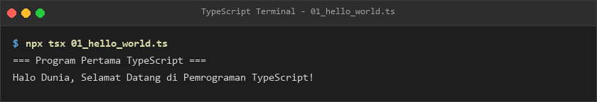

---

### Module 02: Variables and Primitive Data Types
- **Module Directory**: [`module-02-variabel-dan-tipe-data-dasar`](./module-02-variabel-dan-tipe-data-dasar/README.md)
- **Pedagogical Scope**: Declaration keywords (`let`, `const`, `var`), lexical scoping, primitive types (`string`, `number`, `boolean`, `bigint`, `symbol`), special types (`null`, `undefined`, `any`, `unknown`, `never`, `void`), type annotations, type inference, and literal types.
- **Subtopics & Source Implementations**:
  - [`11_let_variable.ts`](./module-02-variabel-dan-tipe-data-dasar/11_let_variable.ts) — Reassignable variable declarations with block-level scoping.
  - [`12_const_variable.ts`](./module-02-variabel-dan-tipe-data-dasar/12_const_variable.ts) — Immutable identifier binding and reference immutability.
  - [`13_var_variable.ts`](./module-02-variabel-dan-tipe-data-dasar/13_var_variable.ts) — Function-scoped variables and hoisting pitfalls in legacy code.
  - [`14_type_annotations.ts`](./module-02-variabel-dan-tipe-data-dasar/14_type_annotations.ts) — Explicit type annotations on variables, constants, and parameters.
  - [`15_string_type.ts`](./module-02-variabel-dan-tipe-data-dasar/15_string_type.ts) — String manipulation, template literals, and string operations.
  - [`16_number_type.ts`](./module-02-variabel-dan-tipe-data-dasar/16_number_type.ts) — Floating-point, integer, hex, binary, and octal numeric types.
  - [`17_boolean_type.ts`](./module-02-variabel-dan-tipe-data-dasar/17_boolean_type.ts) — Boolean flags and truth evaluation.
  - [`18_bigint_type.ts`](./module-02-variabel-dan-tipe-data-dasar/18_bigint_type.ts) — Arbitrary-precision integers for large numerical computations.
  - [`19_symbol_type.ts`](./module-02-variabel-dan-tipe-data-dasar/19_symbol_type.ts) — Unique and immutable primitive symbol keys.
  - [`20_null_undefined.ts`](./module-02-variabel-dan-tipe-data-dasar/20_null_undefined.ts) — Handling absent values and uninitialized variables safely.
  - [`21_any_type.ts`](./module-02-variabel-dan-tipe-data-dasar/21_any_type.ts) — Opting out of type checking and migration strategies.
  - [`22_unknown_type.ts`](./module-02-variabel-dan-tipe-data-dasar/22_unknown_type.ts) — Type-safe counterpart of any requiring narrowing before use.
  - [`23_never_type.ts`](./module-02-variabel-dan-tipe-data-dasar/23_never_type.ts) — Representing unreachable code and exhaustive checks.
  - [`24_void_type.ts`](./module-02-variabel-dan-tipe-data-dasar/24_void_type.ts) — Indicating the absence of a return value in functions.
  - [`25_type_inference.ts`](./module-02-variabel-dan-tipe-data-dasar/25_type_inference.ts) — Automatic deduction of types by the TypeScript compiler.
  - [`26_literal_types.ts`](./module-02-variabel-dan-tipe-data-dasar/26_literal_types.ts) — Exact string, number, and boolean value literal types.
- **Verified Execution Preview**:

  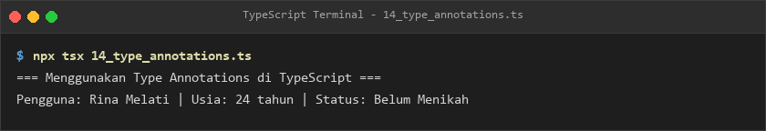

---

### Module 03: Operators and Decision Making
- **Module Directory**: [`module-03-operator-dan-pengambilan-keputusan`](./module-03-operator-dan-pengambilan-keputusan/README.md)
- **Pedagogical Scope**: Computational operators, strict equality, logical and bitwise manipulations, ternary expressions, modern nullish coalescing (`??`), optional chaining (`?.`), runtime type inspection (`typeof`, `instanceof`, `in`), branch logic (`if...else`), switch-case structures, exhaustive evaluation with `never`, and Control Flow Analysis (CFA).
- **Subtopics & Source Implementations**:
  - [`27_arithmetic_operators.ts`](./module-03-operator-dan-pengambilan-keputusan/27_arithmetic_operators.ts) — Addition, subtraction, multiplication, division, modulo, and exponentiation.
  - [`28_assignment_operators.ts`](./module-03-operator-dan-pengambilan-keputusan/28_assignment_operators.ts) — Compound assignment operators (`+=`, `-=`, `*=`, `/=`).
  - [`29_comparison_operators.ts`](./module-03-operator-dan-pengambilan-keputusan/29_comparison_operators.ts) — Strict equality (`===`), inequality (`!==`), and relational evaluations.
  - [`30_logical_operators.ts`](./module-03-operator-dan-pengambilan-keputusan/30_logical_operators.ts) — Short-circuit evaluation with `&&`, `||`, and `!`.
  - [`31_bitwise_operators.ts`](./module-03-operator-dan-pengambilan-keputusan/31_bitwise_operators.ts) — Bitwise AND, OR, XOR, NOT, and bit-shift operations.
  - [`32_increment_decrement.ts`](./module-03-operator-dan-pengambilan-keputusan/32_increment_decrement.ts) — Pre-increment and post-increment evaluation semantics.
  - [`33_ternary_operator.ts`](./module-03-operator-dan-pengambilan-keputusan/33_ternary_operator.ts) — Concise conditional branching expressions (`? :`).
  - [`34_nullish_coalescing.ts`](./module-03-operator-dan-pengambilan-keputusan/34_nullish_coalescing.ts) — Safe fallback assignment ignoring falsy zero or empty strings (`??`).
  - [`35_optional_chaining.ts`](./module-03-operator-dan-pengambilan-keputusan/35_optional_chaining.ts) — Safe deep property access avoiding runtime TypeError (`?.`).
  - [`36_typeof_operator.ts`](./module-03-operator-dan-pengambilan-keputusan/36_typeof_operator.ts) — Primitive type inspection at runtime.
  - [`37_instanceof_operator.ts`](./module-03-operator-dan-pengambilan-keputusan/37_instanceof_operator.ts) — Prototype chain verification for class instances.
  - [`38_in_operator.ts`](./module-03-operator-dan-pengambilan-keputusan/38_in_operator.ts) — Object property existence checking for type narrowing.
  - [`39_if_statement.ts`](./module-03-operator-dan-pengambilan-keputusan/39_if_statement.ts) — Multi-tier conditional branching with `if`, `else if`, and `else`.
  - [`40_switch_statement.ts`](./module-03-operator-dan-pengambilan-keputusan/40_switch_statement.ts) — Multi-case discrete value branching.
  - [`41_switch_exhaustiveness.ts`](./module-03-operator-dan-pengambilan-keputusan/41_switch_exhaustiveness.ts) — Compile-time completeness verification using the `never` type.
  - [`42_control_flow_analysis.ts`](./module-03-operator-dan-pengambilan-keputusan/42_control_flow_analysis.ts) — Flow-sensitive type deduction across logical blocks.
- **Verified Execution Preview**:

  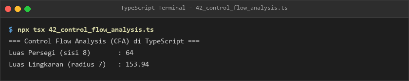

---

### Module 04: Loops and Flow Control
- **Module Directory**: [`module-04-perulangan-dan-kontrol-alur`](./module-04-perulangan-dan-kontrol-alur/README.md)
- **Pedagogical Scope**: Iteration constructs (`for`, `while`, `do-while`), modern collection traversal (`for...of`, `for...in`), nested iteration, flow termination (`break`, `continue`), counter state machines, typed collection processing, and classic numerical algorithms (pyramid patterns, factorials, prime test, Fibonacci).
- **Subtopics & Source Implementations**:
  - [`43_for_loop.ts`](./module-04-perulangan-dan-kontrol-alur/43_for_loop.ts) — Standard indexed for loops with initialization, condition, and step.
  - [`44_while_loop.ts`](./module-04-perulangan-dan-kontrol-alur/44_while_loop.ts) — Condition-driven iterative execution.
  - [`45_do_while_loop.ts`](./module-04-perulangan-dan-kontrol-alur/45_do_while_loop.ts) — Post-condition loops ensuring at least one execution pass.
  - [`46_for_of_loop.ts`](./module-04-perulangan-dan-kontrol-alur/46_for_of_loop.ts) — Iterating directly over iterable values (arrays, sets, strings).
  - [`47_for_in_loop.ts`](./module-04-perulangan-dan-kontrol-alur/47_for_in_loop.ts) — Iterating over enumerable string property keys of an object.
  - [`48_nested_loop.ts`](./module-04-perulangan-dan-kontrol-alur/48_nested_loop.ts) — Multi-dimensional loops and coordinate grid generation.
  - [`49_break_statement.ts`](./module-04-perulangan-dan-kontrol-alur/49_break_statement.ts) — Early termination of loop executions upon condition match.
  - [`50_continue_statement.ts`](./module-04-perulangan-dan-kontrol-alur/50_continue_statement.ts) — Skipping current iterations and advancing to the next cycle.
  - [`51_loop_counter.ts`](./module-04-perulangan-dan-kontrol-alur/51_loop_counter.ts) — State tracking and counter accumulators.
  - [`52_array_iteration.ts`](./module-04-perulangan-dan-kontrol-alur/52_array_iteration.ts) — Traversing structured collections with typed elements.
  - [`53_loop_with_types.ts`](./module-04-perulangan-dan-kontrol-alur/53_loop_with_types.ts) — Strict type annotations inside loop body declarations.
  - [`54_loop_conditions.ts`](./module-04-perulangan-dan-kontrol-alur/54_loop_conditions.ts) — Complex compound Boolean conditions in loops.
  - [`55_number_patterns.ts`](./module-04-perulangan-dan-kontrol-alur/55_number_patterns.ts) — Formatting triangular and matrix numerical patterns.
  - [`56_factorial_loop.ts`](./module-04-perulangan-dan-kontrol-alur/56_factorial_loop.ts) — Iterative computation of factorial functions.
  - [`57_prime_number.ts`](./module-04-perulangan-dan-kontrol-alur/57_prime_number.ts) — Primality testing algorithm using trial division.
  - [`58_fibonacci_loop.ts`](./module-04-perulangan-dan-kontrol-alur/58_fibonacci_loop.ts) — Generating Fibonacci sequence terms iteratively.
- **Verified Execution Preview**:

  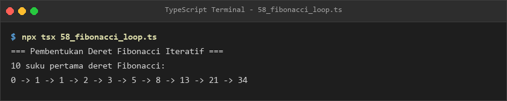

---

### Module 05: Functions and Parameters
- **Module Directory**: [`module-05-fungsi-dan-parameter`](./module-05-fungsi-dan-parameter/README.md)
- **Pedagogical Scope**: Function declarations, function expressions, arrow functions, parameter type annotations, return types, optional and default parameters, rest parameters, function overloading, function type aliases, callbacks, higher-order functions, recursion, generic functions, lexical scoping, closures, contextual `this`, and assertion functions.
- **Subtopics & Source Implementations**:
  - [`59_function_declaration.ts`](./module-05-fungsi-dan-parameter/59_function_declaration.ts) — Standard function declaration syntax and hoisting.
  - [`60_function_expression.ts`](./module-05-fungsi-dan-parameter/60_function_expression.ts) — Storing anonymous and named functions in variables.
  - [`61_arrow_function.ts`](./module-05-fungsi-dan-parameter/61_arrow_function.ts) — Concise arrow functions and lexical this binding.
  - [`62_function_parameters.ts`](./module-05-fungsi-dan-parameter/62_function_parameters.ts) — Parameter type validation and count enforcement.
  - [`63_function_return_types.ts`](./module-05-fungsi-dan-parameter/63_function_return_types.ts) — Explicit return types and return type inference.
  - [`64_optional_parameters.ts`](./module-05-fungsi-dan-parameter/64_optional_parameters.ts) — Defining optional parameters with `?`.
  - [`65_default_parameters.ts`](./module-05-fungsi-dan-parameter/65_default_parameters.ts) — Initializing fallback default values for omitted arguments.
  - [`66_rest_parameters.ts`](./module-05-fungsi-dan-parameter/66_rest_parameters.ts) — Variadic functions accepting unbounded arguments as an array (`...args`).
  - [`67_function_overloads.ts`](./module-05-fungsi-dan-parameter/67_function_overloads.ts) — Declaring multiple function call signatures with a single implementation.
  - [`68_function_type_alias.ts`](./module-05-fungsi-dan-parameter/68_function_type_alias.ts) — Defining reusable function signature type aliases.
  - [`69_callback_functions.ts`](./module-05-fungsi-dan-parameter/69_callback_functions.ts) — Passing typed functions as arguments for event-driven logic.
  - [`70_higher_order_functions.ts`](./module-05-fungsi-dan-parameter/70_higher_order_functions.ts) — Functions accepting or returning other functions.
  - [`71_recursive_functions.ts`](./module-05-fungsi-dan-parameter/71_recursive_functions.ts) — Self-invoking recursive functions with base termination cases.
  - [`72_generic_functions_intro.ts`](./module-05-fungsi-dan-parameter/72_generic_functions_intro.ts) — Introduction to parameterized type functions.
  - [`73_function_scope.ts`](./module-05-fungsi-dan-parameter/73_function_scope.ts) — Variable lifespan and lexical scoping hierarchy.
  - [`74_closures.ts`](./module-05-fungsi-dan-parameter/74_closures.ts) — Encapsulating private outer state within inner returned functions.
  - [`75_this_parameter.ts`](./module-05-fungsi-dan-parameter/75_this_parameter.ts) — Explicitly typing contextual `this` parameter in callbacks.
  - [`76_assertion_functions.ts`](./module-05-fungsi-dan-parameter/76_assertion_functions.ts) — Functions that assert type conditions at runtime using `asserts condition`.
- **Verified Execution Preview**:

  

---

### Module 06: Arrays, Tuples, and Objects
- **Module Directory**: [`module-06-array-tuple-dan-object`](./module-06-array-tuple-dan-object/README.md)
- **Pedagogical Scope**: Array types (`T[]` vs `Array<T>`), readonly collections (`ReadonlyArray<T>`), mutation methods, functional transforms (`map`, `filter`, `reduce`), sorting algorithms, array destructuring, fixed-length tuples, named tuples, optional tuple elements, object models, object destructuring, readonly properties, index signatures, and excess property checking.
- **Subtopics & Source Implementations**:
  - [`77_array_basic.ts`](./module-06-array-tuple-dan-object/77_array_basic.ts) — Array initialization and element index access.
  - [`78_array_type_annotations.ts`](./module-06-array-tuple-dan-object/78_array_type_annotations.ts) — Comparing `T[]` and generic `Array<T>` syntax.
  - [`79_readonly_array.ts`](./module-06-array-tuple-dan-object/79_readonly_array.ts) — Immutable array collections preventing mutation calls.
  - [`80_array_methods.ts`](./module-06-array-tuple-dan-object/80_array_methods.ts) — Mutating array methods (`push`, `pop`, `shift`, `unshift`, `splice`).
  - [`81_array_map.ts`](./module-06-array-tuple-dan-object/81_array_map.ts) — Transforming collection elements immutably via `map()`.
  - [`82_array_filter.ts`](./module-06-array-tuple-dan-object/82_array_filter.ts) — Extracting sub-arrays matching predicate criteria via `filter()`.
  - [`83_array_reduce.ts`](./module-06-array-tuple-dan-object/83_array_reduce.ts) — Aggregating array elements into single accumulated values via `reduce()`.
  - [`84_array_sorting.ts`](./module-06-array-tuple-dan-object/84_array_sorting.ts) — Sorting numbers, strings, and objects with custom comparators.
  - [`85_array_destructuring.ts`](./module-06-array-tuple-dan-object/85_array_destructuring.ts) — Extracting positional array elements and rest variables.
  - [`86_tuple_basic.ts`](./module-06-array-tuple-dan-object/86_tuple_basic.ts) — Fixed-size arrays with heterogeneous element types.
  - [`87_named_tuple.ts`](./module-06-array-tuple-dan-object/87_named_tuple.ts) — Providing descriptive labels to tuple positions (`[name: string, age: number]`).
  - [`88_optional_tuple_elements.ts`](./module-06-array-tuple-dan-object/88_optional_tuple_elements.ts) — Tuples with optional trailing elements (`?`).
  - [`89_object_basic.ts`](./module-06-array-tuple-dan-object/89_object_basic.ts) — Object literal definitions and property access.
  - [`90_object_type_annotations.ts`](./module-06-array-tuple-dan-object/90_object_type_annotations.ts) — Explicit inline and alias object typing.
  - [`91_object_destructuring.ts`](./module-06-array-tuple-dan-object/91_object_destructuring.ts) — Unpacking object properties with renaming and default fallbacks.
  - [`92_readonly_properties.ts`](./module-06-array-tuple-dan-object/92_readonly_properties.ts) — Preventing modification of object keys via `readonly`.
  - [`93_index_signatures.ts`](./module-06-array-tuple-dan-object/93_index_signatures.ts) — Dynamic dictionary property typing (`[key: string]: T`).
  - [`94_excess_property_checks.ts`](./module-06-array-tuple-dan-object/94_excess_property_checks.ts) — Compiler safeguards against undeclared object properties.
- **Verified Execution Preview**:

  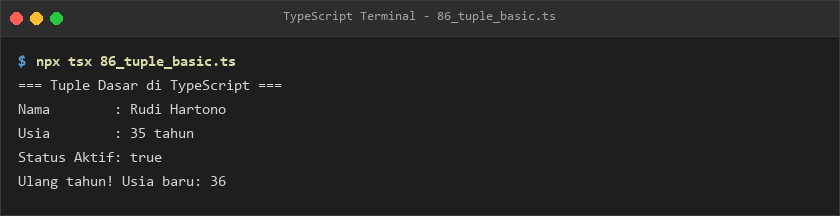

---

### Module 07: Type Aliases, Interfaces, and Enums
- **Module Directory**: [`module-07-type-aliases-interface-dan-enum`](./module-07-type-aliases-interface-dan-enum/README.md)
- **Pedagogical Scope**: Type aliases, interface declarations, optional and readonly properties, callable interface signatures, interface index signatures, inheritance via `extends`, declaration merging, type alias vs interface tradeoffs, numeric/string enums, const enums, union type alternatives, and domain data modeling.
- **Subtopics & Source Implementations**:
  - [`95_type_aliases.ts`](./module-07-type-aliases-interface-dan-enum/95_type_aliases.ts) — Defining custom naming aliases for primitives and objects.
  - [`96_interface_basic.ts`](./module-07-type-aliases-interface-dan-enum/96_interface_basic.ts) — Interface contracts defining public object shapes.
  - [`97_interface_optional_properties.ts`](./module-07-type-aliases-interface-dan-enum/97_interface_optional_properties.ts) — Optional fields within interfaces.
  - [`98_interface_readonly_properties.ts`](./module-07-type-aliases-interface-dan-enum/98_interface_readonly_properties.ts) — Immutable interface property enforcement.
  - [`99_interface_function_types.ts`](./module-07-type-aliases-interface-dan-enum/99_interface_function_types.ts) — Modeling callable function signatures with interfaces.
  - [`100_interface_index_signatures.ts`](./module-07-type-aliases-interface-dan-enum/100_interface_index_signatures.ts) — Dynamic key-value index signatures in interfaces.
  - [`101_interface_extends.ts`](./module-07-type-aliases-interface-dan-enum/101_interface_extends.ts) — Single and multi-interface inheritance via `extends`.
  - [`102_interface_declaration_merging.ts`](./module-07-type-aliases-interface-dan-enum/102_interface_declaration_merging.ts) — Merging multiple interface definitions under the same name.
  - [`103_type_alias_vs_interface.ts`](./module-07-type-aliases-interface-dan-enum/103_type_alias_vs_interface.ts) — Direct comparison of capabilities, union support, and performance.
  - [`104_enum_basic.ts`](./module-07-type-aliases-interface-dan-enum/104_enum_basic.ts) — Enumerated constants for named values.
  - [`105_numeric_enum.ts`](./module-07-type-aliases-interface-dan-enum/105_numeric_enum.ts) — Auto-incrementing and custom numeric enums.
  - [`106_string_enum.ts`](./module-07-type-aliases-interface-dan-enum/106_string_enum.ts) — String-based enums with explicit values.
  - [`107_const_enum.ts`](./module-07-type-aliases-interface-dan-enum/107_const_enum.ts) — Inlined const enums optimizing output bundle sizes.
  - [`108_enum_alternatives.ts`](./module-07-type-aliases-interface-dan-enum/108_enum_alternatives.ts) — Utilizing string literal union types as modern lightweight enum alternatives.
  - [`109_object_type_composition.ts`](./module-07-type-aliases-interface-dan-enum/109_object_type_composition.ts) — Composing complex structures from simpler types.
  - [`110_data_modeling.ts`](./module-07-type-aliases-interface-dan-enum/110_data_modeling.ts) — Comprehensive domain data modeling for e-commerce entities.
- **Verified Execution Preview**:

  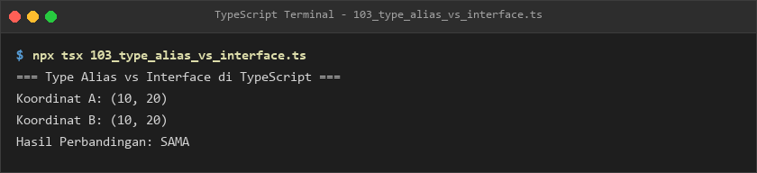

---

### Module 08: Union, Intersection, and Type Narrowing
- **Module Directory**: [`module-08-union-intersection-dan-type-narrowing`](./module-08-union-intersection-dan-type-narrowing/README.md)
- **Pedagogical Scope**: Union types (`|`), intersection types (`&`), discriminated unions with discriminator fields, narrowing strategies, user-defined type guards (`arg is Type`), property-based narrowing (`in`), class instance narrowing (`instanceof`), equality/truthiness narrowing, exhaustive checking with `never`, the `satisfies` operator, type assertions (`as`), `const` assertions, non-null assertions (`!`), and branded types.
- **Subtopics & Source Implementations**:
  - [`111_union_types.ts`](./module-08-union-intersection-dan-type-narrowing/111_union_types.ts) — Accepting multiple valid value types using `|`.
  - [`112_intersection_types.ts`](./module-08-union-intersection-dan-type-narrowing/112_intersection_types.ts) — Combining multiple types into unified contracts using `&`.
  - [`113_discriminated_unions.ts`](./module-08-union-intersection-dan-type-narrowing/113_discriminated_unions.ts) — Tagged unions with common discriminator properties.
  - [`114_type_narrowing.ts`](./module-08-union-intersection-dan-type-narrowing/114_type_narrowing.ts) — Refining broad types to specific variants through conditional checks.
  - [`115_type_guards.ts`](./module-08-union-intersection-dan-type-narrowing/115_type_guards.ts) — Utilizing native JavaScript runtime checks to narrow types.
  - [`116_custom_type_guards.ts`](./module-08-union-intersection-dan-type-narrowing/116_custom_type_guards.ts) — Authoring custom type guard functions.
  - [`117_type_predicates.ts`](./module-08-union-intersection-dan-type-narrowing/117_type_predicates.ts) — Type predicate syntax (`value is Type`) for narrowing functions.
  - [`118_in_operator_narrowing.ts`](./module-08-union-intersection-dan-type-narrowing/118_in_operator_narrowing.ts) — Narrowing object unions based on property existence.
  - [`119_instanceof_narrowing.ts`](./module-08-union-intersection-dan-type-narrowing/119_instanceof_narrowing.ts) — Narrowing class hierarchy instances.
  - [`120_equality_narrowing.ts`](./module-08-union-intersection-dan-type-narrowing/120_equality_narrowing.ts) — Narrowing using strict equality operators (`===`, `!==`).
  - [`121_truthiness_narrowing.ts`](./module-08-union-intersection-dan-type-narrowing/121_truthiness_narrowing.ts) — Filtering out `null`, `undefined`, and falsy values.
  - [`122_discriminated_switch.ts`](./module-08-union-intersection-dan-type-narrowing/122_discriminated_switch.ts) — Pattern matching discriminated unions via switch statements.
  - [`123_exhaustive_checks.ts`](./module-08-union-intersection-dan-type-narrowing/123_exhaustive_checks.ts) — Enforcing unhandled case compilation errors with `never`.
  - [`124_satisfies_operator.ts`](./module-08-union-intersection-dan-type-narrowing/124_satisfies_operator.ts) — Type matching validation while preserving exact literal types.
  - [`125_type_assertions.ts`](./module-08-union-intersection-dan-type-narrowing/125_type_assertions.ts) — Explicit type overrides with `as Type`.
  - [`126_const_assertions.ts`](./module-08-union-intersection-dan-type-narrowing/126_const_assertions.ts) — Locking deep literals into readonly primitives via `as const`.
  - [`127_non_null_assertion.ts`](./module-08-union-intersection-dan-type-narrowing/127_non_null_assertion.ts) — Asserting non-null/non-undefined status via `!`.
  - [`128_branded_types.ts`](./module-08-union-intersection-dan-type-narrowing/128_branded_types.ts) — Nominal typing simulating distinct types for primitive values.
- **Verified Execution Preview**:

  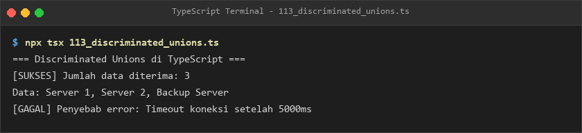

---

### Module 09: Generics and Generic Programming
- **Module Directory**: [`module-09-generics-dan-pemrograman-generik`](./module-09-generics-dan-pemrograman-generik/README.md)
- **Pedagogical Scope**: Generic functions, type parameters (`<T>`), constraints (`extends`), generic interfaces, generic classes, generic type aliases, multiple type parameters, default type arguments, key querying (`keyof`), type querying (`typeof`), indexed access types (`T[K]`), generic key constraints, generic factories, collections, callbacks, inference, variance, and generic type guards.
- **Subtopics & Source Implementations**:
  - [`129_generic_functions.ts`](./module-09-generics-dan-pemrograman-generik/129_generic_functions.ts) — Reusable functions operating across arbitrary types.
  - [`130_generic_parameters.ts`](./module-09-generics-dan-pemrograman-generik/130_generic_parameters.ts) — Managing single and multi-type parameters.
  - [`131_generic_constraints.ts`](./module-09-generics-dan-pemrograman-generik/131_generic_constraints.ts) — Restricting generic type arguments using `extends`.
  - [`132_generic_interfaces.ts`](./module-09-generics-dan-pemrograman-generik/132_generic_interfaces.ts) — Parameterized interface contracts.
  - [`133_generic_classes.ts`](./module-09-generics-dan-pemrograman-generik/133_generic_classes.ts) — Reusable generic class data structures.
  - [`134_generic_type_aliases.ts`](./module-09-generics-dan-pemrograman-generik/134_generic_type_aliases.ts) — Creating flexible parameterized type definitions.
  - [`135_multiple_type_parameters.ts`](./module-09-generics-dan-pemrograman-generik/135_multiple_type_parameters.ts) — Handling paired and triple type variables (`<T, U, V>`).
  - [`136_default_generic_parameters.ts`](./module-09-generics-dan-pemrograman-generik/136_default_generic_parameters.ts) — Specifying fallback types (`<T = string>`).
  - [`137_keyof_operator.ts`](./module-09-generics-dan-pemrograman-generik/137_keyof_operator.ts) — Extracting union of keys from object types.
  - [`138_typeof_type_operator.ts`](./module-09-generics-dan-pemrograman-generik/138_typeof_type_operator.ts) — Deriving types directly from existing runtime values.
  - [`139_indexed_access_types.ts`](./module-09-generics-dan-pemrograman-generik/139_indexed_access_types.ts) — Querying specific property types with `T[K]`.
  - [`140_generic_key_constraints.ts`](./module-09-generics-dan-pemrograman-generik/140_generic_key_constraints.ts) — Enforcing property key constraints (`<K extends keyof T>`).
  - [`141_generic_factory.ts`](./module-09-generics-dan-pemrograman-generik/141_generic_factory.ts) — Factory functions instantiating classes dynamically.
  - [`142_generic_collections.ts`](./module-09-generics-dan-pemrograman-generik/142_generic_collections.ts) — Implementing custom Queue and Stack structures.
  - [`143_generic_callbacks.ts`](./module-09-generics-dan-pemrograman-generik/143_generic_callbacks.ts) — Strongly typing callback arguments generically.
  - [`144_generic_inference.ts`](./module-09-generics-dan-pemrograman-generik/144_generic_inference.ts) — Automatic deduction of type parameters from call arguments.
  - [`145_variance_basics.ts`](./module-09-generics-dan-pemrograman-generik/145_variance_basics.ts) — Covariance and contravariance in generic subtyping.
  - [`146_generic_type_guards.ts`](./module-09-generics-dan-pemrograman-generik/146_generic_type_guards.ts) — Authoring reusable generic type-narrowing functions.
- **Verified Execution Preview**:

  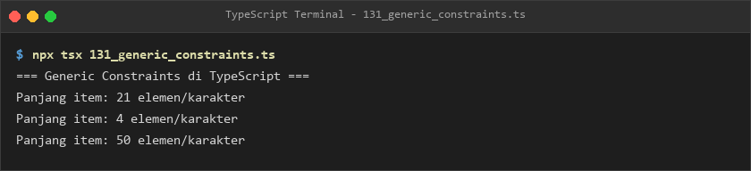

---

### Module 10: Advanced Types and Type Manipulation
- **Module Directory**: [`module-10-advanced-types`](./module-10-advanced-types/README.md)
- **Pedagogical Scope**: Conditional types (`T extends U ? X : Y`), type inference within conditional types using `infer`, mapped types, mapped type modifiers (`+readonly`, `-readonly`, `?`, `-?`), key remapping via `as`, template literal types, recursive JSON types, recursive conditional types, built-in utility types (`Partial`, `Required`, `Readonly`, `Pick`, `Omit`, `Record`, `Exclude`, `Extract`, `NonNullable`, `ReturnType`, `Parameters`, `InstanceType`, `Awaited`), and authoring custom utility types.
- **Subtopics & Source Implementations**:
  - [`147_conditional_types.ts`](./module-10-advanced-types/147_conditional_types.ts) — Type selection based on subtyping conditions.
  - [`148_conditional_type_inference.ts`](./module-10-advanced-types/148_conditional_type_inference.ts) — Extracting nested types conditionally.
  - [`149_infer_keyword.ts`](./module-10-advanced-types/149_infer_keyword.ts) — Introducing type variables for inference within condition clauses.
  - [`150_mapped_types.ts`](./module-10-advanced-types/150_mapped_types.ts) — Transforming existing object properties into new shapes.
  - [`151_mapped_type_modifiers.ts`](./module-10-advanced-types/151_mapped_type_modifiers.ts) — Adding or stripping `readonly` and optional `?` flags.
  - [`152_key_remapping.ts`](./module-10-advanced-types/152_key_remapping.ts) — Filtering and transforming property names via `as`.
  - [`153_template_literal_types.ts`](./module-10-advanced-types/153_template_literal_types.ts) — String-level type interpolation and event name schemas.
  - [`154_recursive_types.ts`](./module-10-advanced-types/154_recursive_types.ts) — Self-referential types modeling JSON trees and linked nodes.
  - [`155_recursive_conditional_types.ts`](./module-10-advanced-types/155_recursive_conditional_types.ts) — Deep flattening and path resolution at compile time.
  - [`156_utility_partial.ts`](./module-10-advanced-types/156_utility_partial.ts) — Making all properties optional via `Partial<T>`.
  - [`157_utility_required.ts`](./module-10-advanced-types/157_utility_required.ts) — Making all properties mandatory via `Required<T>`.
  - [`158_utility_readonly.ts`](./module-10-advanced-types/158_utility_readonly.ts) — Freezing properties immutably via `Readonly<T>`.
  - [`159_utility_pick.ts`](./module-10-advanced-types/159_utility_pick.ts) — Selecting a subset of properties via `Pick<T, K>`.
  - [`160_utility_omit.ts`](./module-10-advanced-types/160_utility_omit.ts) — Dropping specified properties via `Omit<T, K>`.
  - [`161_utility_record.ts`](./module-10-advanced-types/161_utility_record.ts) — Mapping discrete key unions to value types via `Record<K, T>`.
  - [`162_utility_exclude_extract.ts`](./module-10-advanced-types/162_utility_exclude_extract.ts) — Filtering union members via `Exclude` and `Extract`.
  - [`163_utility_nonnullable.ts`](./module-10-advanced-types/163_utility_nonnullable.ts) — Stripping `null` and `undefined` via `NonNullable<T>`.
  - [`164_utility_returntype.ts`](./module-10-advanced-types/164_utility_returntype.ts) — Extracting return types from function signatures via `ReturnType<T>`.
  - [`165_utility_parameters.ts`](./module-10-advanced-types/165_utility_parameters.ts) — Extracting function parameter tuples via `Parameters<T>`.
  - [`166_utility_instance_type.ts`](./module-10-advanced-types/166_utility_instance_type.ts) — Extracting instance types from constructor functions via `InstanceType<T>`.
  - [`167_utility_awaited.ts`](./module-10-advanced-types/167_utility_awaited.ts) — Unwrapping nested promises via `Awaited<T>`.
  - [`168_custom_utility_types.ts`](./module-10-advanced-types/168_custom_utility_types.ts) — Building bespoke utility types (`DeepReadonly`, `Nullable`).
- **Verified Execution Preview**:

  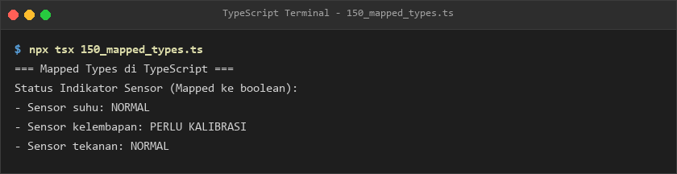

---

### Module 11: Classes and Object-Oriented Programming
- **Module Directory**: [`module-11-class-dan-object-oriented-programming`](./module-11-class-dan-object-oriented-programming/README.md)
- **Pedagogical Scope**: Class anatomy, instantiation, methods, constructors, access modifiers (`public`, `private`, `protected`), readonly class fields, parameter properties, getters/setters, static members, abstract classes, abstract methods, inheritance (`extends`), method overriding, interface implementation (`implements`), abstract classes vs interfaces, runtime polymorphism, object composition, aggregation, advanced generic classes, and parameter decorators with metadata reflection.
- **Subtopics & Source Implementations**:
  - [`169_class_basic.ts`](./module-11-class-dan-object-oriented-programming/169_class_basic.ts) — Class anatomy, property declarations, and instantiation.
  - [`170_class_properties.ts`](./module-11-class-dan-object-oriented-programming/170_class_properties.ts) — Initializing instance properties and typing fields.
  - [`171_class_methods.ts`](./module-11-class-dan-object-oriented-programming/171_class_methods.ts) — Defining instance methods and return types.
  - [`172_class_constructor.ts`](./module-11-class-dan-object-oriented-programming/172_class_constructor.ts) — Constructors and parameter passing.
  - [`173_access_modifiers.ts`](./module-11-class-dan-object-oriented-programming/173_access_modifiers.ts) — Encapsulation via `public`, `private`, and `protected`.
  - [`174_readonly_class_properties.ts`](./module-11-class-dan-object-oriented-programming/174_readonly_class_properties.ts) — Immutable class instance properties.
  - [`175_parameter_properties.ts`](./module-11-class-dan-object-oriented-programming/175_parameter_properties.ts) — Shorthand property declaration inside constructor signatures.
  - [`176_getters_setters.ts`](./module-11-class-dan-object-oriented-programming/176_getters_setters.ts) — Encapsulating private fields with `get` and `set` accessors.
  - [`177_static_members.ts`](./module-11-class-dan-object-oriented-programming/177_static_members.ts) — Class-level static properties and methods.
  - [`178_abstract_classes.ts`](./module-11-class-dan-object-oriented-programming/178_abstract_classes.ts) — Non-instantiable base blueprints using `abstract class`.
  - [`179_abstract_methods.ts`](./module-11-class-dan-object-oriented-programming/179_abstract_methods.ts) — Mandatory method signatures for derived subclasses.
  - [`180_class_inheritance.ts`](./module-11-class-dan-object-oriented-programming/180_class_inheritance.ts) — Extending parent classes and invoking `super()`.
  - [`181_method_overriding.ts`](./module-11-class-dan-object-oriented-programming/181_method_overriding.ts) — Customizing inherited method implementations.
  - [`182_implements_keyword.ts`](./module-11-class-dan-object-oriented-programming/182_implements_keyword.ts) — Enforcing interface contracts on class definitions.
  - [`183_abstract_vs_interface.ts`](./module-11-class-dan-object-oriented-programming/183_abstract_vs_interface.ts) — Architectural comparison of abstract classes and interfaces.
  - [`184_polymorphism.ts`](./module-11-class-dan-object-oriented-programming/184_polymorphism.ts) — Uniform treatment of diverse subclass instances.
  - [`185_composition.ts`](./module-11-class-dan-object-oriented-programming/185_composition.ts) — Favoring object composition over class inheritance.
  - [`186_aggregation.ts`](./module-11-class-dan-object-oriented-programming/186_aggregation.ts) — Modeling weak "has-a" relationships between classes.
  - [`187_generic_classes_advanced.ts`](./module-11-class-dan-object-oriented-programming/187_generic_classes_advanced.ts) — Generic repositories and multi-type data stores.
  - [`188_parameter_decorators.ts`](./module-11-class-dan-object-oriented-programming/188_parameter_decorators.ts) — Applying decorators and reflecting metadata.
- **Verified Execution Preview**:

  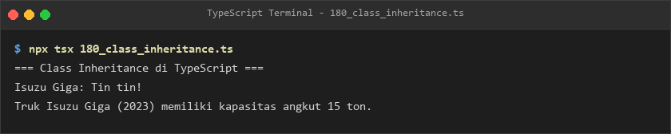

---

### Module 12: Modules and Project Management
- **Module Directory**: [`module-12-modules-dan-pengelolaan-proyek`](./module-12-modules-dan-pengelolaan-proyek/README.md)
- **Pedagogical Scope**: ECMAScript Modules (named and default exports/imports, namespace imports, re-exports), dynamic `import()`, module resolution algorithms, module augmentation, declaration merging, ambient modules (`declare module`), type declaration files (`.d.ts`), global declarations (`declare global`), legacy namespaces, project references, path mapping aliases, and compiler configuration.
- **Subtopics & Source Implementations**:
  - [`189_es_module_exports.ts`](./module-12-modules-dan-pengelolaan-proyek/189_es_module_exports.ts) — Exporting named variables, types, and functions.
  - [`190_default_exports.ts`](./module-12-modules-dan-pengelolaan-proyek/190_default_exports.ts) — Defining primary default module exports.
  - [`191_named_imports.ts`](./module-12-modules-dan-pengelolaan-proyek/191_named_imports.ts) — Importing specific named members.
  - [`192_default_imports.ts`](./module-12-modules-dan-pengelolaan-proyek/192_default_imports.ts) — Consuming default module exports.
  - [`193_namespace_imports.ts`](./module-12-modules-dan-pengelolaan-proyek/193_namespace_imports.ts) — Bundling module contents under namespace aliases (`import * as`).
  - [`194_re_exports.ts`](./module-12-modules-dan-pengelolaan-proyek/194_re_exports.ts) — Aggregating and re-exporting modules in barrel files.
  - [`195_dynamic_import.ts`](./module-12-modules-dan-pengelolaan-proyek/195_dynamic_import.ts) — Asynchronous on-demand module loading via `import()`.
  - [`196_module_resolution.ts`](./module-12-modules-dan-pengelolaan-proyek/196_module_resolution.ts) — Classic vs Node vs Bundler resolution mechanisms.
  - [`197_module_augmentation.ts`](./module-12-modules-dan-pengelolaan-proyek/197_module_augmentation.ts) — Extending existing external third-party module types.
  - [`198_declaration_merging.ts`](./module-12-modules-dan-pengelolaan-proyek/198_declaration_merging.ts) — Advanced declaration merging patterns.
  - [`199_ambient_modules.ts`](./module-12-modules-dan-pengelolaan-proyek/199_ambient_modules.ts) — Typing untyped JavaScript libraries with `declare module`.
  - [`200_declaration_files.ts`](./module-12-modules-dan-pengelolaan-proyek/200_declaration_files.ts) — Structuring `.d.ts` type definition files.
  - [`201_global_declarations.ts`](./module-12-modules-dan-pengelolaan-proyek/201_global_declarations.ts) — Extending global scope types via `declare global`.
  - [`202_namespace_basic.ts`](./module-12-modules-dan-pengelolaan-proyek/202_namespace_basic.ts) — TypeScript internal namespaces and legacy scoping.
  - [`203_project_references.ts`](./module-12-modules-dan-pengelolaan-proyek/203_project_references.ts) — Monorepo builds and composite project configurations.
  - [`204_path_aliases.ts`](./module-12-modules-dan-pengelolaan-proyek/204_path_aliases.ts) — Cleaner imports using tsconfig `paths` aliases (`@/`).
  - [`205_tsconfig_basic.ts`](./module-12-modules-dan-pengelolaan-proyek/205_tsconfig_basic.ts) — Core options in `tsconfig.json`.
  - [`206_compiler_options.ts`](./module-12-modules-dan-pengelolaan-proyek/206_compiler_options.ts) — Advanced compiler flags (`strict`, `noImplicitAny`, `skipLibCheck`).
- **Verified Execution Preview**:

  

---

### Module 13: Asynchronous Programming and Error Handling
- **Module Directory**: [`module-13-asynchronous-programming-dan-error-handling`](./module-13-asynchronous-programming-dan-error-handling/README.md)
- **Pedagogical Scope**: Asynchronous callbacks, Promises, Promise typing (`Promise<T>`), promise chaining with `.then()`/`.catch()`, concurrent combinators (`Promise.all`, `allSettled`, `race`), modern `async/await`, async error handling with `try/catch/finally`, async return types, generic promises, async iterators/generators (`for await...of`), `AbortController`, Fetch API (GET/POST requests with typed DTOs), exponential retry patterns, custom domain errors, and the functional `Result<T, E>` pattern.
- **Subtopics & Source Implementations**:
  - [`207_callback_functions.ts`](./module-13-asynchronous-programming-dan-error-handling/207_callback_functions.ts) — Asynchronous callback execution and callback hell pitfalls.
  - [`208_promise_basic.ts`](./module-13-asynchronous-programming-dan-error-handling/208_promise_basic.ts) — Creating, resolving, and rejecting Promises.
  - [`209_promise_types.ts`](./module-13-asynchronous-programming-dan-error-handling/209_promise_types.ts) — Strongly typing Promise resolutions and rejections.
  - [`210_promise_then_catch.ts`](./module-13-asynchronous-programming-dan-error-handling/210_promise_then_catch.ts) — Chaining asynchronous tasks with `.then()`, `.catch()`, and `.finally()`.
  - [`211_promise_all.ts`](./module-13-asynchronous-programming-dan-error-handling/211_promise_all.ts) — Concurrent promise execution failing fast on any rejection.
  - [`212_promise_all_settled.ts`](./module-13-asynchronous-programming-dan-error-handling/212_promise_all_settled.ts) — Awaiting multiple promises while inspecting individual status.
  - [`213_promise_race.ts`](./module-13-asynchronous-programming-dan-error-handling/213_promise_race.ts) — Returning the earliest settled promise.
  - [`214_async_functions.ts`](./module-13-asynchronous-programming-dan-error-handling/214_async_functions.ts) — Modern `async` function syntax and return behavior.
  - [`215_await_keyword.ts`](./module-13-asynchronous-programming-dan-error-handling/215_await_keyword.ts) — Sequential asynchronous execution with `await`.
  - [`216_async_error_handling.ts`](./module-13-asynchronous-programming-dan-error-handling/216_async_error_handling.ts) — Handling async errors safely using `try...catch` blocks.
  - [`217_async_return_types.ts`](./module-13-asynchronous-programming-dan-error-handling/217_async_return_types.ts) — Enforcing explicit `Promise<T>` return types.
  - [`218_generic_promises.ts`](./module-13-asynchronous-programming-dan-error-handling/218_generic_promises.ts) — Authoring reusable generic asynchronous utilities.
  - [`219_async_iterators.ts`](./module-13-asynchronous-programming-dan-error-handling/219_async_iterators.ts) — Consuming asynchronous data streams with `Symbol.asyncIterator`.
  - [`220_async_generators.ts`](./module-13-asynchronous-programming-dan-error-handling/220_async_generators.ts) — Generating paginated stream items via `async function*`.
  - [`221_abort_controller.ts`](./module-13-asynchronous-programming-dan-error-handling/221_abort_controller.ts) — Cancelling long-running network operations with `AbortSignal`.
  - [`222_fetch_api.ts`](./module-13-asynchronous-programming-dan-error-handling/222_fetch_api.ts) — Typed HTTP requests using native Fetch.
  - [`223_fetch_get_request.ts`](./module-13-asynchronous-programming-dan-error-handling/223_fetch_get_request.ts) — Fetching and deserializing JSON payloads into typed interfaces.
  - [`224_fetch_post_request.ts`](./module-13-asynchronous-programming-dan-error-handling/224_fetch_post_request.ts) — Submitting typed POST request bodies.
  - [`225_api_response_types.ts`](./module-13-asynchronous-programming-dan-error-handling/225_api_response_types.ts) — Generic response envelopes (`ApiResponse<T>`).
  - [`226_async_retry.ts`](./module-13-asynchronous-programming-dan-error-handling/226_async_retry.ts) — Exponential backoff retry strategies for flaky I/O.
  - [`227_error_classification.ts`](./module-13-asynchronous-programming-dan-error-handling/227_error_classification.ts) — Defining custom domain error class hierarchies.
  - [`228_result_type_pattern.ts`](./module-13-asynchronous-programming-dan-error-handling/228_result_type_pattern.ts) — Functional error handling using `Result<T, E> = Ok<T> | Err<E>`.
- **Verified Execution Preview**:

  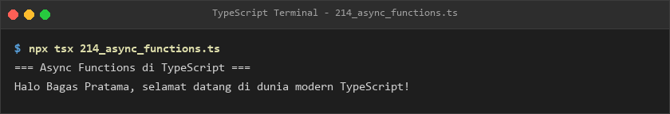

---

### Module 14: Browser DOM and Frontend TypeScript
- **Module Directory**: [`module-14-browser-dom-dan-frontend-typescript`](./module-14-browser-dom-dan-frontend-typescript/README.md)
- **Pedagogical Scope**: DOM element querying, typed DOM element hierarchies (`HTMLElement`, `HTMLInputElement`, `HTMLButtonElement`), text/HTML manipulation, attribute binding, CSS class management, element creation, strongly typed event listeners (`MouseEvent`, `KeyboardEvent`), form input types, programmatic client-side form validation, `FormData`, Web Storage (`localStorage`, `sessionStorage`), URL APIs, `IntersectionObserver`, `MutationObserver`, Web Workers, WebSockets, HTML5 Canvas, and native browser ES modules.
- **Subtopics & Source Implementations**:
  - [`229_dom_element_selection.ts`](./module-14-browser-dom-dan-frontend-typescript/229_dom_element_selection.ts) — Querying elements via `querySelector` and `getElementById`.
  - [`230_dom_element_types.ts`](./module-14-browser-dom-dan-frontend-typescript/230_dom_element_types.ts) — Casting and verifying typed HTML element specializations.
  - [`231_dom_text_content.ts`](./module-14-browser-dom-dan-frontend-typescript/231_dom_text_content.ts) — Updating text content securely avoiding XSS risks.
  - [`232_dom_attributes.ts`](./module-14-browser-dom-dan-frontend-typescript/232_dom_attributes.ts) — Reading and setting element attributes safely.
  - [`233_dom_class_list.ts`](./module-14-browser-dom-dan-frontend-typescript/233_dom_class_list.ts) — Managing CSS classes using `classList`.
  - [`234_dom_create_element.ts`](./module-14-browser-dom-dan-frontend-typescript/234_dom_create_element.ts) — Dynamically creating and appending DOM tree elements.
  - [`235_dom_event_listener.ts`](./module-14-browser-dom-dan-frontend-typescript/235_dom_event_listener.ts) — Registering typed event callbacks.
  - [`236_dom_event_types.ts`](./module-14-browser-dom-dan-frontend-typescript/236_dom_event_types.ts) — Handling specific event properties (`MouseEvent`, `KeyboardEvent`).
  - [`237_form_input_types.ts`](./module-14-browser-dom-dan-frontend-typescript/237_form_input_types.ts) — Reading typed values from text, number, and checkbox inputs.
  - [`238_form_validation.ts`](./module-14-browser-dom-dan-frontend-typescript/238_form_validation.ts) — Client-side form validation logic with error state tracking.
  - [`239_form_data.ts`](./module-14-browser-dom-dan-frontend-typescript/239_form_data.ts) — Serializing form entries with the `FormData` API.
  - [`240_local_storage.ts`](./module-14-browser-dom-dan-frontend-typescript/240_local_storage.ts) — Type-safe wrapper for persistent `localStorage`.
  - [`241_session_storage.ts`](./module-14-browser-dom-dan-frontend-typescript/241_session_storage.ts) — Session-scoped data caching via `sessionStorage`.
  - [`242_url_api.ts`](./module-14-browser-dom-dan-frontend-typescript/242_url_api.ts) — Manipulating query strings with `URL` and `URLSearchParams`.
  - [`243_intersection_observer.ts`](./module-14-browser-dom-dan-frontend-typescript/243_intersection_observer.ts) — Observing element visibility for lazy loading.
  - [`244_mutation_observer.ts`](./module-14-browser-dom-dan-frontend-typescript/244_mutation_observer.ts) — Listening to DOM subtree alterations.
  - [`245_web_workers.ts`](./module-14-browser-dom-dan-frontend-typescript/245_web_workers.ts) — Offloading CPU tasks to background Web Workers with typed messages.
  - [`246_web_socket.ts`](./module-14-browser-dom-dan-frontend-typescript/246_web_socket.ts) — Real-time bidirectional client communication over WebSockets.
  - [`247_canvas_api.ts`](./module-14-browser-dom-dan-frontend-typescript/247_canvas_api.ts) — 2D graphics rendering via `HTMLCanvasElement` context.
  - [`248_browser_modules.ts`](./module-14-browser-dom-dan-frontend-typescript/248_browser_modules.ts) — Loading native ES modules in modern browser runtimes.
- **Verified Execution Preview**:

  

---

### Module 15: Node.js and Backend TypeScript
- **Module Directory**: [`module-15-node-js-dan-backend-typescript`](./module-15-node-js-dan-backend-typescript/README.md)
- **Pedagogical Scope**: Node.js backend execution, process object inspection, CLI argument parsing (`process.argv`), asynchronous file system I/O with `fs/promises`, cross-platform path resolution via `path`, environment variable handling (`process.env`), native HTTP server creation (`http.createServer`), HTTP client requests, stream pipelines (`Readable`, `Writable`, `pipe`), event-driven architecture using `EventEmitter`, cryptographic hashing and UUID generation via `crypto`, worker threads, child process execution, `@types/node` definitions, and CommonJS vs ESM module interoperability.
- **Subtopics & Source Implementations**:
  - [`249_node_hello_world.ts`](./module-15-node-js-dan-backend-typescript/249_node_hello_world.ts) — Node.js runtime environment verification and global objects.
  - [`250_node_process.ts`](./module-15-node-js-dan-backend-typescript/250_node_process.ts) — Inspecting platform metrics, memory usage, and PID.
  - [`251_node_command_line.ts`](./module-15-node-js-dan-backend-typescript/251_node_command_line.ts) — Parsing CLI flags and positional arguments from `process.argv`.
  - [`252_node_file_read.ts`](./module-15-node-js-dan-backend-typescript/252_node_file_read.ts) — Asynchronous file reading using `fs/promises`.
  - [`253_node_file_write.ts`](./module-15-node-js-dan-backend-typescript/253_node_file_write.ts) — Writing and appending typed data to disk files.
  - [`254_node_path.ts`](./module-15-node-js-dan-backend-typescript/254_node_path.ts) — Resolving and normalizing cross-platform file paths with `path`.
  - [`255_node_environment.ts`](./module-15-node-js-dan-backend-typescript/255_node_environment.ts) — Reading and validating environment variables from `process.env`.
  - [`256_node_http_server.ts`](./module-15-node-js-dan-backend-typescript/256_node_http_server.ts) — Creating a typed HTTP server using native Node.js APIs.
  - [`257_node_http_client.ts`](./module-15-node-js-dan-backend-typescript/257_node_http_client.ts) — Issuing outgoing HTTP requests with native modules.
  - [`258_node_streams.ts`](./module-15-node-js-dan-backend-typescript/258_node_streams.ts) — Pipelining large data chunks using Readable and Writable streams.
  - [`259_node_events.ts`](./module-15-node-js-dan-backend-typescript/259_node_events.ts) — Building typed event-driven workflows with `EventEmitter`.
  - [`260_node_crypto.ts`](./module-15-node-js-dan-backend-typescript/260_node_crypto.ts) — Generating SHA-256 hashes, random bytes, and UUIDs with `crypto`.
  - [`261_node_worker_threads.ts`](./module-15-node-js-dan-backend-typescript/261_node_worker_threads.ts) — Parallel CPU computations with Node.js worker threads.
  - [`262_node_child_process.ts`](./module-15-node-js-dan-backend-typescript/262_node_child_process.ts) — Spawning and executing OS shell commands via `child_process`.
  - [`263_node_types.ts`](./module-15-node-js-dan-backend-typescript/263_node_types.ts) — Leveraging `@types/node` for Buffers and system interfaces.
  - [`264_node_module_system.ts`](./module-15-node-js-dan-backend-typescript/264_node_module_system.ts) — Comparing CommonJS `require()` and ES Modules `import`.
- **Verified Execution Preview**:

  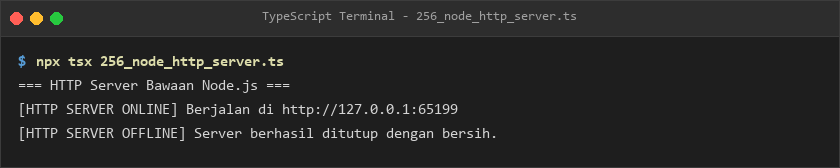

---

### Module 16: APIs, Databases, and Frameworks
- **Module Directory**: [`module-16-api-database-dan-framework`](./module-16-api-database-dan-framework/README.md)
- **Pedagogical Scope**: REST API contracts (DTOs & standardized envelopes), input validation, RFC 7807 problem details, typed Express.js application servers, route modularization (`Router`), custom middleware pipelines (structured logging, auth guards), controller separation, complete CRUD REST APIs, database connection pooling concepts, repository pattern, SQL query result typing, Prisma ORM client concepts, Prisma CRUD, schema validation with Zod (`z.infer`), NestJS decorator controllers, NestJS services, dependency injection, and NestJS REST architectures.
- **Subtopics & Source Implementations**:
  - [`265_rest_api_types.ts`](./module-16-api-database-dan-framework/265_rest_api_types.ts) — Modeling DTOs and standard REST API response envelopes.
  - [`266_api_request_validation.ts`](./module-16-api-database-dan-framework/266_api_request_validation.ts) — Validating request bodies and query parameters.
  - [`267_api_error_responses.ts`](./module-16-api-database-dan-framework/267_api_error_responses.ts) — Formatting standard API error payloads following RFC 7807.
  - [`268_express_server.ts`](./module-16-api-database-dan-framework/268_express_server.ts) — Initializing a typed web server with Express.js.
  - [`269_express_routes.ts`](./module-16-api-database-dan-framework/269_express_routes.ts) — Modularizing endpoint definitions with `express.Router()`.
  - [`270_express_middleware.ts`](./module-16-api-database-dan-framework/270_express_middleware.ts) — Implementing typed middleware for request logging and guards.
  - [`271_express_controllers.ts`](./module-16-api-database-dan-framework/271_express_controllers.ts) — Separating request routing from business controller logic.
  - [`272_express_rest_api.ts`](./module-16-api-database-dan-framework/272_express_rest_api.ts) — Building a comprehensive CRUD REST API service with Express.
  - [`273_database_connection.ts`](./module-16-api-database-dan-framework/273_database_connection.ts) — Managing typed database connection pools and lifecycle.
  - [`274_database_repository.ts`](./module-16-api-database-dan-framework/274_database_repository.ts) — Implementing the Repository Pattern for data abstraction.
  - [`275_sql_query_types.ts`](./module-16-api-database-dan-framework/275_sql_query_types.ts) — Typing SQL relational table records and query results.
  - [`276_prisma_client.ts`](./module-16-api-database-dan-framework/276_prisma_client.ts) — Interfacing with Prisma ORM generated types and client.
  - [`277_prisma_crud.ts`](./module-16-api-database-dan-framework/277_prisma_crud.ts) — Executing type-safe CRUD operations with Prisma.
  - [`278_zod_validation.ts`](./module-16-api-database-dan-framework/278_zod_validation.ts) — Runtime schema validation and TypeScript type inference via `z.infer`.
  - [`279_nestjs_controller.ts`](./module-16-api-database-dan-framework/279_nestjs_controller.ts) — NestJS controller architecture with class decorators (`@Controller`, `@Get`).
  - [`280_nestjs_service.ts`](./module-16-api-database-dan-framework/280_nestjs_service.ts) — Injectable business services using `@Injectable()`.
  - [`281_nestjs_dependency_injection.ts`](./module-16-api-database-dan-framework/281_nestjs_dependency_injection.ts) — Inversion of Control and dependency injection in NestJS.
  - [`282_nestjs_rest_api.ts`](./module-16-api-database-dan-framework/282_nestjs_rest_api.ts) — End-to-end NestJS modular REST API architecture.
- **Verified Execution Preview**:

  

---

### Module 17: Testing, Tooling, and Application Security
- **Module Directory**: [`module-17-testing-tooling-dan-keamanan`](./module-17-testing-tooling-dan-keamanan/README.md)
- **Pedagogical Scope**: Unit testing, testing with Vitest, Jest matchers, mock functions (spies and stubs), integration testing, REST API endpoint testing, test fixtures and mock data factories, compile-time type testing (`expectTypeOf`), code quality enforcement with ESLint, automatic formatting with Prettier, npm package management, strictly typed environment variables, secure input validation (directory traversal prevention), XSS defense, JWT authentication data modeling, and Role-Based Access Control (RBAC).
- **Subtopics & Source Implementations**:
  - [`283_typescript_unit_testing.ts`](./module-17-testing-tooling-dan-keamanan/283_typescript_unit_testing.ts) — Unit testing fundamentals and assertion verification.
  - [`284_vitest_basic.ts`](./module-17-testing-tooling-dan-keamanan/284_vitest_basic.ts) — Fast modern testing using Vitest runner.
  - [`285_jest_basic.ts`](./module-17-testing-tooling-dan-keamanan/285_jest_basic.ts) — Test suites, assertions, and matchers with Jest.
  - [`286_mock_functions.ts`](./module-17-testing-tooling-dan-keamanan/286_mock_functions.ts) — Isolating dependencies with function spies, mocks, and stubs.
  - [`287_integration_testing.ts`](./module-17-testing-tooling-dan-keamanan/287_integration_testing.ts) — Testing multi-component integration workflows.
  - [`288_api_testing.ts`](./module-17-testing-tooling-dan-keamanan/288_api_testing.ts) — Automated HTTP endpoint testing and status validation.
  - [`289_test_fixtures.ts`](./module-17-testing-tooling-dan-keamanan/289_test_fixtures.ts) — Generating deterministic test fixtures and mock factories.
  - [`290_type_testing.ts`](./module-17-testing-tooling-dan-keamanan/290_type_testing.ts) — Compile-time static type testing and type equality assertions.
  - [`291_eslint_typescript.ts`](./module-17-testing-tooling-dan-keamanan/291_eslint_typescript.ts) — Static code analysis and rule enforcement with ESLint.
  - [`292_prettier_typescript.ts`](./module-17-testing-tooling-dan-keamanan/292_prettier_typescript.ts) — Consistent code formatting with Prettier.
  - [`293_npm_package_management.ts`](./module-17-testing-tooling-dan-keamanan/293_npm_package_management.ts) — Managing semver dependencies and lockfile integrity.
  - [`294_environment_configuration.ts`](./module-17-testing-tooling-dan-keamanan/294_environment_configuration.ts) — Type-safe environment variable validation schemas.
  - [`295_secure_input_validation.ts`](./module-17-testing-tooling-dan-keamanan/295_secure_input_validation.ts) — Defensive input sanitization preventing path traversal attacks.
  - [`296_xss_prevention.ts`](./module-17-testing-tooling-dan-keamanan/296_xss_prevention.ts) — HTML escaping and Cross-Site Scripting (XSS) mitigation.
  - [`297_authentication_types.ts`](./module-17-testing-tooling-dan-keamanan/297_authentication_types.ts) — Modeling JWT token payloads, claims, and verification contracts.
  - [`298_authorization_types.ts`](./module-17-testing-tooling-dan-keamanan/298_authorization_types.ts) — Implementing Role-Based Access Control (RBAC) permission guards.
- **Verified Execution Preview**:

  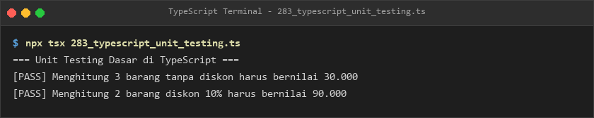

---

### Module 18: Practical Capstone Projects
- **Module Directory**: [`module-18-proyek-praktik-typescript`](./module-18-proyek-praktik-typescript/README.md)
- **Pedagogical Scope**: Comprehensive synthesis of all 17 preceding curriculum modules into two complete, production-grade applications demonstrating Clean Architecture, domain entity modeling, computational algorithms, state mutation guards, and error resilience.
- **Subtopics & Source Implementations**:
  - [`299_student_management_project.ts`](./module-18-proyek-praktik-typescript/299_student_management_project.ts) — **Capstone Project 1: Student Management System**. Implements an academic grading and transcript platform featuring OOP classes, typed student entities, credit weight (SKS) conversions, Grade Point Average (GPA / IPK) calculations, graduation honors evaluation (*Cumlaude*, *Very Satisfactory*, *Satisfactory*), and automated academic transcript printing.
  - [`300_fullstack_task_manager_project.ts`](./module-18-proyek-praktik-typescript/300_fullstack_task_manager_project.ts) — **Capstone Project 2: Full-Stack Task Manager**. Implements an enterprise layered architecture (Controller, Service, Repository, DTOs, and Analytics Dashboard). Features discrete status enums (`TODO`, `IN_PROGRESS`, `IN_REVIEW`, `DONE`), functional `Result<T, E>` error handling, business mutation guards preventing invalid state transitions, input validation, and sprint productivity analytics.
- **Verified Execution Previews**:

  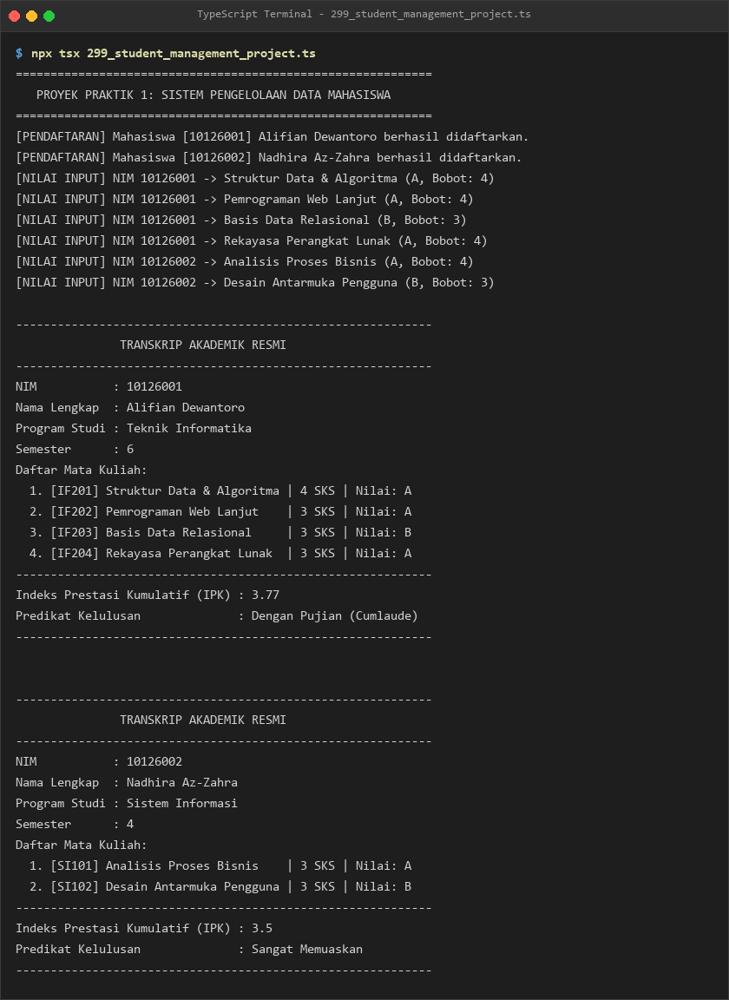

  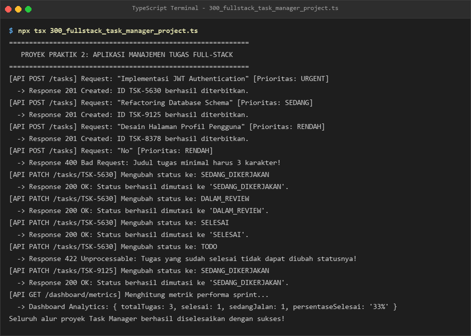

---

## Exercises & Practice

The curriculum integrates practical programming challenges at every stage of the learning progression. Rather than abstract theoretical snippets, each of the 300 lesson files is structured as an interactive, executable practice implementation:

- **Self-Contained Coding Scenarios**: Each lesson file contains a concrete problem statement, typed data contracts, implementation logic, and console verification displays.
- **Progressive Problem Solving**: Lessons begin with guided demonstrations and progress into algorithmic implementations, such as prime number sieves ([`57_prime_number.ts`](./module-04-perulangan-dan-kontrol-alur/57_prime_number.ts)), Fibonacci series generators ([`58_fibonacci_loop.ts`](./module-04-perulangan-dan-kontrol-alur/58_fibonacci_loop.ts)), generic queue and stack collections ([`142_generic_collections.ts`](./module-09-generics-dan-pemrograman-generik/142_generic_collections.ts)), and custom utility type builders ([`168_custom_utility_types.ts`](./module-10-advanced-types/168_custom_utility_types.ts)).
- **Integrated Capstone Challenges**:
  - **Academic Transcript & GPA Engine** ([`299_student_management_project.ts`](./module-18-proyek-praktik-typescript/299_student_management_project.ts)): Practice modeling complex entity relationships, credit-weighted averages, and formal formatting.
  - **Layered Clean Architecture Task Manager** ([`300_fullstack_task_manager_project.ts`](./module-18-proyek-praktik-typescript/300_fullstack_task_manager_project.ts)): Practice structuring controllers, service layers, in-memory repository abstractions, functional error modeling with `Result<T, E>`, and data metrics aggregation.

---

## Code Execution & Expected Output

All lesson files are designed to be executed directly from the project root using the `tsx` runtime. This eliminates the need for separate manual build steps or temporary JavaScript artifact folders.

### Universal Execution Command
Run any lesson by providing its relative path to `npx tsx`:
```bash
npx tsx <module-folder>/<lesson-file>.ts
```

*Example:*
```bash
npx tsx module-08-union-intersection-dan-type-narrowing/113_discriminated_unions.ts
```

### Standardized Output Anatomy
Every lesson outputs a clean, structured terminal transcript demarcated by descriptive headers:
```text
=== Discriminated Unions pada TypeScript ===
Memproses Notifikasi Email: Mengirim email ke user@example.com dengan subjek 'Halo'
Memproses Notifikasi SMS: Mengirim SMS ke +628123456789
Memproses Push Notification: Push ke device dev-9876
```

### Verifying Results
To confirm your code produces the intended output, compare your local terminal stdout against the verified capture located in that module's `output/` directory:
```bash
# Path pattern to official execution capture
<module-folder>/output/<lesson-file>.png
```

---

## Learning Resources & References

Explore these official references and documentation to deepen your knowledge of TypeScript and related technologies:

- **Official TypeScript Documentation**: [typescriptlang.org/docs](https://www.typescriptlang.org/docs/)
- **The TypeScript Handbook**: [typescriptlang.org/docs/handbook/intro.html](https://www.typescriptlang.org/docs/handbook/intro.html)
- **TypeScript Official GitHub Repository & Issue Tracker**: [github.com/microsoft/TypeScript](https://github.com/microsoft/TypeScript)
- **Node.js Official Documentation**: [nodejs.org/en/docs](https://nodejs.org/en/docs/)
- **Express.js Documentation**: [expressjs.com](https://expressjs.com/)
- **Zod Schema Validation Documentation**: [zod.dev](https://zod.dev/)
- **Vitest Testing Guide**: [vitest.dev/guide](https://vitest.dev/guide/)
- **Jest Testing Framework Documentation**: [jestjs.io/docs/getting-started](https://jestjs.io/docs/getting-started)

---

## Troubleshooting

Common environment and execution questions, along with their verified solutions:

### 1. Windows PowerShell Script Execution Policy Error (`PSSecurityException`)
**Symptom:** Running `npx tsx ...` in PowerShell fails with:
`File C:\Program Files\nodejs\npx.ps1 cannot be loaded because running scripts is disabled on this system.`

**Solution:**
On Windows, PowerShell restricts unsigned script execution by default. You can resolve this using either of the following approaches:
- **Option A (Invoke through cmd.exe or npx.cmd):**
  ```powershell
  cmd /c npx tsx <module-folder>/<lesson-file>.ts
  ```
  or:
  ```powershell
  npx.cmd tsx <module-folder>/<lesson-file>.ts
  ```
- **Option B (Update PowerShell Execution Policy for Current User):**
  ```powershell
  Set-ExecutionPolicy -ExecutionPolicy RemoteSigned -Scope CurrentUser
  ```

### 2. Missing Dependencies Error (`Cannot find package 'tsx'` or `Cannot find module 'express'`)
**Symptom:** Running a lesson throws `ERR_MODULE_NOT_FOUND` for packages like `tsx`, `express`, or `zod`.

**Solution:**
Ensure you have installed the repository dependencies from the root directory:
```bash
npm install
```

### 3. Module Resolution & TypeScript Decorator Warnings
**Symptom:** Experimental decorator warnings or path resolution issues during custom modifications.

**Solution:**
The root [`tsconfig.json`](./tsconfig.json) is already pre-configured with `experimentalDecorators: true`, `emitDecoratorMetadata: true`, and `moduleResolution: "bundler"`. Ensure your IDE is using the workspace's TypeScript version located in `node_modules/typescript`.

---

## License

Please see the [LICENSE](./LICENSE) file for the terms and conditions governing the use, modification, and distribution of this project.

---

## Author & Contact

**Yohanes Dimas Pratama**

- GitHub: [github.com/weztcy](https://github.com/weztcy)
- Portfolio: [dimaspratama.vercel.app](https://dimaspratama.vercel.app)
- LinkedIn: [linkedin.com/in/yohanes-dimas](https://www.linkedin.com/in/yohanes-dimas)
