# Modul 5: Fungsi dan Parameter

## A. Judul Modul
- **Nomor Modul:** 05
- **Nama Modul:** Fungsi dan Parameter
- **Ruang Lingkup:** Deklarasi fungsi standar (*function declaration*), ekspresi fungsi (*function expression*), fungsi panah (*arrow function*), validasi parameter terketik, tipe kembalian (*return types*), parameter opsional (`?`), nilai bawaan (*default parameters*), parameter sisa (*rest parameters*), kelebihan beban fungsi (*function overloads*), alias tipe fungsi (*function type alias*), fungsi callback, fungsi tingkat tinggi (*higher-order functions*), fungsi rekursif, pengenalan fungsi generik, cakupan variabel (*scope*), *closures*, parameter kontekstual `this`, serta fungsi penegasan tipe (*assertion functions*).
- **Tujuan Pembelajaran:** Menguasai seluruh arsitektur pembuatan dan eksekusi fungsi di TypeScript, menjamin integritas data parameter dan return value secara statis, serta mampu mengimplementasikan paradigma fungsional tingkat lanjut secara aman dan terstruktur.

---

## B. Daftar Materi atau Submodul
59. [`59_function_declaration.ts`](59_function_declaration.ts) : Function declaration
60. [`60_function_expression.ts`](60_function_expression.ts) : Function expression
61. [`61_arrow_function.ts`](61_arrow_function.ts) : Arrow function
62. [`62_function_parameters.ts`](62_function_parameters.ts) : Parameter fungsi
63. [`63_function_return_types.ts`](63_function_return_types.ts) : Return types
64. [`64_optional_parameters.ts`](64_optional_parameters.ts) : Optional parameters
65. [`65_default_parameters.ts`](65_default_parameters.ts) : Default parameters
66. [`66_rest_parameters.ts`](66_rest_parameters.ts) : Rest parameters
67. [`67_function_overloads.ts`](67_function_overloads.ts) : Function overloads
68. [`68_function_type_alias.ts`](68_function_type_alias.ts) : Function type aliases
69. [`69_callback_functions.ts`](69_callback_functions.ts) : Callback functions
70. [`70_higher_order_functions.ts`](70_higher_order_functions.ts) : Higher-order functions
71. [`71_recursive_functions.ts`](71_recursive_functions.ts) : Fungsi rekursif
72. [`72_generic_functions_intro.ts`](72_generic_functions_intro.ts) : Pengenalan generic functions
73. [`73_function_scope.ts`](73_function_scope.ts) : Scope fungsi
74. [`74_closures.ts`](74_closures.ts) : Closures
75. [`75_this_parameter.ts`](75_this_parameter.ts) : Parameter `this` pada fungsi
76. [`76_assertion_functions.ts`](76_assertion_functions.ts) : Assertion functions

---

## C. Penjelasan Setiap Submodul

### 59. 59_function_declaration.ts
- **Tujuan:** Membuat fungsi deklarasi standar dengan parameter dan tipe kembalian terketik.
- **Konsep Utama:** Sintaks `function` dan penegakan tipe data numerik.
- **Penjelasan Source Code:** Menghitung luas persegi panjang dari parameter panjang dan lebar.
- **Cara Menjalankan:**
  ```bash
  npx tsx 59_function_declaration.ts
  ```
- **Hasil yang Diharapkan:** Nilai dimensi dan hasil perhitungan luas persegi panjang tercetak.
- **Screenshot Hasil Eksekusi:**
  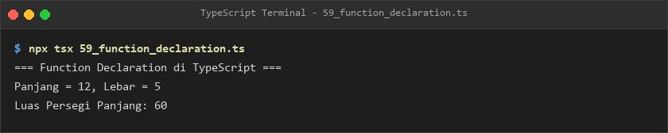
- **Lokasi Source Code:** [59_function_declaration.ts](59_function_declaration.ts)

### 60. 60_function_expression.ts
- **Tujuan:** Menyimpan fungsi anonim ke dalam variabel konstan dengan tipe statis.
- **Konsep Utama:** Ekspresi fungsi dan konversi nilai matematis.
- **Penjelasan Source Code:** Mengonversi suhu dari satuan Celsius ke Fahrenheit menggunakan fungsi ekspresi.
- **Cara Menjalankan:**
  ```bash
  npx tsx 60_function_expression.ts
  ```
- **Hasil yang Diharapkan:** Hasil konversi suhu tercetak ke terminal.
- **Screenshot Hasil Eksekusi:**
  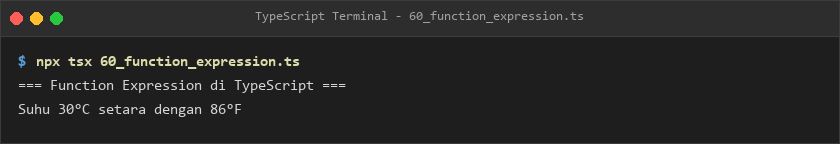
- **Lokasi Source Code:** [60_function_expression.ts](60_function_expression.ts)

### 61. 61_arrow_function.ts
- **Tujuan:** Menggunakan sintaks panah (*arrow function*) ringkas untuk transformasi nilai.
- **Konsep Utama:** Arrow function satu baris implisit dan fungsi berbadan blok kurung kurawal.
- **Penjelasan Source Code:** Menghitung perkalian dua kali lipat dan perhitungan potongan diskon barang.
- **Cara Menjalankan:**
  ```bash
  npx tsx 61_arrow_function.ts
  ```
- **Hasil yang Diharapkan:** Hasil penggandaan angka dan harga setelah diskon ditampilkan.
- **Screenshot Hasil Eksekusi:**
  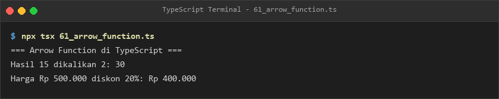
- **Lokasi Source Code:** [61_arrow_function.ts](61_arrow_function.ts)

### 62. 62_function_parameters.ts
- **Tujuan:** Memvalidasi kombinasi parameter primitif dan parameter objek terstruktur.
- **Konsep Utama:** Interface parameter `InfoPengiriman` dan perhitungan ongkos kirim.
- **Penjelasan Source Code:** Menghasilkan resi pengiriman lengkap berdasarkan berat dan tarif per kilogram.
- **Cara Menjalankan:**
  ```bash
  npx tsx 62_function_parameters.ts
  ```
- **Hasil yang Diharapkan:** Label resi pengiriman dengan rincian biaya tercetak rapi.
- **Screenshot Hasil Eksekusi:**
  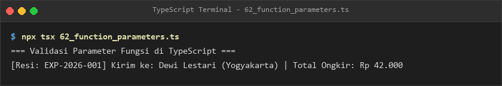
- **Lokasi Source Code:** [62_function_parameters.ts](62_function_parameters.ts)

### 63. 63_function_return_types.ts
- **Tujuan:** Mengontrol tipe nilai yang dikembalikan fungsi, termasuk tipe union nullable.
- **Konsep Utama:** Return type `PenggunaSistem | null` untuk menandai potensi ketiadaan hasil.
- **Penjelasan Source Code:** Mensimulasikan pencarian pengguna berdasarkan ID unik.
- **Cara Menjalankan:**
  ```bash
  npx tsx 63_function_return_types.ts
  ```
- **Hasil yang Diharapkan:** Laporan penemuan pengguna untuk ID terdaftar dan ID tidak ditemukan.
- **Screenshot Hasil Eksekusi:**
  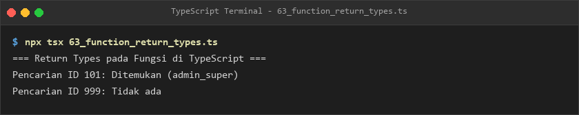
- **Lokasi Source Code:** [63_function_return_types.ts](63_function_return_types.ts)

### 64. 64_optional_parameters.ts
- **Tujuan:** Mendefinisikan parameter yang fleksibel dan boleh diabaikan oleh pemanggil fungsi.
- **Konsep Utama:** Tanda tanya `?` pada nama parameter setelah parameter wajib.
- **Penjelasan Source Code:** Fungsi `sapaPelanggan` menyusun nama lengkap dengan nama belakang dan gelar opsional.
- **Cara Menjalankan:**
  ```bash
  npx tsx 64_optional_parameters.ts
  ```
- **Hasil yang Diharapkan:** Variasi salam dari satu kata nama hingga nama lengkap bergelar tercetak.
- **Screenshot Hasil Eksekusi:**
  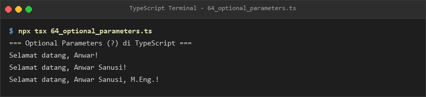
- **Lokasi Source Code:** [64_optional_parameters.ts](64_optional_parameters.ts)

### 65. 65_default_parameters.ts
- **Tujuan:** Menyediakan nilai bawaan (*default value*) jika argumen tidak dioperasikan.
- **Konsep Utama:** Pengaturan parameter `jumlah = 1` dan `tarifPajak = 0.11`.
- **Penjelasan Source Code:** Menghitung total tagihan belanja dengan nilai pajak default PPN 11%.
- **Cara Menjalankan:**
  ```bash
  npx tsx 65_default_parameters.ts
  ```
- **Hasil yang Diharapkan:** Perhitungan tagihan default maupun kustom tercetak akurat.
- **Screenshot Hasil Eksekusi:**
  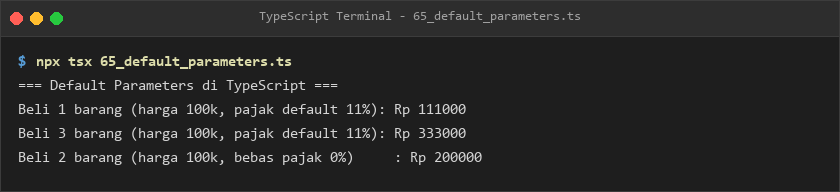
- **Lokasi Source Code:** [65_default_parameters.ts](65_default_parameters.ts)

### 66. 66_rest_parameters.ts
- **Tujuan:** Menerima argumen dalam jumlah bervariasi menggunakan parameter sisa (*rest parameter*).
- **Konsep Utama:** Operator `...angkaList: number[]` dan reduksi array.
- **Penjelasan Source Code:** Menghitung rata-rata nilai mata pelajaran dari daftar angka berukuran fleksibel.
- **Cara Menjalankan:**
  ```bash
  npx tsx 66_rest_parameters.ts
  ```
- **Hasil yang Diharapkan:** Nilai rata-rata dari berbagai jumlah argumen ditampilkan.
- **Screenshot Hasil Eksekusi:**
  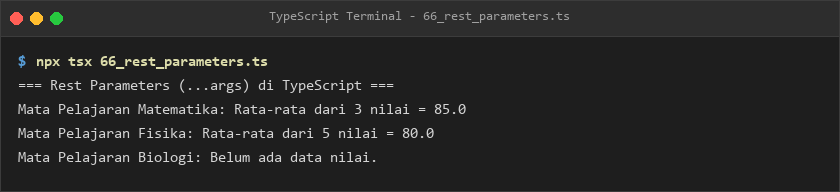
- **Lokasi Source Code:** [66_rest_parameters.ts](66_rest_parameters.ts)

### 67. 67_function_overloads.ts
- **Tujuan:** Menyediakan tanda tangan pemanggilan ganda untuk satu implementasi fungsi.
- **Konsep Utama:** Overload signatures dan implementation signature dengan type checking.
- **Penjelasan Source Code:** Fungsi `cetakIdentitas` dapat dipanggil dengan format ID angka atau format nama dan usia.
- **Cara Menjalankan:**
  ```bash
  npx tsx 67_function_overloads.ts
  ```
- **Hasil yang Diharapkan:** Informasi identitas tercetak sesuai format overload yang dipanggil.
- **Screenshot Hasil Eksekusi:**
  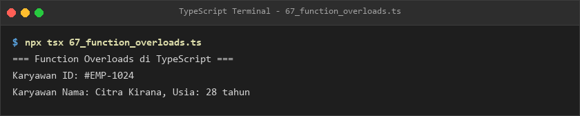
- **Lokasi Source Code:** [67_function_overloads.ts](67_function_overloads.ts)

### 68. 68_function_type_alias.ts
- **Tujuan:** Mendefinisikan kontrak tipe fungsi untuk menjamin konsistensi handler fungsi.
- **Konsep Utama:** Type alias `type PemformatTeks = (input: string) => string`.
- **Penjelasan Source Code:** Mengimplementasikan fungsi transformer teks (kapital dan format slug url).
- **Cara Menjalankan:**
  ```bash
  npx tsx 68_function_type_alias.ts
  ```
- **Hasil yang Diharapkan:** Teks terformat kapital dan slug url ditampilkan ke terminal.
- **Screenshot Hasil Eksekusi:**
  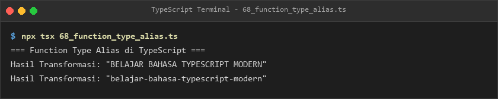
- **Lokasi Source Code:** [68_function_type_alias.ts](68_function_type_alias.ts)

### 69. 69_callback_functions.ts
- **Tujuan:** Mengirimkan fungsi sebagai parameter untuk dipanggil kembali saat operasi rampung.
- **Konsep Utama:** Pola komunikasi callback dengan parameter pesan dan kode status.
- **Penjelasan Source Code:** Menjalankan proses pengolahan data berkas dan memicu callback notifikasi selesai.
- **Cara Menjalankan:**
  ```bash
  npx tsx 69_callback_functions.ts
  ```
- **Hasil yang Diharapkan:** Pesan permulaan proses dan eksekusi callback tercetak jelas.
- **Screenshot Hasil Eksekusi:**
  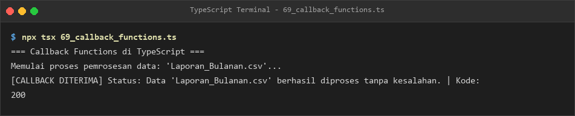
- **Lokasi Source Code:** [69_callback_functions.ts](69_callback_functions.ts)

### 70. 70_higher_order_functions.ts
- **Tujuan:** Mengimplementasikan fungsi yang memproduksi fungsi baru (*function factory*) atau menerima fungsi predikat.
- **Konsep Utama:** Higher-Order Functions (HOF) dan penyaringan koleksi generik.
- **Penjelasan Source Code:** Membuat pengali angka kustom dan menyaring angka yang bernilai lebih dari 10.
- **Cara Menjalankan:**
  ```bash
  npx tsx 70_higher_order_functions.ts
  ```
- **Hasil yang Diharapkan:** Nilai hasil pengalian pabrik fungsi dan array hasil filter ditampilkan.
- **Screenshot Hasil Eksekusi:**
  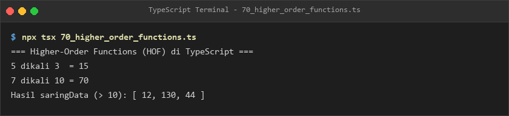
- **Lokasi Source Code:** [70_higher_order_functions.ts](70_higher_order_functions.ts)

### 71. 71_recursive_functions.ts
- **Tujuan:** Menggunakan teknik pemanggilan rekursif untuk menyelesaikan persoalan berpola perulangan.
- **Konsep Utama:** Base case dan recursive case pada perhitungan nilai perpangkatan.
- **Penjelasan Source Code:** Menghitung pangkat bilangan bulat positif dan pangkat nol.
- **Cara Menjalankan:**
  ```bash
  npx tsx 71_recursive_functions.ts
  ```
- **Hasil yang Diharapkan:** Nilai perhitungan pangkat $2^0$, $2^3$, dan $5^4$ tercetak benar.
- **Screenshot Hasil Eksekusi:**
  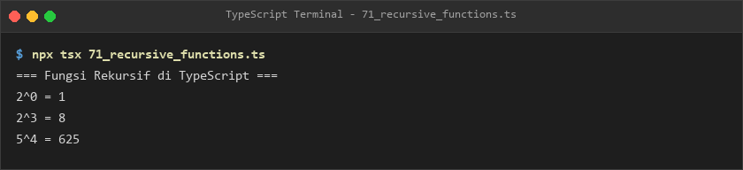
- **Lokasi Source Code:** [71_recursive_functions.ts](71_recursive_functions.ts)

### 72. 72_generic_functions_intro.ts
- **Tujuan:** Membuat fungsi generik yang dapat beroperasi dengan tipe apa pun tanpa kehilangan type-checking.
- **Konsep Utama:** Parameter tipe `<T>` pada fungsi identitas dan pengambil elemen pertama array.
- **Penjelasan Source Code:** Mendemonstrasikan inferensi tipe generik untuk string dan number.
- **Cara Menjalankan:**
  ```bash
  npx tsx 72_generic_functions_intro.ts
  ```
- **Hasil yang Diharapkan:** Nilai kembalian fungsi generik tercetak dengan tipe data yang terjaga.
- **Screenshot Hasil Eksekusi:**
  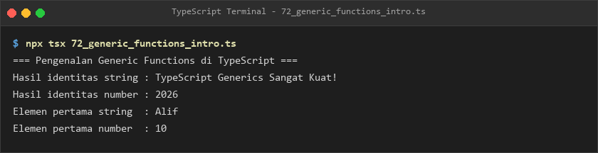
- **Lokasi Source Code:** [72_generic_functions_intro.ts](72_generic_functions_intro.ts)

### 73. 73_function_scope.ts
- **Tujuan:** Memahami aturan keterlihatan variabel pada scope global, scope lokal fungsi, dan scope blok.
- **Konsep Utama:** Hirarki cakupan variabel (*lexical scoping*).
- **Penjelasan Source Code:** Menunjukkan keterbacaan variabel antar-tingkat ruang lingkup kode.
- **Cara Menjalankan:**
  ```bash
  npx tsx 73_function_scope.ts
  ```
- **Hasil yang Diharapkan:** Catatan akses variabel dari setiap level ruang lingkup tercetak.
- **Screenshot Hasil Eksekusi:**
  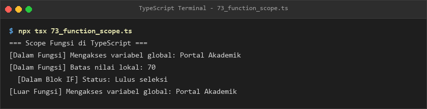
- **Lokasi Source Code:** [73_function_scope.ts](73_function_scope.ts)

### 74. 74_closures.ts
- **Tujuan:** Mengenkapsulasi data privat menggunakan mekanisme *closure*.
- **Konsep Utama:** Fungsi dalam mempertahankan referensi variabel dari lingkungan luar yang telah selesai dieksekusi.
- **Penjelasan Source Code:** Membuat dua instance counter independen dengan memori nilai terisolasi.
- **Cara Menjalankan:**
  ```bash
  npx tsx 74_closures.ts
  ```
- **Hasil yang Diharapkan:** Nilai counter bertambah secara independen tanpa saling bertabrakan.
- **Screenshot Hasil Eksekusi:**
  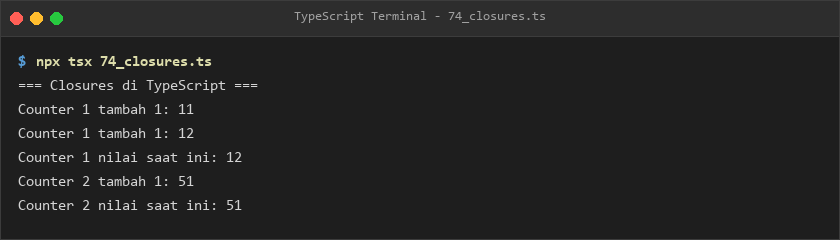
- **Lokasi Source Code:** [74_closures.ts](74_closures.ts)

### 75. 75_this_parameter.ts
- **Tujuan:** Memberikan tipe eksplisit pada konteks pemanggilan `this` di dalam fungsi.
- **Konsep Utama:** Parameter khusus `this: Type` pada posisi argumen pertama.
- **Penjelasan Source Code:** Interface dompet digital mengikat metode penambahan dan pemeriksaan saldo ke konteks `this`.
- **Cara Menjalankan:**
  ```bash
  npx tsx 75_this_parameter.ts
  ```
- **Hasil yang Diharapkan:** Perubahan saldo dompet digital tercetak melalui metode beranotasi `this`.
- **Screenshot Hasil Eksekusi:**
  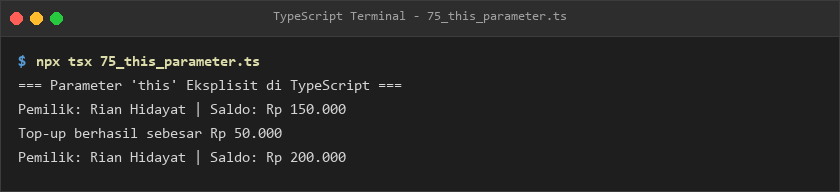
- **Lokasi Source Code:** [75_this_parameter.ts](75_this_parameter.ts)

### 76. 76_assertion_functions.ts
- **Tujuan:** Memberikan jaminan pengecekan tipe kepada compiler melalui fungsi asersi tipe (*asserts condition*).
- **Konsep Utama:** Sintaks `asserts nilai is string` untuk validasi runtime sekaligus compile-time narrowing.
- **Penjelasan Source Code:** Memvalidasi input `unknown` dan mempersempit tipenya menjadi string sebelum manipulasi teks.
- **Cara Menjalankan:**
  ```bash
  npx tsx 76_assertion_functions.ts
  ```
- **Hasil yang Diharapkan:** Operasi string sukses pada input valid dan pelemparan eksepsi pada input non-string.
- **Screenshot Hasil Eksekusi:**
  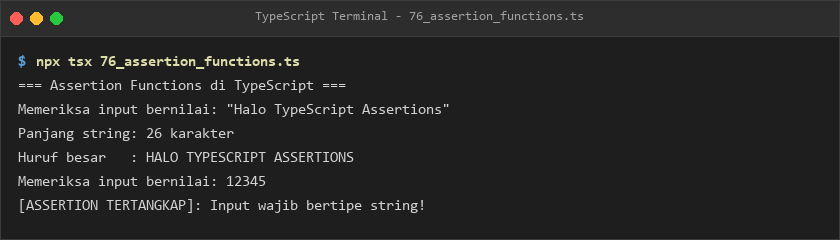
- **Lokasi Source Code:** [76_assertion_functions.ts](76_assertion_functions.ts)

---

## E. Ringkasan Modul
Modul 5 membedah seluruh aspek fungsional dalam ekosistem TypeScript. Pembelajar memahami sintaks dasar hingga fitur-fitur mutakhir seperti parameter opsional, parameter sisa, *function overloads*, *closures*, serta fungsi tingkat tinggi (*higher-order functions*). Dengan melengkapi fungsi menggunakan tipe data yang ketat dan fungsi asersi, integritas data sistem aplikasi dapat dijaga dengan tingkat keandalan yang sangat tinggi.
