# Modul 9: Generics dan Pemrograman Generik

## A. Judul Modul
- **Nomor Modul:** 09
- **Nama Modul:** Generics dan Pemrograman Generik
- **Ruang Lingkup:** Penggunaan fungsi generik dasar (`<T>`), parameter generik jamak, batasan tipe generik (*generic constraints* `T extends Constraint`), interface generik, class generik, type aliases generik, parameter generik berulang (*multiple type parameters*), nilai bawaan parameter generik (*default generic parameters*), operator `keyof`, operator tipe `typeof`, tipe akses terindeks (*indexed access types*), batasan kunci generik (`K extends keyof T`), pola pabrik generik (*generic factory*), koleksi generik (`Map<K, V>` & `Set<T>`), callback generik, inferensi tipe generik otomatis, dasar-dasar konsep *variance* (kovariansi & kontravariansi), serta penjaga tipe generik (*generic type guards*).
- **Tujuan Pembelajaran:** Menguasai paradigma pemrograman generik untuk membangun komponen, fungsi, class, dan utilitas yang dapat digunakan kembali (*reusable*) dengan mempertahankan keamanan tipe data statis secara penuh.

---

## B. Daftar Materi atau Submodul
129. [`129_generic_functions.ts`](129_generic_functions.ts) : Generic functions
130. [`130_generic_parameters.ts`](130_generic_parameters.ts) : Generic parameters
131. [`131_generic_constraints.ts`](131_generic_constraints.ts) : Generic constraints
132. [`132_generic_interfaces.ts`](132_generic_interfaces.ts) : Generic interfaces
133. [`133_generic_classes.ts`](133_generic_classes.ts) : Generic classes
134. [`134_generic_type_aliases.ts`](134_generic_type_aliases.ts) : Generic type aliases
135. [`135_multiple_type_parameters.ts`](135_multiple_type_parameters.ts) : Multiple type parameters
136. [`136_default_generic_parameters.ts`](136_default_generic_parameters.ts) : Default generic parameters
137. [`137_keyof_operator.ts`](137_keyof_operator.ts) : Operator `keyof`
138. [`138_typeof_type_operator.ts`](138_typeof_type_operator.ts) : Type operator `typeof`
139. [`139_indexed_access_types.ts`](139_indexed_access_types.ts) : Indexed access types
140. [`140_generic_key_constraints.ts`](140_generic_key_constraints.ts) : Generic key constraints
141. [`141_generic_factory.ts`](141_generic_factory.ts) : Generic factory
142. [`142_generic_collections.ts`](142_generic_collections.ts) : Generic collections
143. [`143_generic_callbacks.ts`](143_generic_callbacks.ts) : Generic callbacks
144. [`144_generic_inference.ts`](144_generic_inference.ts) : Generic type inference
145. [`145_variance_basics.ts`](145_variance_basics.ts) : Dasar variance
146. [`146_generic_type_guards.ts`](146_generic_type_guards.ts) : Generic type guards

---

## C. Penjelasan Setiap Submodul

### 129. 129_generic_functions.ts
- **Tujuan:** Membuat fungsi penggandaan elemen generik yang menerima dan mengembalikan tipe konsisten.
- **Konsep Utama:** Parameter tipe `<T>` pada fungsi `buatDuplikasi`.
- **Penjelasan Source Code:** Menghasilkan array duplikasi bertipe string dan number dengan mempertahankan tipe asal.
- **Cara Menjalankan:**
  ```bash
  npx tsx 129_generic_functions.ts
  ```
- **Hasil yang Diharapkan:** Hasil duplikasi string dan number tercetak dengan benar.
- **Screenshot Hasil Eksekusi:**
  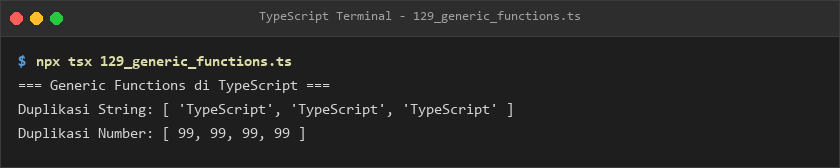
- **Lokasi Source Code:** [129_generic_functions.ts](129_generic_functions.ts)

### 130. 130_generic_parameters.ts
- **Tujuan:** Mengelola pembalikan urutan posisi pasangan tuple dua tipe berbeda `<T, U>`.
- **Konsep Utama:** Tuple generic swap `[T, U] -> [U, T]`.
- **Penjelasan Source Code:** Membalik urutan pasangan string-number dan boolean-string secara aman.
- **Cara Menjalankan:**
  ```bash
  npx tsx 130_generic_parameters.ts
  ```
- **Hasil yang Diharapkan:** Pasangan awal dan pasangan terbalik tercetak jelas.
- **Screenshot Hasil Eksekusi:**
  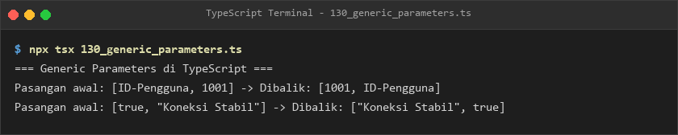
- **Lokasi Source Code:** [130_generic_parameters.ts](130_generic_parameters.ts)

### 131. 131_generic_constraints.ts
- **Tujuan:** Membatasi tipe generik hanya pada objek yang memiliki properti `.length`.
- **Konsep Utama:** Constraint `T extends PunyaPanjang`.
- **Penjelasan Source Code:** Menghitung panjang karakter string, array angka, dan objek berukuran panjang.
- **Cara Menjalankan:**
  ```bash
  npx tsx 131_generic_constraints.ts
  ```
- **Hasil yang Diharapkan:** Nilai panjang elemen dari berbagai tipe data yang valid ditampilkan.
- **Screenshot Hasil Eksekusi:**
  
- **Lokasi Source Code:** [131_generic_constraints.ts](131_generic_constraints.ts)

### 132. 132_generic_interfaces.ts
- **Tujuan:** Membungkus respon HTTP API generik dengan muatan payload dinamis.
- **Konsep Utama:** Interface `ResponStandarAPI<T>` untuk model profil dan transaksi.
- **Penjelasan Source Code:** Menangani respon profil pengguna dan rincian transaksi dengan struktur seragam.
- **Cara Menjalankan:**
  ```bash
  npx tsx 132_generic_interfaces.ts
  ```
- **Hasil yang Diharapkan:** Kode status dan payload kedua respon API tercetak rapi.
- **Screenshot Hasil Eksekusi:**
  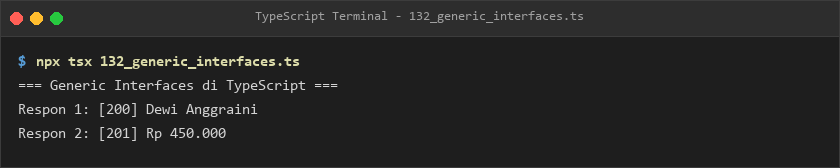
- **Lokasi Source Code:** [132_generic_interfaces.ts](132_generic_interfaces.ts)

### 133. 133_generic_classes.ts
- **Tujuan:** Membangun struktur data antrean generik (*Queue*) berbasis class OOP.
- **Konsep Utama:** Class `AntreanGenerik<T>` dengan operasi FIFO (First-In, First-Out).
- **Penjelasan Source Code:** Mengelola antrean angka dan antrean tugas bertipe string.
- **Cara Menjalankan:**
  ```bash
  npx tsx 133_generic_classes.ts
  ```
- **Hasil yang Diharapkan:** Elemen yang keluar dari antrean nomor dan antrean tugas ditampilkan.
- **Screenshot Hasil Eksekusi:**
  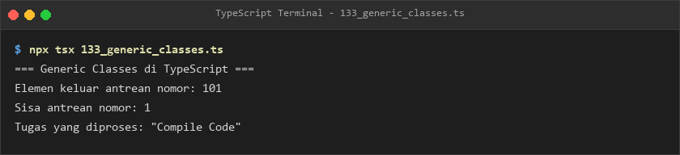
- **Lokasi Source Code:** [133_generic_classes.ts](133_generic_classes.ts)

### 134. 134_generic_type_aliases.ts
- **Tujuan:** Membuat tipe generik untuk simpul pohon biner dan nilai berpeluang null.
- **Konsep Utama:** Type alias rekursif `SimpulPohon<T>`.
- **Penjelasan Source Code:** Memodelkan pohon biner bertipe number dan mengakses simpul anak.
- **Cara Menjalankan:**
  ```bash
  npx tsx 134_generic_type_aliases.ts
  ```
- **Hasil yang Diharapkan:** Nilai angka, teks status, dan simpul pohon biner tercetak ke terminal.
- **Screenshot Hasil Eksekusi:**
  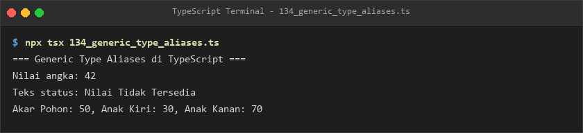
- **Lokasi Source Code:** [134_generic_type_aliases.ts](134_generic_type_aliases.ts)

### 135. 135_multiple_type_parameters.ts
- **Tujuan:** Menghubungkan tiga parameter tipe berbeda `<K, V, M>` dalam satu objek entitas.
- **Konsep Utama:** Kombinasi kunci, nilai, dan metadata bertipe independen.
- **Penjelasan Source Code:** Mencatat rekaman sesi login dengan kunci string, durasi numerik, dan metadata objek.
- **Cara Menjalankan:**
  ```bash
  npx tsx 135_multiple_type_parameters.ts
  ```
- **Hasil yang Diharapkan:** Informasi kunci, nilai durasi, dan pembuat rekaman tercetak jelas.
- **Screenshot Hasil Eksekusi:**
  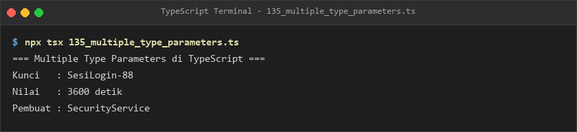
- **Lokasi Source Code:** [135_multiple_type_parameters.ts](135_multiple_type_parameters.ts)

### 136. 136_default_generic_parameters.ts
- **Tujuan:** Menyediakan tipe bawaan fallback string jika parameter generik diabaikan pemanggil.
- **Konsep Utama:** Sintaks `interface PaketPesan<T = string>`.
- **Penjelasan Source Code:** Membandingkan paket pesan berpayload string default vs berpayload objek insiden.
- **Cara Menjalankan:**
  ```bash
  npx tsx 136_default_generic_parameters.ts
  ```
- **Hasil yang Diharapkan:** Pesan string biasa dan detail kode insiden terstruktur ditampilkan.
- **Screenshot Hasil Eksekusi:**
  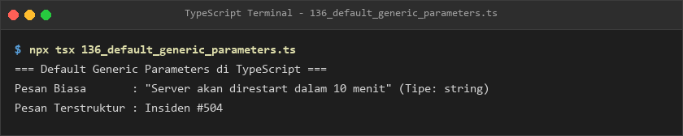
- **Lokasi Source Code:** [136_default_generic_parameters.ts](136_default_generic_parameters.ts)

### 137. 137_keyof_operator.ts
- **Tujuan:** Memperoleh himpunan nama kunci dari interface mobil keluarga.
- **Konsep Utama:** Operator `keyof MobilKeluarga` menghasilkan union nama properti.
- **Penjelasan Source Code:** Memvalidasi penggunaan nama properti `merk` dan `kapasitasPenumpang`.
- **Cara Menjalankan:**
  ```bash
  npx tsx 137_keyof_operator.ts
  ```
- **Hasil yang Diharapkan:** Kunci yang tervalidasi dan penjelasan fungsi `keyof` tercetak.
- **Screenshot Hasil Eksekusi:**
  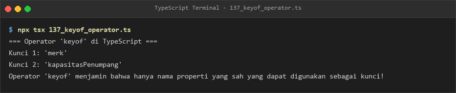
- **Lokasi Source Code:** [137_keyof_operator.ts](137_keyof_operator.ts)

### 138. 138_typeof_type_operator.ts
- **Tujuan:** Mengekstrak bentuk struktur objek runtime menjadi definisi tipe baru.
- **Konsep Utama:** Operator tipe `type TipeKonfigurasi = typeof konfigurasiAplikasi`.
- **Penjelasan Source Code:** Membentuk objek staging yang strukturnya dijamin identik dengan konfigurasi utama.
- **Cara Menjalankan:**
  ```bash
  npx tsx 138_typeof_type_operator.ts
  ```
- **Hasil yang Diharapkan:** Objek konfigurasi staging hasil ekstraksi tipe tercetak.
- **Screenshot Hasil Eksekusi:**
  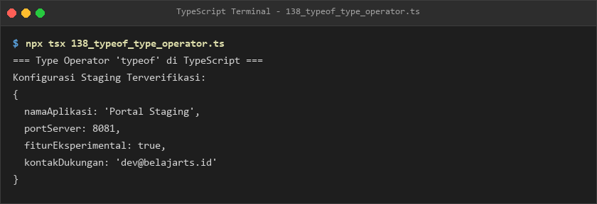
- **Lokasi Source Code:** [138_typeof_type_operator.ts](138_typeof_type_operator.ts)

### 139. 139_indexed_access_types.ts
- **Tujuan:** Mengambil tipe data dari properti bersarang menggunakan sintaks indeks `T[K]`.
- **Konsep Utama:** Penarikan tipe `ProfilPegawai["alamat"]["kota"]`.
- **Penjelasan Source Code:** Membentuk variabel domisili dan ibukota berdasarkan tipe sub-properti pegawai.
- **Cara Menjalankan:**
  ```bash
  npx tsx 139_indexed_access_types.ts
  ```
- **Hasil yang Diharapkan:** Rincian domisili dan nama kota tercetak ke konsol.
- **Screenshot Hasil Eksekusi:**
  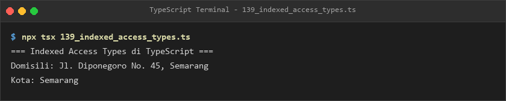
- **Lokasi Source Code:** [139_indexed_access_types.ts](139_indexed_access_types.ts)

### 140. 140_generic_key_constraints.ts
- **Tujuan:** Menjamin keselamatan penarikan nilai properti dinamis tanpa risiko runtime error.
- **Konsep Utama:** Batasan kunci generik `<T, K extends keyof T>`.
- **Penjelasan Source Code:** Fungsi `ambilProperti` membaca nama dan nilai rata-rata siswa secara type-safe.
- **Cara Menjalankan:**
  ```bash
  npx tsx 140_generic_key_constraints.ts
  ```
- **Hasil yang Diharapkan:** Nama dan nilai siswa yang ditarik via generic key constraint ditampilkan.
- **Screenshot Hasil Eksekusi:**
  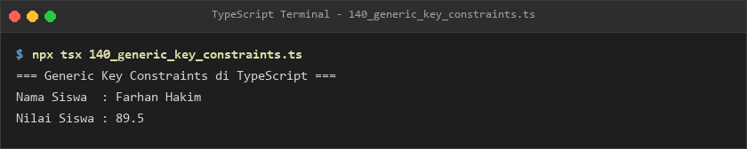
- **Lokasi Source Code:** [140_generic_key_constraints.ts](140_generic_key_constraints.ts)

### 141. 141_generic_factory.ts
- **Tujuan:** Menginisialisasi class secara dinamis menggunakan konstruktor generic.
- **Konsep Utama:** Constructor signature `new (...args: any[]) => T`.
- **Penjelasan Source Code:** Memproduksi robot pembersih dan drone pengantar melalui satu fungsi pabrik.
- **Cara Menjalankan:**
  ```bash
  npx tsx 141_generic_factory.ts
  ```
- **Hasil yang Diharapkan:** Log pembuatan class dan aktivitas robot serta drone tercetak.
- **Screenshot Hasil Eksekusi:**
  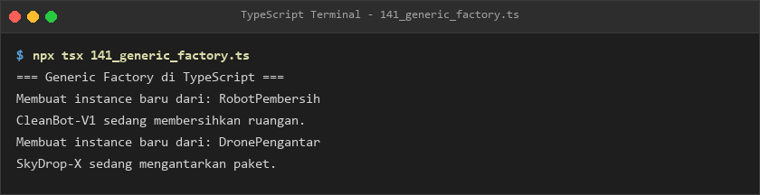
- **Lokasi Source Code:** [141_generic_factory.ts](141_generic_factory.ts)

### 142. 142_generic_collections.ts
- **Tujuan:** Menggunakan struktur data koleksi `Set<T>` dan `Map<K, V>` dengan validasi tipe ketat.
- **Konsep Utama:** Koleksi data unik dan kamus nilai siswa berbasis generic collections.
- **Penjelasan Source Code:** Menyimpan ID unik tanpa duplikasi dan memetakan nilai ujian siswa.
- **Cara Menjalankan:**
  ```bash
  npx tsx 142_generic_collections.ts
  ```
- **Hasil yang Diharapkan:** Jumlah ID unik dan daftar pasangan siswa-nilai ditampilkan.
- **Screenshot Hasil Eksekusi:**
  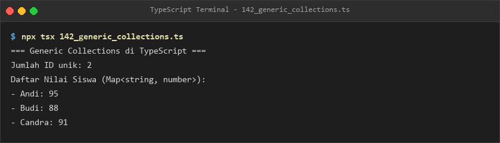
- **Lokasi Source Code:** [142_generic_collections.ts](142_generic_collections.ts)

### 143. 143_generic_callbacks.ts
- **Tujuan:** Mengaplikasikan fungsi callback generik untuk memetakan array dari tipe `T` ke tipe `U`.
- **Konsep Utama:** Transformasi elemen array melalui generic callback `(item: T, idx: number) => U`.
- **Penjelasan Source Code:** Mengubah deret angka menjadi teks terformat skor bernomor urut.
- **Cara Menjalankan:**
  ```bash
  npx tsx 143_generic_callbacks.ts
  ```
- **Hasil yang Diharapkan:** Array hasil pemetaan generic callback tercetak ke terminal.
- **Screenshot Hasil Eksekusi:**
  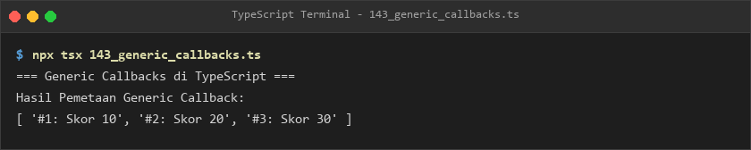
- **Lokasi Source Code:** [143_generic_callbacks.ts](143_generic_callbacks.ts)

### 144. 144_generic_inference.ts
- **Tujuan:** Mengetahui cara kerja inferensi parameter tipe otomatis saat memanggil fungsi generik.
- **Konsep Utama:** Resolusi tipe otomatis tanpa perlu menuliskan `<Type>` secara eksplisit.
- **Penjelasan Source Code:** Menggabungkan dua item string dan number dengan inferensi otomatis.
- **Cara Menjalankan:**
  ```bash
  npx tsx 144_generic_inference.ts
  ```
- **Hasil yang Diharapkan:** Array hasil penggabungan string dan number ditampilkan.
- **Screenshot Hasil Eksekusi:**
  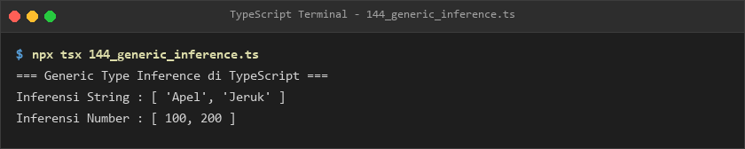
- **Lokasi Source Code:** [144_generic_inference.ts](144_generic_inference.ts)

### 145. 145_variance_basics.ts
- **Tujuan:** Memahami prinsip dasar kovariansi pada hubungan subtipe koleksi readonly.
- **Konsep Utama:** Penugasan `Anjing[]` ke `readonly Hewan[]`.
- **Penjelasan Source Code:** Mengelola kawanan hewan dan memanggil method gonggong anjing secara aman.
- **Cara Menjalankan:**
  ```bash
  npx tsx 145_variance_basics.ts
  ```
- **Hasil yang Diharapkan:** Jumlah hewan, suara gonggong anjing, dan penjelasan kovariansi tercetak.
- **Screenshot Hasil Eksekusi:**
  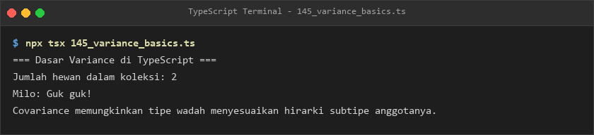
- **Lokasi Source Code:** [145_variance_basics.ts](145_variance_basics.ts)

### 146. 146_generic_type_guards.ts
- **Tujuan:** Memvalidasi keberadaan properti ID string pada objek unknown melalui penjaga tipe generik.
- **Konsep Utama:** Predikat tipe `obj is PunyaIDString`.
- **Penjelasan Source Code:** Menguji sampel dokumen valid dan menolak objek dengan ID numerik.
- **Cara Menjalankan:**
  ```bash
  npx tsx 146_generic_type_guards.ts
  ```
- **Hasil yang Diharapkan:** Konfirmasi validasi sampel 1 dan penolakan sampel 2 tercetak tepat.
- **Screenshot Hasil Eksekusi:**
  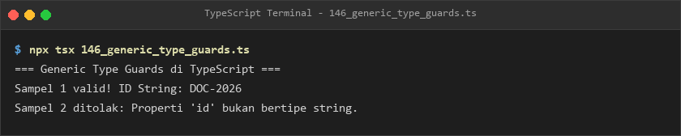
- **Lokasi Source Code:** [146_generic_type_guards.ts](146_generic_type_guards.ts)

---

## E. Ringkasan Modul
Modul 9 memberikan penguasaan menyeluruh atas paradigma pemrograman generik dalam TypeScript. Melalui generic functions, interfaces, classes, batasan kunci (`keyof`, `K extends keyof T`), hingga konsep tingkat tinggi seperti kovariansi dan generic type guards, pembelajar mampu menciptakan kode yang sangat reusable, fleksibel, dan memiliki keamanan tipe statis yang sempurna.
