# Modul 10: Advanced Types

## A. Judul Modul
- **Nomor Modul:** 10
- **Nama Modul:** Advanced Types
- **Ruang Lingkup:** Tipe kondisional (*conditional types*), inferensi tipe dalam conditional types, kata kunci `infer`, *mapped types*, pengubah mapped types (`+`/`-`, `readonly`, `?`), pemetaan ulang kunci (*key remapping* via `as`), tipe template literal (*template literal types*), tipe rekursif, tipe kondisional rekursif, utility types resmi TypeScript (`Partial`, `Required`, `Readonly`, `Pick`, `Omit`, `Record`, `Exclude`, `Extract`, `NonNullable`, `ReturnType`, `Parameters`, `InstanceType`, `Awaited`), serta perancangan *custom utility types* tingkat lanjut.
- **Tujuan Pembelajaran:** Menguasai seluruh sistem manipulasi dan komputasi tipe pada masa kompilasi (*type-level programming*), mampu membangun utilitas tipe data kustom berskala besar, serta memaksimalkan penggunaan utility types standar untuk kode yang ringkas dan bebas duplikasi.

---

## B. Daftar Materi atau Submodul
147. [`147_conditional_types.ts`](147_conditional_types.ts) : Conditional types
148. [`148_conditional_type_inference.ts`](148_conditional_type_inference.ts) : Infer dalam conditional types
149. [`149_infer_keyword.ts`](149_infer_keyword.ts) : Keyword `infer`
150. [`150_mapped_types.ts`](150_mapped_types.ts) : Mapped types
151. [`151_mapped_type_modifiers.ts`](151_mapped_type_modifiers.ts) : Mapped type modifiers
152. [`152_key_remapping.ts`](152_key_remapping.ts) : Key remapping
153. [`153_template_literal_types.ts`](153_template_literal_types.ts) : Template literal types
154. [`154_recursive_types.ts`](154_recursive_types.ts) : Recursive types
155. [`155_recursive_conditional_types.ts`](155_recursive_conditional_types.ts) : Recursive conditional types
156. [`156_utility_partial.ts`](156_utility_partial.ts) : Utility type `Partial`
157. [`157_utility_required.ts`](157_utility_required.ts) : Utility type `Required`
158. [`158_utility_readonly.ts`](158_utility_readonly.ts) : Utility type `Readonly`
159. [`159_utility_pick.ts`](159_utility_pick.ts) : Utility type `Pick`
160. [`160_utility_omit.ts`](160_utility_omit.ts) : Utility type `Omit`
161. [`161_utility_record.ts`](161_utility_record.ts) : Utility type `Record`
162. [`162_utility_exclude_extract.ts`](162_utility_exclude_extract.ts) : Utility types `Exclude` dan `Extract`
163. [`163_utility_nonnullable.ts`](163_utility_nonnullable.ts) : Utility type `NonNullable`
164. [`164_utility_returntype.ts`](164_utility_returntype.ts) : Utility type `ReturnType`
165. [`165_utility_parameters.ts`](165_utility_parameters.ts) : Utility type `Parameters`
166. [`166_utility_instance_type.ts`](166_utility_instance_type.ts) : Utility type `InstanceType`
167. [`167_utility_awaited.ts`](167_utility_awaited.ts) : Utility type `Awaited`
168. [`168_custom_utility_types.ts`](168_custom_utility_types.ts) : Membuat custom utility types

---

## C. Penjelasan Setiap Submodul

### 147. 147_conditional_types.ts
- **Tujuan:** Menentukan tipe hasil secara dinamis berdasarkan percabangan tipe `T extends U ? X : Y`.
- **Konsep Utama:** Conditional types pembentuk array kata vs array nilai angka.
- **Penjelasan Source Code:** Memetakan tipe input string ke `string[]` dan tipe lainnya ke `number[]`.
- **Cara Menjalankan:**
  ```bash
  npx tsx 147_conditional_types.ts
  ```
- **Hasil yang Diharapkan:** Koleksi kata dan koleksi nilai angka tercetak.
- **Screenshot Hasil Eksekusi:**
  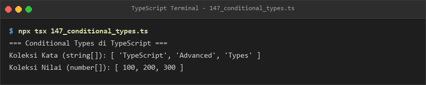
- **Lokasi Source Code:** [147_conditional_types.ts](147_conditional_types.ts)

### 148. 148_conditional_type_inference.ts
- **Tujuan:** Mengambil tipe elemen internal dari suatu array menggunakan sintaks `infer E`.
- **Konsep Utama:** Pola ekstraksi `T extends (infer E)[] ? E : T`.
- **Penjelasan Source Code:** Mengekstrak tipe data angka dan teks dari struktur array.
- **Cara Menjalankan:**
  ```bash
  npx tsx 148_conditional_type_inference.ts
  ```
- **Hasil yang Diharapkan:** Tipe angka dan tipe teks hasil inferensi tercetak ke terminal.
- **Screenshot Hasil Eksekusi:**
  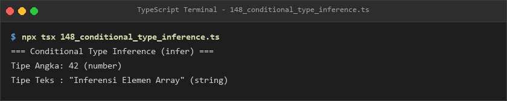
- **Lokasi Source Code:** [148_conditional_type_inference.ts](148_conditional_type_inference.ts)

### 149. 149_infer_keyword.ts
- **Tujuan:** Mengambil tipe kembalian fungsi (*return type*) secara otomatis menggunakan `infer R`.
- **Konsep Utama:** Konstruksi pembaca return type fungsi `AmbilKembalian<T>`.
- **Penjelasan Source Code:** Membaca tipe return kalkulasi diskon dan menampilkan rincian harga.
- **Cara Menjalankan:**
  ```bash
  npx tsx 149_infer_keyword.ts
  ```
- **Hasil yang Diharapkan:** Rincian harga awal, potongan, dan harga akhir tercetak.
- **Screenshot Hasil Eksekusi:**
  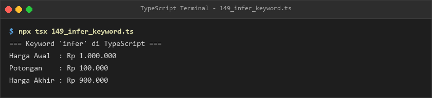
- **Lokasi Source Code:** [149_infer_keyword.ts](149_infer_keyword.ts)

### 150. 150_mapped_types.ts
- **Tujuan:** Mentransformasikan seluruh properti interface menjadi format flag status boolean.
- **Konsep Utama:** Mapped type `[K in keyof T]: boolean`.
- **Penjelasan Source Code:** Memetakan data sensor suhu, kelembapan, dan tekanan ke indikator kenormalan sistem.
- **Cara Menjalankan:**
  ```bash
  npx tsx 150_mapped_types.ts
  ```
- **Hasil yang Diharapkan:** Status indikator seluruh sensor tercetak jelas.
- **Screenshot Hasil Eksekusi:**
  
- **Lokasi Source Code:** [150_mapped_types.ts](150_mapped_types.ts)

### 151. 151_mapped_type_modifiers.ts
- **Tujuan:** Menghapus sifat readonly dan opsional menggunakan modifier `-readonly` dan `-?`.
- **Konsep Utama:** Transformasi mutabilitas dan kewajiban pengisian properti konfigurasi.
- **Penjelasan Source Code:** Mengubah profil aplikasi yang terkunci menjadi dapat dimutasi dan diwajibkan.
- **Cara Menjalankan:**
  ```bash
  npx tsx 151_mapped_type_modifiers.ts
  ```
- **Hasil yang Diharapkan:** Objek konfigurasi yang berhasil dimutasi ditampilkan.
- **Screenshot Hasil Eksekusi:**
  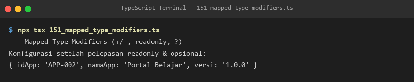
- **Lokasi Source Code:** [151_mapped_type_modifiers.ts](151_mapped_type_modifiers.ts)

### 152. 152_key_remapping.ts
- **Tujuan:** Mengubah nama properti objek secara dinamis menggunakan klausa `as NewKey`.
- **Konsep Utama:** Pembuatan getter otomatis dengan prefix `get${Capitalize<K>}`.
- **Penjelasan Source Code:** Mengonversi properti nama dan saldo menjadi fungsi getter terstruktur.
- **Cara Menjalankan:**
  ```bash
  npx tsx 152_key_remapping.ts
  ```
- **Hasil yang Diharapkan:** Output pemanggilan `getNama()` dan `getSaldo()` tercetak ke konsol.
- **Screenshot Hasil Eksekusi:**
  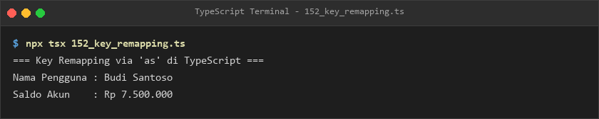
- **Lokasi Source Code:** [152_key_remapping.ts](152_key_remapping.ts)

### 153. 153_template_literal_types.ts
- **Tujuan:** Membentuk kombinasi tipe string literal menggunakan sintaks template string.
- **Konsep Utama:** Tipe lokasi notasi 2D dan penamaan handler event kustom.
- **Penjelasan Source Code:** Menghasilkan opsi penempatan notasi "atas-kanan" dan event "onKlik".
- **Cara Menjalankan:**
  ```bash
  npx tsx 153_template_literal_types.ts
  ```
- **Hasil yang Diharapkan:** Nilai posisi notifikasi dan handler event ditampilkan.
- **Screenshot Hasil Eksekusi:**
  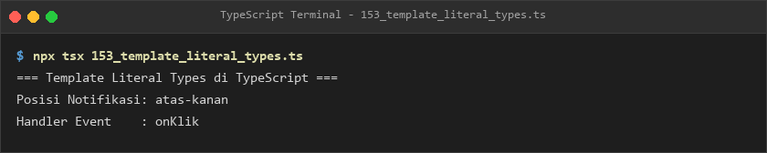
- **Lokasi Source Code:** [153_template_literal_types.ts](153_template_literal_types.ts)

### 154. 154_recursive_types.ts
- **Tujuan:** Memodelkan struktur data dokumen JSON bersarang tanpa batasan kedalaman.
- **Konsep Utama:** Recursive type `NilaiJSON`.
- **Penjelasan Source Code:** Memvalidasi dokumen JSON bertingkat berisi string, number, array, dan objek.
- **Cara Menjalankan:**
  ```bash
  npx tsx 154_recursive_types.ts
  ```
- **Hasil yang Diharapkan:** Dokumen JSON terformat rapi tercetak ke terminal.
- **Screenshot Hasil Eksekusi:**
  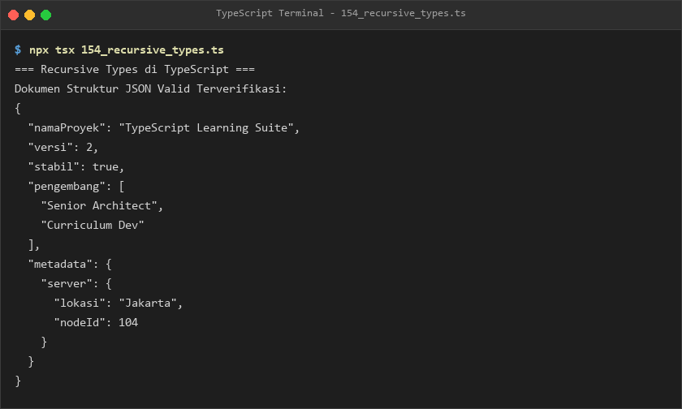
- **Lokasi Source Code:** [154_recursive_types.ts](154_recursive_types.ts)

### 155. 155_recursive_conditional_types.ts
- **Tujuan:** Meratakan susunan array bertingkat tiga lapis menjadi satu array linear.
- **Konsep Utama:** Rekurensi kondisional `T extends (infer E)[] ? RatakanArray<E> : T`.
- **Penjelasan Source Code:** Meratakan data array sarang 3 dimensi ke array 1 dimensi.
- **Cara Menjalankan:**
  ```bash
  npx tsx 155_recursive_conditional_types.ts
  ```
- **Hasil yang Diharapkan:** Data bersarang dan array hasil perataan ditampilkan.
- **Screenshot Hasil Eksekusi:**
  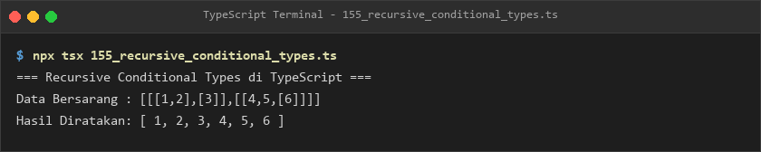
- **Lokasi Source Code:** [155_recursive_conditional_types.ts](155_recursive_conditional_types.ts)

### 156. 156_utility_partial.ts
- **Tujuan:** Mengizinkan pengiriman sebagian atribut objek menggunakan utility type `Partial<T>`.
- **Konsep Utama:** Operasi update parsial pada profil siswa.
- **Penjelasan Source Code:** Memperbarui nilai rata-rata siswa tanpa harus menyertakan nama dan kelas.
- **Cara Menjalankan:**
  ```bash
  npx tsx 156_utility_partial.ts
  ```
- **Hasil yang Diharapkan:** Log pembaruan data parsial tercetak jelas.
- **Screenshot Hasil Eksekusi:**
  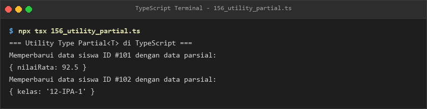
- **Lokasi Source Code:** [156_utility_partial.ts](156_utility_partial.ts)

### 157. 157_utility_required.ts
- **Tujuan:** Mewajibkan seluruh properti opsional agar wajib disediakan nilainya.
- **Konsep Utama:** Utilitas `Required<OpsiSetup>` untuk penyiapan lingkungan aplikasi.
- **Penjelasan Source Code:** Memastikan host, port, dan timeout diisi lengkap tanpa ada yang tertinggal.
- **Cara Menjalankan:**
  ```bash
  npx tsx 157_utility_required.ts
  ```
- **Hasil yang Diharapkan:** Data konfigurasi penuh tercetak ke terminal.
- **Screenshot Hasil Eksekusi:**
  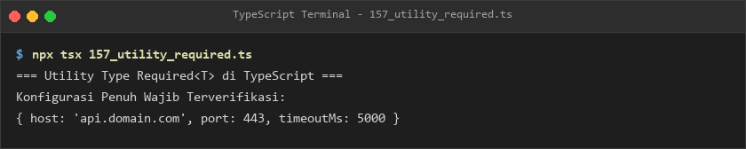
- **Lokasi Source Code:** [157_utility_required.ts](157_utility_required.ts)

### 158. 158_utility_readonly.ts
- **Tujuan:** Mengunci seluruh atribut konfigurasi keamanan agar tidak dapat diubah nilainya.
- **Konsep Utama:** Utilitas `Readonly<T>` untuk perlindungan integritas data konfigurasi.
- **Penjelasan Source Code:** Mengunci kunci enkripsi dan batas durasi sesi aplikasi.
- **Cara Menjalankan:**
  ```bash
  npx tsx 158_utility_readonly.ts
  ```
- **Hasil yang Diharapkan:** Informasi keamanan tercetak dan terproteksi dari mutasi.
- **Screenshot Hasil Eksekusi:**
  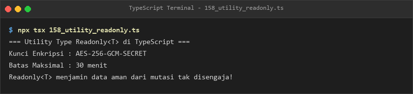
- **Lokasi Source Code:** [158_utility_readonly.ts](158_utility_readonly.ts)

### 159. 159_utility_pick.ts
- **Tujuan:** Memilih sub-himpunan properti dari interface artikel lengkap untuk kartu ringkasan.
- **Konsep Utama:** Utilitas `Pick<ArtikelLengkap, "id" | "judul" | "penulis">`.
- **Penjelasan Source Code:** Menampilkan ringkasan artikel tanpa membawa muatan teks konten yang berat.
- **Cara Menjalankan:**
  ```bash
  npx tsx 159_utility_pick.ts
  ```
- **Hasil yang Diharapkan:** Objek ringkasan artikel ditampilkan rapi.
- **Screenshot Hasil Eksekusi:**
  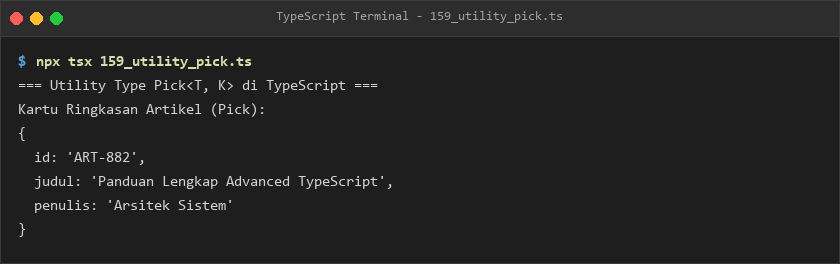
- **Lokasi Source Code:** [159_utility_pick.ts](159_utility_pick.ts)

### 160. 160_utility_omit.ts
- **Tujuan:** Menyembunyikan atribut sensitif (*password hash* dan *salt*) dari eksposur publik.
- **Konsep Utama:** Utilitas `Omit<AkunDatabase, "passwordHash" | "salt">`.
- **Penjelasan Source Code:** Mengembalikan data akun publik yang aman dan bebas kredensial rahasia.
- **Cara Menjalankan:**
  ```bash
  npx tsx 160_utility_omit.ts
  ```
- **Hasil yang Diharapkan:** Respon data akun publik tanpa properti rahasia tercetak.
- **Screenshot Hasil Eksekusi:**
  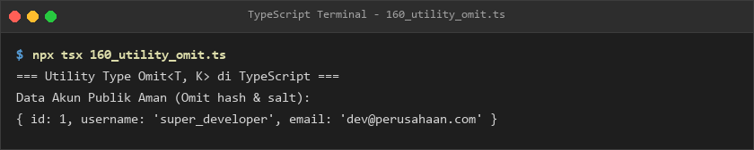
- **Lokasi Source Code:** [160_utility_omit.ts](160_utility_omit.ts)

### 161. 161_utility_record.ts
- **Tujuan:** Memetakan tingkat peran pengguna ke matriks hak akses secara terstruktur.
- **Konsep Utama:** Utilitas `Record<TingkatPeran, HakAksesHalaman>`.
- **Penjelasan Source Code:** Mendefinisikan izin menulis dan menghapus untuk admin, editor, dan pembaca.
- **Cara Menjalankan:**
  ```bash
  npx tsx 161_utility_record.ts
  ```
- **Hasil yang Diharapkan:** Matriks hak akses pengguna ditampilkan ke konsol.
- **Screenshot Hasil Eksekusi:**
  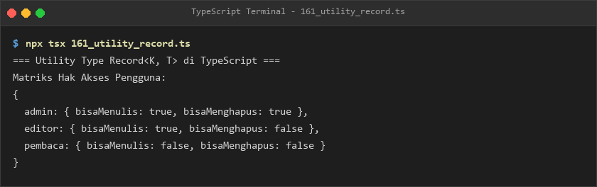
- **Lokasi Source Code:** [161_utility_record.ts](161_utility_record.ts)

### 162. 162_utility_exclude_extract.ts
- **Tujuan:** Memilah anggota union type antara format file gambar dan format berkas dokumen.
- **Konsep Utama:** Utilitas `Exclude` untuk eliminasi dan `Extract` untuk pemilihan.
- **Penjelasan Source Code:** Memisahkan format gambar (png/jpg/gif) dari format dokumen (pdf/docx).
- **Cara Menjalankan:**
  ```bash
  npx tsx 162_utility_exclude_extract.ts
  ```
- **Hasil yang Diharapkan:** Format gambar dan format dokumen yang valid ditampilkan.
- **Screenshot Hasil Eksekusi:**
  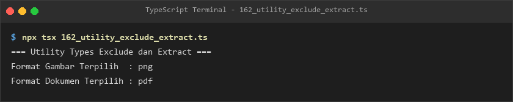
- **Lokasi Source Code:** [162_utility_exclude_extract.ts](162_utility_exclude_extract.ts)

### 163. 163_utility_nonnullable.ts
- **Tujuan:** Membersihkan union type dari kemungkinan nilai kosong `null` atau `undefined`.
- **Konsep Utama:** Utilitas `NonNullable<T>`.
- **Penjelasan Source Code:** Menjamin nilai respon hanya berupa string atau number yang valid.
- **Cara Menjalankan:**
  ```bash
  npx tsx 163_utility_nonnullable.ts
  ```
- **Hasil yang Diharapkan:** Nilai terkonfirmasi non-nullable tercetak ke konsol.
- **Screenshot Hasil Eksekusi:**
  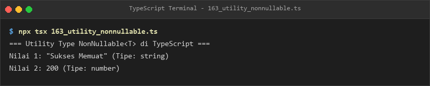
- **Lokasi Source Code:** [163_utility_nonnullable.ts](163_utility_nonnullable.ts)

### 164. 164_utility_returntype.ts
- **Tujuan:** Mengambil tipe kembalian fungsi pembuat sesi secara otomatis tanpa deklarasi ganda.
- **Konsep Utama:** Utilitas `ReturnType<typeof buatSesiPengguna>`.
- **Penjelasan Source Code:** Menangani objek sesi aktif lengkap dengan stempel waktu kedaluwarsa.
- **Cara Menjalankan:**
  ```bash
  npx tsx 164_utility_returntype.ts
  ```
- **Hasil yang Diharapkan:** ID sesi, nama pengguna, dan jam kedaluwarsa ditampilkan.
- **Screenshot Hasil Eksekusi:**
  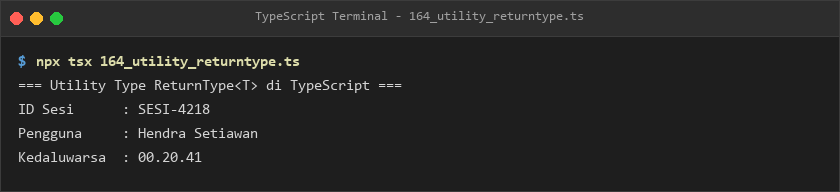
- **Lokasi Source Code:** [164_utility_returntype.ts](164_utility_returntype.ts)

### 165. 165_utility_parameters.ts
- **Tujuan:** Mengekstrak parameter fungsi notifikasi ke bentuk tuple argumen.
- **Konsep Utama:** Utilitas `Parameters<typeof kirimNotifikasi>`.
- **Penjelasan Source Code:** Mengisi parameter pengiriman email via spread operator dari tuple terketik.
- **Cara Menjalankan:**
  ```bash
  npx tsx 165_utility_parameters.ts
  ```
- **Hasil yang Diharapkan:** Log pengiriman email dengan prioritas tercetak ke terminal.
- **Screenshot Hasil Eksekusi:**
  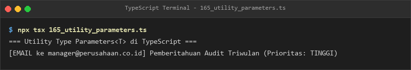
- **Lokasi Source Code:** [165_utility_parameters.ts](165_utility_parameters.ts)

### 166. 166_utility_instance_type.ts
- **Tujuan:** Memperoleh tipe instance yang diinstansiasi dari class manajer basis data.
- **Konsep Utama:** Utilitas `InstanceType<typeof ManajerBasisData>`.
- **Penjelasan Source Code:** Memeriksa status koneksi instance basis data yang terbentuk.
- **Cara Menjalankan:**
  ```bash
  npx tsx 166_utility_instance_type.ts
  ```
- **Hasil yang Diharapkan:** Nama pool koneksi dan status online basis data ditampilkan.
- **Screenshot Hasil Eksekusi:**
  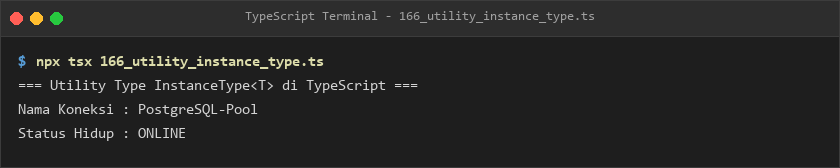
- **Lokasi Source Code:** [166_utility_instance_type.ts](166_utility_instance_type.ts)

### 167. 167_utility_awaited.ts
- **Tujuan:** Mengupas tipe nilai hasil pembungkus Promise asynchronous secara kompilasi.
- **Konsep Utama:** Utilitas `Awaited<ReturnType<typeof ambilDataCuaca>>`.
- **Penjelasan Source Code:** Membaca data ramalan cuaca kota Denpasar dari tipe asynchronous.
- **Cara Menjalankan:**
  ```bash
  npx tsx 167_utility_awaited.ts
  ```
- **Hasil yang Diharapkan:** Informasi kota dan suhu cuaca tercetak akurat.
- **Screenshot Hasil Eksekusi:**
  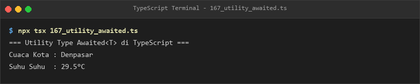
- **Lokasi Source Code:** [167_utility_awaited.ts](167_utility_awaited.ts)

### 168. 168_custom_utility_types.ts
- **Tujuan:** Merancang utilitas kustom `DeepReadonly<T>` yang mengunci seluruh level properti objek bersarang.
- **Konsep Utama:** Kombinasi mapped type dan conditional type rekursif.
- **Penjelasan Source Code:** Mengunci konfigurasi sistem beserta properti jaringan internalnya.
- **Cara Menjalankan:**
  ```bash
  npx tsx 168_custom_utility_types.ts
  ```
- **Hasil yang Diharapkan:** Objek konfigurasi mendalam terkunci tercetak ke terminal.
- **Screenshot Hasil Eksekusi:**
  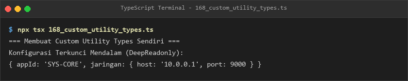
- **Lokasi Source Code:** [168_custom_utility_types.ts](168_custom_utility_types.ts)

---

## E. Ringkasan Modul
Modul 10 menghadirkan kapabilitas terdalam dari sistem tipe TypeScript (Type-level Programming). Dengan menguasai conditional types, kata kunci `infer`, mapped types, manipulasi modifier, template literal types, hingga seluruh utility types standar dan kustom, pembelajar kini mampu merekayasa tipe data tingkat tinggi yang dinamis, efisien, dan sepenuhnya aman dari galat runtime.
