# Modul 11: Class dan Object-Oriented Programming

## A. Judul Modul
- **Nomor Modul:** 11
- **Nama Modul:** Class dan Object-Oriented Programming
- **Ruang Lingkup:** Perancangan class dan instansiasi objek, deklarasi properti class, pembuatan *methods*, fungsi inisialisasi awal (*constructor*), penentu hak akses (*access modifiers* `public`, `private`, `protected`), properti kekal (*readonly class properties*), properti parameter ringkas (*parameter properties*), kendali akses *getters* & *setters*, anggota statis (*static members*), kelas abstrak (*abstract classes*), metode abstrak (*abstract methods*), pewarisan kelas (*inheritance* dengan `extends` dan `super`), penimpaan metode (*method overriding*), penerapan interface (*implements*), perbandingan mendalam abstract class vs interface, konsep polimorfisme (*polymorphism*), relasi kepemilikan kuat (*composition*), relasi asosiasi longgar (*aggregation*), class generik tingkat lanjut (Repository Pattern), serta pengenalan dasar *decorators*.
- **Tujuan Pembelajaran:** Menguasai paradigma Pemrograman Berorientasi Objek (OOP) modern dalam lingkungan TypeScript, mampu merancang arsitektur perangkat lunak yang bersih, terenkapsulasi dengan baik, dan mudah diperluas (*maintainable & extensible*).

---

## B. Daftar Materi atau Submodul
169. [`169_class_basic.ts`](169_class_basic.ts) : Class dan object
170. [`170_class_properties.ts`](170_class_properties.ts) : Class properties
171. [`171_class_methods.ts`](171_class_methods.ts) : Class methods
172. [`172_class_constructor.ts`](172_class_constructor.ts) : Constructor
173. [`173_access_modifiers.ts`](173_access_modifiers.ts) : `public`, `private`, dan `protected`
174. [`174_readonly_class_properties.ts`](174_readonly_class_properties.ts) : Readonly properties
175. [`175_parameter_properties.ts`](175_parameter_properties.ts) : Parameter properties
176. [`176_getters_setters.ts`](176_getters_setters.ts) : Getter dan setter
177. [`177_static_members.ts`](177_static_members.ts) : Static members
178. [`178_abstract_classes.ts`](178_abstract_classes.ts) : Abstract classes
179. [`179_abstract_methods.ts`](179_abstract_methods.ts) : Abstract methods
180. [`180_class_inheritance.ts`](180_class_inheritance.ts) : Inheritance
181. [`181_method_overriding.ts`](181_method_overriding.ts) : Method overriding
182. [`182_implements_keyword.ts`](182_implements_keyword.ts) : Keyword `implements`
183. [`183_abstract_vs_interface.ts`](183_abstract_vs_interface.ts) : Abstract class dan interface
184. [`184_polymorphism.ts`](184_polymorphism.ts) : Polymorphism
185. [`185_composition.ts`](185_composition.ts) : Composition
186. [`186_aggregation.ts`](186_aggregation.ts) : Aggregation
187. [`187_generic_classes_advanced.ts`](187_generic_classes_advanced.ts) : Generic classes lanjutan
188. [`188_parameter_decorators.ts`](188_parameter_decorators.ts) : Pengenalan decorators dan parameter metadata

---

## C. Penjelasan Setiap Submodul

### 169. 169_class_basic.ts
- **Tujuan:** Membuat class blueprint sederhana dan menginstansiasinya menjadi objek konkret.
- **Konsep Utama:** Deklarasi class `Pelajar`, atribut nama dan usia, serta pemanggilan metode perkenalan.
- **Penjelasan Source Code:** Mengonstruksi objek murid baru dan memanggil metode `perkenalkanDiri()`.
- **Cara Menjalankan:**
  ```bash
  npx tsx 169_class_basic.ts
  ```
- **Hasil yang Diharapkan:** Salam perkenalan diri murid tercetak ke terminal.
- **Screenshot Hasil Eksekusi:**
  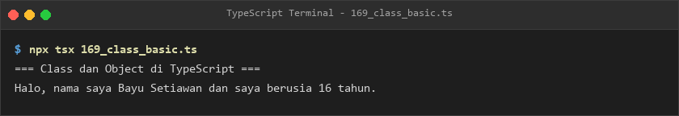
- **Lokasi Source Code:** [169_class_basic.ts](169_class_basic.ts)

### 170. 170_class_properties.ts
- **Tujuan:** Mengelola properti class dengan nilai inisialisasi default dan mutasi terstruktur.
- **Konsep Utama:** Deklarasi properti default level, koin emas, dan status VIP pemain game.
- **Penjelasan Source Code:** Memperbarui level pemain, menambah koin, dan mengaktifkan status VIP.
- **Cara Menjalankan:**
  ```bash
  npx tsx 170_class_properties.ts
  ```
- **Hasil yang Diharapkan:** Status pemain sebelum dan sesudah peningkatan level ditampilkan.
- **Screenshot Hasil Eksekusi:**
  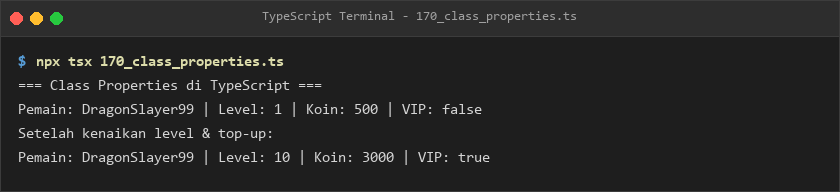
- **Lokasi Source Code:** [170_class_properties.ts](170_class_properties.ts)

### 171. 171_class_methods.ts
- **Tujuan:** Mengatur logika transaksi keuangan dompet elektronik melalui metode objek.
- **Konsep Utama:** Method `isiSaldo`, `belanja`, dan `cetakRingkasan` dengan validasi kecukupan dana.
- **Penjelasan Source Code:** Mensimulasikan top-up saldo dan penolakan transaksi saat dana tidak mencukupi.
- **Cara Menjalankan:**
  ```bash
  npx tsx 171_class_methods.ts
  ```
- **Hasil yang Diharapkan:** Riwayat transaksi isi saldo, belanja sukses, dan belanja gagal tercetak.
- **Screenshot Hasil Eksekusi:**
  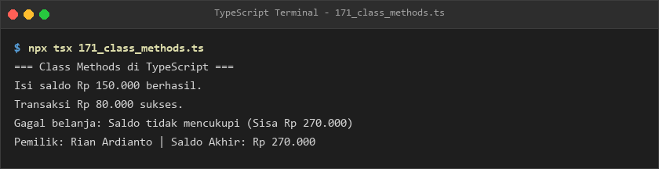
- **Lokasi Source Code:** [171_class_methods.ts](171_class_methods.ts)

### 172. 172_class_constructor.ts
- **Tujuan:** Menginisialisasi parameter konfigurasi jaringan server melalui fungsi konstruktor.
- **Konsep Utama:** Inisialisasi properti `host` dan nilai default `port = 8080`.
- **Penjelasan Source Code:** Membuat dua instance konfigurasi server dan mencetak endpoint URL masing-masing.
- **Cara Menjalankan:**
  ```bash
  npx tsx 172_class_constructor.ts
  ```
- **Hasil yang Diharapkan:** Log booting server dan URL endpoint tercetak rapi.
- **Screenshot Hasil Eksekusi:**
  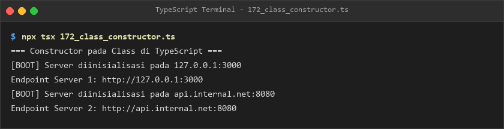
- **Lokasi Source Code:** [172_class_constructor.ts](172_class_constructor.ts)

### 173. 173_access_modifiers.ts
- **Tujuan:** Menerapkan pembatasan akses data menggunakan modifier `public`, `private`, dan `protected`.
- **Konsep Utama:** Enkapsulasi gaji privat dan akses nomor KTP pada subclass manajer.
- **Penjelasan Source Code:** Menunjukkan visibilitas data publik karyawan, gaji terproteksi, dan akses nomor KTP di turunan.
- **Cara Menjalankan:**
  ```bash
  npx tsx 173_access_modifiers.ts
  ```
- **Hasil yang Diharapkan:** Info publik staf dan akses KTP terlindungi pada manajer tercetak.
- **Screenshot Hasil Eksekusi:**
  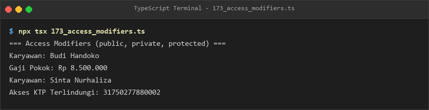
- **Lokasi Source Code:** [173_access_modifiers.ts](173_access_modifiers.ts)

### 174. 174_readonly_class_properties.ts
- **Tujuan:** Mengunci nomor seri perangkat keras agar tidak dapat diubah setelah konstruksi objek.
- **Konsep Utama:** Modifier `readonly` pada properti kelas perangkat IoT.
- **Penjelasan Source Code:** Menginisialisasi nomor seri pada konstruktor dan menampilkan spesifikasi perangkat.
- **Cara Menjalankan:**
  ```bash
  npx tsx 174_readonly_class_properties.ts
  ```
- **Hasil yang Diharapkan:** Rincian spesifikasi perangkat keras tercetak ke terminal.
- **Screenshot Hasil Eksekusi:**
  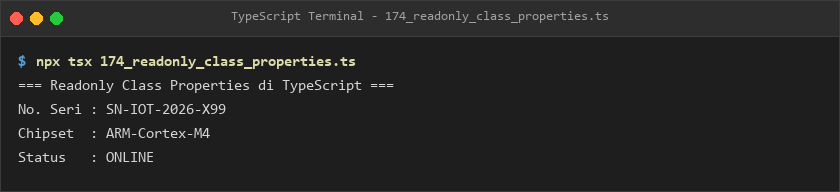
- **Lokasi Source Code:** [174_readonly_class_properties.ts](174_readonly_class_properties.ts)

### 175. 175_parameter_properties.ts
- **Tujuan:** Meringkas penulisan boilerplate class dengan mendeklarasikan properti langsung di parameter konstruktor.
- **Konsep Utama:** Shorthand `constructor(public readonly noRek, public nama, private saldo)`.
- **Penjelasan Source Code:** Mengonstruksi rekening simpanan bank secara ringkas dan aman.
- **Cara Menjalankan:**
  ```bash
  npx tsx 175_parameter_properties.ts
  ```
- **Hasil yang Diharapkan:** Nomor rekening, nama nasabah, dan saldo awal tercetak jelas.
- **Screenshot Hasil Eksekusi:**
  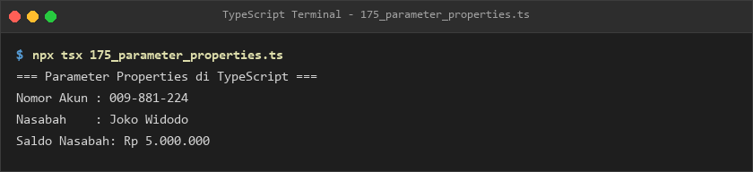
- **Lokasi Source Code:** [175_parameter_properties.ts](175_parameter_properties.ts)

### 176. 176_getters_setters.ts
- **Tujuan:** Memvalidasi ambang batas pengaturan suhu AC melalui metode `get` dan `set`.
- **Konsep Utama:** Enkapsulasi suhu ruangan dan kalkulasi otomatis suhu Fahrenheit.
- **Penjelasan Source Code:** Menolak pengaturan suhu di luar rentang 16°C - 35°C pada thermostat.
- **Cara Menjalankan:**
  ```bash
  npx tsx 176_getters_setters.ts
  ```
- **Hasil yang Diharapkan:** Suhu awal, pembaruan suhu valid, dan peringatan suhu tidak valid ditampilkan.
- **Screenshot Hasil Eksekusi:**
  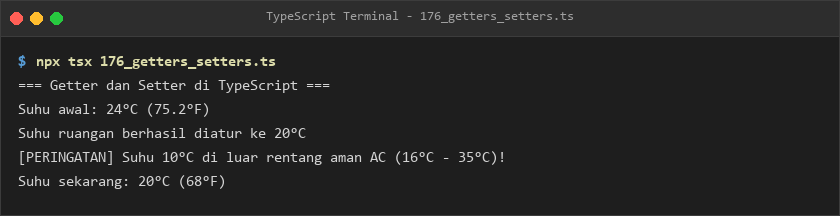
- **Lokasi Source Code:** [176_getters_setters.ts](176_getters_setters.ts)

### 177. 177_static_members.ts
- **Tujuan:** Membuat konstanta dan fungsi utilitas yang melekat langsung pada class matematika.
- **Konsep Utama:** Properti statis `PHI` dan penghitung pemanggilan metode statis bersama.
- **Penjelasan Source Code:** Menghitung luas lingkaran tanpa perlu membuat instance class.
- **Cara Menjalankan:**
  ```bash
  npx tsx 177_static_members.ts
  ```
- **Hasil yang Diharapkan:** Nilai Phi, hasil hitung luas dua lingkaran, dan total pemanggilan statis ditampilkan.
- **Screenshot Hasil Eksekusi:**
  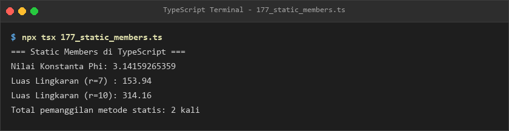
- **Lokasi Source Code:** [177_static_members.ts](177_static_members.ts)

### 178. 178_abstract_classes.ts
- **Tujuan:** Membuat kerangka kelas induk bangun datar yang tidak dapat diinstansiasi secara langsung.
- **Konsep Utama:** Sintaks `abstract class BangunDatar` dengan metode konkret `deskripsi()`.
- **Penjelasan Source Code:** Subclass `Persegi` mengimplementasikan method hitungLuas() sesuai rumus sisinya.
- **Cara Menjalankan:**
  ```bash
  npx tsx 178_abstract_classes.ts
  ```
- **Hasil yang Diharapkan:** Deskripsi bangun datar dan luas persegi tercetak ke konsol.
- **Screenshot Hasil Eksekusi:**
  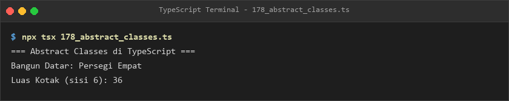
- **Lokasi Source Code:** [178_abstract_classes.ts](178_abstract_classes.ts)

### 179. 179_abstract_methods.ts
- **Tujuan:** Mewajibkan setiap kanal pembayaran digital mengimplementasikan proses verifikasi transaksinya sendiri.
- **Konsep Utama:** Metode abstrak `abstract prosesKanal(): boolean`.
- **Penjelasan Source Code:** Memproses transaksi pembayaran via kanal QRIS dan Transfer Bank secara terstruktur.
- **Cara Menjalankan:**
  ```bash
  npx tsx 179_abstract_methods.ts
  ```
- **Hasil yang Diharapkan:** Log alur pemindaian QRIS dan verifikasi transfer virtual account ditampilkan.
- **Screenshot Hasil Eksekusi:**
  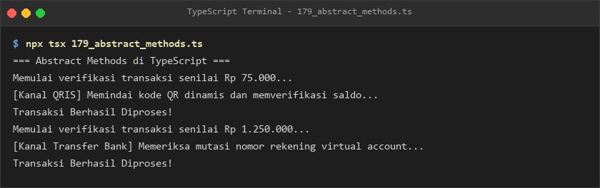
- **Lokasi Source Code:** [179_abstract_methods.ts](179_abstract_methods.ts)

### 180. 180_class_inheritance.ts
- **Tujuan:** Mewariskan atribut kendaraan bermotor ke subclass mobil komersil menggunakan `extends`.
- **Konsep Utama:** Pewarisan atribut dan pemanggilan konstruktor induk melalui `super()`.
- **Penjelasan Source Code:** Truk komersil mewarisi merk dan tahun serta memiliki spesifikasi daya angkut tonase.
- **Cara Menjalankan:**
  ```bash
  npx tsx 180_class_inheritance.ts
  ```
- **Hasil yang Diharapkan:** Bunyi klakson kendaraan dan rincian kapasitas angkut truk tercetak.
- **Screenshot Hasil Eksekusi:**
  
- **Lokasi Source Code:** [180_class_inheritance.ts](180_class_inheritance.ts)

### 181. 181_method_overriding.ts
- **Tujuan:** Menimpa implementasi metode notifikasi biasa dengan notifikasi prioritas berformat khusus.
- **Konsep Utama:** Kata kunci `override` dan pemanggilan `super.kirim()` di dalam subclass.
- **Penjelasan Source Code:** Menampilkan pesan biasa dan pesan prioritas berenkripsi dengan format berbingkai.
- **Cara Menjalankan:**
  ```bash
  npx tsx 181_method_overriding.ts
  ```
- **Hasil yang Diharapkan:** Tampilan dua format pesan notifikasi tercetak ke terminal.
- **Screenshot Hasil Eksekusi:**
  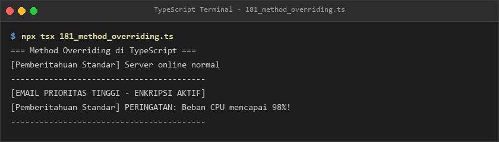
- **Lokasi Source Code:** [181_method_overriding.ts](181_method_overriding.ts)

### 182. 182_implements_keyword.ts
- **Tujuan:** Mengikat class programmer dengan dua kontrak interface (`Bekerja` dan `Istirahat`).
- **Konsep Utama:** Multiple interface implementation `class Programmer implements Bekerja, Istirahat`.
- **Penjelasan Source Code:** Menjalankan rutinitas menulis kode dan istirahat minum kopi bagi programmer.
- **Cara Menjalankan:**
  ```bash
  npx tsx 182_implements_keyword.ts
  ```
- **Hasil yang Diharapkan:** Aktivitas bekerja dan durasi istirahat programmer tercetak.
- **Screenshot Hasil Eksekusi:**
  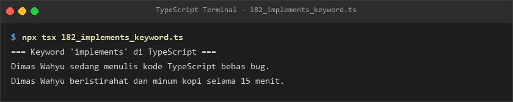
- **Lokasi Source Code:** [182_implements_keyword.ts](182_implements_keyword.ts)

### 183. 183_abstract_vs_interface.ts
- **Tujuan:** Membandingkan antarmuka murni interface logger dengan kerangka dasar abstract class berstempel waktu.
- **Konsep Utama:** Pembedaan implementasi method konkret pada abstract class dibanding interface murni.
- **Penjelasan Source Code:** Logger JSON mewarisi format stempel waktu dari base abstract class.
- **Cara Menjalankan:**
  ```bash
  npx tsx 183_abstract_vs_interface.ts
  ```
- **Hasil yang Diharapkan:** Log berstempel waktu lokal dan muatan pesan JSON ditampilkan.
- **Screenshot Hasil Eksekusi:**
  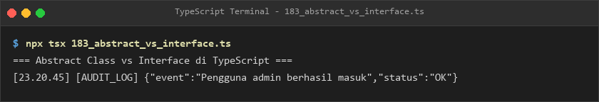
- **Lokasi Source Code:** [183_abstract_vs_interface.ts](183_abstract_vs_interface.ts)

### 184. 184_polymorphism.ts
- **Tujuan:** Memainkan berbagai instrumen musik yang berbeda melalui antarmuka polimorfis kelas induk `AlatMusik`.
- **Konsep Utama:** Array polimorfis `AlatMusik[]` yang mengeksekusi metode `mainkan()` masing-masing.
- **Penjelasan Source Code:** Menjalankan konser instrumen gitar, drum, dan piano dalam satu perulangan seragam.
- **Cara Menjalankan:**
  ```bash
  npx tsx 184_polymorphism.ts
  ```
- **Hasil yang Diharapkan:** Suara instrumen gitar, drum, dan piano tercetak berurutan.
- **Screenshot Hasil Eksekusi:**
  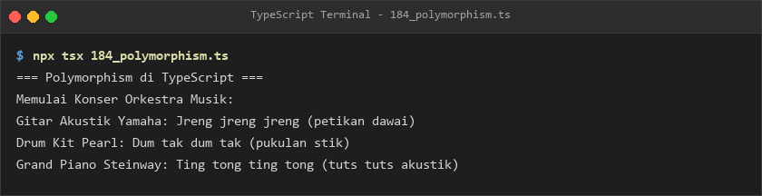
- **Lokasi Source Code:** [184_polymorphism.ts](184_polymorphism.ts)

### 185. 185_composition.ts
- **Tujuan:** Merancang mobil balap melalui penggabungan komponen mesin dan roda yang independen.
- **Konsep Utama:** Desain komposisi arsitektur (Composition over Inheritance).
- **Penjelasan Source Code:** Class `MobilBalap` mengendalikan siklus hidup mesin dan putaran rodanya.
- **Cara Menjalankan:**
  ```bash
  npx tsx 185_composition.ts
  ```
- **Hasil yang Diharapkan:** Log aktivasi mesin berkekuatan tenaga kuda dan putaran roda ditampilkan.
- **Screenshot Hasil Eksekusi:**
  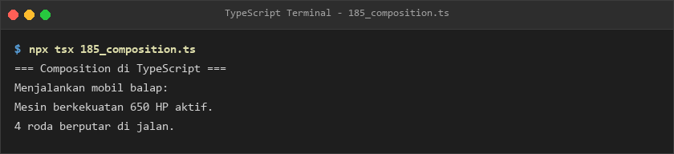
- **Lokasi Source Code:** [185_composition.ts](185_composition.ts)

### 186. 186_aggregation.ts
- **Tujuan:** Memodelkan relasi asosiasi guru dan sekolah di mana objek guru dapat berdiri sendiri.
- **Konsep Utama:** Agregasi objek independen yang ditampung ke dalam array sekolah.
- **Penjelasan Source Code:** Mendaftarkan guru fisika dan kimia ke sekolah tanpa kepemilikan mutlak siklus hidup.
- **Cara Menjalankan:**
  ```bash
  npx tsx 186_aggregation.ts
  ```
- **Hasil yang Diharapkan:** Notifikasi bergabungnya guru dan daftar pendidik sekolah tercetak.
- **Screenshot Hasil Eksekusi:**
  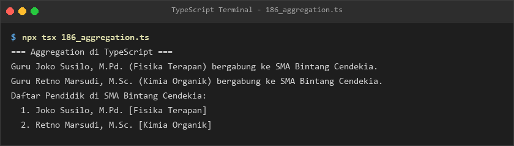
- **Lokasi Source Code:** [186_aggregation.ts](186_aggregation.ts)

### 187. 187_generic_classes_advanced.ts
- **Tujuan:** Membangun repository memori CRUD generik dengan ID bertipe dinamis.
- **Konsep Utama:** Repositori berpola `RepositoriMemori<T extends EntitasBeridentitas<ID>, ID>`.
- **Penjelasan Source Code:** Menyimpan dan mencari data mahasiswa berdasarkan ID numerik secara type-safe.
- **Cara Menjalankan:**
  ```bash
  npx tsx 187_generic_classes_advanced.ts
  ```
- **Hasil yang Diharapkan:** Hasil pencarian mahasiswa dan total data tersimpan tercetak jelas.
- **Screenshot Hasil Eksekusi:**
  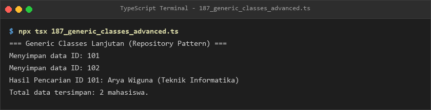
- **Lokasi Source Code:** [187_generic_classes_advanced.ts](187_generic_classes_advanced.ts)

### 188. 188_parameter_decorators.ts
- **Tujuan:** Menerapkan method decorator untuk mencatat log pemanggilan method dan argumen secara otomatis.
- **Konsep Utama:** Decorator `@LogEksekusi` yang membungkus fungsi kalkulator.
- **Penjelasan Source Code:** Mencatat argumen masukan dan hasil keluaran operasi tambah dan kali.
- **Cara Menjalankan:**
  ```bash
  npx tsx 188_parameter_decorators.ts
  ```
- **Hasil yang Diharapkan:** Log instrumentasi pemanggilan fungsi dan hasil akhir kalkulasi ditampilkan.
- **Screenshot Hasil Eksekusi:**
  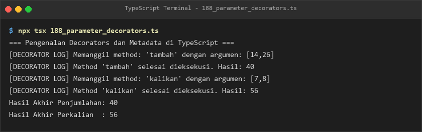
- **Lokasi Source Code:** [188_parameter_decorators.ts](188_parameter_decorators.ts)

---

## E. Ringkasan Modul
Modul 11 membahas tuntas Pemrograman Berorientasi Objek (OOP) modern di TypeScript. Mulai dari instansiasi objek, kontrol visibilitas properti (`public`, `private`, `protected`), getters/setters, static members, pewarisan bertingkat, method overriding, polimorfisme, pemodelan arsitektur komposisi & agregasi, hingga generic repository dan decorators. Fondasi ini membekali pembelajar dengan kemampuan membangun sistem berorientasi objek yang kuat dan teruji.
