# Modul 12: Modules dan Pengelolaan Proyek

## A. Judul Modul
- **Nomor Modul:** 12
- **Nama Modul:** Modules dan Pengelolaan Proyek
- **Ruang Lingkup:** Penggunaan *named exports*, *default exports*, *named imports*, *default imports*, impor namespace (`import * as`), teknik penerusan ekspor (*re-exports / barrel pattern*), impor dinamis (*dynamic import* `import()`), strategi resolusi modul (*module resolution*), augmentasi modul (*module augmentation*), penggabungan deklarasi tingkat lanjut (*declaration merging*), modul ambient (`declare module`), berkas deklarasi tipe (`.d.ts`), deklarasi cakupan global (`declare global`), pengelompokan fungsi dengan *namespaces*, arsitektur monorepo dengan *project references*, konfigurasi alias path (`paths` mapping), struktur dasar `tsconfig.json`, serta pengaturan opsi compiler ketat (*compiler options*).
- **Tujuan Pembelajaran:** Menguasai tata kelola arsitektur proyek modular di TypeScript, mampu menyusun struktur impor dan ekspor yang bersih, mengoptimalkan proses kompilasi monorepo, serta menyempurnakan konfigurasi compiler untuk keamanan kode tingkat produksi.

---

## B. Daftar Materi atau Submodul
189. [`189_es_module_exports.ts`](189_es_module_exports.ts) : Named exports
190. [`190_default_exports.ts`](190_default_exports.ts) : Default exports
191. [`191_named_imports.ts`](191_named_imports.ts) : Named imports
192. [`192_default_imports.ts`](192_default_imports.ts) : Default imports
193. [`193_namespace_imports.ts`](193_namespace_imports.ts) : Namespace imports
194. [`194_re_exports.ts`](194_re_exports.ts) : Re-exports
195. [`195_dynamic_import.ts`](195_dynamic_import.ts) : Dynamic import
196. [`196_module_resolution.ts`](196_module_resolution.ts) : Module resolution
197. [`197_module_augmentation.ts`](197_module_augmentation.ts) : Module augmentation
198. [`198_declaration_merging.ts`](198_declaration_merging.ts) : Declaration merging lanjutan
199. [`199_ambient_modules.ts`](199_ambient_modules.ts) : Ambient modules
200. [`200_declaration_files.ts`](200_declaration_files.ts) : Declaration files `.d.ts`
201. [`201_global_declarations.ts`](201_global_declarations.ts) : Global declarations
202. [`202_namespace_basic.ts`](202_namespace_basic.ts) : Namespace
203. [`203_project_references.ts`](203_project_references.ts) : Project references
204. [`204_path_aliases.ts`](204_path_aliases.ts) : Path aliases
205. [`205_tsconfig_basic.ts`](205_tsconfig_basic.ts) : Konfigurasi `tsconfig.json`
206. [`206_compiler_options.ts`](206_compiler_options.ts) : Compiler options

---

## C. Penjelasan Setiap Submodul

### 189. 189_es_module_exports.ts
- **Tujuan:** Mengekspos konstanta dan fungsi menggunakan sintaks named exports.
- **Konsep Utama:** Kata kunci `export const` dan `export function`.
- **Penjelasan Source Code:** Menyediakan konstanta versi modul, kurs dollar, fungsi kalkulasi pajak, dan pemformat Rupiah.
- **Cara Menjalankan:**
  ```bash
  npx tsx 189_es_module_exports.ts
  ```
- **Hasil yang Diharapkan:** Versi modul, kurs dollar, dan perhitungan pajak tercetak ke terminal.
- **Screenshot Hasil Eksekusi:**
  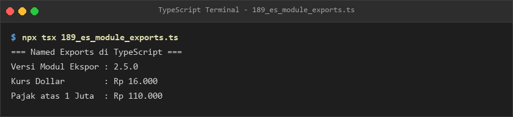
- **Lokasi Source Code:** [189_es_module_exports.ts](189_es_module_exports.ts)

### 190. 190_default_exports.ts
- **Tujuan:** Mengekspor satu entitas class utama sebagai default export dari berkas modul.
- **Konsep Utama:** Kata kunci `export default class LayananAutentikasi`.
- **Penjelasan Source Code:** Mengelola metode autentikasi pengguna masuk dan keluar pada sebuah domain.
- **Cara Menjalankan:**
  ```bash
  npx tsx 190_default_exports.ts
  ```
- **Hasil yang Diharapkan:** Pesan log login dan logout autentikasi ditampilkan.
- **Screenshot Hasil Eksekusi:**
  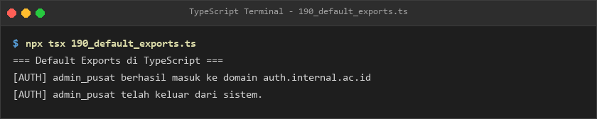
- **Lokasi Source Code:** [190_default_exports.ts](190_default_exports.ts)

### 191. 191_named_imports.ts
- **Tujuan:** Mengimpor item spesifik dengan atau tanpa alias nama dari modul lain.
- **Konsep Utama:** Sintaks `import { hitungPajak, formatRupiah as rupiah }`.
- **Penjelasan Source Code:** Menghitung total belanja beserta PPN 11% menggunakan fungsi yang diimpor.
- **Cara Menjalankan:**
  ```bash
  npx tsx 191_named_imports.ts
  ```
- **Hasil yang Diharapkan:** Rincian belanja, PPN, dan total bayar terformat Rupiah tercetak.
- **Screenshot Hasil Eksekusi:**
  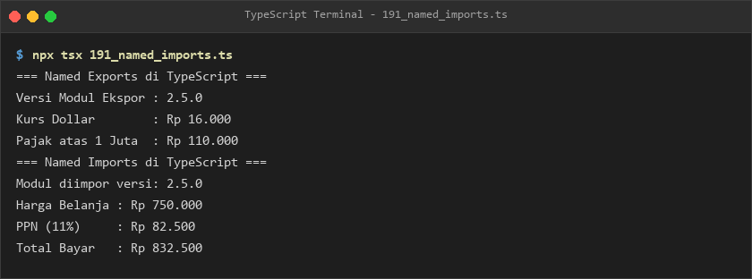
- **Lokasi Source Code:** [191_named_imports.ts](191_named_imports.ts)

### 192. 192_default_imports.ts
- **Tujuan:** Mengimpor default export class menggunakan penamaan lokal yang independen.
- **Konsep Utama:** Sintaks `import AuthHandler from "./190_default_exports"`.
- **Penjelasan Source Code:** Menginstansiasi instance layanan auth SSO kampus dan memvalidasi akses mahasiswa.
- **Cara Menjalankan:**
  ```bash
  npx tsx 192_default_imports.ts
  ```
- **Hasil yang Diharapkan:** Pesan berhasil masuk ke domain SSO kampus ditampilkan.
- **Screenshot Hasil Eksekusi:**
  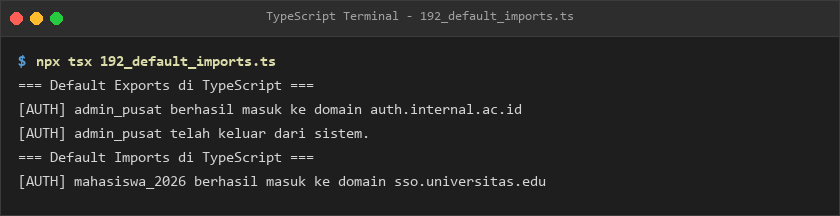
- **Lokasi Source Code:** [192_default_imports.ts](192_default_imports.ts)

### 193. 193_namespace_imports.ts
- **Tujuan:** Mengelompokkan seluruh named exports menjadi satu objek namespace terpadu.
- **Konsep Utama:** Sintaks `import * as KeuanganUtils`.
- **Penjelasan Source Code:** Mengakses seluruh fungsi keuangan melalui prefix namespace.
- **Cara Menjalankan:**
  ```bash
  npx tsx 193_namespace_imports.ts
  ```
- **Hasil yang Diharapkan:** Versi engine, omset bisnis, dan kewajiban PPN tercetak jelas.
- **Screenshot Hasil Eksekusi:**
  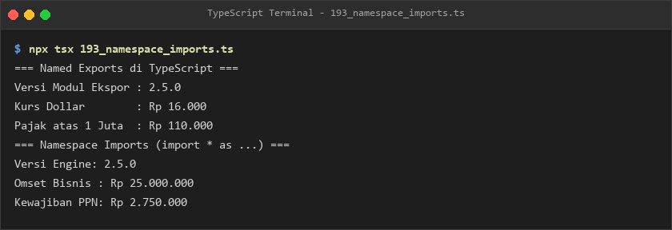
- **Lokasi Source Code:** [193_namespace_imports.ts](193_namespace_imports.ts)

### 194. 194_re_exports.ts
- **Tujuan:** Menyediakan satu gerbang ekspor terpadu (*barrel file*) untuk beberapa modul internal.
- **Konsep Utama:** Penerusan ekspor `export { ... } from "./..."`.
- **Penjelasan Source Code:** Mendemonstrasikan arsitektur modular barrel yang mempermudah pengorganisasian kode.
- **Cara Menjalankan:**
  ```bash
  npx tsx 194_re_exports.ts
  ```
- **Hasil yang Diharapkan:** Penjelasan pola barrel dan contoh sintaks re-export ditampilkan.
- **Screenshot Hasil Eksekusi:**
  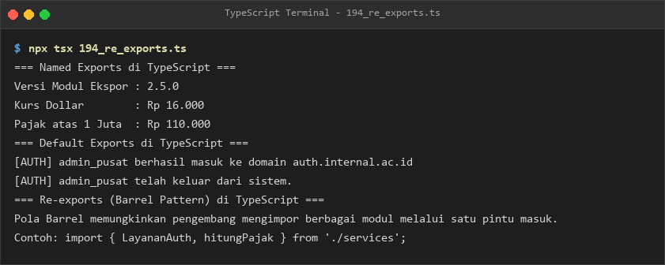
- **Lokasi Source Code:** [194_re_exports.ts](194_re_exports.ts)

### 195. 195_dynamic_import.ts
- **Tujuan:** Memuat modul secara dinamis saat runtime (*lazy loading*) berbasis asynchronous Promise.
- **Konsep Utama:** Pemanggilan fungsi ekspresi `await import(...)`.
- **Penjelasan Source Code:** Mengunduh modul finansial hanya ketika fungsi dipanggil untuk menghemat beban awal.
- **Cara Menjalankan:**
  ```bash
  npx tsx 195_dynamic_import.ts
  ```
- **Hasil yang Diharapkan:** Log pengunduhan dinamis dan hasil konversi mata uang tercetak.
- **Screenshot Hasil Eksekusi:**
  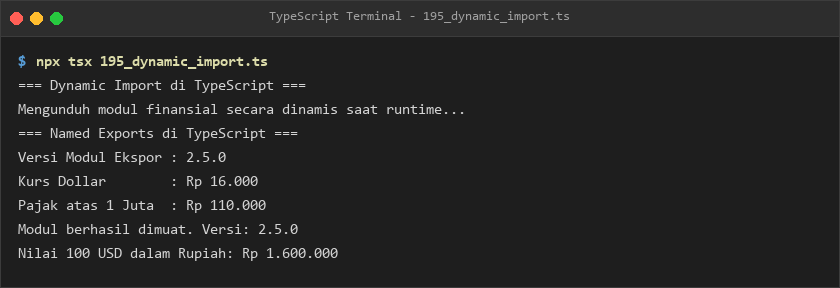
- **Lokasi Source Code:** [195_dynamic_import.ts](195_dynamic_import.ts)

### 196. 196_module_resolution.ts
- **Tujuan:** Memahami algoritma pelacakan path file modul relatif vs non-relatif pada runtime Node.js.
- **Konsep Utama:** Strategi module resolution `NodeNext` dan pelacakan folder `node_modules`.
- **Penjelasan Source Code:** Menjelaskan perbedaan pencarian berkas relatif dan paket non-relatif.
- **Cara Menjalankan:**
  ```bash
  npx tsx 196_module_resolution.ts
  ```
- **Hasil yang Diharapkan:** Ringkasan strategi resolusi modul tercetak ke terminal.
- **Screenshot Hasil Eksekusi:**
  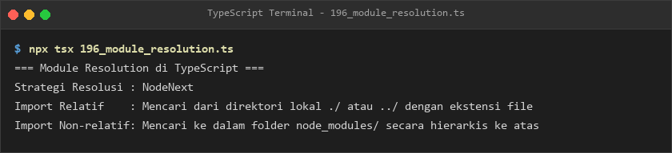
- **Lokasi Source Code:** [196_module_resolution.ts](196_module_resolution.ts)

### 197. 197_module_augmentation.ts
- **Tujuan:** Memperluas definisi interface modul tanpa memodifikasi kode sumber aslinya.
- **Konsep Utama:** Menambahkan properti `versiRilis` dan `lingkungan` ke interface modul yang sudah ada.
- **Penjelasan Source Code:** Mengonfigurasi objek dengan properti awal dan properti hasil augmentasi.
- **Cara Menjalankan:**
  ```bash
  npx tsx 197_module_augmentation.ts
  ```
- **Hasil yang Diharapkan:** Data konfigurasi hasil augmentasi ditampilkan.
- **Screenshot Hasil Eksekusi:**
  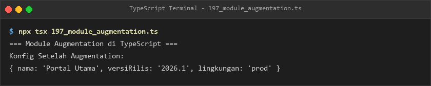
- **Lokasi Source Code:** [197_module_augmentation.ts](197_module_augmentation.ts)

### 198. 198_declaration_merging.ts
- **Tujuan:** Menggabungkan deklarasi fungsi dengan namespace untuk menambahkan atribut statis terstruktur.
- **Konsep Utama:** Penggabungan `function bangunKoneksi` dengan `namespace bangunKoneksi`.
- **Penjelasan Source Code:** Mengakses port default dari namespace dan mengeksekusi fungsi pembangun koneksi.
- **Cara Menjalankan:**
  ```bash
  npx tsx 198_declaration_merging.ts
  ```
- **Hasil yang Diharapkan:** Port default, protokol, dan URL string koneksi tercetak.
- **Screenshot Hasil Eksekusi:**
  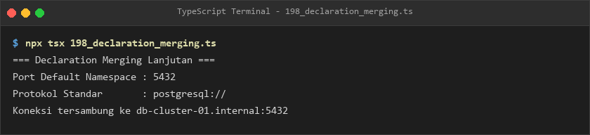
- **Lokasi Source Code:** [198_declaration_merging.ts](198_declaration_merging.ts)

### 199. 199_ambient_modules.ts
- **Tujuan:** Mengenal deklarasi tipe ambient (`declare module`) untuk file aset grafis atau pustaka legacy.
- **Konsep Utama:** Deklarasi module shim untuk format file `*.png` dan modul JavaScript murni.
- **Penjelasan Source Code:** Menjelaskan cara kerja ambient module dalam mengatasi pesan error tipe modul tak terdefinisi.
- **Cara Menjalankan:**
  ```bash
  npx tsx 199_ambient_modules.ts
  ```
- **Hasil yang Diharapkan:** Penjelasan ambient module dan contoh deklarasi tercetak.
- **Screenshot Hasil Eksekusi:**
  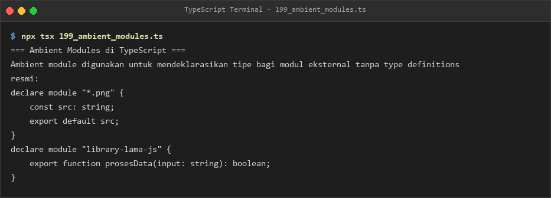
- **Lokasi Source Code:** [199_ambient_modules.ts](199_ambient_modules.ts)

### 200. 200_declaration_files.ts
- **Tujuan:** Memahami fungsi berkas `.d.ts` yang mendistribusikan metadata tipe data murni tanpa kode eksekusi.
- **Konsep Utama:** Peran `.d.ts` dalam ekosistem npm DefinitelyTyped (`@types/*`).
- **Penjelasan Source Code:** Menampilkan karakteristik berkas deklarasi tipe TypeScript.
- **Cara Menjalankan:**
  ```bash
  npx tsx 200_declaration_files.ts
  ```
- **Hasil yang Diharapkan:** Ringkasan peran berkas `.d.ts` ditampilkan ke terminal.
- **Screenshot Hasil Eksekusi:**
  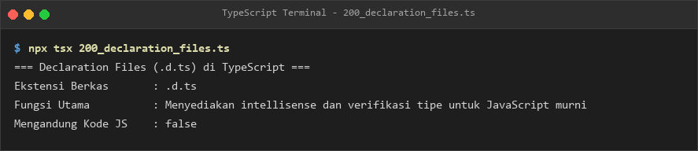
- **Lokasi Source Code:** [200_declaration_files.ts](200_declaration_files.ts)

### 201. 201_global_declarations.ts
- **Tujuan:** Mengelola konfigurasi variabel global aplikasi secara terpusat.
- **Konsep Utama:** Deklarasi bentuk data global yang dapat diakses dari seluruh modul.
- **Penjelasan Source Code:** Mengakses endpoint URL API dan status mode debug global.
- **Cara Menjalankan:**
  ```bash
  npx tsx 201_global_declarations.ts
  ```
- **Hasil yang Diharapkan:** Endpoint URL dan status mode debug global tercetak.
- **Screenshot Hasil Eksekusi:**
  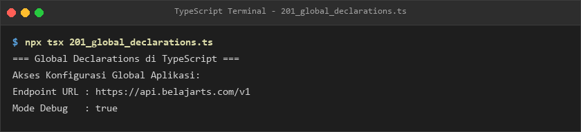
- **Lokasi Source Code:** [201_global_declarations.ts](201_global_declarations.ts)

### 202. 202_namespace_basic.ts
- **Tujuan:** Mengelompokkan fungsi-fungsi geometri ke dalam namespace untuk mencegah tabrakan nama global.
- **Konsep Utama:** Kata kunci `namespace Geometri2D` dan metode yang di-export.
- **Penjelasan Source Code:** Menghitung luas persegi dan luas lingkaran melalui namespace geometri.
- **Cara Menjalankan:**
  ```bash
  npx tsx 202_namespace_basic.ts
  ```
- **Hasil yang Diharapkan:** Nilai konstanta Phi dan hasil perhitungan luas bangun datar ditampilkan.
- **Screenshot Hasil Eksekusi:**
  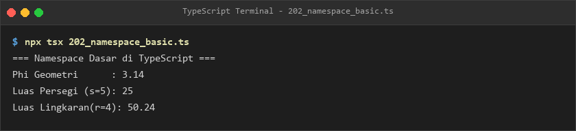
- **Lokasi Source Code:** [202_namespace_basic.ts](202_namespace_basic.ts)

### 203. 203_project_references.ts
- **Tujuan:** Memahami konfigurasi Project References untuk arsitektur monorepo berkinerja tinggi.
- **Konsep Utama:** Pengaturan opsi `composite: true` pada subproyek domain, backend, dan frontend.
- **Penjelasan Source Code:** Memetakan hierarki sub-proyek monorepo dan jalurnya.
- **Cara Menjalankan:**
  ```bash
  npx tsx 203_project_references.ts
  ```
- **Hasil yang Diharapkan:** Daftar subproyek dan status composite monorepo ditampilkan.
- **Screenshot Hasil Eksekusi:**
  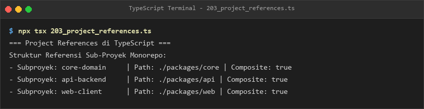
- **Lokasi Source Code:** [203_project_references.ts](203_project_references.ts)

### 204. 204_path_aliases.ts
- **Tujuan:** Menghilangkan path impor relatif bertingkat (`../../..`) menggunakan pemetaan path alias.
- **Konsep Utama:** Pengaturan opsi `paths` pada file konfigurasi tsconfig.json.
- **Penjelasan Source Code:** Menampilkan daftar mapping alias path `@core`, `@utils`, dan `@models`.
- **Cara Menjalankan:**
  ```bash
  npx tsx 204_path_aliases.ts
  ```
- **Hasil yang Diharapkan:** Daftar pemetaan path alias tercetak rapi.
- **Screenshot Hasil Eksekusi:**
  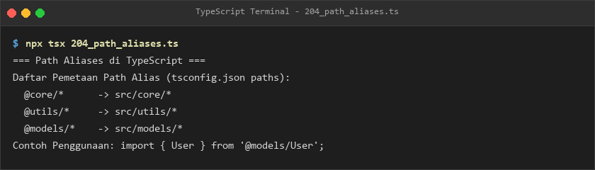
- **Lokasi Source Code:** [204_path_aliases.ts](204_path_aliases.ts)

### 205. 205_tsconfig_basic.ts
- **Tujuan:** Memahami struktur dasar dan seksi kunci dalam berkas `tsconfig.json`.
- **Konsep Utama:** Konfigurasi seksi `compilerOptions`, `include`, dan `exclude`.
- **Penjelasan Source Code:** Menampilkan objek representasi tsconfig.json terformat JSON.
- **Cara Menjalankan:**
  ```bash
  npx tsx 205_tsconfig_basic.ts
  ```
- **Hasil yang Diharapkan:** Struktur standar tsconfig.json tercetak lengkap.
- **Screenshot Hasil Eksekusi:**
  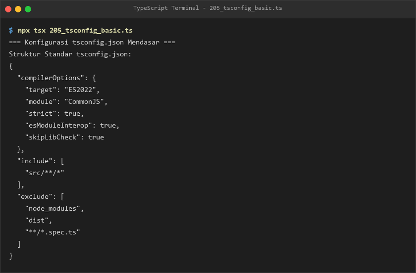
- **Lokasi Source Code:** [205_tsconfig_basic.ts](205_tsconfig_basic.ts)

### 206. 206_compiler_options.ts
- **Tujuan:** Mengetahui opsi compiler ketat untuk menjamin kualitas tinggi kode aplikasi produksi.
- **Konsep Utama:** Opsi `noImplicitAny`, `strictNullChecks`, `noUnusedLocals`, dan `noImplicitReturns`.
- **Penjelasan Source Code:** Menguraikan peran dan fungsi dari masing-masing opsi compiler ketat.
- **Cara Menjalankan:**
  ```bash
  npx tsx 206_compiler_options.ts
  ```
- **Hasil yang Diharapkan:** Rincian opsi compiler ketat tercetak ke terminal.
- **Screenshot Hasil Eksekusi:**
  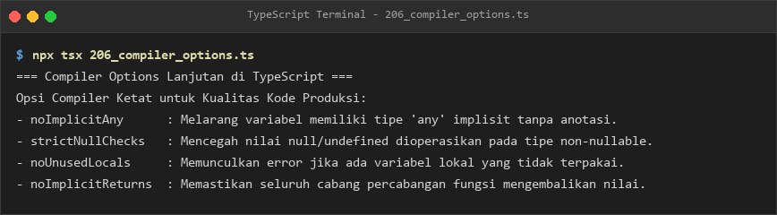
- **Lokasi Source Code:** [206_compiler_options.ts](206_compiler_options.ts)

---

## E. Ringkasan Modul
Modul 12 mengupas tuntas pengelolaan modularitas dan manajemen proyek di TypeScript. Pembelajar memahami ekosistem impor-ekspor modern (ES Modules, default & named, barrel re-exports, dynamic imports), deklarasi tipe (.d.ts & ambient modules), arsitektur monorepo dengan Project References, hingga penataan konfigurasi compiler `tsconfig.json` yang ketat demi menjaga standar kualitas aplikasi kelas enterprise.
