# Modul 13: Asynchronous Programming dan Error Handling

## A. Judul Modul
- **Nomor Modul:** 13
- **Nama Modul:** Asynchronous Programming dan Error Handling
- **Ruang Lingkup:** Penggunaan callback asynchronous, pembentukan *Promise* dasar, keamanan tipe *Promise types* (`Promise<T>`), perangkaian metode `.then()`, `.catch()`, `.finally()`, eksekusi paralel dengan `Promise.all()`, penanganan penyelesaian penuh dengan `Promise.allSettled()`, perlombaan tercepat dengan `Promise.race()`, fungsi `async/await`, penanganan eksepsi menggunakan `try...catch`, tipe kembalian asynchronous, *generic promises*, konsumsi data bertahap dengan *async iterators* (`for await...of`), pembentukan data on-demand via *async generators* (`async function*`), pembatalan tugas via `AbortController`, penggunaan Fetch API, HTTP GET & POST terketik, tipe respons API terstandar, pola pengulangan otomatis (*async retry*), klasifikasi galat kustom (*error hierarchy*), serta penerapan pola *Result type* (`Ok / Err`).
- **Tujuan Pembelajaran:** Menguasai pemrograman asynchronous modern di TypeScript, mampu menangani operasi I/O dan jaringan secara tangguh, serta merancang arsitektur penanganan kesalahan yang elegan tanpa memicu *unhandled rejection* atau crash runtime.

---

## B. Daftar Materi atau Submodul
207. [`207_callback_functions.ts`](207_callback_functions.ts) : Callback functions
208. [`208_promise_basic.ts`](208_promise_basic.ts) : Promise
209. [`209_promise_types.ts`](209_promise_types.ts) : Promise types
210. [`210_promise_then_catch.ts`](210_promise_then_catch.ts) : `.then()` dan `.catch()`
211. [`211_promise_all.ts`](211_promise_all.ts) : `Promise.all()`
212. [`212_promise_all_settled.ts`](212_promise_all_settled.ts) : `Promise.allSettled()`
213. [`213_promise_race.ts`](213_promise_race.ts) : `Promise.race()`
214. [`214_async_functions.ts`](214_async_functions.ts) : Async functions
215. [`215_await_keyword.ts`](215_await_keyword.ts) : Keyword `await`
216. [`216_async_error_handling.ts`](216_async_error_handling.ts) : Penanganan error asynchronous
217. [`217_async_return_types.ts`](217_async_return_types.ts) : Return types asynchronous
218. [`218_generic_promises.ts`](218_generic_promises.ts) : Generic promises
219. [`219_async_iterators.ts`](219_async_iterators.ts) : Async iterators
220. [`220_async_generators.ts`](220_async_generators.ts) : Async generators
221. [`221_abort_controller.ts`](221_abort_controller.ts) : AbortController
222. [`222_fetch_api.ts`](222_fetch_api.ts) : Fetch API
223. [`223_fetch_get_request.ts`](223_fetch_get_request.ts) : HTTP GET request
224. [`224_fetch_post_request.ts`](224_fetch_post_request.ts) : HTTP POST request
225. [`225_api_response_types.ts`](225_api_response_types.ts) : Tipe respons API
226. [`226_async_retry.ts`](226_async_retry.ts) : Pola retry asynchronous
227. [`227_error_classification.ts`](227_error_classification.ts) : Klasifikasi error
228. [`228_result_type_pattern.ts`](228_result_type_pattern.ts) : Pola Result type

---

## C. Penjelasan Setiap Submodul

### 207. 207_callback_functions.ts
- **Tujuan:** Menjalankan operasi asynchronous menggunakan pola error-first callback.
- **Konsep Utama:** Type `ErrorFirstCallback<T>` dan simulasi jeda I/O.
- **Penjelasan Source Code:** Membaca konten berkas dan mengembalikan isi dokumen atau galat format tidak didukung.
- **Cara Menjalankan:**
  ```bash
  npx tsx 207_callback_functions.ts
  ```
- **Hasil yang Diharapkan:** Log pembacaan sukses dengan konten dokumen ditampilkan.
- **Screenshot Hasil Eksekusi:**
  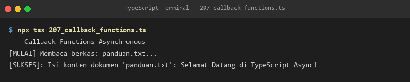
- **Lokasi Source Code:** [207_callback_functions.ts](207_callback_functions.ts)

### 208. 208_promise_basic.ts
- **Tujuan:** Membuat objek Promise dengan transisi status resolve dan reject.
- **Konsep Utama:** Konstruktor `new Promise((resolve, reject) => ...)`.
- **Penjelasan Source Code:** Mensimulasikan pengecekan kesehatan server dan menangani hasil resolvenya.
- **Cara Menjalankan:**
  ```bash
  npx tsx 208_promise_basic.ts
  ```
- **Hasil yang Diharapkan:** Pesan respon server aktif tercetak ke terminal.
- **Screenshot Hasil Eksekusi:**
  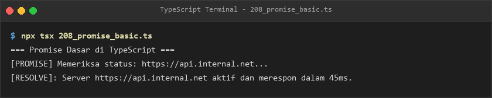
- **Lokasi Source Code:** [208_promise_basic.ts](208_promise_basic.ts)

### 209. 209_promise_types.ts
- **Tujuan:** Menetapkan anotasi tipe `Promise<DataProfilMahasiswa>` pada fungsi pengambil data.
- **Konsep Utama:** Keamanan tipe muatan asynchronous.
- **Penjelasan Source Code:** Mengambil data profil mahasiswa dan mencetak NIM, nama, jurusan, dan IPK.
- **Cara Menjalankan:**
  ```bash
  npx tsx 209_promise_types.ts
  ```
- **Hasil yang Diharapkan:** Rincian data profil mahasiswa tercetak rapi.
- **Screenshot Hasil Eksekusi:**
  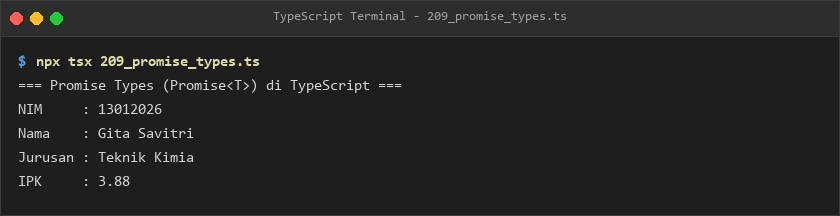
- **Lokasi Source Code:** [209_promise_types.ts](209_promise_types.ts)

### 210. 210_promise_then_catch.ts
- **Tujuan:** Merangkai operasi asynchronous berurutan menggunakan teknik promise chaining.
- **Konsep Utama:** Penanganan tiga tahap kalkulasi berantai, blok `.catch()`, dan blok `.finally()`.
- **Penjelasan Source Code:** Mengalikan dan menambahkan angka secara berurutan dengan penutupan di blok finally.
- **Cara Menjalankan:**
  ```bash
  npx tsx 210_promise_then_catch.ts
  ```
- **Hasil yang Diharapkan:** Tiga tahapan kalkulasi angka dan pesan penutup finally tercetak.
- **Screenshot Hasil Eksekusi:**
  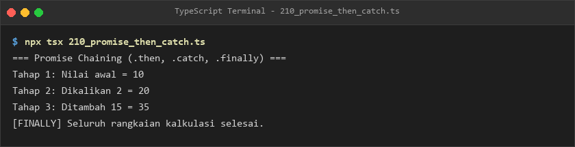
- **Lokasi Source Code:** [210_promise_then_catch.ts](210_promise_then_catch.ts)

### 211. 211_promise_all.ts
- **Tujuan:** Menjalankan tiga permintaan data mikroservis secara paralel dan menunggu penyelesaiannya.
- **Konsep Utama:** Metode `Promise.all([p1, p2, p3])`.
- **Penjelasan Source Code:** Menunggu respon data user, produk, dan promo secara simultan.
- **Cara Menjalankan:**
  ```bash
  npx tsx 211_promise_all.ts
  ```
- **Hasil yang Diharapkan:** Seluruh hasil respon ketiga layanan mikroservis ditampilkan.
- **Screenshot Hasil Eksekusi:**
  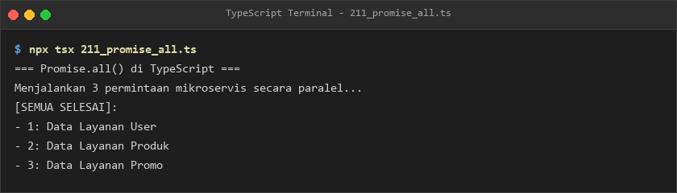
- **Lokasi Source Code:** [211_promise_all.ts](211_promise_all.ts)

### 212. 212_promise_all_settled.ts
- **Tujuan:** Mengetahui status seluruh tugas asynchronous tanpa terputus jika ada salah satu tugas yang gagal.
- **Konsep Utama:** Metode `Promise.allSettled()` dan pembedaan status `fulfilled` vs `rejected`.
- **Penjelasan Source Code:** Memeriksa tugas notifikasi email sukses, sms gagal, dan database sukses.
- **Cara Menjalankan:**
  ```bash
  npx tsx 212_promise_all_settled.ts
  ```
- **Hasil yang Diharapkan:** Rekapitulasi status dan pesan tiap tugas tercetak.
- **Screenshot Hasil Eksekusi:**
  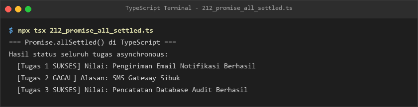
- **Lokasi Source Code:** [212_promise_all_settled.ts](212_promise_all_settled.ts)

### 213. 213_promise_race.ts
- **Tujuan:** Memilih respon server paling cepat antara server Singapura dan server Tokyo.
- **Konsep Utama:** Metode `Promise.race([p1, p2])`.
- **Penjelasan Source Code:** Menentukan pemenang respon tercepat yang tiba dalam 70ms.
- **Cara Menjalankan:**
  ```bash
  npx tsx 213_promise_race.ts
  ```
- **Hasil yang Diharapkan:** Pengumuman pemenang server tercepat ditampilkan.
- **Screenshot Hasil Eksekusi:**
  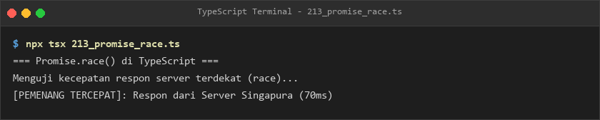
- **Lokasi Source Code:** [213_promise_race.ts](213_promise_race.ts)

### 214. 214_async_functions.ts
- **Tujuan:** Membuat fungsi asynchronous menggunakan kata kunci `async function`.
- **Konsep Utama:** Pembungkusan otomatis nilai kembalian ke dalam Promise.
- **Penjelasan Source Code:** Menghasilkan pesan sambutan dan menangani resolvenya.
- **Cara Menjalankan:**
  ```bash
  npx tsx 214_async_functions.ts
  ```
- **Hasil yang Diharapkan:** Pesan selamat datang tercetak ke konsol.
- **Screenshot Hasil Eksekusi:**
  
- **Lokasi Source Code:** [214_async_functions.ts](214_async_functions.ts)

### 215. 215_await_keyword.ts
- **Tujuan:** Menghentikan sementara alur fungsi async hingga operasi tunda selesai secara sekuensial.
- **Konsep Utama:** Penggunaan kata kunci `await` pada fungsi alur pemesanan tiket.
- **Penjelasan Source Code:** Menjalankan verifikasi kursi, penguncian tiket, dan penerbitan tiket berurutan.
- **Cara Menjalankan:**
  ```bash
  npx tsx 215_await_keyword.ts
  ```
- **Hasil yang Diharapkan:** Tiga langkah pemesanan tiket tercetak teratur.
- **Screenshot Hasil Eksekusi:**
  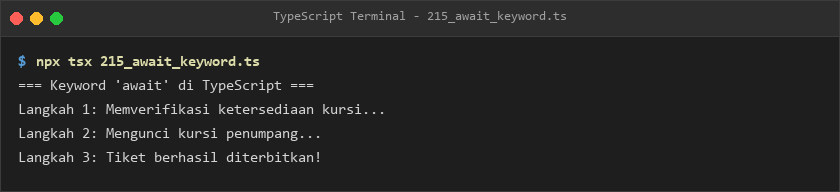
- **Lokasi Source Code:** [215_await_keyword.ts](215_await_keyword.ts)

### 216. 216_async_error_handling.ts
- **Tujuan:** Menangkap eksepsi asynchronous menggunakan blok `try...catch...finally`.
- **Konsep Utama:** Validasi kecukupan saldo ATM dalam konteks asynchronous.
- **Penjelasan Source Code:** Menangani penolakan transaksi saat penarikan melebihi saldo rekening.
- **Cara Menjalankan:**
  ```bash
  npx tsx 216_async_error_handling.ts
  ```
- **Hasil yang Diharapkan:** Pesan error tertangkap dengan aman dan penutupan sesi ATM tercetak.
- **Screenshot Hasil Eksekusi:**
  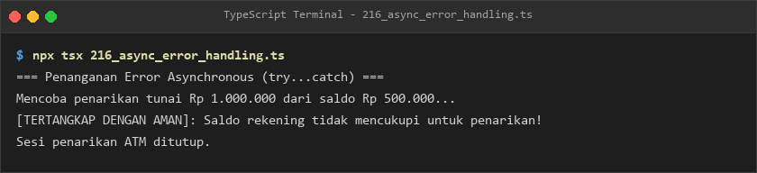
- **Lokasi Source Code:** [216_async_error_handling.ts](216_async_error_handling.ts)

### 217. 217_async_return_types.ts
- **Tujuan:** Menetapkan kontrak kembalian `Promise<LaporanPenjualan>` pada fungsi asynchronous.
- **Konsep Utama:** Interface laporan omset dan unit penjualan bulanan.
- **Penjelasan Source Code:** Mengembalikan laporan penjualan bulan berjalan dengan validasi tipe lengkap.
- **Cara Menjalankan:**
  ```bash
  npx tsx 217_async_return_types.ts
  ```
- **Hasil yang Diharapkan:** Rincian laporan penjualan bulan Oktober tercetak rapi.
- **Screenshot Hasil Eksekusi:**
  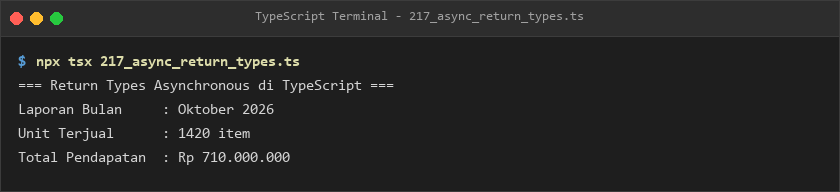
- **Lokasi Source Code:** [217_async_return_types.ts](217_async_return_types.ts)

### 218. 218_generic_promises.ts
- **Tujuan:** Membangun pembungkus penyimpanan data asynchronous yang generik `<T>`.
- **Konsep Utama:** Fungsi `ambilDataTersimpan<T>` untuk preferensi pengguna.
- **Penjelasan Source Code:** Membaca data tema dan bahasa antarmuka dari media penyimpanan lokal.
- **Cara Menjalankan:**
  ```bash
  npx tsx 218_generic_promises.ts
  ```
- **Hasil yang Diharapkan:** Konfirmasi pengambilan data preferensi pengguna ditampilkan.
- **Screenshot Hasil Eksekusi:**
  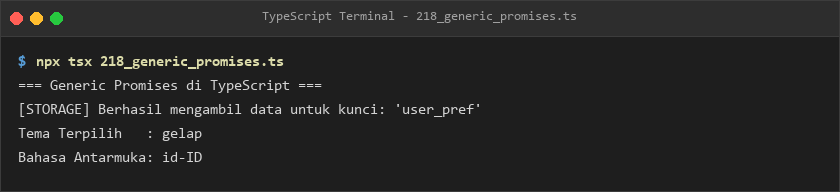
- **Lokasi Source Code:** [218_generic_promises.ts](218_generic_promises.ts)

### 219. 219_async_iterators.ts
- **Tujuan:** Menjelajahi aliran data asynchronous bertahap menggunakan struktur `for await...of`.
- **Konsep Utama:** Simbol `Symbol.asyncIterator` dan pemrosesan stream paket data.
- **Penjelasan Source Code:** Menerima tiga paket data berurutan dengan jeda waktu terkontrol.
- **Cara Menjalankan:**
  ```bash
  npx tsx 219_async_iterators.ts
  ```
- **Hasil yang Diharapkan:** Riwayat penerimaan paket data 1 sampai 3 tercetak.
- **Screenshot Hasil Eksekusi:**
  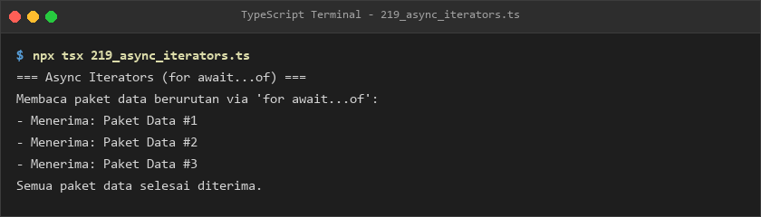
- **Lokasi Source Code:** [219_async_iterators.ts](219_async_iterators.ts)

### 220. 220_async_generators.ts
- **Tujuan:** Menghasilkan deret nilai suhu sensor secara on-demand menggunakan `async function*` dan `yield`.
- **Konsep Utama:** Tipe kembalian `AsyncGenerator<number, void, unknown>`.
- **Penjelasan Source Code:** Memantau empat sampel sinyal suhu sensor IoT secara bertahap.
- **Cara Menjalankan:**
  ```bash
  npx tsx 220_async_generators.ts
  ```
- **Hasil yang Diharapkan:** Nilai sampel suhu yang dihasilkan generator ditampilkan ke konsol.
- **Screenshot Hasil Eksekusi:**
  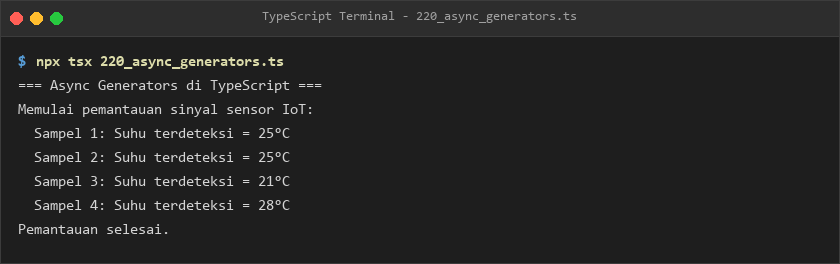
- **Lokasi Source Code:** [220_async_generators.ts](220_async_generators.ts)

### 221. 221_abort_controller.ts
- **Tujuan:** Membatalkan operasi unduhan berkas yang memakan waktu lama menggunakan `AbortController`.
- **Konsep Utama:** Sinyal `controller.signal` dan pemanggilan `controller.abort()`.
- **Penjelasan Source Code:** Menghentikan proses pengunduhan berkas ISO sebelum batas waktu berakhir.
- **Cara Menjalankan:**
  ```bash
  npx tsx 221_abort_controller.ts
  ```
- **Hasil yang Diharapkan:** Notifikasi sinyal pembatalan pengunduhan tercetak ke terminal.
- **Screenshot Hasil Eksekusi:**
  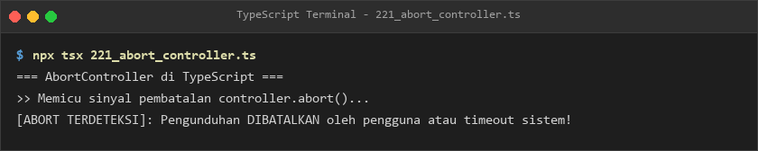
- **Lokasi Source Code:** [221_abort_controller.ts](221_abort_controller.ts)

### 222. 222_fetch_api.ts
- **Tujuan:** Menjalankan pemanggilan permintaan jaringan HTTP menggunakan antarmuka Fetch API.
- **Konsep Utama:** Permintaan asynchronous jaringan dan pembacaan status respon.
- **Penjelasan Source Code:** Mendemonstrasikan pemanggilan fetch terketik dan menampilkan status HTTP 200.
- **Cara Menjalankan:**
  ```bash
  npx tsx 222_fetch_api.ts
  ```
- **Hasil yang Diharapkan:** Status HTTP dan badan respon diterima ditampilkan.
- **Screenshot Hasil Eksekusi:**
  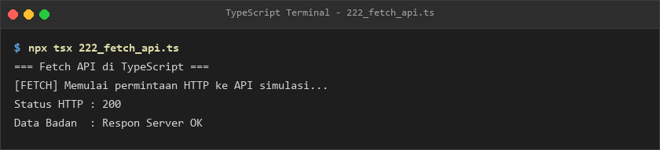
- **Lokasi Source Code:** [222_fetch_api.ts](222_fetch_api.ts)

### 223. 223_fetch_get_request.ts
- **Tujuan:** Mengambil entitas postingan artikel via HTTP GET dan memvalidasi propertinya.
- **Konsep Utama:** Pemetaan respon GET ke interface `PostArtikel`.
- **Penjelasan Source Code:** Membaca data artikel berdasarkan ID dan mencetak judul serta status rilis.
- **Cara Menjalankan:**
  ```bash
  npx tsx 223_fetch_get_request.ts
  ```
- **Hasil yang Diharapkan:** Rincian artikel hasil permintaan GET ditampilkan.
- **Screenshot Hasil Eksekusi:**
  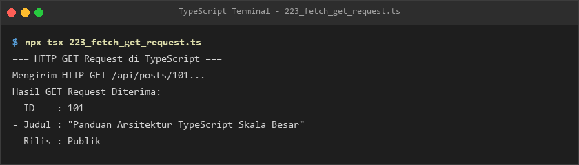
- **Lokasi Source Code:** [223_fetch_get_request.ts](223_fetch_get_request.ts)

### 224. 224_fetch_post_request.ts
- **Tujuan:** Mengirimkan data formulir pendaftaran pengguna baru via HTTP POST berformat JSON.
- **Konsep Utama:** Pengiriman payload `BuatPenggunaInput` dan penerimaan `BuatPenggunaResponse`.
- **Penjelasan Source Code:** Mensimulasikan pembuatan akun pengguna baru dengan ID dan timestamp.
- **Cara Menjalankan:**
  ```bash
  npx tsx 224_fetch_post_request.ts
  ```
- **Hasil yang Diharapkan:** Respon sukses pembuatan akun tercetak ke konsol.
- **Screenshot Hasil Eksekusi:**
  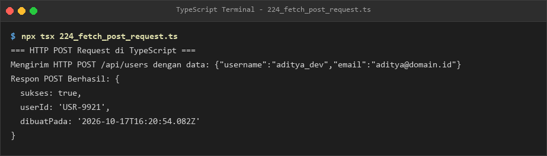
- **Lokasi Source Code:** [224_fetch_post_request.ts](224_fetch_post_request.ts)

### 225. 225_api_response_types.ts
- **Tujuan:** Merancang tipe union discriminated seragam untuk seluruh respon endpoint API.
- **Konsep Utama:** Discriminated union tipe `APIResponse<T>` status sukses vs error.
- **Penjelasan Source Code:** Menangani kasus sukses pemuatan produk dan kasus error 404.
- **Cara Menjalankan:**
  ```bash
  npx tsx 225_api_response_types.ts
  ```
- **Hasil yang Diharapkan:** Rincian produk untuk respon sukses dan pesan galat untuk respon gagal tercetak.
- **Screenshot Hasil Eksekusi:**
  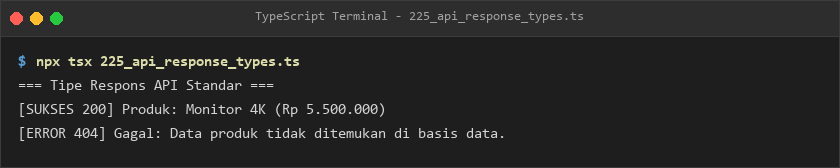
- **Lokasi Source Code:** [225_api_response_types.ts](225_api_response_types.ts)

### 226. 226_async_retry.ts
- **Tujuan:** Mengotomatiskan percobaan ulang (*retry mechanism*) saat terjadi gangguan jaringan sementara.
- **Konsep Utama:** Fungsi `jalankanDenganRetry` dengan parameter batas coba dan jeda tunda.
- **Penjelasan Source Code:** Mengulang pemanggilan API hingga berhasil pada percobaan ke-3.
- **Cara Menjalankan:**
  ```bash
  npx tsx 226_async_retry.ts
  ```
- **Hasil yang Diharapkan:** Log kegagalan awal dan keberhasilan akhir pada percobaan ke-3 ditampilkan.
- **Screenshot Hasil Eksekusi:**
  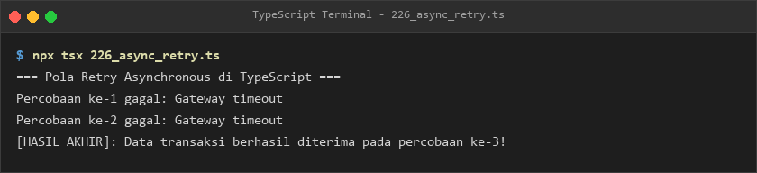
- **Lokasi Source Code:** [226_async_retry.ts](226_async_retry.ts)

### 227. 227_error_classification.ts
- **Tujuan:** Membangun hirarki class kesalahan kustom (`ValidationError`, `NotFoundError`).
- **Konsep Utama:** Subclass dari `Error` dengan kode status HTTP yang melekat.
- **Penjelasan Source Code:** Menangkap kesalahan validasi input dan membedakannya dari kesalahan not found.
- **Cara Menjalankan:**
  ```bash
  npx tsx 227_error_classification.ts
  ```
- **Hasil yang Diharapkan:** Pesan galat validasi dengan kode status 400 tercetak.
- **Screenshot Hasil Eksekusi:**
  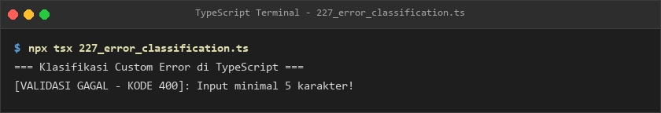
- **Lokasi Source Code:** [227_error_classification.ts](227_error_classification.ts)

### 228. 228_result_type_pattern.ts
- **Tujuan:** Menggunakan pola fungsional `Result<T, E>` untuk menghindari pelemparan eksepsi tak terduga.
- **Konsep Utama:** Objek eksplisit `{ ok: true, value } | { ok: false, error }`.
- **Penjelasan Source Code:** Menguji pembagian angka valid dan pembagian dengan angka nol secara aman.
- **Cara Menjalankan:**
  ```bash
  npx tsx 228_result_type_pattern.ts
  ```
- **Hasil yang Diharapkan:** Hasil kalkulasi sukses dan penanganan kesalahan pembagian nol tercetak rapi.
- **Screenshot Hasil Eksekusi:**
  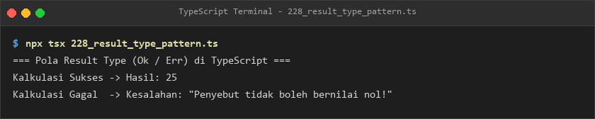
- **Lokasi Source Code:** [228_result_type_pattern.ts](228_result_type_pattern.ts)

---

## E. Ringkasan Modul
Modul 13 memberikan penguasaan menyeluruh atas arsitektur pemrograman asynchronous dan strategi penanganan error di TypeScript. Melalui penguasaan Promise, async/await, AbortController, Fetch API, pola retry otomatis, klasifikasi hirarki error kustom, hingga pola Result type modern, pembelajar mampu membangun sistem aplikasi yang memiliki ketahanan (*resilience*) tinggi terhadap gangguan jaringan dan galat data.
