# Modul 14: Browser, DOM, dan Frontend TypeScript

## A. Judul Modul
- **Nomor Modul:** 14
- **Nama Modul:** Browser, DOM, dan Frontend TypeScript
- **Ruang Lingkup:** Pemilihan elemen DOM (`getElementById`, `querySelector`), pengenalan tipe elemen DOM spesifik (`HTMLInputElement`, `HTMLButtonElement`), pembaruan teks aman via `textContent`, pengelolaan atribut elemen (`setAttribute`, `getAttribute`), manipulasi kelas CSS via `classList`, penciptaan elemen baru secara dinamis (`createElement`, `appendChild`), pemasangan *event listener*, pemrosesan tipe-tipe event DOM (`MouseEvent`, `KeyboardEvent`), penanganan input formulir terketik, validasi formulir frontend, pemanfaatan `FormData`, penyimpanan persisten `localStorage`, penyimpanan sesi `sessionStorage`, bedah URL via `URLSearchParams`, pemantauan viewport dengan `IntersectionObserver`, pemantauan perubahan DOM dengan `MutationObserver`, komputasi multithread latar belakang dengan `Web Workers`, komunikasi real-time dua arah via `WebSocket`, manipulasi grafis visual via `Canvas API`, serta integrasi modul TypeScript ke dokumen HTML.
- **Tujuan Pembelajaran:** Menguasai seluruh aspek rekayasa antarmuka pengguna (Frontend Web) menggunakan TypeScript, mampu memanipulasi dokumen web dan API browser modern secara aman dan efisien, serta membangun aplikasi web interaktif yang tahan terhadap serangan injeksi script.

---

## B. Daftar Materi atau Submodul
229. [`229_dom_element_selection.ts`](229_dom_element_selection.ts) : Memilih elemen DOM
230. [`230_dom_element_types.ts`](230_dom_element_types.ts) : Tipe elemen DOM
231. [`231_dom_text_content.ts`](231_dom_text_content.ts) : Manipulasi `textContent`
232. [`232_dom_attributes.ts`](232_dom_attributes.ts) : Manipulasi atribut
233. [`233_dom_class_list.ts`](233_dom_class_list.ts) : Manipulasi class CSS
234. [`234_dom_create_element.ts`](234_dom_create_element.ts) : Membuat elemen DOM
235. [`235_dom_event_listener.ts`](235_dom_event_listener.ts) : Event listener
236. [`236_dom_event_types.ts`](236_dom_event_types.ts) : Tipe event DOM
237. [`237_form_input_types.ts`](237_form_input_types.ts) : Tipe input formulir
238. [`238_form_validation.ts`](238_form_validation.ts) : Validasi formulir
239. [`239_form_data.ts`](239_form_data.ts) : FormData
240. [`240_local_storage.ts`](240_local_storage.ts) : Local Storage
241. [`241_session_storage.ts`](241_session_storage.ts) : Session Storage
242. [`242_url_api.ts`](242_url_api.ts) : URL API
243. [`243_intersection_observer.ts`](243_intersection_observer.ts) : Intersection Observer
244. [`244_mutation_observer.ts`](244_mutation_observer.ts) : Mutation Observer
245. [`245_web_workers.ts`](245_web_workers.ts) : Web Workers
246. [`246_web_socket.ts`](246_web_socket.ts) : WebSocket
247. [`247_canvas_api.ts`](247_canvas_api.ts) : Canvas API
248. [`248_browser_modules.ts`](248_browser_modules.ts) : Modul TypeScript dalam browser

---

## C. Penjelasan Setiap Submodul

### 229. 229_dom_element_selection.ts
- **Tujuan:** Mengambil referensi elemen DOM berbasis ID dan selector class secara aman.
- **Konsep Utama:** Pengecekan nullish dan type narrowing elemen DOM.
- **Penjelasan Source Code:** Memeriksa keberadaan tombol simpan dan label status di dokumen.
- **Cara Menjalankan:**
  ```bash
  npx tsx 229_dom_element_selection.ts
  ```
- **Hasil yang Diharapkan:** Notifikasi penemuan elemen tombol dan label tercetak.
- **Screenshot Hasil Eksekusi:**
  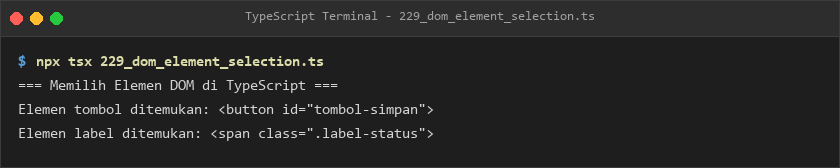
- **Lokasi Source Code:** [229_dom_element_selection.ts](229_dom_element_selection.ts)

### 230. 230_dom_element_types.ts
- **Tujuan:** Mengakses properti khusus elemen seperti input teks dan tombol submit.
- **Konsep Utama:** Antarmuka tipe spesifik `HTMLInputElement` dan `HTMLButtonElement`.
- **Penjelasan Source Code:** Membaca atribut value, type, dan status disabled tombol formulir.
- **Cara Menjalankan:**
  ```bash
  npx tsx 230_dom_element_types.ts
  ```
- **Hasil yang Diharapkan:** Representasi tag HTML input dan button tercetak lengkap.
- **Screenshot Hasil Eksekusi:**
  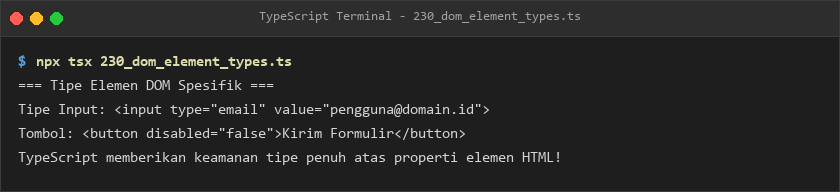
- **Lokasi Source Code:** [230_dom_element_types.ts](230_dom_element_types.ts)

### 231. 231_dom_text_content.ts
- **Tujuan:** Memperbarui konten teks antarmuka web tanpa risiko injeksi HTML liar (XSS).
- **Konsep Utama:** Penggunaan properti `.textContent` untuk penyandian teks otomatis.
- **Penjelasan Source Code:** Memperbarui teks paragraf status dan pengumuman pemeliharaan server.
- **Cara Menjalankan:**
  ```bash
  npx tsx 231_dom_text_content.ts
  ```
- **Hasil yang Diharapkan:** Riwayat pembaruan konten teks paragraf ditampilkan.
- **Screenshot Hasil Eksekusi:**
  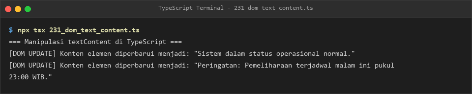
- **Lokasi Source Code:** [231_dom_text_content.ts](231_dom_text_content.ts)

### 232. 232_dom_attributes.ts
- **Tujuan:** Menetapkan dan memeriksa atribut tautan hyperlink secara terstruktur.
- **Konsep Utama:** Operasi `.setAttribute()`, `.getAttribute()`, dan `.hasAttribute()`.
- **Penjelasan Source Code:** Mengonfigurasi atribut href, target _blank, dan rel pada elemen link.
- **Cara Menjalankan:**
  ```bash
  npx tsx 232_dom_attributes.ts
  ```
- **Hasil yang Diharapkan:** Target URL dan konfirmasi keberadaan atribut rel ditampilkan.
- **Screenshot Hasil Eksekusi:**
  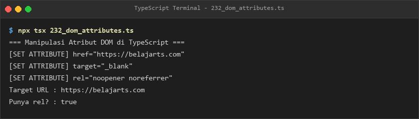
- **Lokasi Source Code:** [232_dom_attributes.ts](232_dom_attributes.ts)

### 233. 233_dom_class_list.ts
- **Tujuan:** Memanipulasi kelas CSS secara dinamis untuk styling responsif antarmuka.
- **Konsep Utama:** Metode `.add()`, `.remove()`, dan `.contains()` pada properti `classList`.
- **Penjelasan Source Code:** Menambah kelas alert bayangan dan menukar alert primer menjadi sukses.
- **Cara Menjalankan:**
  ```bash
  npx tsx 233_dom_class_list.ts
  ```
- **Hasil yang Diharapkan:** Riwayat perubahan daftar kelas CSS aktif tercetak rapi.
- **Screenshot Hasil Eksekusi:**
  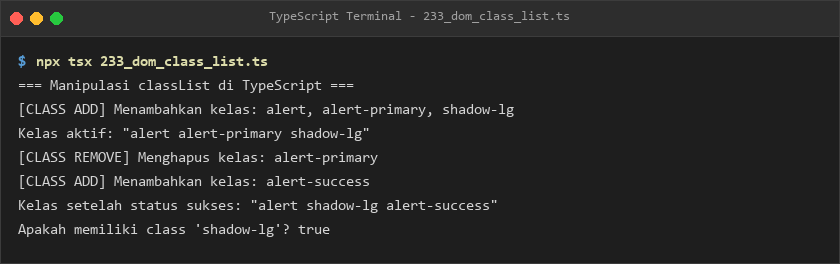
- **Lokasi Source Code:** [233_dom_class_list.ts](233_dom_class_list.ts)

### 234. 234_dom_create_element.ts
- **Tujuan:** Membangun pohon elemen HTML secara programatis melalui kode TypeScript.
- **Konsep Utama:** Pembuatan elemen `ul` dan penambahan elemen anak `li`.
- **Penjelasan Source Code:** Mengonstruksi daftar navigasi menu dan menampilkan struktur pohonnya.
- **Cara Menjalankan:**
  ```bash
  npx tsx 234_dom_create_element.ts
  ```
- **Hasil yang Diharapkan:** Struktur tag induk dan teks ketiga elemen anak tercetak.
- **Screenshot Hasil Eksekusi:**
  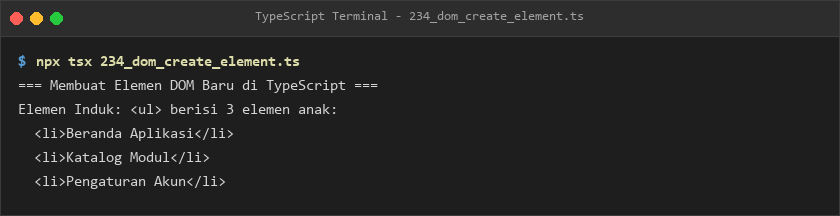
- **Lokasi Source Code:** [234_dom_create_element.ts](234_dom_create_element.ts)

### 235. 235_dom_event_listener.ts
- **Tujuan:** Mendaftarkan pendengar event klik tombol pengguna secara asynchronous.
- **Konsep Utama:** Metode `.addEventListener("click", handler)`.
- **Penjelasan Source Code:** Menangkap aksi interaksi pengguna pada tombol checkout pesanan.
- **Cara Menjalankan:**
  ```bash
  npx tsx 235_dom_event_listener.ts
  ```
- **Hasil yang Diharapkan:** Pemasangan listener dan eksekusi event klik dengan timestamp ditampilkan.
- **Screenshot Hasil Eksekusi:**
  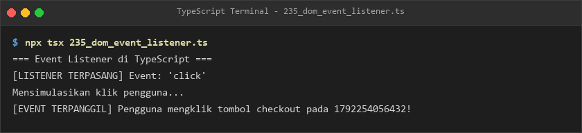
- **Lokasi Source Code:** [235_dom_event_listener.ts](235_dom_event_listener.ts)

### 236. 236_dom_event_types.ts
- **Tujuan:** Memproses data koordinat mouse dan kombinasi tombol keyboard secara terketik.
- **Konsep Utama:** Tipe event khusus `MouseEvent` dan `KeyboardEvent`.
- **Penjelasan Source Code:** Menampilkan posisi klik mouse (X, Y) dan tombol kombinasi Ctrl+S.
- **Cara Menjalankan:**
  ```bash
  npx tsx 236_dom_event_types.ts
  ```
- **Hasil yang Diharapkan:** Rincian koordinat mouse dan tombol keyboard tercetak jelas.
- **Screenshot Hasil Eksekusi:**
  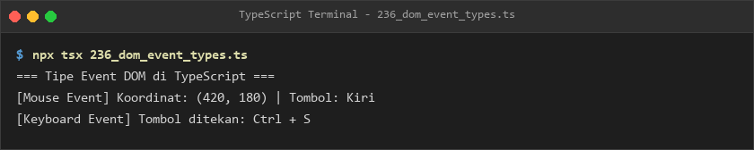
- **Lokasi Source Code:** [236_dom_event_types.ts](236_dom_event_types.ts)

### 237. 237_form_input_types.ts
- **Tujuan:** Mengelola input pemilihan dropdown select dan persetujuan kotak centang checkbox.
- **Konsep Utama:** Pembacaan properti `.value` pada dropdown dan `.checked` pada checkbox.
- **Penjelasan Source Code:** Memvalidasi paket langganan premium dan persetujuan syarat ketentuan.
- **Cara Menjalankan:**
  ```bash
  npx tsx 237_form_input_types.ts
  ```
- **Hasil yang Diharapkan:** Nilai paket langganan dan status persetujuan syarat ditampilkan.
- **Screenshot Hasil Eksekusi:**
  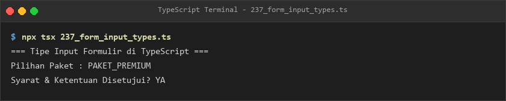
- **Lokasi Source Code:** [237_form_input_types.ts](237_form_input_types.ts)

### 238. 238_form_validation.ts
- **Tujuan:** Memvalidasi kelayakan formulir pendaftaran pengguna di sisi frontend secara ketat.
- **Konsep Utama:** Pemeriksaan panjang karakter nama, format email, dan batas usia minimal 17 tahun.
- **Penjelasan Source Code:** Menguji data pendaftaran tidak lengkap dan data pendaftaran yang sah.
- **Cara Menjalankan:**
  ```bash
  npx tsx 238_form_validation.ts
  ```
- **Hasil yang Diharapkan:** Daftar galat pada data tidak valid dan status sukses data valid tercetak.
- **Screenshot Hasil Eksekusi:**
  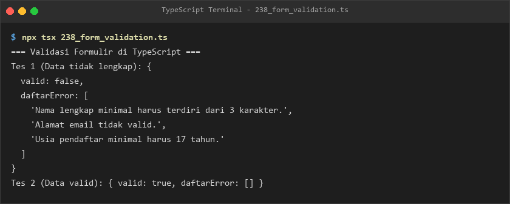
- **Lokasi Source Code:** [238_form_validation.ts](238_form_validation.ts)

### 239. 239_form_data.ts
- **Tujuan:** Mengemas muatan pasangan kunci dan nilai formulir menggunakan antarmuka FormData.
- **Konsep Utama:** Operasi `.append()` dan penelusuran pasangan entri form.
- **Penjelasan Source Code:** Menyiapkan muatan username, role, dan lampiran file avatar profil.
- **Cara Menjalankan:**
  ```bash
  npx tsx 239_form_data.ts
  ```
- **Hasil yang Diharapkan:** Pasangan data form yang dikemas tercetak teratur.
- **Screenshot Hasil Eksekusi:**
  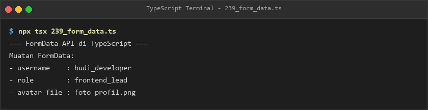
- **Lokasi Source Code:** [239_form_data.ts](239_form_data.ts)

### 240. 240_local_storage.ts
- **Tujuan:** Menyimpan data preferensi tema pengguna secara persisten di penyimpanan browser.
- **Konsep Utama:** Operasi `localStorage.setItem()` dan `localStorage.getItem()` dengan JSON stringify.
- **Penjelasan Source Code:** Menyimpan dan memulihkan kembali konfigurasi tema gelap dan font 16px.
- **Cara Menjalankan:**
  ```bash
  npx tsx 240_local_storage.ts
  ```
- **Hasil yang Diharapkan:** Data konfigurasi preferensi dari LocalStorage ditampilkan.
- **Screenshot Hasil Eksekusi:**
  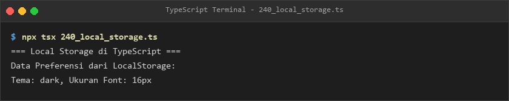
- **Lokasi Source Code:** [240_local_storage.ts](240_local_storage.ts)

### 241. 241_session_storage.ts
- **Tujuan:** Mengamankan token autentikasi sesi sementara yang otomatis bersih saat tab ditutup.
- **Konsep Utama:** Isolasi memori tab browser via `sessionStorage`.
- **Penjelasan Source Code:** Menyimpan dan membaca kembali token JWT sesi aktif.
- **Cara Menjalankan:**
  ```bash
  npx tsx 241_session_storage.ts
  ```
- **Hasil yang Diharapkan:** Token sesi aktif dan penjelasan sifat isolasi tab tercetak.
- **Screenshot Hasil Eksekusi:**
  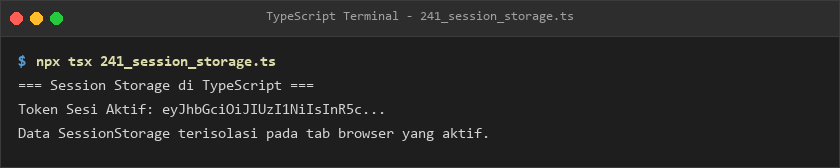
- **Lokasi Source Code:** [241_session_storage.ts](241_session_storage.ts)

### 242. 242_url_api.ts
- **Tujuan:** Membedah komponen URL dan memanipulasi parameter query menggunakan `URLSearchParams`.
- **Konsep Utama:** Parsing protokol, hostname, dan pembacaan parameter query secara terstruktur.
- **Penjelasan Source Code:** Membaca parameter kategori, halaman, sort, serta menambahkan filter diskon.
- **Cara Menjalankan:**
  ```bash
  npx tsx 242_url_api.ts
  ```
- **Hasil yang Diharapkan:** Rincian parameter URL dan URL utuh yang telah diperbarui ditampilkan.
- **Screenshot Hasil Eksekusi:**
  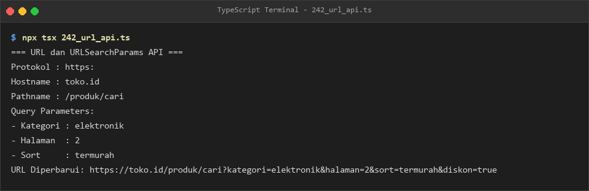
- **Lokasi Source Code:** [242_url_api.ts](242_url_api.ts)

### 243. 243_intersection_observer.ts
- **Tujuan:** Mendeteksi elemen web yang masuk ke dalam viewport untuk optimasi lazy-loading gambar.
- **Konsep Utama:** Evaluasi properti `isIntersecting` dan `intersectionRatio`.
- **Penjelasan Source Code:** Membedakan antara banner promosi yang terlihat dan footer yang di luar layar.
- **Cara Menjalankan:**
  ```bash
  npx tsx 243_intersection_observer.ts
  ```
- **Hasil yang Diharapkan:** Log elemen yang berada di dalam dan di luar viewport ditampilkan.
- **Screenshot Hasil Eksekusi:**
  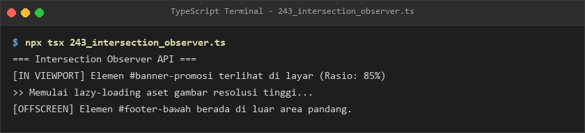
- **Lokasi Source Code:** [243_intersection_observer.ts](243_intersection_observer.ts)

### 244. 244_mutation_observer.ts
- **Tujuan:** Mengamati penambahan simpul anak atau pembaruan atribut pada pohon DOM.
- **Konsep Utama:** Penanganan mutasi tipe `childList` dan `attributes`.
- **Penjelasan Source Code:** Mencatat penambahan komentar baru dan perubahan atribut modal login.
- **Cara Menjalankan:**
  ```bash
  npx tsx 244_mutation_observer.ts
  ```
- **Hasil yang Diharapkan:** Log mutasi pohon DOM tercetak ke terminal.
- **Screenshot Hasil Eksekusi:**
  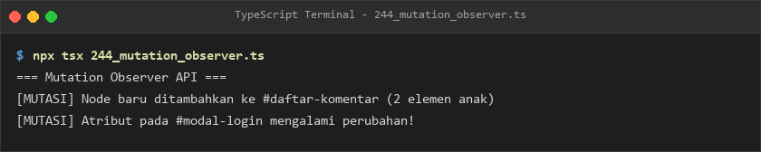
- **Lokasi Source Code:** [244_mutation_observer.ts](244_mutation_observer.ts)

### 245. 245_web_workers.ts
- **Tujuan:** Menjalankan perhitungan faktorial berat di latar belakang tanpa mengganggu thread UI utama.
- **Konsep Utama:** Komunikasi pesan antar-thread melalui `postMessage` dan `onmessage`.
- **Penjelasan Source Code:** Menyerahkan komputasi faktorial 8! ke worker dan menerima hasil akhirnya.
- **Cara Menjalankan:**
  ```bash
  npx tsx 245_web_workers.ts
  ```
- **Hasil yang Diharapkan:** Log pengiriman tugas dan penerimaan hasil komputasi latar belakang tercetak.
- **Screenshot Hasil Eksekusi:**
  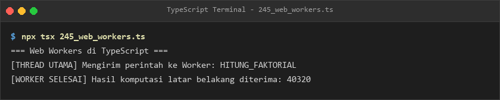
- **Lokasi Source Code:** [245_web_workers.ts](245_web_workers.ts)

### 246. 246_web_socket.ts
- **Tujuan:** Membuka saluran komunikasi real-time dua arah (*full-duplex*) berbasis protokol WebSocket.
- **Konsep Utama:** State koneksi `WebSocket.OPEN` dan pertukaran payload pesan chat.
- **Penjelasan Source Code:** Mensimulasikan koneksi aktif dan pengiriman pesan chat real-time.
- **Cara Menjalankan:**
  ```bash
  npx tsx 246_web_socket.ts
  ```
- **Hasil yang Diharapkan:** Status koneksi WebSocket terbuka dan pesan terkirim ditampilkan.
- **Screenshot Hasil Eksekusi:**
  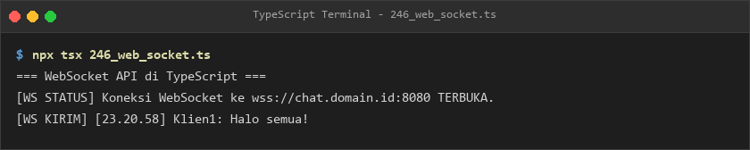
- **Lokasi Source Code:** [246_web_socket.ts](246_web_socket.ts)

### 247. 247_canvas_api.ts
- **Tujuan:** Menggambar bentuk persegi berwarna dan garis batas secara 2D pada elemen Canvas.
- **Konsep Utama:** Operasi konteks grafis `.fillRect()` dan `.strokeRect()`.
- **Penjelasan Source Code:** Mengonfigurasi warna biru dan menggambar persegi berukuran 100x50 px.
- **Cara Menjalankan:**
  ```bash
  npx tsx 247_canvas_api.ts
  ```
- **Hasil yang Diharapkan:** Log penggambaran persegi berwarna dan bingkai canvas ditampilkan.
- **Screenshot Hasil Eksekusi:**
  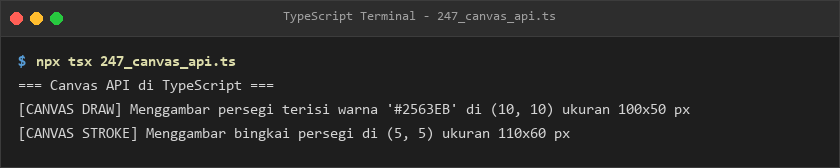
- **Lokasi Source Code:** [247_canvas_api.ts](247_canvas_api.ts)

### 248. 248_browser_modules.ts
- **Tujuan:** Memahami cara penyajian kode hasil kompilasi TypeScript pada browser via `<script type="module">`.
- **Konsep Utama:** Integrasi standar ES Modules native pada browser modern.
- **Penjelasan Source Code:** Menampilkan struktur tag HTML yang memuat modul utama JavaScript hasil build.
- **Cara Menjalankan:**
  ```bash
  npx tsx 248_browser_modules.ts
  ```
- **Hasil yang Diharapkan:** Cuplikan dokumen HTML dan penjelasan eksekusi modul browser ditampilkan.
- **Screenshot Hasil Eksekusi:**
  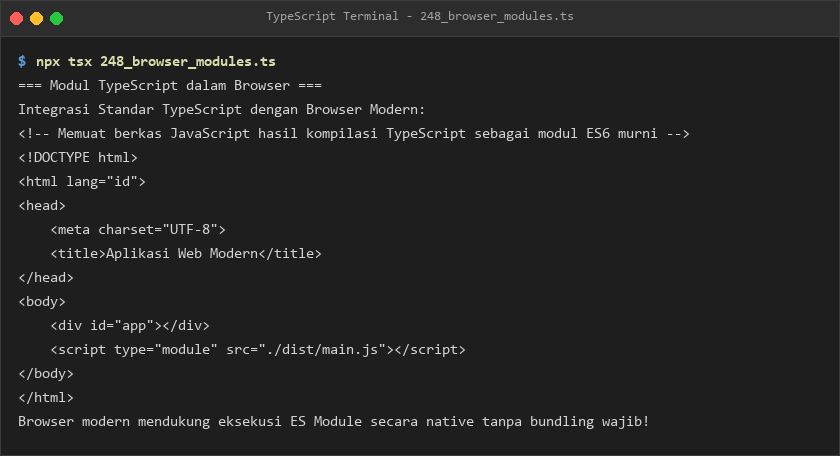
- **Lokasi Source Code:** [248_browser_modules.ts](248_browser_modules.ts)

---

## E. Ringkasan Modul
Modul 14 membekali pembelajar dengan keterampilan komprehensif dalam pengembangan Frontend Web modern dengan TypeScript. Mulai dari manipulasi elemen DOM dasar, validasi formulir, media penyimpanan browser (`localStorage` & `sessionStorage`), hingga API modern tingkat lanjut seperti `IntersectionObserver`, `Web Workers`, `WebSocket`, dan `Canvas API`. Seluruh konsep ini mengukuhkan kemampuan perancangan aplikasi frontend yang responsif, terketik aman, dan berkinerja tinggi.
