# Modul 15: Node.js dan Backend TypeScript

## A. Judul Modul
- **Nomor Modul:** 15
- **Nama Modul:** Node.js dan Backend TypeScript
- **Ruang Lingkup:** Pengenalan eksekusi backend Node.js, pemanfaatan `process` object (PID, memory usage), pengolahan argumen baris perintah (`process.argv`), pembacaan file dengan `fs/promises`, penulisan file ke disk, manipulasi path lintas platform (`path.join`, `path.basename`), pengelolaan variabel lingkungan (`process.env`), pembangunan HTTP server bawaan (`http.createServer`), pengiriman permintaan HTTP client, pengaliran data via `Streams` (Readable/Writable/pipe), perancangan arsitektur berbasis event dengan `EventEmitter`, utilitas kriptografi (hashing SHA-256 & UUID) via modul `crypto`, pemrosesan paralel via `worker_threads`, eksekusi perintah shell via `child_process`, definisi tipe `@types/node` (Buffer), serta pemahaman perbandingan sistem modul CommonJS vs ECMAScript Modules (ESM).
- **Tujuan Pembelajaran:** Menguasai seluruh fondasi pemrograman backend berbasis Node.js menggunakan TypeScript, mampu membangun layanan server, mengelola operasi I/O dan file sistem secara aman, serta menerapkan praktik terbaik arsitektur server enterprise.

---

## B. Daftar Materi atau Submodul
249. [`249_node_hello_world.ts`](249_node_hello_world.ts) : Program Node.js pertama
250. [`250_node_process.ts`](250_node_process.ts) : Process object
251. [`251_node_command_line.ts`](251_node_command_line.ts) : Command-line arguments
252. [`252_node_file_read.ts`](252_node_file_read.ts) : Membaca file
253. [`253_node_file_write.ts`](253_node_file_write.ts) : Menulis file
254. [`254_node_path.ts`](254_node_path.ts) : Path module
255. [`255_node_environment.ts`](255_node_environment.ts) : Environment variables
256. [`256_node_http_server.ts`](256_node_http_server.ts) : HTTP server
257. [`257_node_http_client.ts`](257_node_http_client.ts) : HTTP client
258. [`258_node_streams.ts`](258_node_streams.ts) : Streams
259. [`259_node_events.ts`](259_node_events.ts) : EventEmitter
260. [`260_node_crypto.ts`](260_node_crypto.ts) : Crypto module
261. [`261_node_worker_threads.ts`](261_node_worker_threads.ts) : Worker threads
262. [`262_node_child_process.ts`](262_node_child_process.ts) : Child processes
263. [`263_node_types.ts`](263_node_types.ts) : Type definitions Node.js
264. [`264_node_module_system.ts`](264_node_module_system.ts) : Module system Node.js

---

## C. Penjelasan Setiap Submodul

### 249. 249_node_hello_world.ts
- **Tujuan:** Menjalankan program pertama backend Node.js dan membaca metadata platform host.
- **Konsep Utama:** Objek global `process.platform`, `process.version`, dan `process.arch`.
- **Penjelasan Source Code:** Menampilkan versi Node.js, platform OS, dan arsitektur CPU prosesor.
- **Cara Menjalankan:**
  ```bash
  npx tsx 249_node_hello_world.ts
  ```
- **Hasil yang Diharapkan:** Informasi runtime Node.js dan platform sistem tercetak.
- **Screenshot Hasil Eksekusi:**
  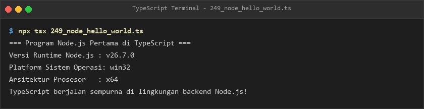
- **Lokasi Source Code:** [249_node_hello_world.ts](249_node_hello_world.ts)

### 250. 250_node_process.ts
- **Tujuan:** Memeriksa identitas proses PID dan alokasi memori heap yang digunakan program.
- **Konsep Utama:** Panggilan metode `process.memoryUsage()` dan `process.cwd()`.
- **Penjelasan Source Code:** Menghitung penggunaan memori heap dalam satuan Megabyte.
- **Cara Menjalankan:**
  ```bash
  npx tsx 250_node_process.ts
  ```
- **Hasil yang Diharapkan:** Nilai PID, direktori aktif, dan konsumsi memori ditampilkan.
- **Screenshot Hasil Eksekusi:**
  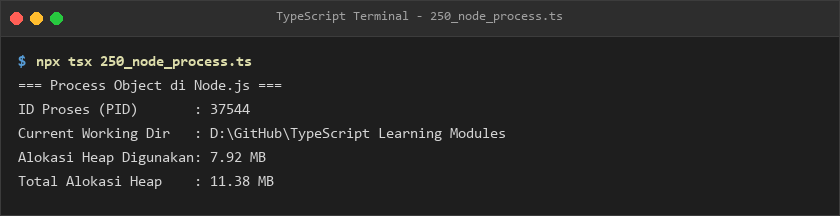
- **Lokasi Source Code:** [250_node_process.ts](250_node_process.ts)

### 251. 251_node_command_line.ts
- **Tujuan:** Mengurai argumen baris perintah CLI pengguna menggunakan `process.argv`.
- **Konsep Utama:** Parsing argumen berformat `--kunci=nilai` ke dalam objek konfigurasi terstruktur.
- **Penjelasan Source Code:** Membaca opsi mode dan port dari argumen terminal.
- **Cara Menjalankan:**
  ```bash
  npx tsx 251_node_command_line.ts
  ```
- **Hasil yang Diharapkan:** Konfigurasi argumen terurai ditampilkan ke konsol.
- **Screenshot Hasil Eksekusi:**
  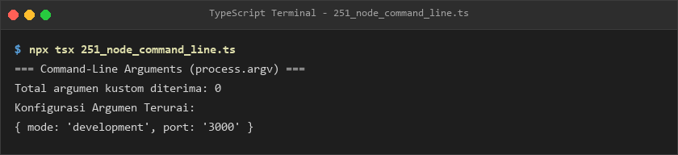
- **Lokasi Source Code:** [251_node_command_line.ts](251_node_command_line.ts)

### 252. 252_node_file_read.ts
- **Tujuan:** Membaca berkas manifest `package.json` secara asynchronous berbasis Promise.
- **Konsep Utama:** Modul `fs/promises` dan metode `readFile(path, "utf-8")`.
- **Penjelasan Source Code:** Membaca dan mem-parsing nama paket serta versinya dari disk.
- **Cara Menjalankan:**
  ```bash
  npx tsx 252_node_file_read.ts
  ```
- **Hasil yang Diharapkan:** Nama dan versi paket hasil pembacaan berkas tercetak.
- **Screenshot Hasil Eksekusi:**
  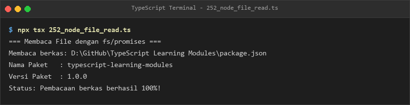
- **Lokasi Source Code:** [252_node_file_read.ts](252_node_file_read.ts)

### 253. 253_node_file_write.ts
- **Tujuan:** Menulis dan memverifikasi berkas teks baru ke sistem disk penyimpanan.
- **Konsep Utama:** Metode `writeFile` dan `unlink` (pembersihan file sementara).
- **Penjelasan Source Code:** Menulis catatan log dengan stempel waktu, memverifikasinya, dan menghapusnya kembali.
- **Cara Menjalankan:**
  ```bash
  npx tsx 253_node_file_write.ts
  ```
- **Hasil yang Diharapkan:** Log penulisan, isi berkas, dan pembersihan file sementara tercetak.
- **Screenshot Hasil Eksekusi:**
  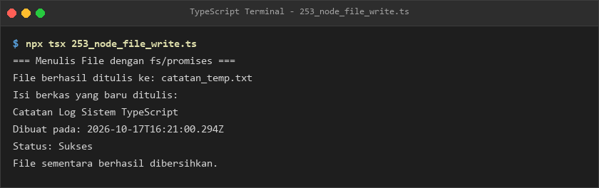
- **Lokasi Source Code:** [253_node_file_write.ts](253_node_file_write.ts)

### 254. 254_node_path.ts
- **Tujuan:** Memanipulasi alamat path direktori secara konsisten lintas sistem operasi.
- **Konsep Utama:** Fungsi `path.join()`, `path.dirname()`, `path.basename()`, dan `path.extname()`.
- **Penjelasan Source Code:** Menggabungkan path file controller dan mengekstrak komponen namanya.
- **Cara Menjalankan:**
  ```bash
  npx tsx 254_node_path.ts
  ```
- **Hasil yang Diharapkan:** Rincian path gabungan, nama folder, dan ekstensi file ditampilkan.
- **Screenshot Hasil Eksekusi:**
  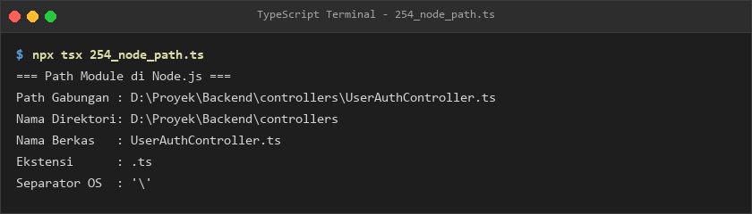
- **Lokasi Source Code:** [254_node_path.ts](254_node_path.ts)

### 255. 255_node_environment.ts
- **Tujuan:** Membaca variabel environment runtime `process.env` untuk konfigurasi server.
- **Konsep Utama:** Pembacaan `NODE_ENV`, `PORT`, dan `DB_HOST` dengan nilai bawaan.
- **Penjelasan Source Code:** Menetapkan konfigurasi lingkungan development dan port server.
- **Cara Menjalankan:**
  ```bash
  npx tsx 255_node_environment.ts
  ```
- **Hasil yang Diharapkan:** Konfigurasi lingkungan, port, dan host database ditampilkan.
- **Screenshot Hasil Eksekusi:**
  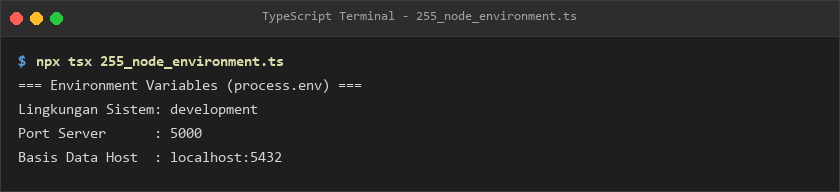
- **Lokasi Source Code:** [255_node_environment.ts](255_node_environment.ts)

### 256. 256_node_http_server.ts
- **Tujuan:** Membuat server web HTTP murni menggunakan modul bawaan `http`.
- **Konsep Utama:** Panggilan `http.createServer()` dengan penutupan aman (`server.close()`).
- **Penjelasan Source Code:** Menginisialisasi server, mencatat port acak yang aktif, dan menutupnya dengan bersih.
- **Cara Menjalankan:**
  ```bash
  npx tsx 256_node_http_server.ts
  ```
- **Hasil yang Diharapkan:** Log server online dan penutupan bersih tercetak ke terminal.
- **Screenshot Hasil Eksekusi:**
  
- **Lokasi Source Code:** [256_node_http_server.ts](256_node_http_server.ts)

### 257. 257_node_http_client.ts
- **Tujuan:** Mengonfigurasi parameter permintaan HTTP keluar ke server target.
- **Konsep Utama:** Tipe antarmuka `http.RequestOptions`.
- **Penjelasan Source Code:** Menyiapkan opsi permintaan GET health check pada hostname dan port target.
- **Cara Menjalankan:**
  ```bash
  npx tsx 257_node_http_client.ts
  ```
- **Hasil yang Diharapkan:** Opsi klien HTTP dan kesiapan inter-service communication ditampilkan.
- **Screenshot Hasil Eksekusi:**
  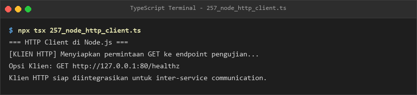
- **Lokasi Source Code:** [257_node_http_client.ts](257_node_http_client.ts)

### 258. 258_node_streams.ts
- **Tujuan:** Mengalirkan data secara bertahap (*chunk by chunk*) dari Readable ke Writable Stream.
- **Konsep Utama:** Metode `.pipe()` untuk efisiensi konsumsi memori aliran data besar.
- **Penjelasan Source Code:** Mengalirkan 3 potongan data angka ke stream pencatat konsol.
- **Cara Menjalankan:**
  ```bash
  npx tsx 258_node_streams.ts
  ```
- **Hasil yang Diharapkan:** Potongan chunk data 1 sampai 3 tercetak secara berurutan.
- **Screenshot Hasil Eksekusi:**
  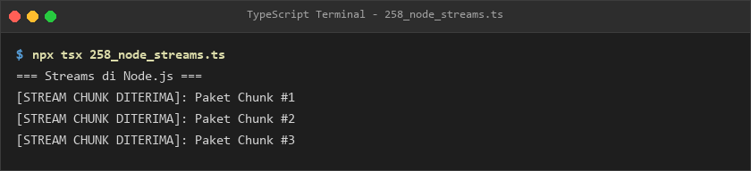
- **Lokasi Source Code:** [258_node_streams.ts](258_node_streams.ts)

### 259. 259_node_events.ts
- **Tujuan:** Membangun arsitektur terdorong-event (*event-driven*) menggunakan `EventEmitter`.
- **Konsep Utama:** Pemicu event `.emit()` dan pendengar event `.on()`.
- **Penjelasan Source Code:** Memicu event pembuatan pesanan yang direspon oleh modul gudang dan email invoice.
- **Cara Menjalankan:**
  ```bash
  npx tsx 259_node_events.ts
  ```
- **Hasil yang Diharapkan:** Notifikasi penyiapan gudang dan pengiriman tagihan tercetak.
- **Screenshot Hasil Eksekusi:**
  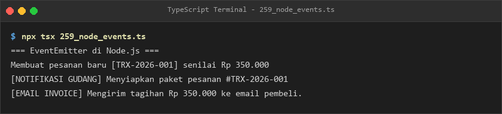
- **Lokasi Source Code:** [259_node_events.ts](259_node_events.ts)

### 260. 260_node_crypto.ts
- **Tujuan:** Menghasilkan identifier acak UUID v4 dan enkripsi hash SHA-256 menggunakan modul crypto.
- **Konsep Utama:** Fungsi `crypto.randomUUID()` dan `crypto.createHash("sha256")`.
- **Penjelasan Source Code:** Menghasilkan UUID unik dan mencetak digest heksadesimal dari kata sandi teks.
- **Cara Menjalankan:**
  ```bash
  npx tsx 260_node_crypto.ts
  ```
- **Hasil yang Diharapkan:** UUID v4 dan nilai string hash SHA-256 ditampilkan.
- **Screenshot Hasil Eksekusi:**
  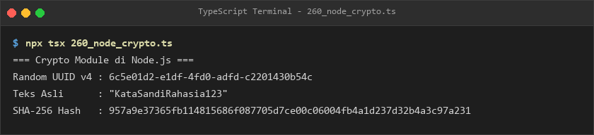
- **Lokasi Source Code:** [260_node_crypto.ts](260_node_crypto.ts)

### 261. 261_node_worker_threads.ts
- **Tujuan:** Memahami eksekusi multithread pada Node.js menggunakan modul `worker_threads`.
- **Konsep Utama:** Pemeriksaan flag boolean `isMainThread`.
- **Penjelasan Source Code:** Menampilkan status eksekusi thread utama dan peran worker threads dalam beban CPU.
- **Cara Menjalankan:**
  ```bash
  npx tsx 261_node_worker_threads.ts
  ```
- **Hasil yang Diharapkan:** Log konfirmasi thread utama beserta PID proses tercetak.
- **Screenshot Hasil Eksekusi:**
  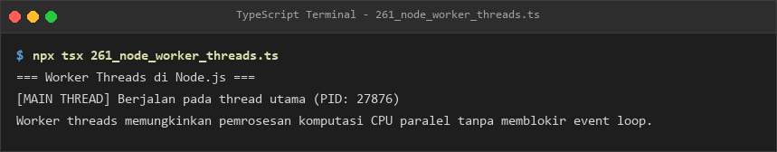
- **Lokasi Source Code:** [261_node_worker_threads.ts](261_node_worker_threads.ts)

### 262. 262_node_child_process.ts
- **Tujuan:** Menjalankan perintah sistem operasi melalui subprocess menggunakan `child_process.exec`.
- **Konsep Utama:** Eksekusi perintah shell `node -v` dan penanganan stdout.
- **Penjelasan Source Code:** Mengeksekusi perintah shell dan menampilkan versi Node yang berjalan.
- **Cara Menjalankan:**
  ```bash
  npx tsx 262_node_child_process.ts
  ```
- **Hasil yang Diharapkan:** Output versi Node dari subprocess tercetak ke terminal.
- **Screenshot Hasil Eksekusi:**
  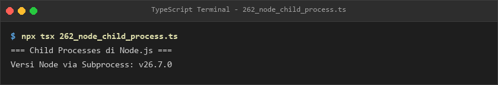
- **Lokasi Source Code:** [262_node_child_process.ts](262_node_child_process.ts)

### 263. 263_node_types.ts
- **Tujuan:** Menggunakan objek biner `Buffer` bawaan Node.js dengan type definitions `@types/node`.
- **Konsep Utama:** Konversi tipe data biner Buffer ke representasi Hex dan teks UTF-8.
- **Penjelasan Source Code:** Membuat buffer dari string teks dan menghitung panjang ukurannya dalam byte.
- **Cara Menjalankan:**
  ```bash
  npx tsx 263_node_types.ts
  ```
- **Hasil yang Diharapkan:** Ukuran byte, string hex, dan hasil konversi balik teks ditampilkan.
- **Screenshot Hasil Eksekusi:**
  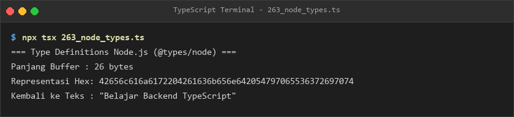
- **Lokasi Source Code:** [263_node_types.ts](263_node_types.ts)

### 264. 264_node_module_system.ts
- **Tujuan:** Memahami perbedaan fundamental sistem modul CommonJS (require) vs ES Modules (import).
- **Konsep Utama:** Pembedaan sintaksis, format ekstensi (`.cjs` vs `.mjs`), dan konfigurasi package.json.
- **Penjelasan Source Code:** Menampilkan matriks perbandingan lengkap antara CJS dan ESM.
- **Cara Menjalankan:**
  ```bash
  npx tsx 264_node_module_system.ts
  ```
- **Hasil yang Diharapkan:** Matriks perbandingan sistem modul Node.js tercetak rapi.
- **Screenshot Hasil Eksekusi:**
  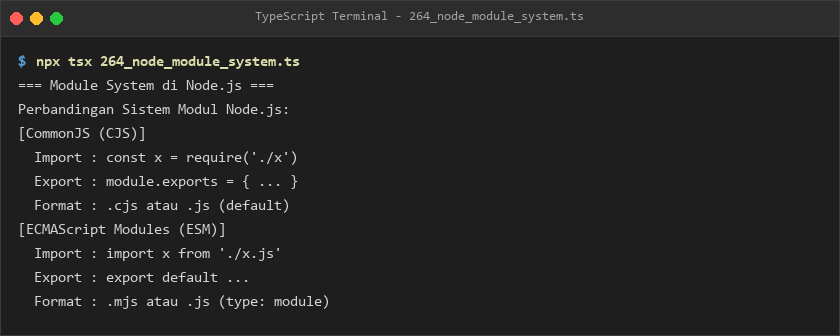
- **Lokasi Source Code:** [264_node_module_system.ts](264_node_module_system.ts)

---

## E. Ringkasan Modul
Modul 15 memberikan fondasi backend yang kuat menggunakan Node.js dan TypeScript. Pembelajar memahami ekosistem backend mulai dari manajemen proses, pembacaan dan penulisan berkas I/O, penanganan path direktori, pemanfaatan Streams untuk efisiensi memori, Event-Driven Architecture dengan EventEmitter, keamanan kriptografi dengan crypto, pemrosesan paralel Worker Threads & Subprocess, hingga perbandingan sistem modul CommonJS dan ES Modules.
