# Modul 16: API, Database, dan Framework

## A. Judul Modul
- **Nomor Modul:** 16
- **Nama Modul:** API, Database, dan Framework
- **Ruang Lingkup:** Perancangan kontrak tipe REST API (DTO & Standard Response), validasi data masukan API, standarisasi format galat API (RFC 7807), pembangunan server Express.js terketik, modularisasi rute Express (`Router`), perancangan Express middleware (logger & auth guard), pemisahan logika controller, pembuatan REST API CRUD terpadu dengan Express, pengelolaan koneksi basis data (connection pooling), implementasi Repository Pattern, pengetikan kolom hasil query SQL relasional, pengenalan arsitektur Prisma ORM Client, operasi CRUD dengan Prisma, validasi runtime & inferensi tipe menggunakan Zod (`z.infer`), pengenalan Controller NestJS berbasis dekorator, Service NestJS (`@Injectable`), pola pembalikan dependensi (*Dependency Injection*), serta perancangan REST API terpadu berarsitektur NestJS.
- **Tujuan Pembelajaran:** Menguasai integrasi TypeScript dengan framework backend modern (Express & NestJS) dan ekosistem basis data (SQL, Repository Pattern, Prisma ORM, serta Zod validation), mampu membangun arsitektur REST API enterprise yang terstruktur, aman, dan mudah diuji.

---

## B. Daftar Materi atau Submodul
265. [`265_rest_api_types.ts`](265_rest_api_types.ts) : Tipe data REST API
266. [`266_api_request_validation.ts`](266_api_request_validation.ts) : Validasi request API
267. [`267_api_error_responses.ts`](267_api_error_responses.ts) : Format error API
268. [`268_express_server.ts`](268_express_server.ts) : Server menggunakan Express
269. [`269_express_routes.ts`](269_express_routes.ts) : Routing Express
270. [`270_express_middleware.ts`](270_express_middleware.ts) : Middleware Express
271. [`271_express_controllers.ts`](271_express_controllers.ts) : Controller Express
272. [`272_express_rest_api.ts`](272_express_rest_api.ts) : REST API dengan Express
273. [`273_database_connection.ts`](273_database_connection.ts) : Koneksi database
274. [`274_database_repository.ts`](274_database_repository.ts) : Repository database
275. [`275_sql_query_types.ts`](275_sql_query_types.ts) : Tipe data hasil query SQL
276. [`276_prisma_client.ts`](276_prisma_client.ts) : Prisma Client
277. [`277_prisma_crud.ts`](277_prisma_crud.ts) : Operasi CRUD dengan Prisma
278. [`278_zod_validation.ts`](278_zod_validation.ts) : Validasi menggunakan Zod
279. [`279_nestjs_controller.ts`](279_nestjs_controller.ts) : Controller NestJS
280. [`280_nestjs_service.ts`](280_nestjs_service.ts) : Service NestJS
281. [`281_nestjs_dependency_injection.ts`](281_nestjs_dependency_injection.ts) : Dependency injection NestJS
282. [`282_nestjs_rest_api.ts`](282_nestjs_rest_api.ts) : REST API dengan NestJS

---

## C. Penjelasan Setiap Submodul

### 265. 265_rest_api_types.ts
- **Tujuan:** Mendefinisikan DTO permintaan pembuatan produk dan pembungkus respon standar REST API.
- **Konsep Utama:** Interface `BuatProdukDTO` dan generic response `ResponStandarDTO<T>`.
- **Penjelasan Source Code:** Menghasilkan payload respon JSON produk monitor gaming dengan metadata.
- **Cara Menjalankan:**
  ```bash
  npx tsx 265_rest_api_types.ts
  ```
- **Hasil yang Diharapkan:** Format JSON respon standar REST API tercetak rapi.
- **Screenshot Hasil Eksekusi:**
  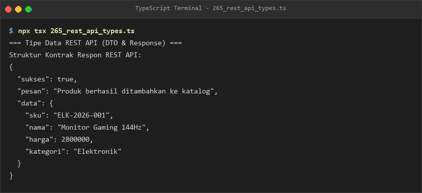
- **Lokasi Source Code:** [265_rest_api_types.ts](265_rest_api_types.ts)

### 266. 266_api_request_validation.ts
- **Tujuan:** Memvalidasi parameter request registrasi pengguna sebelum dialirkan ke lapisan layanan.
- **Konsep Utama:** Validasi format email, batas minimal 8 karakter sandi, dan umur minimal 18 tahun.
- **Penjelasan Source Code:** Menguji permintaan registrasi yang valid dan menolak input tidak memenuhi syarat.
- **Cara Menjalankan:**
  ```bash
  npx tsx 266_api_request_validation.ts
  ```
- **Hasil yang Diharapkan:** Status kelulusan validasi request 1 dan penolakan request 2 ditampilkan.
- **Screenshot Hasil Eksekusi:**
  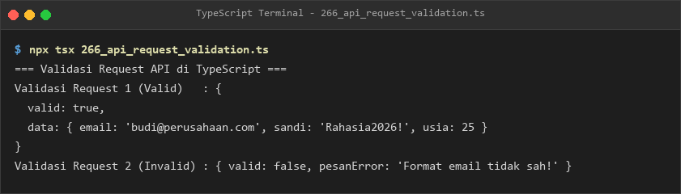
- **Lokasi Source Code:** [266_api_request_validation.ts](266_api_request_validation.ts)

### 267. 267_api_error_responses.ts
- **Tujuan:** Menstandarisasi struktur laporan kesalahan API mengacu pada spesifikasi RFC 7807 Problem Details.
- **Konsep Utama:** Interface `ProblemDetailsError` status 422 untuk kesalahan validasi checkout.
- **Penjelasan Source Code:** Menyajikan detail galat metode bayar dan alamat kirim secara transparan bagi klien.
- **Cara Menjalankan:**
  ```bash
  npx tsx 267_api_error_responses.ts
  ```
- **Hasil yang Diharapkan:** Dokumen JSON Problem Details terformat rapi ditampilkan.
- **Screenshot Hasil Eksekusi:**
  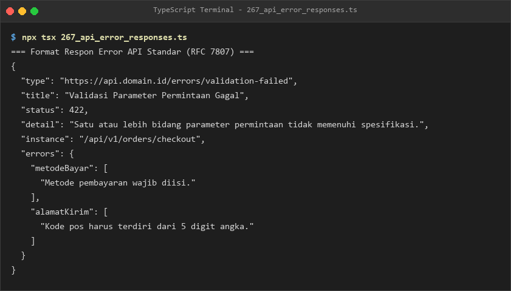
- **Lokasi Source Code:** [267_api_error_responses.ts](267_api_error_responses.ts)

### 268. 268_express_server.ts
- **Tujuan:** Membangun server web HTTP menggunakan Express.js beranotasi Request dan Response terketik.
- **Konsep Utama:** Inisialisasi Express, parsing JSON, endpoint `/health`, dan penutupan bersih.
- **Penjelasan Source Code:** Menjalankan server Express, mencetak endpoint aktif, dan menutupnya secara anggun.
- **Cara Menjalankan:**
  ```bash
  npx tsx 268_express_server.ts
  ```
- **Hasil yang Diharapkan:** Log server aktif dan konfirmasi penutupan bersih tercetak.
- **Screenshot Hasil Eksekusi:**
  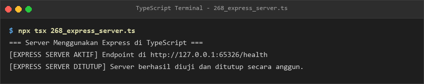
- **Lokasi Source Code:** [268_express_server.ts](268_express_server.ts)

### 269. 269_express_routes.ts
- **Tujuan:** Memisahkan rute API pengguna ke dalam sub-router modular `express.Router()`.
- **Konsep Utama:** Modular routing rute daftar pengguna dan detail pengguna berdasarkan ID.
- **Penjelasan Source Code:** Memasang router pada prefix `/api/pengguna` dan mendokumentasikan endpoint.
- **Cara Menjalankan:**
  ```bash
  npx tsx 269_express_routes.ts
  ```
- **Hasil yang Diharapkan:** Daftar rute modular yang terpasang ditampilkan ke konsol.
- **Screenshot Hasil Eksekusi:**
  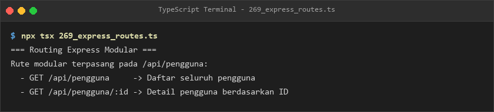
- **Lokasi Source Code:** [269_express_routes.ts](269_express_routes.ts)

### 270. 270_express_middleware.ts
- **Tujuan:** Mengimplementasikan rantai pipeline middleware untuk logging dan verifikasi otorisasi token.
- **Konsep Utama:** Fungsi middleware `(req, res, next)` dan pengecekan header Bearer token.
- **Penjelasan Source Code:** Menjalankan alur pencatatan waktu dan validasi otorisasi sebelum mencapai controller.
- **Cara Menjalankan:**
  ```bash
  npx tsx 270_express_middleware.ts
  ```
- **Hasil yang Diharapkan:** Log pencatatan request, validasi token, dan keberhasilan controller tercetak.
- **Screenshot Hasil Eksekusi:**
  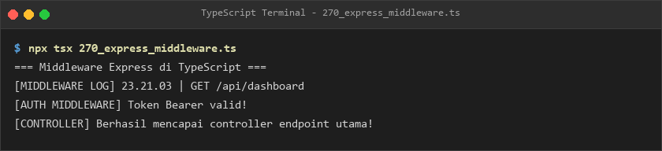
- **Lokasi Source Code:** [270_express_middleware.ts](270_express_middleware.ts)

### 271. 271_express_controllers.ts
- **Tujuan:** Mengisolasi logika pengolahan data mahasiswa ke dalam class controller terpisah.
- **Konsep Utama:** Pemisahan controller handler dan method pencarian data berdasarkan ID.
- **Penjelasan Source Code:** Menampilkan jumlah total mahasiswa dan mencari rincian profil mahasiswa ID 1.
- **Cara Menjalankan:**
  ```bash
  npx tsx 271_express_controllers.ts
  ```
- **Hasil yang Diharapkan:** Log pengambilan data dan profil mahasiswa ID 1 tercetak.
- **Screenshot Hasil Eksekusi:**
  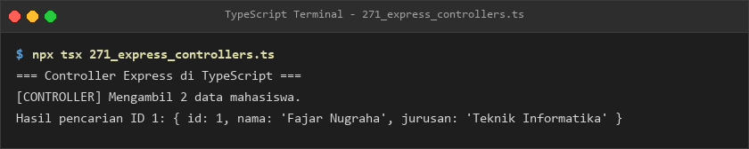
- **Lokasi Source Code:** [271_express_controllers.ts](271_express_controllers.ts)

### 272. 272_express_rest_api.ts
- **Tujuan:** Mengintegrasikan rute GET dan POST ke dalam aplikasi REST API tugas (Todos).
- **Konsep Utama:** Endpoints CRUD Express dengan type `ItemTugas`.
- **Penjelasan Source Code:** Mengelola array tugas dan memetakan endpoint pembacaan serta penambahan tugas baru.
- **Cara Menjalankan:**
  ```bash
  npx tsx 272_express_rest_api.ts
  ```
- **Hasil yang Diharapkan:** Status endpoint CRUD tugas dan total data awal ditampilkan.
- **Screenshot Hasil Eksekusi:**
  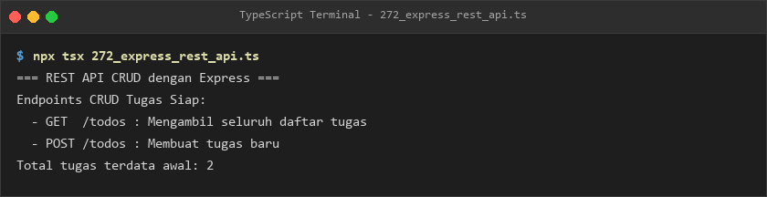
- **Lokasi Source Code:** [272_express_rest_api.ts](272_express_rest_api.ts)

### 273. 273_database_connection.ts
- **Tujuan:** Mengelola siklus hidup pool koneksi basis data relasional secara terprogram.
- **Konsep Utama:** Class `PoolBasisData` dengan method asynchronous `hubungkan()` dan `putuskan()`.
- **Penjelasan Source Code:** Mengonfigurasi parameter host PostgreSQL, membuka koneksi pool, dan menutupnya aman.
- **Cara Menjalankan:**
  ```bash
  npx tsx 273_database_connection.ts
  ```
- **Hasil yang Diharapkan:** Log pembukaan pool database dan pemutusan koneksi tercetak.
- **Screenshot Hasil Eksekusi:**
  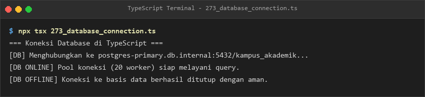
- **Lokasi Source Code:** [273_database_connection.ts](273_database_connection.ts)

### 274. 274_database_repository.ts
- **Tujuan:** Mengabstraksikan operasi basis data mahasiswa menggunakan Repository Pattern.
- **Konsep Utama:** Interface `MahasiswaRepository` dan implementasi penyimpanan in-disk.
- **Penjelasan Source Code:** Menyimpan data mahasiswa baru dan mencarinya kembali berdasarkan ID.
- **Cara Menjalankan:**
  ```bash
  npx tsx 274_database_repository.ts
  ```
- **Hasil yang Diharapkan:** Log penyimpanan repository dan data hasil query ditampilkan.
- **Screenshot Hasil Eksekusi:**
  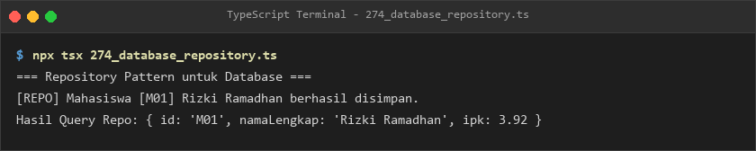
- **Lokasi Source Code:** [274_database_repository.ts](274_database_repository.ts)

### 275. 275_sql_query_types.ts
- **Tujuan:** Menetapkan anotasi tipe data statis pada kolom hasil eksekusi query SQL agregasi.
- **Konsep Utama:** Interface baris `BarisHasilQueryPengguna` untuk query relasional JOIN.
- **Penjelasan Source Code:** Mengeksekusi query SQL pengguna aktif dan membaca total transaksi tercatat.
- **Cara Menjalankan:**
  ```bash
  npx tsx 275_sql_query_types.ts
  ```
- **Hasil yang Diharapkan:** Username dan total kalkulasi transaksi hasil query ditampilkan.
- **Screenshot Hasil Eksekusi:**
  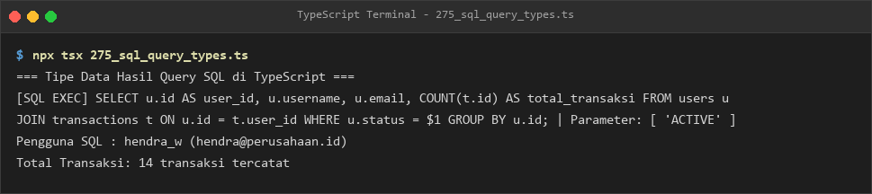
- **Lokasi Source Code:** [275_sql_query_types.ts](275_sql_query_types.ts)

### 276. 276_prisma_client.ts
- **Tujuan:** Memahami konsep Prisma Client sebagai ORM penghasil query yang terketik 100% otomatis.
- **Konsep Utama:** Model pengguna Prisma dan pemanggilan `prisma.user.findMany()`.
- **Penjelasan Source Code:** Membaca pengguna dengan filter peran ADMIN dan mencetak hasilnya.
- **Cara Menjalankan:**
  ```bash
  npx tsx 276_prisma_client.ts
  ```
- **Hasil yang Diharapkan:** Log kueri Prisma dan daftar pengguna hasil query ditampilkan.
- **Screenshot Hasil Eksekusi:**
  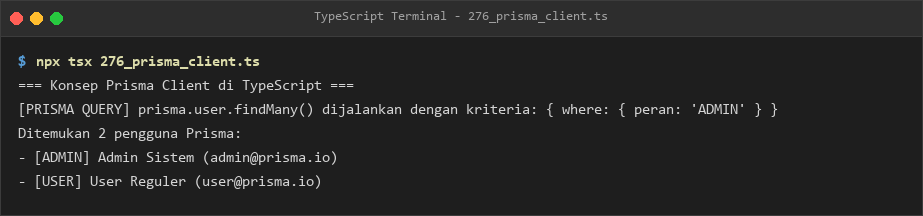
- **Lokasi Source Code:** [276_prisma_client.ts](276_prisma_client.ts)

### 277. 277_prisma_crud.ts
- **Tujuan:** Mensimulasikan alur kerja operasi Create dan Update pada entitas artikel blog dengan Prisma.
- **Konsep Utama:** Mutasi status artikel dari draf menjadi rilis.
- **Penjelasan Source Code:** Membuat artikel baru dan memperbarui status penerbitannya.
- **Cara Menjalankan:**
  ```bash
  npx tsx 277_prisma_crud.ts
  ```
- **Hasil yang Diharapkan:** Log operasi create artikel dan update status rilis ditampilkan.
- **Screenshot Hasil Eksekusi:**
  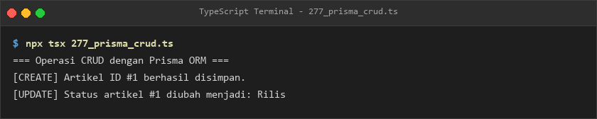
- **Lokasi Source Code:** [277_prisma_crud.ts](277_prisma_crud.ts)

### 278. 278_zod_validation.ts
- **Tujuan:** Memvalidasi skema data masukan saat runtime sekaligus menghasilkan tipe TypeScript dengan Zod.
- **Konsep Utama:** `z.object()`, `z.infer<typeof Schema>`, dan penanganan error via `safeParse()`.
- **Penjelasan Source Code:** Memverifikasi data pengguna valid dan menangkap rincian galat pada input salah.
- **Cara Menjalankan:**
  ```bash
  npx tsx 278_zod_validation.ts
  ```
- **Hasil yang Diharapkan:** Data hasil parse sukses dan daftar issue kesalahan Zod tercetak lengkap.
- **Screenshot Hasil Eksekusi:**
  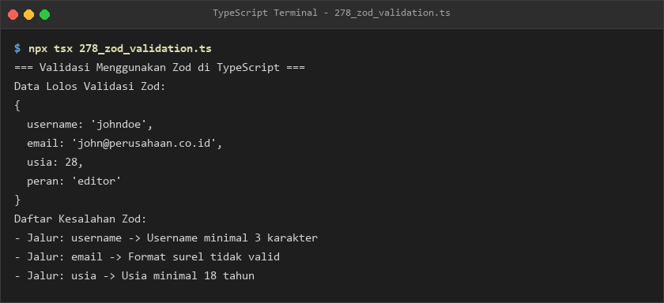
- **Lokasi Source Code:** [278_zod_validation.ts](278_zod_validation.ts)

### 279. 279_nestjs_controller.ts
- **Tujuan:** Memahami struktur Controller pada arsitektur framework NestJS berbasis dekorator rute.
- **Konsep Utama:** Dekorator `@Controller("produk")` dan `@Get(":id")`.
- **Penjelasan Source Code:** Mendaftarkan rute produk dan mengeksekusi metode pengambilan daftar produk.
- **Cara Menjalankan:**
  ```bash
  npx tsx 279_nestjs_controller.ts
  ```
- **Hasil yang Diharapkan:** Log pendaftaran dekorator Controller dan daftar produk ditampilkan.
- **Screenshot Hasil Eksekusi:**
  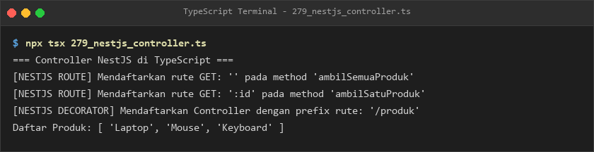
- **Lokasi Source Code:** [279_nestjs_controller.ts](279_nestjs_controller.ts)

### 280. 280_nestjs_service.ts
- **Tujuan:** Mengisolasi pengelolaan inventaris katalog produk ke dalam Service berdekorator `@Injectable()`.
- **Konsep Utama:** Peran service sebagai penyedia logika bisnis murni di ekosistem NestJS.
- **Penjelasan Source Code:** Mengambil data inventaris dan menambahkan item perangkat jaringan baru.
- **Cara Menjalankan:**
  ```bash
  npx tsx 280_nestjs_service.ts
  ```
- **Hasil yang Diharapkan:** Log registrasi Injectable, isi inventaris, dan penambahan item tercetak.
- **Screenshot Hasil Eksekusi:**
  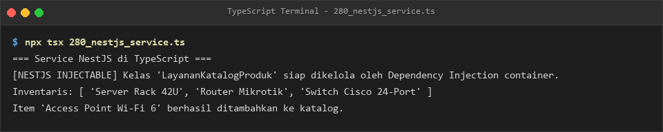
- **Lokasi Source Code:** [280_nestjs_service.ts](280_nestjs_service.ts)

### 281. 281_nestjs_dependency_injection.ts
- **Tujuan:** Menerapkan konsep Dependency Injection (DI) dengan menginjeksi layanan email ke dalam controller.
- **Konsep Utama:** Injeksi dependensi melalui parameter konstruktor (*constructor injection*).
- **Penjelasan Source Code:** Mengirim notifikasi sambutan email otomatis saat pengguna baru berhasil didaftarkan.
- **Cara Menjalankan:**
  ```bash
  npx tsx 281_nestjs_dependency_injection.ts
  ```
- **Hasil yang Diharapkan:** Log registrasi user dan dispatch pengiriman email ditampilkan.
- **Screenshot Hasil Eksekusi:**
  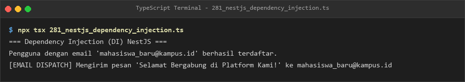
- **Lokasi Source Code:** [281_nestjs_dependency_injection.ts](281_nestjs_dependency_injection.ts)

### 282. 282_nestjs_rest_api.ts
- **Tujuan:** Mengintegrasikan DTO, Service, dan Controller ke dalam arsitektur REST API lengkap ala NestJS.
- **Konsep Utama:** Manajemen perpustakaan buku dengan pemisahan lapisan DTO, logika, dan controller.
- **Penjelasan Source Code:** Menambahkan buku baru dan menampilkan seluruh koleksi buku perpustakaan.
- **Cara Menjalankan:**
  ```bash
  npx tsx 282_nestjs_rest_api.ts
  ```
- **Hasil yang Diharapkan:** Notifikasi penambahan buku dan daftar koleksi terkini tercetak ke terminal.
- **Screenshot Hasil Eksekusi:**
  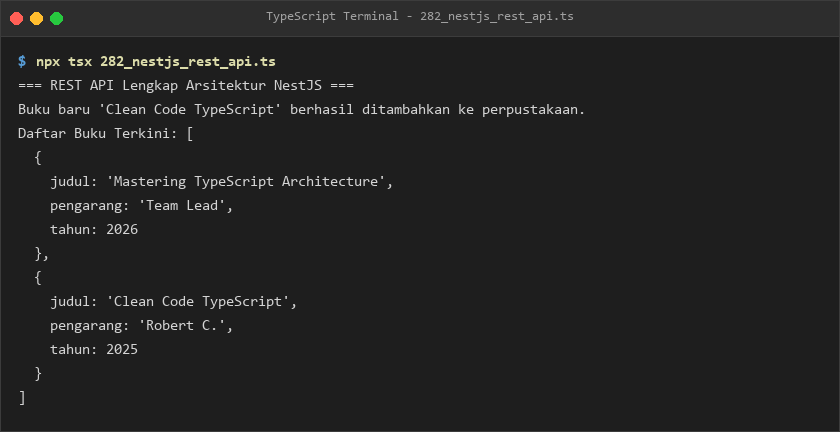
- **Lokasi Source Code:** [282_nestjs_rest_api.ts](282_nestjs_rest_api.ts)

---

## E. Ringkasan Modul
Modul 16 membekali pembelajar dengan pemahaman arsitektur backend komprehensif menggunakan TypeScript. Pembelajar menguasai pembangunan REST API modular dengan Express, validasi skema runtime canggih dengan Zod, pengelolaan basis data relasional dan ORM Prisma, serta paradigma arsitektur enterprise modern berbasis modul, dekorator, dan Dependency Injection menggunakan konsep NestJS.
